# [10] ＋ 기능판 · 카메라 · 사진

- 브랜치: `step/10-camera` (main 병합 안 함)
- 시작 전 확인: `step/9-collection` 은 main 에 병합돼 있음(`1b92baf`, 현황 커밋 `f9f8aaf`)
- 원고: `docs/drafts/10-11-카메라-사진-포토부스-문구.md` 의 [10] 부분 — 문구는 그대로 넣음. 그대로 못 넣은 곳은 아래 「원고와 다른 곳」
- 커밋: `[10-A] ＋ 기능판과 사진 저장소`(`01dd094`) → `[10-B] 카메라`(`4bdbf14`) → `[10-C] 사진 화면과 공유`(`4015f48`)
  - A 커밋의 `photos.js` 에는 카메라·사진 화면 자리만 비워 둔 빈 모듈(`Cam`·`PhotoUI`)이 있고, B·C 에서 채움. 커밋마다 앱이 뜨고 기능판·선물하기가 되는 것은 확인함

## 바뀐 파일

| 파일 | 내용 |
| --- | --- |
| `photos.js` | **새 파일.** `Photos`(IndexedDB 저장소·칸 수), `Shot`(3D → jpeg), `Cam`(촬영 화면), `PhotoUI`(사진 시트·크게 보기·공유·지우기·가득 참 시트·시연 채우기) |
| `photos.css` | **새 파일.** 촬영 화면·사진 시트·크게 보기·지우기 확인. blur·filter·그림자·그라데이션 없음 |
| `data/photos.json` | **새 파일.** 저장 칸(무료 20, +10칸 💎 50, PLUS 200), 사진 크기(3:4, 긴 변 1440, jpeg, 300KB), 촬영 화면 값(1초, 좌우 60°, 확대 범위, 그림자, 깜빡임, 도움말 3초), 셔터 소리, 공유 표시, 시연 견본 각도 |
| `data/ui.json` | `fn`(기능판), `cam`(촬영 화면), `photoFull`(가득 찼을 때), `photo`(사진 시트·크게 보기), `my.plusPhotos`. `chat.seoaFirst` 한 곳 수정(아래 「원고와 다른 곳」) |
| `data/demo.json` | 시연 패널 「사진」 묶음: 「사진 가득 채우기」·「사진 비우기」 |
| `index.html` | 아래 A·B·C |
| `docs/CREDITS.md` | 아이콘(코드 안 SVG, 직접 그림)·셔터 소리(코드로 만듦) |
| `docs/drafts/10-11-카메라-사진-포토부스-문구.md` | 원고(받은 그대로 커밋) |
| `docs/reports/img/10/*.jpg` | 캡처·저장한 사진 |

### A. ＋ 기능판과 사진 저장소

- 입력줄 왼쪽 🎁(빛나는 그림 버튼) → ＋ 버튼(선 아이콘, 둥근 칸). 행동 ( ) 버튼은 그대로
- ＋ 를 누르면 입력칸 아래에 기능판이 올라오고(높이 전환 0.22초) ＋ 가 45° 돌아 × 가 됨. 키보드가 떠 있으면 내림. 입력칸을 누르면 닫힘. 탭을 옮기거나 목록으로 나가도 닫힘
- 한 줄 4칸 격자에 「선물하기 · 카메라 · 사진」. 칸마다 누르는 범위(격자 한 칸 전체) 같음
- 아이콘: 세 개 모두 24 칸 SVG, 선 굵기 1.8, 둥근 끝·꺾임, 26px. 56px 둥근 사각형(반경 18px) 칸 + 아래 12px 글자. 선물하기만 칸 바탕이 보라 강조색(`--pri`) + 흰 아이콘, 카메라·사진은 어두운 바탕(#1d1a27) + 연한 아이콘(#d9d2ee). 빛·그라데이션·입체·반짝이는 테두리 없음
- 선물하기 → 예전 선물 창(`giftSheet`) 그대로
- 사진 저장소(IndexedDB `moti_photos`): `meta` = id·종류(camera/booth)·날짜·몸짓 id·이름·장소·좋아요 + 목록용 작은 사진, `full` = 큰 사진. 사진 바이트는 ArrayBuffer 로 저장
- 칸 수: 무료 20 + 산 칸(💎 50 에 +10, 영구, `S.photoSlots`), PLUS 이용 중이면 200. 전체 초기화는 사진·산 칸을 모두 비움
- 마이 페이지 PLUS 혜택에 「🖼 사진 200장까지 저장」

### B. 카메라

- 기능판 카메라 → 앱 전체를 덮는 촬영 화면(대화방 3D 그림판을 빌려 옴, 모델을 다시 불러오지 않음). 위: ✕ · 「사진 n / cap」, 가운데: 3:4 칸(저장되는 사진과 같은 범위), 아래: 멈춤 · 셔터 · 마지막 사진
- 서아 전신 + 지금 장소 배경(배경 어둡게 층도 같음) + 들어간 순간의 표정(7초 뒤 기본 표정으로 돌아가는 타이머를 멈춤)
- 몸짓 중이거나 끝난 지 1초 안이면 그 몸짓을 반복(재생 중이면 그 자리에서 이어서). 아니면 「기본 자세」. 왼쪽 아래 「{몸짓} · 반복 중」/「{몸짓} · 멈춤」/「기본 자세」
- ⏸ 멈춤 ↔ ▷ 다시 재생(그 순간에 몸짓을 붙잡음). 기본 자세일 때는 흐리게(누를 수 없음)
- 두 손가락 확대·축소(전신 ~ 얼굴 가까이), 한 손가락 좌우 밀기로 서아 주위 돌기(정면 기준 ±60°). 노트북: 휠 확대·축소, 끌어서 돌리기. 발밑 그림자(가운데가 진한 원 그림 한 장)
- 페이지 확대 막기: 촬영 화면 전체 `touch-action:none`, 두 손가락 터치·`touchmove`·`gesturestart/change`(사파리) 기본 동작 막기, 휠 기본 동작 막기
- 셔터: 하얀 깜빡임 0.26초 + 짧은 셔터 소리(Web Audio 잡음 두 번) → 1080×1440 jpeg 로 다시 그려 저장 → 「사진에 저장했어요」. 오른쪽 아래 칸에 마지막 사진, 누르면 사진 시트
- 촬영 중 도착한 답장: 대화 기록에만. 몸짓·표정·입·도감 기록·해금 연출은 나올 때 마지막 답장 것으로(해금 연출은 그 몸짓이 끝난 뒤). 인트로 문단의 몸짓도 촬영 중엔 재생 안 함
- 가득 차 있으면 들어갈 때 3:4 칸 위쪽에 안내 한 줄 + 「칸 비우기」(사진 시트)·「칸 늘리기」(가득 참 시트). 셔터를 누르면 가득 참 시트(「사진 하나 지우기 · 칸 늘리기 +10 · 💎 50 · ✨ PLUS · 사진 200장」). 칸이 생기면 촬영 화면 그대로 다시 찍을 수 있음
- 처음 한 번만 「두 손가락으로 확대 · 옆으로 밀어서 돌리기」 3초

### C. 사진 화면과 공유

- 기능판 사진 → 시트: 「사진」 + 「n / cap」, 진행 막대(가득 차면 빨강), 「전체 / 좋아요 / 포토부스」, 한 줄 3칸(3:4), 좋아요 사진은 오른쪽 위 작은 하트, 포토부스 사진은 세로 두 칸 크기(지금은 없음 → 빈 상태 문구). 아래에 고정된 두 줄 「칸 늘리기 +10 / 💎 50」「✨ PLUS · 사진 200장 / 월 9,900원」
- 크게 보기: 사진, 정보 줄 「{몸짓} · {장소}」/「{날짜}」(포토부스는 「포토부스 · {날짜}」), 같은 크기 아이콘 세 개(공유하기 · 좋아요 · 지우기, 기능판과 같은 선 아이콘). 좌우로 밀어 다음·이전
- 공유하기: Web Share API 로 이미지 파일 공유. 공유 이미지에만 오른쪽 아래 「moti · 윤서아」(앱 안 사진에는 없음). 공유 창을 못 여는 브라우저는 같은 버튼에 작은 메뉴 「내려받기」
- 좋아요: 하트 채움 ↔ 풀림. 지우기: 「이 사진을 지울까요? 취소 · 지우기」 → 「사진을 지웠어요」, 다음 사진으로(없으면 닫힘)
- 시연 패널(항상 보임) 「사진」 묶음: 「사진 가득 채우기」(견본 사진으로 cap 까지), 「사진 비우기」, 지금 「사진 n / cap」

## 캡처 (390×844, 픽셀 비율 2, 헤드리스 Chrome + 소프트웨어 WebGL, 서버 없음 모드)

| 기능판 열림 | 아이콘 확대(2배) |
| --- | --- |
| 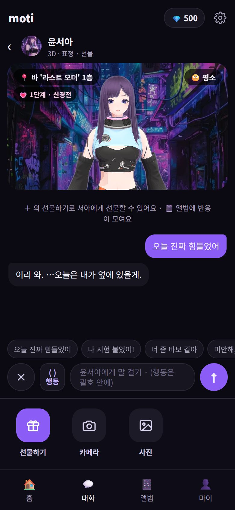 | 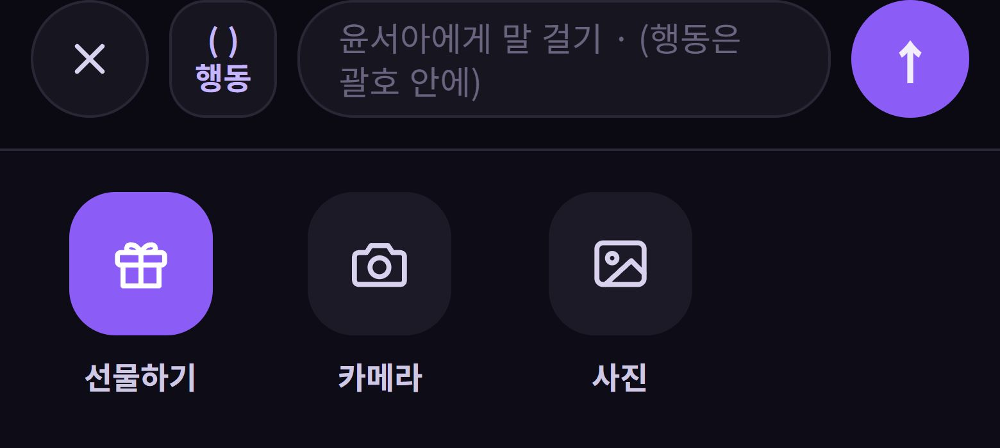 |

| 몸짓 중 카메라 진입(다가가기, 첫 도움말) | 확대·회전(실제 두 손가락·한 손가락 터치, 42° · 확대 0.59) | 멈춤 상태 |
| --- | --- | --- |
| 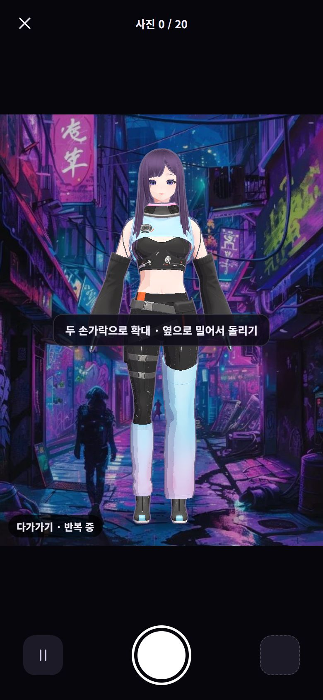 | 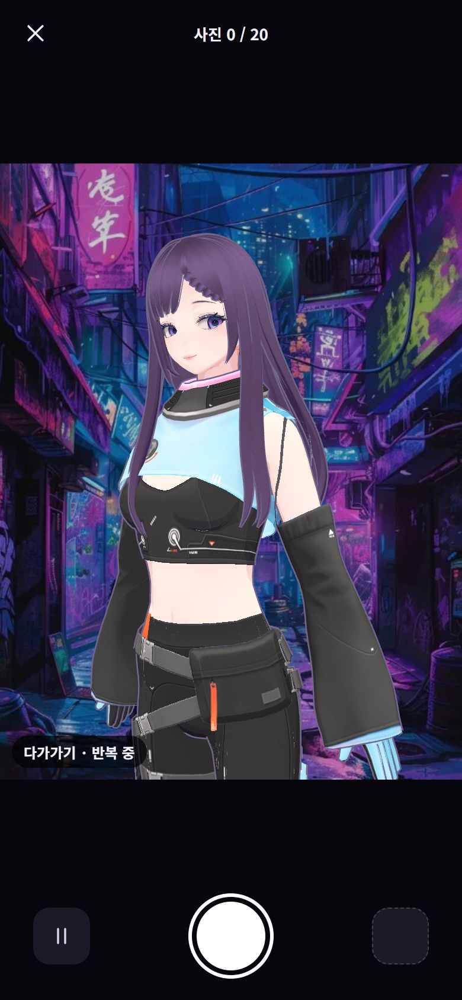 | 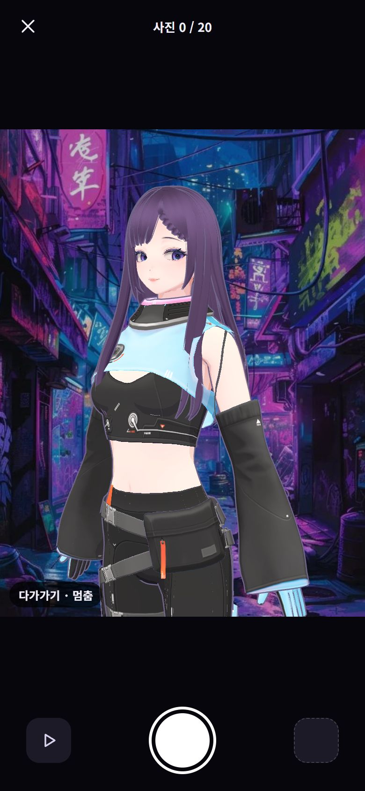 |

| 사진 목록(20 / 20, 견본 19장 + 찍은 1장) | 크게 보기 | 지우기 확인 |
| --- | --- | --- |
| 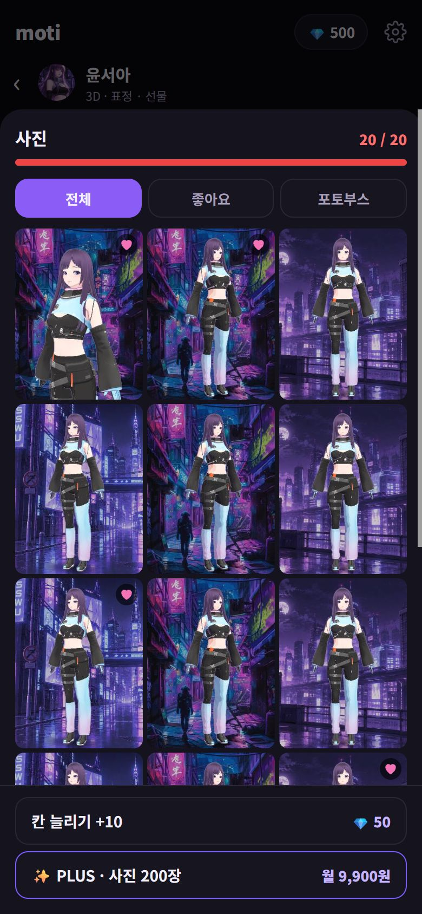 | 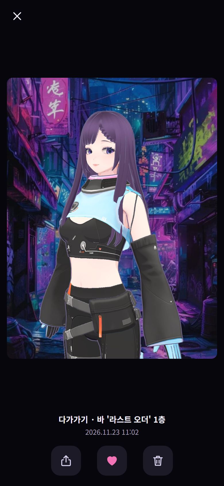 | 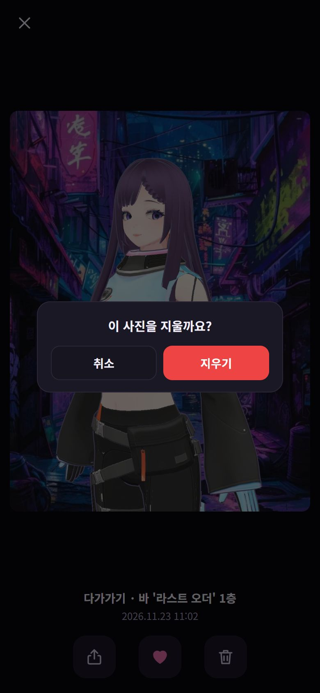 |

| 가득 찬 상태 진입 안내 | 셔터 때 가득 참 시트 | 공유 못 하는 브라우저의 내려받기 메뉴 |
| --- | --- | --- |
| 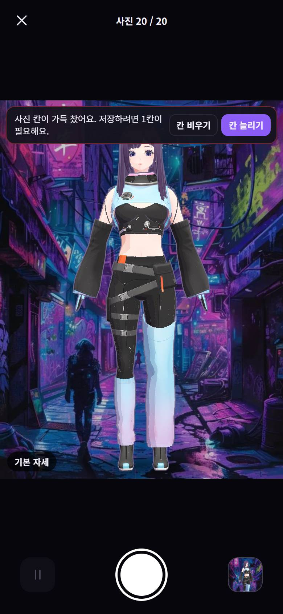 | 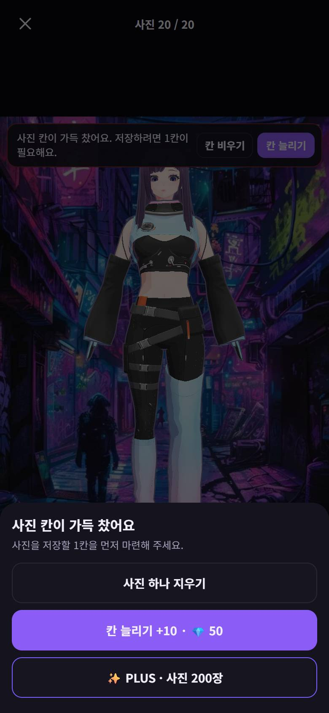 | 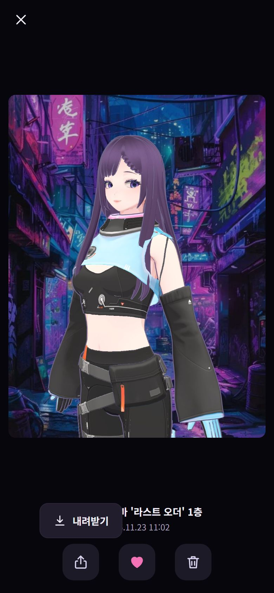 |

- 터치로 확대·회전한 뒤 `visualViewport.scale` = 1(페이지 확대로 새지 않음, 크롬 터치 흉내 기준)
- 「공유 못 하는 브라우저」 캡처는 `navigator.canShare` 가 거짓인 브라우저를 흉내 냄(헤드리스 Chrome 은 공유 API 가 있음). 앱 주소 `?share=off` 로도 같은 화면

### 저장한 사진 파일

| 카메라로 찍은 사진(앱에 저장되는 그대로, 1080×1440, 226KB) | 공유용(구석 표시 들어감, 248KB) |
| --- | --- |
| 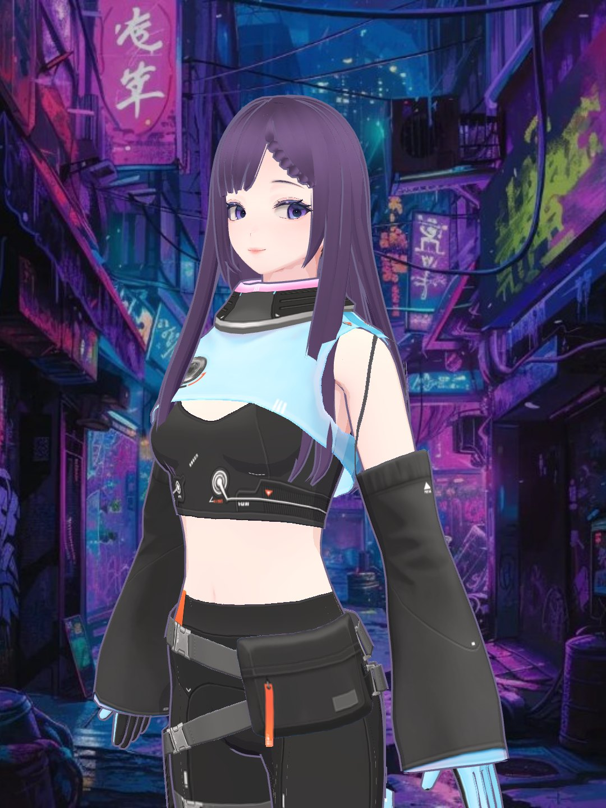 | 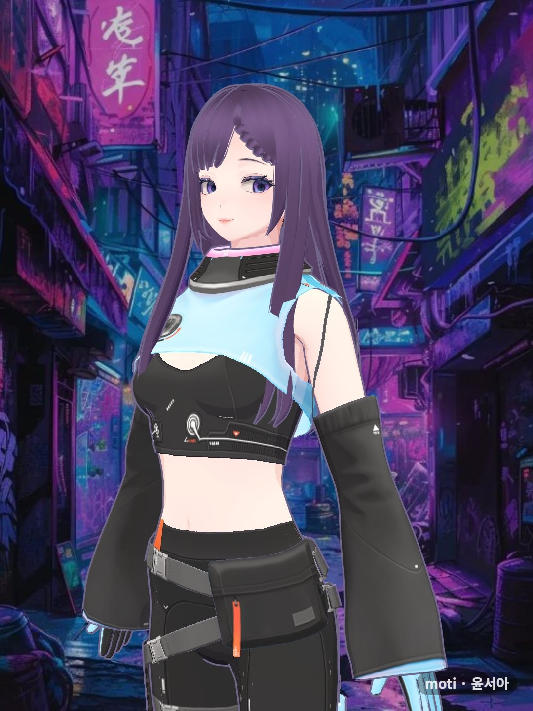 |

## 사진 20장 측정

앱 안 브라우저 창(Chromium, GPU, 390×844 흉내, Windows 노트북). 아이폰 값이 아님 — 아이폰에서는 인코딩이 더 걸릴 수 있음.

| 항목 | 값 |
| --- | --- |
| 사진 한 장 | 1080×1440 jpeg, 245KB(품질 0.86 에서 300KB 안이라 낮추지 않음) + 목록용 작은 사진 400px 23KB |
| 20장 전체 | 사진·작은 사진 바이트 합 5,353KB, `navigator.storage.estimate()` 늘어난 양 5,424KB |
| 저장 한 장(평균) | 다시 그리기 9ms + jpeg 만들기(큰 것·작은 것) 93ms + IndexedDB 쓰기 2ms ≈ 105ms. 셔터 → 「사진에 저장했어요」 첫 장 283ms |
| 불러오기 | 앱을 다시 열 때 20장 정보·작은 사진 6ms, 크게 보기(큰 사진 읽기 + 그리기) 41ms, 큰 사진 하나 읽기 1ms |
| 다시 열어도 남는지 | 새로고침 뒤 20장 그대로(앱 안 브라우저 창) |
| 시연 「사진 가득 채우기」 | 견본 3장 그리기 + 19장 쓰기 331ms |

## 확인한 것

- 기능판: ＋ → 열림·× / 입력칸 누르면 닫힘 / 선물하기 → 예전 선물 창, 기능판 닫힘
- 몸짓(손 내밀기) 중 카메라 → 「손 내밀기 · 반복 중」, 멈춤 → 「손 내밀기 · 멈춤」
- 촬영 중 「너 좀 바보 같아」 답장 → 대화 기록에만(촬영 화면은 앞 몸짓 그대로 반복), 나온 뒤 팔짱 끼기 재생 + 도감 기록
- 사진 20 / 20 → 진입 안내, 셔터 → 가득 참 시트, 칸 늘리기 → 💎 500 → 450, 「사진 칸이 30칸이 됐어요」, 안내 사라짐
- 크게 보기: 공유(공유 창 없는 브라우저) → 내려받기 메뉴, 좋아요 켜고 끄기, 지우기 확인 → 19장 + 「사진을 지웠어요」
- 전체 초기화 → 사진 0, 산 칸 0(칸 20)
- 마이 PLUS 혜택 다섯째 줄 「🖼 사진 200장까지 저장」
- 다가가기(m12)처럼 서아가 앞으로 나오는 몸짓에서 가까이 확대하면 서아가 화면 밖으로 나가던 것 → 돌 중심이 서아(멀리서는 몸, 가까이서는 머리)를 따라가게 고침
- 콘솔 오류 없음. 화면 갱신(소프트웨어 WebGL) 촬영 전후·견본 채운 뒤·시트 열고 닫은 뒤 모두 21~26fps 로 그대로

## 아이폰 사파리 확인 항목 (기획자 확인 필요)

- [ ] 촬영 화면에서 두 손가락 확대가 **페이지 확대로 새지 않는지**(서아만 커지고 화면 전체는 그대로). 두 번 톡톡 눌러도 페이지가 커지지 않는지
- [ ] 한 손가락 좌우 밀기가 페이지 스크롤·뒤로 가기 몸짓으로 새지 않는지
- [ ] **셔터 소리**가 나는지(무음 스위치를 켜면 Web Audio 는 소리가 안 나는 게 사파리 동작 — 무음 스위치를 끄고 확인)
- [ ] 하얀 깜빡임이 짧게 보이는지
- [ ] 크게 보기 공유하기 → **공유 창이 열리는지**, 거기서 「이미지 저장」으로 사진 앱에 들어가는지, 저장된 사진 오른쪽 아래에 「moti · 윤서아」가 있는지
- [ ] 사진을 찍고 **앱(사파리 탭)을 닫았다 다시 열어도 사진이 남는지**. 홈 화면에 추가한 앱으로 열었을 때도(사파리와 홈 화면 앱은 저장소가 따로라 서로 안 보이는 게 정상)
- [ ] 촬영 화면 3:4 칸 안의 서아가 늘어나거나 잘리지 않는지(아래 노치·홈 막대 자리와 셔터가 겹치지 않는지)
- [ ] 사진 시트 아래 두 줄(칸 늘리기·PLUS)이 홈 막대에 가리지 않는지
- [ ] 기능판이 키보드 자리에 올라올 때 입력줄이 튀지 않는지, 입력칸을 누르면 기능판이 닫히고 키보드가 바로 뜨는지
- [ ] 크게 보기 좌우 밀기가 다음·이전 사진으로 넘어가는지

## 원고와 다른 곳

- **대화방 맨 위 안내(`chat.seoaFirst`):** 「🎁 버튼으로 서아에게 선물할 수 있어요 · …」였는데 🎁 버튼이 없어져서 「＋ 의 선물하기로 서아에게 선물할 수 있어요 · …」로 바꿈. 원고에 없는 문구라 **확인 필요**(원고의 「＋ 의 카메라로 …」와 같은 말투로 맞춤)
- **몸짓 없이 찍은 사진의 정보 줄:** 원고 「{몸짓 이름} · {장소}」에서 몸짓 이름 자리에 촬영 화면 문구 「기본 자세」를 씀
- **접근성 이름(화면에는 안 보임):** 원고에 없는 ＋ 버튼 「기능 열기 / 기능 닫기」, 촬영 화면 「나가기 · 촬영 · 멈춤 · 다시 재생 · 사진」, 크게 보기 「닫기」를 넣음(`data/ui.json`). 크게 보기 세 아이콘은 원고 「공유하기 · 좋아요 · 지우기」 그대로
- **PLUS 시작 알림:** 사진 시트·가득 참 시트에서 PLUS 를 누르면 마이 페이지와 같은 「✨ PLUS 시작 · 💎 300 지급」 + 원고 「사진 칸이 {cap}칸이 됐어요」

## 제가 정한 것

- **＋ 버튼은 서아 대화방에만** (예전 🎁 버튼과 같음). 다른 캐릭터 대화방에서는 안 보이고 기능판도 닫힘
- **기능판의 기능을 누르면 기능판은 닫힘** (선물하기·카메라·사진 모두)
- **칸 수:** PLUS 이용 중 = 200 과 (무료 + 산 칸) 중 큰 쪽. PLUS 를 끄면 칸이 줄어도 사진은 지우지 않고, 칸이 생길 때까지 새로 저장만 막음(가득 참 안내·시트)
- **카메라 안내의 「칸 늘리기」는 바로 사지 않고 가득 참 시트를 엶**(값 💎 50 이 보이도록). 「칸 비우기」는 사진 시트
- **이미 PLUS 면** 사진 시트 아래 PLUS 줄과 가득 참 시트의 PLUS 선택지를 숨김
- **사진 형식 jpeg:** 아이폰 사파리는 webp 로 저장(인코딩)을 못 하고, 공유·사진 앱 호환도 jpeg 가 안전. 품질 0.86 에서 시작해 300KB 를 넘으면 0.08 씩 낮춤(0.5 까지). 목록용 작은 사진(긴 변 400px)을 따로 저장해 목록이 큰 사진 200장을 한꺼번에 풀지 않게
- **촬영 화면 3:4 칸 = 저장되는 사진 범위.** 남는 위아래는 어두운 바탕. 화면 높이가 낮으면(375×667 등) 칸 높이에 맞춰 폭을 줄임
- **기본 자세:** 대기 몸짓(m25, 답장 기다리며 갸웃)은 몸짓으로 치지 않음. 기본 자세일 때 멈춤 버튼은 흐리게
- **반복:** 끝나면 처음부터(몸짓 자체의 시작·끝 자세). 들어갈 때 재생 중이면 그 순간부터 이어서
- **확대 범위:** 가장 멀리 = 발끝까지 전신(키의 −5%~107%), 가장 가까이 = 얼굴(80%~103%). 두 손가락은 벌린 비율의 log 로(0.75), 휠은 1당 0.0012, 한 손가락은 1px 당 0.35°. 돌 중심은 서아를 따라감(멀리서는 몸, 가까이서는 머리) — 다가가기처럼 앞으로 나오는 몸짓에서 서아가 화면 밖으로 나가서
- **그림자:** 촬영 화면에서만(대화 3D 칸은 발이 안 보여서 그대로). 엉덩이 뼈 바로 아래 바닥, 0.78×0.5m, 진하기 0.5
- **도움말 「처음 한 번」은 저장값(`S.camHelp`)** 이라 전체 초기화하면 다시 나옴
- **선물 몸짓을 찍으면** 몸짓 이름은 선물 몸짓 이름(예: g05 「볼 붉히며 시선 피하기」), 사진의 몸짓 id 는 도감 id(g01~g12)
- **촬영 중 서아 상태가 바뀌는 답장:** 「서아가 ○○ 상태가 됐어요」 토스트는 그대로 뜸(서아의 말이 아니라 앱 안내라서)
- **날짜 모양** `2026.11.23 10:51` (`data/ui.json photo.date`)
- **공유:** 크게 보기에서 사진이 바뀔 때마다 표시 넣은 공유 파일을 미리 만들어 둠(아이폰은 누른 순간 바로 공유 창을 열어야 해서). 공유 창을 닫는 것(취소)은 무시, 다른 오류면 내려받기 메뉴. 파일 이름 `moti-20261123-105112.jpg`. 표시는 오른쪽 아래 반투명 검은 알약 안 흰 글자, 글자 크기 사진 폭의 2.6%
- **크게 보기 넘기기:** 가로로 45px 넘게 밀면 다음·이전(그 묶음 안에서, 최신이 처음). 끝에서는 멈춤
- **지운 뒤:** 다음 사진을 보여 주고, 없으면 크게 보기를 닫음
- **시연 「사진 가득 채우기」:** 지금 자세로 견본 3장(지금 장소부터 장소 3곳, 각도 −28°·0°·28°)을 그려 돌려 씀. 몸짓 이름은 대화 몸짓을 차례로(4장마다 기본 자세), 5장마다 좋아요, 날짜는 1시간씩 앞으로
- **새 시트 두 개(사진·가득 참)는 내려가는 동안 누르기를 받지 않게** 함(아래 줄이 ＋ 기능판을 가로채지 않게). 예전 시트는 그대로
- **촬영 화면은 헤더·아래 탭까지 덮음.** 시트·토스트·시연 패널은 그 위
- **입력줄의 선물 그림 버튼(`icons/gift_button.png`)** 은 이제 안 씀. 파일은 지우지 않음(선물 창의 선물 아이콘은 그대로 씀)
- **확인용:** 주소 `?share=off` = 공유 창 없는 브라우저 흉내. `Cam.view(각도, 확대)`·`PhotoUI.sharedBlob(id)` 는 캡처용
- 로컬 확인 서버 설정 `moti-10`(포트 8790)을 `.claude/launch.json` 에 더함(이 폴더는 git 이 무시함)
