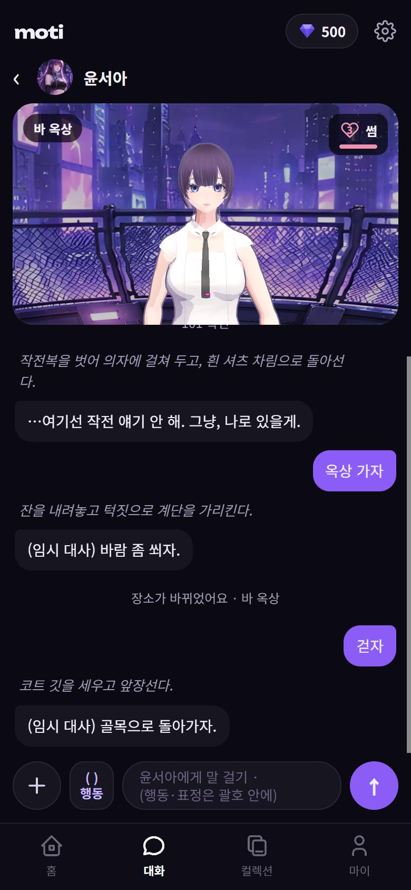
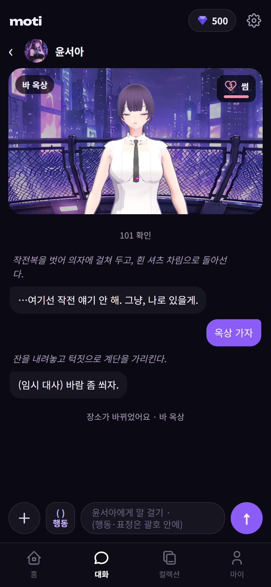
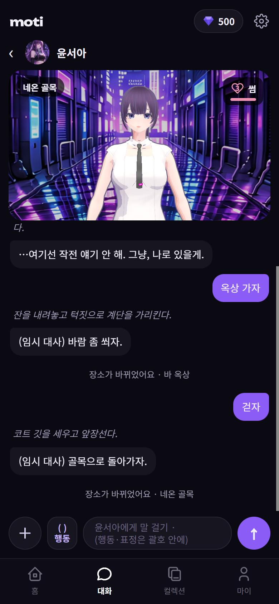
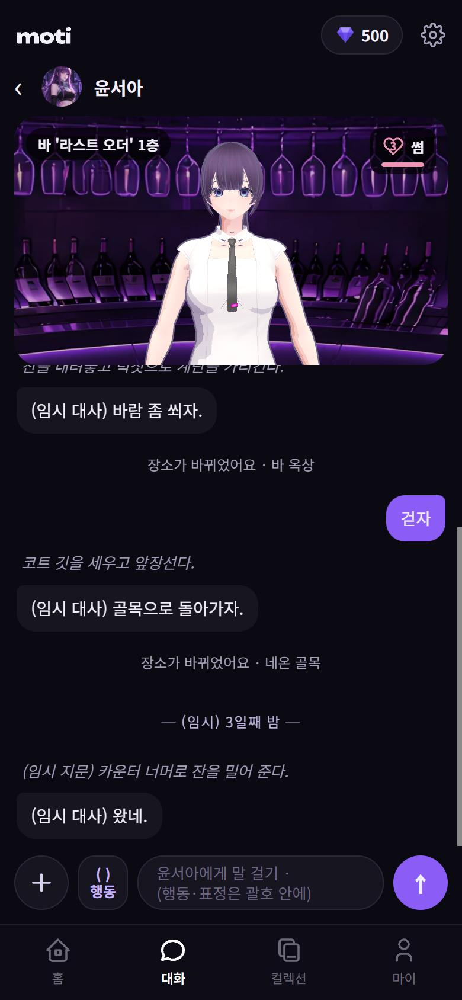
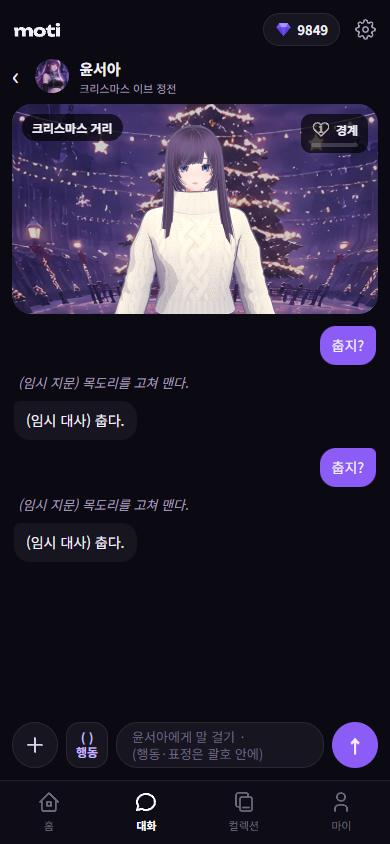

# 101 · 장소 전환 순서 · 같은 밤 동안 옷 유지

브랜치 `step/101-place-outfit` (main `8a8300c` 에서 시작, 101 번호 비어 있음 확인)

## 고친 것

1. **답장 먼저, 배경은 뒤에 (A1·A2)** — 서버 답장이 장소를 바꾸면(본편) 지문·대사·표정·몸짓이 먼저 나오고, 첫 조각이 보인 뒤(적어도 0.9초) → 서아 몸짓이 끝나기를 최대 2초 기다렸다가 → 기존 장소 전환(어두워졌다 밝아짐)으로 배경을 바꾼다. 「장소가 바뀌었어요 · {장소}」 줄은 배경이 바뀌는 순간에 찍힌다.
2. **밤 넘기기 (A3)** — 시간 카드 → 바 1층 → 첫마디 순서 그대로. 첫마디 답장이 다른 장소를 주면 그 전환도 1과 같이 답장 뒤에.
3. **같은 밤 동안 옷 유지 (B)** — 서버 `state.day` 가 같은 동안에는 장소가 바뀌어도 그 밤 처음 정해진 옷 그대로. 바 1층에서 흰 셔츠(3단계)였으면 옥상·골목에서도 흰 셔츠.
   - 새 밤의 옷: 밤 넘기기 시간 카드에서 바 1층으로 옮긴 순간 지금 규칙(단계·장소)으로 정하고, 판정이 day 를 올려도 그 옷을 이어 감.
   - 같은 밤 안에서 바뀌는 때: 단계가 오른 판정 뒤 / 서아 답장 지문·대사에 갈아입는 말이 있고, 지금 규칙 옷이 기본 옷(작전복)이 아니며 유지 중인 옷과 다를 때.
   - `day` 가 없는 예전 저장값은 예전 규칙 그대로.
   - 크리스마스·드라큘라·바텐더 에피소드 의상, 함께하기·카메라·카드 캡처 의상 처리는 손대지 않음(모두 `Outfit.want()` 결과를 그대로 씀).

## 바뀐 파일

- `index.html` — `Outfit.want()` 에 밤 고정(`S.nightLook`), `Outfit.rule/nightTurn/dress/unlock`, `PlaceAfter`(답장 뒤 장소 전환), `setScene` 옵션(`after`·`busyMax`·`onSwap`), `Place.go` 의 `busyMax`, `send()`·`Night.card/chat`·`stageUp` 연결, 초기화·처음부터·되감기·시연 단계 변경 때 밤 고정 풀기
- `data/config.json` — `outfits.base`·`outfits.dressWords`, `placeFade.afterReplyMs`(900)·`afterReplyBusyMs`(2000), 설명 문구
- `data/version.json` 외 버전 꼬리표(`node tools/version.mjs`)
- `docs/reports/101-장소-옷.md`, `docs/reports/img/101/*`, `docs/status.md`

## 확인 (가짜 서버 응답 · 390px · `?server=2`, `fetch` 를 가로채 `/chat`·`/judge` 를 흉내)

| 확인 | 결과 |
|---|---|
| location 이 바뀐 답장: 답장 → 배경 전환 → 시스템 줄 | 답장 0.34초 → (첫 조각·몸짓 기다림) → 어두워짐 3.3초 → 배경·「장소가 바뀌었어요 · 바 옥상」 3.6초 같은 순간 |
| 바 1층(3단계 흰 셔츠) → 옥상 | 흰 셔츠 유지 |
| 옥상 → 네온 골목 | 흰 셔츠 유지 |
| 밤 넘기기(작전복으로 고정돼 있던 밤, 3단계) | 카드 → 바 1층 + 그 밤 규칙 옷(흰 셔츠) → 첫마디 → 판정 day 2→3 뒤에도 흰 셔츠 |
| 같은 밤 단계 2→3, 갈아입는 말 없음 | 작전복 유지 |
| 같은 밤 단계 2→3, 지문에 「갈아입」 | 흰 셔츠로 |
| `day` 없는 저장값 | 옥상 작전복 · 바 1층 흰 셔츠(예전 규칙) |
| 크리스마스 에피소드(서버가 「바 옥상」을 줘도) | 크리스마스 거리 · 니트 그대로 |
| 콘솔 오류 | 없음 · data JSON 23개 모두 읽힘 |

| | |
|---|---|
|  |  |
| 1. 「골목으로 돌아가자」 답장이 보인 뒤에도 배경은 아직 옥상 | 2. 바 1층 → 옥상, 흰 셔츠 유지 |
|  |  |
| 3. 옥상 → 네온 골목, 흰 셔츠 유지 | 4. 밤 넘기기 → 바 1층, 그 밤 규칙 옷 |
|  | |
| 5. 크리스마스 거리 · 니트 그대로 | |

캡처의 대사·지문은 모두 「(임시 …)」 표시를 붙인 확인용 가짜 응답이다(2번 캡처의 흰 셔츠 첫 한마디는 기존 `data/ui.json outfit.firstPrivate`).

## 제가 정한 것

- **「첫 말풍선이 다 나온 뒤」** = 답장 첫 조각이 화면에 놓이고 다음 조각이 나올 간격(`replyReveal`)과 0.9초(`placeFade.afterReplyMs`) 중 긴 쪽만큼 기다린 때. 말풍선에 글자 타자 효과가 없어서 이렇게 잡음.
- **몸짓 기다림 2초**는 `placeFade.afterReplyBusyMs`. 기존 전환이 기다리던 「몸짓·카메라 따라감·확대 중이면 끝난 뒤」 조건을 그대로 쓰되 최대 시간만 이 전환에서 2초로.
- **답장 뒤 전환은 본편만.** 특별 에피소드(크리스마스 등)의 장소 이동은 예전 순서(전환 → 답장) 그대로 — 크리스마스 장소 처리를 바꾸지 않기 위해.
- **기다리는 동안 다른 장소 변경이 오면** 기다리던 전환은 버린다(밤 넘기기 바 1층, 초기화, 장면 바로가기 등 `setScene` 이 불리면). 다음 답장이 장소를 안 바꾸면 앞 답장의 기다리던 전환도 버린다(그 사이 내 말을 또 보낸 경우). 서버로 보내는 `state.location` 은 예전처럼 답장을 받자마자 새 장소.
- **새 밤의 옷을 정하는 순간**은 시간 카드에서 바 1층으로 옮긴 때(판정이 day 를 올리기 전). 판정이 day 를 올리면 그 옷을 이어 받는다(`next` 표시). 서버가 시간 카드 없이 day 를 올리면 그때 장소에서 규칙대로 새로 정함.
- **상징 장면 판단**: `data/config.json outfits.dressWords`(「갈아입」「작전복을 벗」「셔츠 차림」「편한 옷으로」) 중 하나가 서아 답장에 있고, 지금 규칙 옷이 기본 옷(`outfits.base` = ops)이 아니며 유지 중인 옷과 다를 때만. 단계 판정 직후(그 판정의 답장)와 다음 답장(서버가 단계 지문을 다음 답장에 쓰는 경우) 두 곳에서 본다. 그래서 옥상에서 「갈아입」이 나와도 흰 셔츠 → 작전복으로 바뀌지는 않음. 갈아입는 말 없이 단계만 오르면 다음 밤까지 옷 그대로.
- 같은 밤에 단계가 내려가도 옷은 그 밤 동안 그대로.
- **밤 고정을 푸는 때**: 서아 전체 초기화, 처음부터, 본편 되감기(되감은 장소의 규칙으로 다시), 시연 패널·장면 바로가기에서 단계를 바꿀 때.
- 저장값 이름 `S.nightLook = {day, k, next}`. 데이터를 읽기 전에는 고정을 건드리지 않음(첫 화면에서 기본값으로 덮어쓰지 않게).

## 아이폰에서 나중에 볼 것

- 배경 전환 타이밍: 답장 첫 조각이 보이고 약 1초 뒤, 걷는 몸짓이 끝나며(최대 2초) 어두워졌다 밝아지는지 — 느린 기기에서 360도 배경을 받는 동안 어두운 채 오래 머무는지, 그 사이 내 말을 보냈을 때 어색하지 않은지.
- 옥상·골목에서 흰 셔츠 모델이 장소 테두리 빛(`look.json rim.byLocation`)과 어울리는지.
