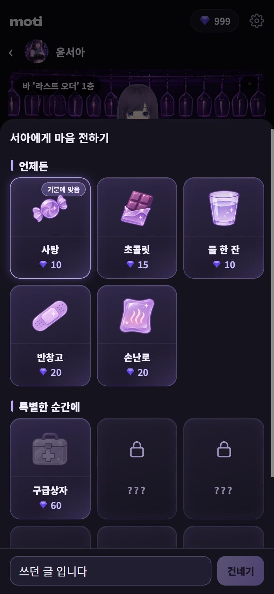
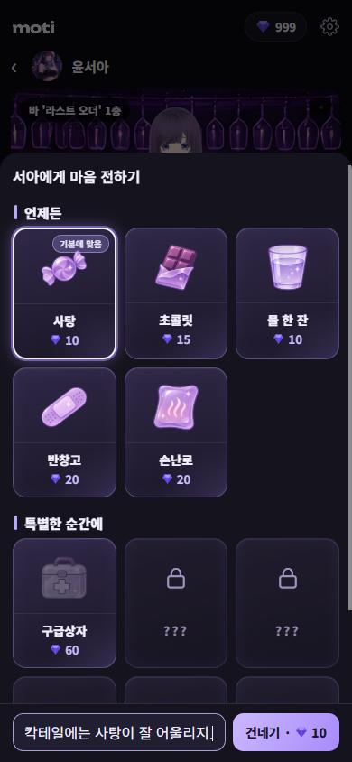
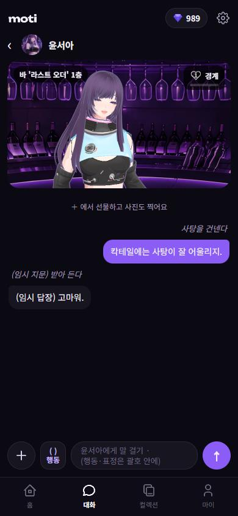
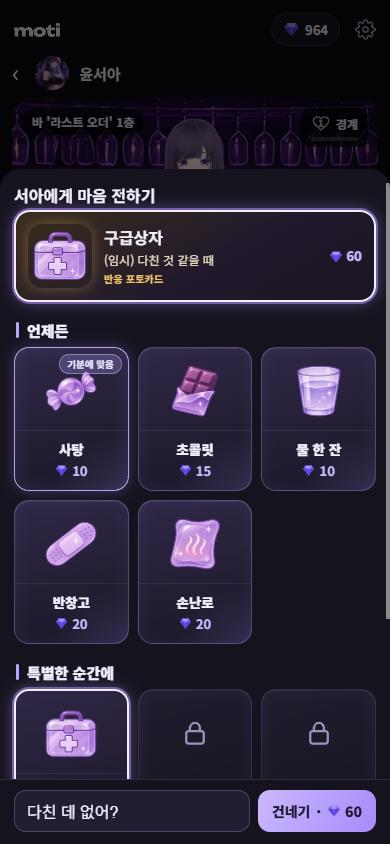

# 102 선물과 함께 전할 말

목적: 「사탕 하나 먹겠나」라고 말한 뒤 선물 창에서 사탕을 또 건네면 서아가 같은 사탕에 두 번 반응하던 문제. 선물과 한마디를 **한 번의 내 턴**으로 건넨다.

## 바뀐 파일

| 파일 | 내용 |
| --- | --- |
| `index.html` | 선물 창: 누르면 「고른 상태」(`gSel`, 흰 테두리) → 맨 아래 고정 칸 「함께 전할 말」 + 「건네기 · 💎가격」. 창을 열 때 대화 입력창 글을 칸으로 옮김. 키보드가 올라오면 창을 키보드 위로(`giftKb`, 이름 바꾸기 창과 같은 `visualViewport` 방식). `give(id, words)` 가 한마디를 받아 화면 줄·서버 줄 뒤에 붙임 |
| `data/ui.json` | `gift.placeholder`(「함께 전할 말 (선택)」)·`gift.giveBtn`(「건네기 · {price}」)·`gift.giveBtnNone`(「건네기」) |
| `docs/reports/img/102-*.jpg` | 캡처 4장 |

## 보내는 모양

- 화면(내 메시지 하나): `(사탕을 건넨다) 칵테일에는 사탕이 잘 어울리지.` → 지문 「사탕을 건넨다」 + 내 말풍선 「칵테일에는 사탕이 잘 어울리지.」 (기존 `userParts` 가 괄호를 지문, 나머지를 말풍선으로 나눔)
- 서버 `/chat` message · `history` · `/judge` last_user: 지금 줄(꼬리표 포함) 뒤에 한 칸 띄고 한마디
  - `[유저가 선물함: 사탕] 칵테일에는 사탕이 잘 어울리지.`
  - `[유저가 선물함: 사탕] · 서아 기분에 맞는 선물 · 또 하나 더.`
  - `[유저가 선물함: 구급상자] · 순간 선물 다친 데 없어?`
- 몸짓·카드·호감 절반(또)·순간 선물 닫기·다이아 차감·판정 횟수는 그대로(`send` 한 번).

## 확인 (가짜 서버 응답 · 390px · `?server=2`, `fetch` 를 가로채 `/chat`·`/judge` 흉내)

| 항목 | 결과 |
| --- | --- |
| 초콜릿 고르기 → 사탕으로 바꾸기 → 한마디 → 건네기 | 화면 지문 + 말풍선 한 번, `/chat` message `[유저가 선물함: 사탕] · 서아 기분에 맞는 선물 칵테일에는 사탕이 잘 어울리지.`(시험 때 서아 기분이 사탕과 맞아 꼬리표가 붙음), 💎 999→989 |
| 한마디 없이 건네기 | `[유저가 선물함: 초콜릿]`, 화면 `(초콜릿을 건넨다)` — 예전과 같음 |
| 아무것도 안 고름 | 버튼 「건네기」 흐림·안 눌림 |
| 대화 입력창 글 | 창을 열면 칸으로 옮겨짐, 건넨 뒤 입력창 비움 / 닫기만 하면 입력창 글 그대로 |
| 순간 선물 + 한마디 | 맨 위 칸·아래 칸 둘 다 고른 표시, `· 순간 선물 다친 데 없어?`, 건넨 뒤 순간 선물 닫힘 |
| 같은 선물 또 + 한마디 | `· 또 하나 더.` |
| 판정 묶음 | `/judge` last_user 에 세 메시지가 한 줄씩(한마디 포함) |
| 다이아 부족 | 고를 수 없음(「다이아가 부족해요」), 버튼 그대로 흐림 |
| 답장 대기 중·밤 넘기기 중 | 건네기 막힘, 창·쓴 한마디·다이아 그대로, 요청 없음 |
| 서버 실패 | 예비 지문 「서아가 말없이 받아 든다.」 그대로, 내 줄은 한마디 포함 |
| 크리스마스(s2) | 같은 방식, `[유저가 선물함: 초콜릿] 메리 크리스마스.` |
| 콘솔 오류 · data JSON | 없음 · 모두 읽힘 |

캡처의 서아 답장은 「(임시 …)」 표시를 붙인 확인용 가짜 응답이다.

| 창 열기(입력창 글 옮김) | 고른 상태 + 한마디 | 대화방 결과 | 순간 선물 + 한마디 |
| --- | --- | --- | --- |
|  |  |  |  |

## 제가 정한 것

- **고른 표시:** 흰 2px 테두리 + 보라 빛. 「기분에 맞음」 칸의 연보라 테두리, 순간 선물 칸의 금색 테두리와 헷갈리지 않게 흰색으로.
- **아무것도 안 골랐을 때 버튼 글:** 가격 없이 「건네기」(`gift.giveBtnNone`).
- **창을 열 때마다 고른 것은 비움.** 창이 열린 채 다시 그려질 때만 고른 것·쓴 말 유지.
- **입력창 글 옮길 때** 줄바꿈은 빈칸으로, 80자 넘으면 앞 80자만.
- **칸에서 Enter** = 건네기(한글 조합 중 Enter 는 무시). 칸은 자동으로 포커스하지 않음(창 열자마자 키보드가 뜨지 않게).
- **막힘 순서:** 답장 대기·밤 넘기기 검사를 창을 닫기 **전**으로 옮김(예전엔 밤 넘기기 검사가 창을 닫은 뒤라, 막히면 쓴 한마디가 사라졌을 것). 다이아는 막히면 빠지지 않음(예전과 같음).
- **꼬리표와 한마디 사이** 는 지시대로 한 칸만(「· 또 하나 더.」처럼 붙어 보임). 서버 규칙은 `]` 뒤를 말로 읽는다고 해 그대로 둠.
- **다시 보내기:** 지금 선물 턴의 예비 지문에는 「다시 보내기」 칩이 없다(91단계부터 `!o` 조건, 선물·포즈 부탁 제외). 지시가 「그대로」라 바꾸지 않음. 서버 실패 시 내 줄·기록에는 한마디가 그대로 남는다.
- 입력칸 글자 크기 16px(아이폰 사파리가 16px 미만 칸에 포커스하면 화면을 확대하므로).

## 아이폰에서 나중에 볼 것

- 키보드가 올라올 때 선물 창: 창 아래가 키보드 바로 위로 붙는지, 창 높이가 줄어 목록이 스크롤되는지, 키보드를 내리면 제자리로 오는지(`visualViewport` 로 `bottom`·`max-height` 조정. 데스크톱에서는 키보드가 없어 확인 못 함).
- 홈 막대가 있는 기기에서 맨 아래 칸 여백(`safe-area-inset-bottom`).
- 블러·애니메이션은 바꾸지 않음.
