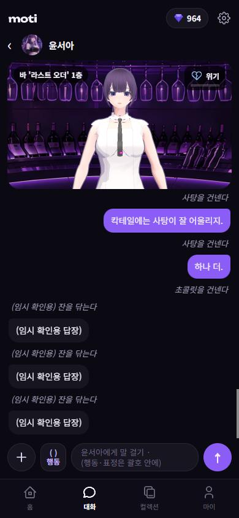

# 103 서버 S6 맞추기 · 선물 한마디 표기

목적: 서버 S6(장면 순서)의 새 state 키 3개를 앱이 받아 돌려주고, 같은 `pending_event` 가 다시 와도 사건 연출은 한 번만. [102] 선물 한마디의 서버 줄 표기를 「」로.

## 바뀐 파일

| 파일 | 내용 |
| --- | --- |
| `index.html` | `S4_KEYS` 에 `crisis_news`·`stage_up_due`·`stage_up_msgs` 추가(→ `MAIN_KEYS`·`clearS4` 도 같이). 앱 전용 기록 `ev_shown`(`APP_KEYS`, 서버로 안 보냄)과 `EvShown`(사건@단계 한 번만). 사건 해금 `unlockShow` 앞에 `EvShown.once`. `give()` 서버 줄에 `gift.srvWords` |
| `data/ui.json` | `gift.srvWords` = `「{words}」` |
| `docs/reports/img/103-1-선물-한마디-화면.jpg` | 캡처 |

## 확인 (가짜 서버 응답 · 390px · `?server=2`, `fetch` 를 가로채 `/chat`·`/judge` 흉내)

| 항목 | 결과 |
| --- | --- |
| 새 키 3개 | 판정이 준 `crisis_news:true, stage_up_due:3, stage_up_msgs:4` 가 저장되고 다음 `/chat`·`/judge` state 에 그대로 감 |
| 크리스마스(s2) | `/chat`·판정 state 에 새 키·`ev_shown` 없음, 본편 값은 그대로 남음 |
| 관계 초기화(`clearS4`)·처음부터 | 새 키·`ev_shown` 모두 지워짐(서버 기본값) |
| 되감기 | 위기 직전 지점의 값으로 돌아감(`crisis_news:false`, `ev_shown` 에서 `CRISIS@5` 빠짐) |
| `judge_soon` true | 답장마다 판정(규칙 그대로, `/chat` 2번 → `/judge` 2번) |
| 같은 STAGE_UP_3 두 번 | `/chat` 에 STAGE_UP_3 두 번 감, 사건 해금 연출 1번, 「관계가 변했어요」는 오른 단계마다 1번(1→3 이라 2·3단계 두 줄) |
| 같은 CRISIS 세 번 | `/chat` 에 CRISIS 세 번 감, 5단계 해금 1번·사건 해금 1번. 정상 답장 뒤 비우기·서버가 다시 주면 다시 넣기 그대로 |
| 선물 서버 줄 | `[유저가 선물함: 사탕] · 서아 기분에 맞는 선물 · 「칵테일에는 사탕이 잘 어울리지.」` / `… · 또 · 「하나 더.」` / `[유저가 선물함: 초콜릿]` — `/chat` message·history·`/judge` last_user 모두 같음 |
| 화면 | 지문 + 말풍선 그대로(캡처) |
| 콘솔 오류 · data JSON | 없음 · 모두 읽힘 |

지금 `data/seoa_story.json` 의 `unlock.event` 는 ROOFTOP(몸짓 비움)뿐이라, 확인 때는 페이지 안에서만 STAGE_UP_3·CRISIS 에 임시 해금 묶음을 붙여 셌다(파일은 안 바꿈). 캡처의 서아 답장은 「(임시 확인용)」 가짜 응답이다.

## 제가 정한 것

- **「이미 연출함」 자리:** 본편 `story.ev_shown`(「사건@단계」 목록). story 안이라 되감기(통째 스냅숏)·처음부터(story={})에 저절로 따라가고, 서버 요청(본편·크리스마스 `/chat`·`/judge`·밤 넘기기 판정)에서는 뺀다. 관계 초기화·시연 패널 단계 이동(`clearS4`)에서도 비운다.
- **막는 연출의 범위:** 앱에서 `pending_event` 이름에 묶인 연출은 사건 해금(`unlock.event` → 카드 해금·토스트·확대) 하나뿐이라 거기에 걸었다. 「관계가 변했어요」·단계 해금·대표 몸짓 확대는 판정에서 단계가 오를 때만 나오므로 같은 사건이 다시 와도 원래 한 번이다(단계가 내려갔다 다시 오르는 경우는 지금처럼 다시 나옴). 위기 되감기 지점은 원래 덮어쓰지 않음.
- **새 키 초기화:** 지시대로 「빼기」(서버가 예전 저장처럼 처리: `crisis_news` 는 위기 차례가 지났으면 true, 나머지 null·0).
- **「」 모양은 데이터로:** `data/ui.json` `gift.srvWords`. 한마디는 태그 목록 맨 뒤에 같은 「 · 」로 붙인다.

## 아이폰에서 볼 것

- 시각 효과는 바꾸지 않음.
