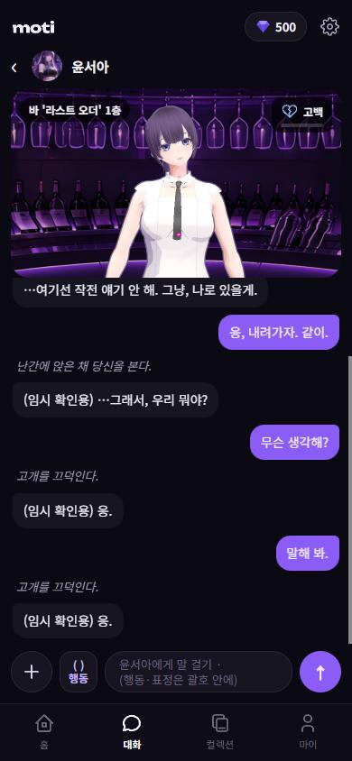
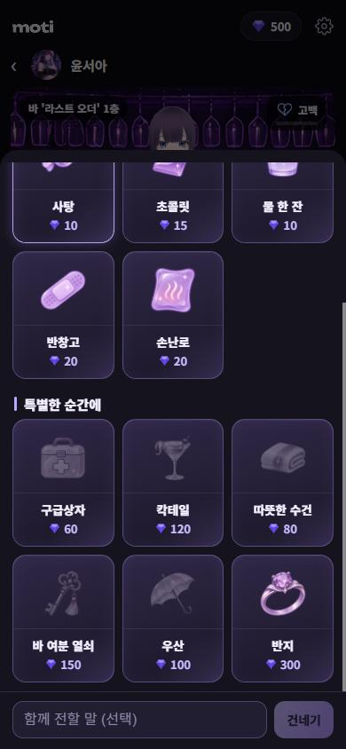
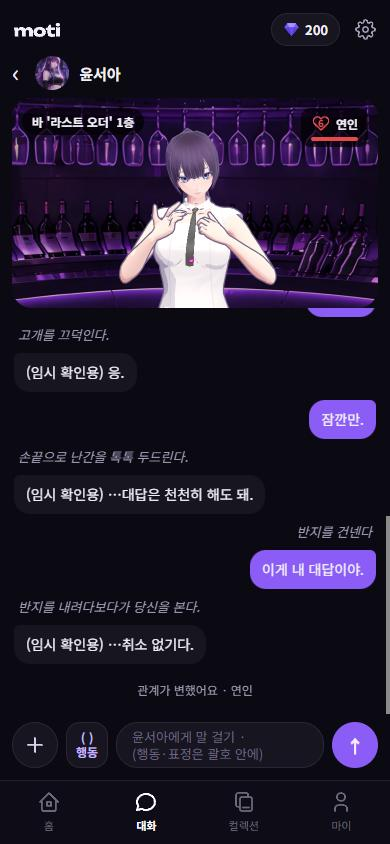

# 104 서버 S7(연인 확정) 맞추기 · 순간 선물 장면 준비

목적: 서버 S7 로 「위기에서 마음 확인 → 서아가 관계를 물음 → 받아 주면 연인(6단계)」이 됐다. 앱이 새 키·단계 이름·연출 시점을 맞추고, 서버 S8(순간 선물을 장면에 맞춰 엶)을 위해 반지가 5단계 연인 확정 질문에서도 열릴 수 있게 했다.

기준: 서버 `seoa-backand` main `94aad44`(S7 병합) · `docs/reports/S7-연인확정.md` 「앱 팀에 전할 것」 7개. 서버 수정·유료 API 호출 없음.

브랜치: `step/104-s7-sync`

## 바뀐 파일

| 파일 | 내용 |
| --- | --- |
| `index.html` | `S4_KEYS` 에 `lovers`·`lovers_msgs`·`lovers_asks`(→ `MAIN_KEYS`·`clearS4`·크리스마스 요청 빼기 같이) · `runJudge` 단계 상승: 6단계는 판정 `stage_up === true` 일 때만 `stageUp` · `Moment.stageOk` 에 `alsoAt`(선물 데이터) · 시연 패널 `s4Demo("lovers")` 와 「연인 확정 바로」 버튼 |
| `data/gifts.json` | when 문구 4개(수건·바 여분 열쇠·우산·반지), 반지 `alsoAt: {stage: 5, lovers: ["ask","wait"]}` |
| `data/demo.json` | `s4.loversNow` 「연인 확정 바로」, `s4.loversLabel` 「고백」 |
| `docs/status.md` | 104 절 |
| `docs/reports/img/104-*.jpg` | 캡처 3장 |

## 서버 7개 항목 처리

| # | 서버가 전한 것 | 앱 |
| --- | --- | --- |
| 1 | 새 키 3개 돌려보내기 | `S4_KEYS` 에 넣음. 받은 그대로 본편 `/chat`·`/judge` 에, 크리스마스 요청에서는 뺌. 처음부터(story={})·관계 초기화·단계 이동(`clearS4`)에서 지움. 되감기는 story 통째 스냅숏이라 그 시점 값 |
| 2 | `won_line` 에 `+` 로 이은 값 | 앱은 읽지 않고 그대로 돌려보냄(원래 그랬음. `WON_CARE+LOVERS_YES_CARE` 로 확인) |
| 3 | lovers ask 면 judge_soon true | 기존 `judgeSoon()` 그대로 — ask 동안 답장마다 `/judge`, wait(judge_soon false) 동안 3개 묶음 |
| 4 | `stage_label` 「고백」 | 기존 `mainStageName` 이 stage_label 을 그대로 써서 대화방 관계 줄·마이·대화 목록·시연 패널 모두 「고백」(stage 5) |
| 5 | `LOVERS_ASK`·`LOVERS_AGAIN` | 다른 사건처럼 정상 답장 뒤 비움, 다시 오면 다시 실음, 사건 연출은 [103] `EvShown` 으로 「사건@단계」 한 번 |
| 6 | 단계 상승 시점이 늦어짐 | 6단계 연출은 `stage_up` true 일 때만. 마음 확인 판정(5 그대로)에는 원래 연출이 없음 |
| 7 | 시연 패널 상태 | 「연인 확정 바로」: 5단계 · crisis done · lovers ask · pending LOVERS_ASK · judge_soon · 갈래 없으면 care |

## 확인 (가짜 서버 응답 · 390px · `?server=2&api=http://fake.test&debug=1`, `fetch` 를 가로채 `/chat`·`/judge` 흉내)

| 항목 | 결과 |
| --- | --- |
| 「연인 확정 바로」 | 5단계, 관계 줄 「고백」, lovers ask, pending LOVERS_ASK, judge_soon, route care |
| 물음 답장 | `/chat` state 에 LOVERS_ASK · lovers ask/0/0 · 정상 답장 뒤 pending 비움 · 답장마다 `/chat`→`/judge` |
| LOVERS_ASK 두 번 | 판정이 같은 값을 다시 줌 → 다음 `/chat` 에 다시 실림, 사건 연출 1번(아래 참고) |
| 망설임(lovers_later → wait) | 「고백」 유지, judge_soon false → `/chat` 3번 뒤 `/judge` 1번 → LOVERS_AGAIN → 다음 `/chat` 에 실리고 비움, 연출 1번 |
| 반지 순간 선물 | lovers ask·wait 에서 `gift_moments` 에 ring(「서아가 관계를 물을 때」). 서버가 `gift_moment: ring` → ＋ 버튼 금빛, 선물 창 반지 칸 `now`(금색 테두리) |
| 반지 + 한마디 | 서버 줄 `[유저가 선물함: 반지] · 순간 선물 · 「이게 내 대답이야.」`(`/chat`·`/judge` 같음), 화면은 「반지를 건넨다」 지문 + 말풍선, 반응 몸짓 x31, 카드 gm06 |
| 그 판정에서 6단계(stage_up true) | 「관계가 변했어요 · 연인」 1줄, 관계 줄 「연인」, 다음 `/chat` 에 STAGE_UP_6 |
| 6단계지만 stage_up false(시험) | 연출 없음 |
| 위기 → 마음 확인 판정(5 그대로, LOVERS_ASK) | 연출 없음, 「고백」 |
| 새 키 다음 요청 | `lovers:"done"`·`lovers_msgs:0`·`lovers_asks:0`·`won_line:"WON_CARE+LOVERS_YES_CARE"` 그대로 |
| 크리스마스(s2) | `/chat`·판정 state 에 새 키·won_line·stage_label·ev_shown 없음, pending null, 본편 값 그대로 |
| 단계 이동(「위기 바로」) | lovers 키 지워짐, 위기 중(lovers 없음)에는 반지 목록에 없음 |
| 콘솔 오류 · data JSON | 가짜 주소 깨우기 요청(ERR_NAME_NOT_RESOLVED) 하나뿐 · data/*.json 모두 읽힘 |

지금 `data/seoa_story.json` `unlock.event` 에는 LOVERS 사건 해금 묶음이 없어 실제로는 연출 없이 지나간다(서버 5번 「연출 없이 지나가면 됨」). 「한 번」 확인은 페이지 안에서만 LOVERS_ASK·LOVERS_AGAIN 에 임시 묶음을 붙여 셌다(파일은 안 바꿈). 캡처의 서아 답장은 「(임시 확인용)」 가짜 응답이다.

## 캡처 (390px)

| 「고백」 표시 | 반지 순간 선물 | 반지 → 연인 연출 |
| --- | --- | --- |
|  |  |  |

## 제가 정한 것

1. **반지 열림 조건은 데이터로.** `data/gifts.json` 반지에 `alsoAt: {stage: 5, lovers: ["ask","wait"]}`. 앱은 「단계 ≥ stage」 또는 「본편이고 지금 단계 = alsoAt.stage 이고 lovers 가 목록 안」이면 열 수 있다고 봄. 반응 몸짓·쿨다운·한 번에 하나·특별 에피소드 닫힘은 그대로. 선물 창의 「다가갈 수 있음」 표시도 같은 함수라 그때 반지 칸이 열린 모양.
2. **6단계 연출 조건.** 판정에서 단계가 6 으로 올랐는데 `stage_up` 이 true 가 아니면 단계 값은 서버 그대로 6 으로 두고 연출(「관계가 변했어요」·6단계 해금·옷 갈아입기·갈래 확인)만 건너뜀. 1~5단계 상승은 예전처럼 단계 비교로.
3. **연인 확정 바로의 다른 값.** 호감 55(위기 바로와 같음), lovers_msgs·lovers_asks 0, stage_label 은 `data/demo.json` `s4.loversLabel` 「고백」, used_events.CRISIS 는 없으면 지금 turn. 위기 되감기 지점은 만들지 않음(위기를 거치지 않은 시연이라). 반지가 바로 열리게 하지는 않음(서버 gift_moment 를 기다림).
4. **when 문구.** 지시 문구를 그대로 넣음. 반지 `momentFallback` 임시 규칙(「남을게」 등)은 서버 신호가 한 번이라도 오면 꺼지는 예전 규칙이라 그대로 둠.
5. **LOVERS 사건 해금 묶음은 만들지 않음.** 원고·몸짓 지시가 없어서. 붙이면 [103] 규칙으로 한 번만 나옴.

## 아이폰에서 나중에 볼 것

- 시각 효과(블러·그림자·애니메이션)는 바꾸지 않음. 반지 금색 테두리·＋ 금빛은 기존 스타일 그대로라 따로 볼 것 없음.
- 실제 서버(S7·S8 배포 뒤)에서 반지가 연인 확정 질문 장면에 열리고, 건넨 판정에서 6단계 연출이 한 번만 나오는지 한 번 플레이로 확인 필요.
