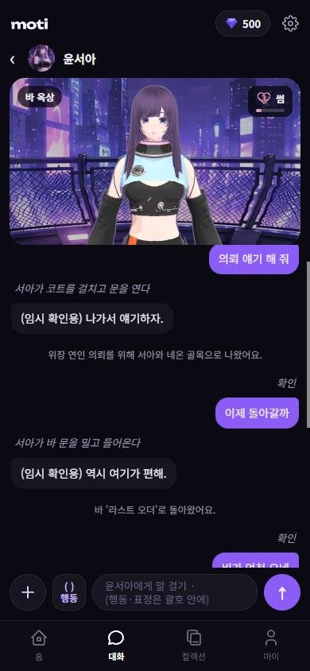
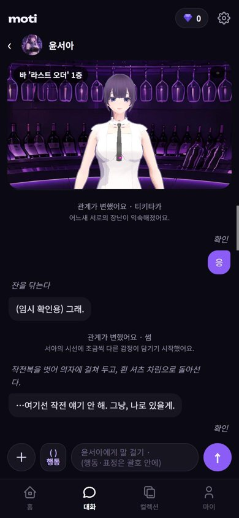
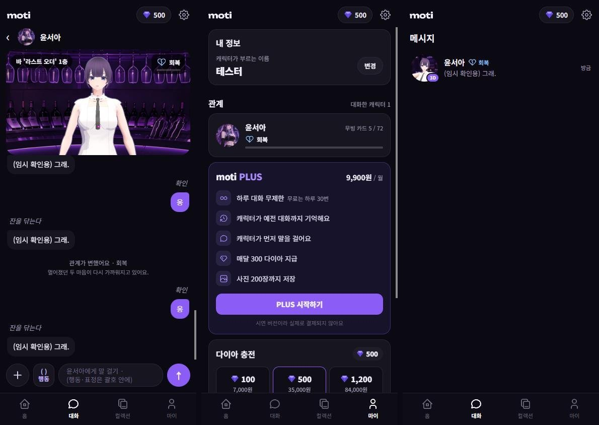

# 105 장소 이동 안내 · 관계 변화 한 줄

목적: 「장소가 바뀌었어요 · 바 옥상」·「관계가 변했어요 · 썸」 만으로는 왜 옮겼는지·무엇이 변했는지 알기 어려워, 앱의 시스템 줄을 이야기에 맞는 문장으로 바꿨다. 서버 수정·유료 API 호출 없음. 장소 전환 타이밍·연출·단계 상승 조건은 그대로.

브랜치: `step/105-system-lines`

## 바뀐 파일

| 파일 | 내용 |
| --- | --- |
| `data/ui.json` | `chat.placeWhy`(장면 → 도착 장소 → 문장 7개) · `chat.placeArrive`(장소 5곳) · `chat.stageLine`(이름 8개) · `chat.stageLabelAt` [「고백」] · `chat.healLabel` 「회복」 · `chat.healEvent` `RECONCILE_OPEN` |
| `index.html` | `placeLine()`(장소 줄 문장 고르기) · `PlaceAfter.go` 에 장면 ctx · `send()` 가 보낸 사건·서버 장면을 넘김 · 밤 첫마디는 `{night:true}` · `bondLine()`(관계 변화 줄 + 작은 줄) · `stageUp` 이 bondLine 사용 · `S4.judged` 엇갈림 토스트 → bondLine, 「고백」 줄 · `Heal`(회복) · `mainStageName` 회복 우선 · `APP_KEYS` 에 `heal`·`place_why` · `.msg.sys .sysub` 스타일 |
| `docs/status.md` | 105 절 |
| `docs/reports/img/105-*.jpg` | 캡처 3장 |

## 확인 (가짜 서버 응답 · 390px · `?server=2&api=http://fake.test&debug=1`, `fetch` 를 가로채 `/chat`·`/judge` 흉내)

| 항목 | 결과 |
| --- | --- |
| placeWhy 7경우(DATE·WALK_HOME·STORM·ROOFTOP·ALLEY·CRISIS 골목·CRISIS 옥상) | 모두 지시 문장 |
| 장면 없이 5곳 | 모두 placeArrive 문장 |
| 같은 장면(state.scene STORM)에서 2층 → 옥상 → 2층 | 첫 번째만 장면 문장, 나머지 placeArrive |
| 표에 없는 사건(STAGE_UP_3 → 네온 골목) | placeArrive |
| 크리스마스(자취방으로) | 「장소가 바뀌었어요 · 서아의 자취방」 그대로 |
| 밤 넘기기(네온 골목 → 바 1층) | 「─ 2일째 밤 ─」 만, 장소 줄 없음 |
| 관계 변화 8경우 | 티키타카·썸·고백 직전·위기(단계 상승) · 엇갈림(위기 → rift) · 회복(RECONCILE_OPEN 정상 답장) · 고백(stage_label 만 바뀜) · 연인(stage_up true) 모두 두 줄. 엇갈림 토스트 없음, 각 한 번(다음 답장·lovers wait 에서 다시 안 나옴) |
| 「회복」 표시 | 대화방 관계 줄·마이 관계·대화 목록 모두 「회복」, 그 뒤 판정이 「고백」을 주면 「고백」 |
| 새로고침 | 기록의 두 줄 모양 그대로(작은 줄 11px, 위 줄 12px) |
| 되감기(위기 직전 지점) | 엇갈림·회복 뒤 되감기 → 「위기」, `heal` 없음, 회복 줄도 기록에서 빠짐 |
| 서버로 가는 state | `heal`·`place_why` 없음(`/chat`·`/judge`) |
| 콘솔 · data JSON | 가짜 주소 깨우기 요청(ERR_NAME_NOT_RESOLVED)뿐 · data/*.json 21개 모두 읽힘 |

캡처의 서아 답장은 「(임시 확인용)」 가짜 응답이다.

## 캡처 (390px)

| 장소 안내 | 관계 변화 | 회복 표시(대화방 · 마이 · 대화 목록) |
| --- | --- | --- |
|  |  |  |

## 제가 정한 것

1. **장면 고르는 순서.** 그 요청에 실은 `pending_event` 를 먼저, 그 사건·도착 장소 짝이 표에 없으면 보낼 때의 서버 `state.scene` 을 봄. 둘 다 안 맞으면 placeArrive.
2. **「같은 장면」 기준.** `장면@시작 turn`(서버 `used_events[장면]`, 없으면 `ROUTE_장면`, 그것도 없으면 빈칸)을 `story.place_why` 에 남겨, 같은 장면 안에서는 한 번만. 다시 일어난 같은 사건(시작 turn 이 다름)은 다시 장면 문장. 앱 전용 키라 서버로 안 보내고, 되감기·처음부터·단계 이동 때 같이 되돌아감.
3. **문장은 실제로 바뀌는 순간에 고름.** 답장 뒤 배경이 바뀌는 순간(예전 줄과 같은 때)에 문장을 고르고 기록함 — 전환이 다른 장소 변경으로 취소되면 「한 번」 도 쓰지 않음.
4. **밤 넘기기.** 시간 카드가 바 1층으로 옮길 때는 원래 줄이 없었고 그대로. 첫마디 답장이 바 1층을 다시 주는 경우도 줄 없음. 첫마디가 다른 장소로 옮기면 placeArrive(장면 문장은 안 씀).
5. **두 줄 모양.** 한 대화 줄 안에 작은 줄(`<small class="sysub">`)을 넣어 기록에 같이 저장(`sub`). 11px · 보조 글자색 · 약간 흐리게(opacity .85). 블러·새 효과 없음. 예전 기록의 한 줄짜리는 그대로.
6. **「고백」 줄 조건.** 판정 뒤 단계 값은 그대로인데 `stage_label` 이 `chat.stageLabelAt`(「고백」)으로 바뀐 때. 시연 「연인 확정 바로」 에서도 같은 줄이 나옴.
7. **엇갈림.** 위기 → 엇갈림이 된 판정에서 토스트(`top.rift`) 대신 「관계가 변했어요 · 엇갈림」 + 한 줄. 이름은 서버 `stage_label`(없으면 riftLabel). `top.rift` 문구는 지우지 않고 「105부터 안 씀」 표시만.
8. **회복.** 조건 = 본편 · 5단계 · 지금 표시가 엇갈림(서버 stage_label, 예전 저장은 crisis rift) · 이번에 실은 사건이 `RECONCILE_OPEN` · 정상 서버 답장. 표시는 stage_label 이 엇갈림인 동안만 「회복」 으로 덮고, 다른 값이 오면 그 값. 엇갈림이 끝나면(crisis 가 rift 가 아니게) `heal` 을 지움.
9. **에피소드 단계 상승 줄(크리스마스)** 은 지시대로 본편만이라 손대지 않음(한 줄 그대로).

## 아이폰에서 나중에 볼 것

- 새 시각 효과 없음(글자 크기·색만). 작은 줄이 두 줄로 넘어갈 때 가운데 정렬이 그대로인지 한 번 보면 됨.
- 실제 서버에서 갈래 장면(DATE·WALK_HOME 등)으로 옮길 때 장면 문장이 나오는지 한 번 플레이로 확인 필요(서버가 장면을 시작하는 답장과 실제로 옮기는 답장이 다를 수 있어 `state.scene` 으로도 보게 함).
