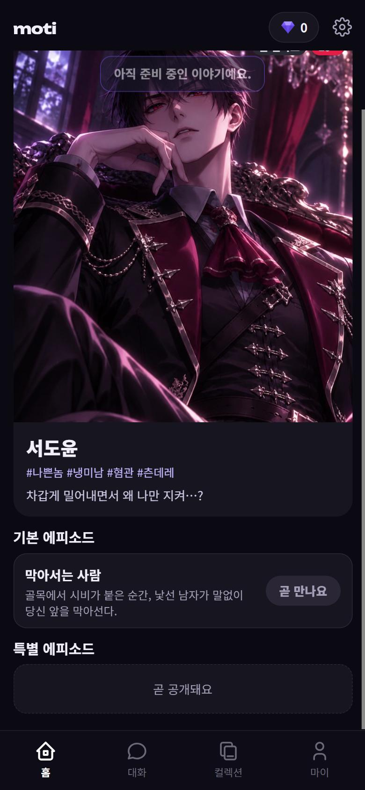
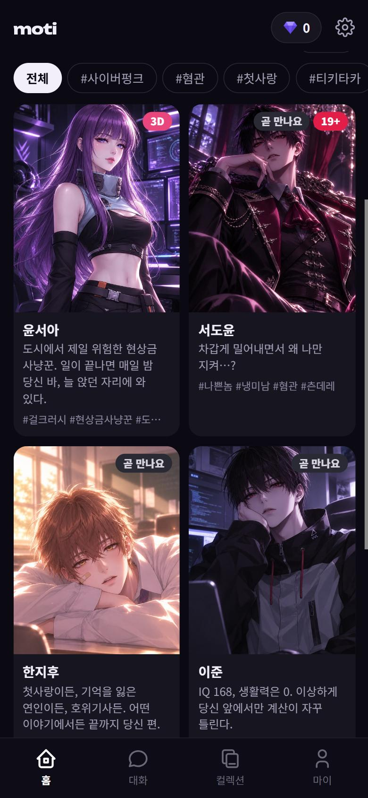

# 107 서아 말고 다른 캐릭터 잠그기 (곧 만나요)

서도윤·한지후·이준·류하람은 대화방에 못 들어가고 「곧 만나요」로 보인다. 소개 화면은 그대로 볼 수 있다. 서아는 바뀐 것 없음.

## 바뀐 파일
- `data/characters.json`: doyun·jihu·ijun·haram 에 `"locked": true`(서아에는 없음). `_설명`에 뜻 추가.
- `data/ui.json` `home`: `lockedBtn` 「곧 만나요」 · `lockedToast` 「아직 준비 중인 이야기예요.」 · `lockedBadge` 「곧 만나요」.
- `data/demo.json`: 디버그 패널 줄 `sec.charLock` · `charUnlock` · 켜고 끌 때 알림 `charUnlockOn`·`charUnlockOff`.
- `index.html`
  - `CharLock`·`isLocked(cid)`(새): 잠금은 `locked` 값으로만 정함(코드에 캐릭터 id 없음). `?debug=1` 이고 이 기기 저장값(`localStorage` `moti.charUnlock`)이 켜졌을 때만 풀림.
  - 막는 곳: `openRoom`(대화방을 여는 모든 길의 마지막 관문 · 잠긴 방이 열려 있었으면 목록으로) · `enterRoom`(홈 버튼·대화 목록·마이 관계·헤더 알림) · 기본 에피소드 버튼 · `startStory` · `send` · `askServer`·`askOther`(잠긴 캐릭터는 /chat·샘플 요청 없음).
  - 기본 에피소드 버튼: 잠기면 「곧 만나요」(아이콘 없음, 회색 `.eb.lk`), 누르면 toast 한 줄.
  - 카드·소개 사진 위 표시: `badgesHTML(c)`(새). 잠긴 동안 「곧 만나요」 + 19+ 는 그대로, NEW 는 숨김. 표시가 둘이면 나란히(`.pls`).
  - 대화 목록·안 읽은 수·마이 「관계」·다른 캐릭터 먼저 말 걸기 알림: 잠긴 캐릭터 빼고(저장값 `S.rooms`·`S.chats` 는 지우지 않음).
  - 디버그 패널(`?debug=1`)에 「캐릭터 잠금(107) · 다른 캐릭터 잠금 풀기(이 기기만)」 켜기/끄기.
- 버전 꼬리표(`tools/version.mjs` 와 같은 내용을 실행, 아래 「제가 정한 것」).

## 확인 (390px)
| 항목 | 결과 |
|---|---|
| 네 캐릭터 기본 에피소드 버튼 | 모두 「곧 만나요」(회색), 누르면 알림 「아직 준비 중인 이야기예요.」, 대화방 안 열림 |
| `enterRoom`·`openRoom` 직접 호출 | 대화방 안 열림(`S.room` 비어 있음, 대화방 숨김) |
| 검색(「하람」) → 카드 → 버튼 | 대화방 안 열림, 소개 화면은 보임 |
| 위 표시 | 서도윤 「곧 만나요 · 19+」, 한지후·이준·류하람 「곧 만나요」(류하람 NEW 숨김), 서아 「3D」 그대로 |
| 잠긴 방에 강제로 `send` · 알림 `ping` | 메시지 안 쌓임 |
| 네트워크 | 위 확인 동안 /chat·/judge 요청 0건 |
| 서도윤 예전 방을 저장한 채 새로고침 | 대화 목록에 안 보임(「아직 대화가 없어요」), 안 읽은 수 없음, 저장값 그대로 |
| 서아 | 기본 「시작」→ 들어간 뒤 「이어하기」, 특별 에피소드 셋 그대로, 대화방 열림, 목록에 서아만 |
| 디버그 잠금 풀기 | 켜면 한지후 대화방 열림·류하람 「시작」·NEW 다시 보임 / 끄면 다시 잠기고 열려 있던 한지후 방은 목록으로 |
| 저장값이 켜진 채 `?debug=1` 없이 열기 | 네 캐릭터 모두 잠김 |
| 콘솔 · data JSON | 오류 없음 · data/*.json 모두 읽힘 |

캡처:
- 홈 「곧 만나요」 버튼 + 알림: 
- 캐릭터 찾기 카드: 

## 제가 정한 것
- **서도윤(19+)의 버튼**: 성인 인증 전에도 「19+ 인증」 대신 「곧 만나요」. 인증을 해도 들어갈 수 없어서 잠금을 먼저 보여 줌.
- **회색**: 버튼 바탕은 기존 선 색(`--line`), 글자는 보조 글자 색(`--sub`). 카드 위 「곧 만나요」 표시는 어두운 회색 바탕(`#2a2a34`) + 밝은 회색 글자. 새 효과 없음.
- **19+ 와 함께 보일 때** 순서는 「곧 만나요」 → 「19+」.
- **「신규」 정렬**: 잠긴 동안 NEW 가 안 보이므로 류하람을 앞으로 올리지 않음.
- **마이 「관계」 목록·안 읽은 수·먼저 말 걸기 알림**도 대화 목록처럼 잠긴 캐릭터를 뺌(누르면 어차피 못 들어가는 곳이라).
- **잠금 풀기 저장값**은 `S`(앱 저장값)가 아니라 따로 `localStorage` `moti.charUnlock` 에 둠 → 전체 초기화해도 남고, 일반 화면에서는 읽지 않음.
- **버전 꼬리표**: 이 PC 에 node 가 없어 `tools/version.mjs` 와 같은 바꾸기(같은 정규식·같은 시각 형식)를 Python 으로 한 번 돌림. 결과는 같다.
- 작업은 원래 폴더의 다른 단계(step/4) 미커밋 변경을 건드리지 않으려고 별도 worktree(`../Moti-107`)에서 함.

## 아이폰에서 나중에 볼 것
- 새 시각 효과(블러·애니메이션)는 없음. 카드 위 표시가 둘(「곧 만나요」·「19+」)일 때 좁은 카드에서 줄이 넘치지 않는지만 사파리에서 한 번.
- 알림(toast)이 홈 위쪽에 뜨는 위치가 노치 아래로 잘 보이는지.
