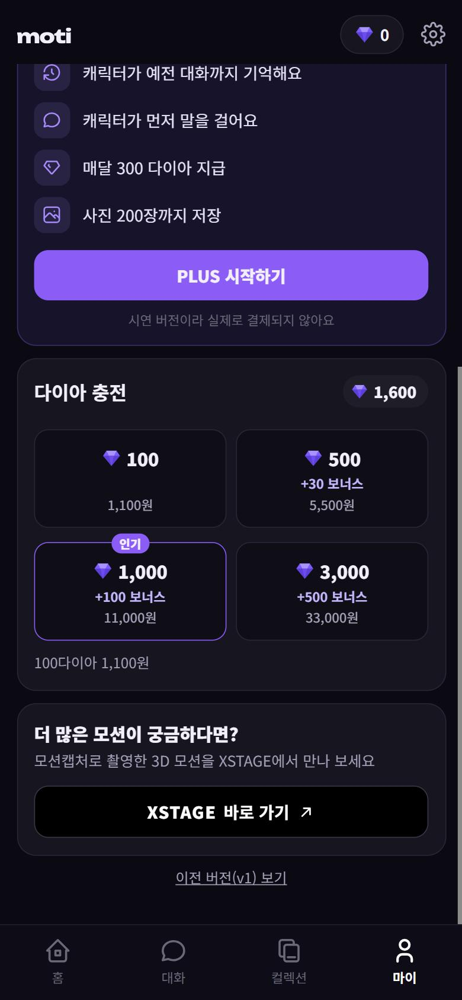
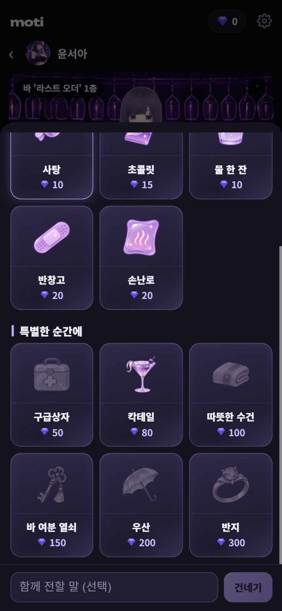

# 109 다이아 가격 다시 정하기 (충전 단가 · 순간 선물 순서)

지시문 번호는 108이었으나 main 에 이미 108(손목·지문·오타)이 있어 **109**로 했다. 브랜치 `step/109-dia-price`.

충전 단가를 100다이아 = 1,100원(1다이아 11원)으로 내리고, 순간 선물을 이야기 단계 순서대로 비싸지게 정리했다.

## 바뀐 표

원화 환산은 1다이아 = 11원 기준.

### 충전 상품 (`data/ui.json` my.packs)
| 항목 | 예전 | 새 값 | 받는 다이아 | 1다이아당 |
|---|---|---|---|---|
| 1번 | 100 · 7,000원 | 100 · 1,100원 | 100 | 11원 |
| 2번 | 500 · 35,000원 · 인기 | 500 + 보너스 30 · 5,500원 | 530 | 약 10.4원 |
| 3번 | 1,200 · 84,000원 | 1,000 + 보너스 100 · 11,000원 · 인기 | 1,100 | 10원 |
| 4번 | (없음) | 3,000 + 보너스 500 · 33,000원 | 3,500 | 약 9.4원 |
| 안내 줄 chargeNote | 1다이아 70원 | 100다이아 1,100원 | | |

### 순간 선물 (`data/gifts.json` list, kind = moment)
| 선물 | 예전 | 새 값 | 원화 환산 |
|---|---|---|---|
| firstaid 구급상자 | 60 | 50 | 550원 |
| cocktail 칵테일 | 120 | 80 | 880원 |
| towel 따뜻한 수건 | 80 | 100 | 1,100원 |
| flower 바 여분 열쇠 | 150 | 150 (그대로) | 1,650원 |
| umbrella 우산 | 100 | 200 | 2,200원 |
| ring 반지 | 300 | 300 (그대로) | 3,300원 |

### 특별 에피소드 (`data/episodes.json` special)
| 에피소드 | 예전 | 새 값 | 원화 환산 |
|---|---|---|---|
| s4 오늘의 바텐더 | 150 | 200 | 2,200원 |
| s2 크리스마스 이브 정전 | 150 | 200 | 2,200원 |
| s3 할로윈, 드라큘라의 밤 | 150 | 200 | 2,200원 |

손대지 않은 것: 서버, 시작 다이아(500), 상시 선물, 카드팩, 되감기, 사진 칸, 닉네임 변경, 선물 효과·단계, PLUS(9,900원 · 매달 300).

## 바뀐 파일
- `data/ui.json` — my.packs 네 상품(새 키 `bonus`), 새 문구 `my.bonus`「+{bonus} 보너스」, chargeNote, `_my` 설명에 bonus 추가.
- `data/gifts.json` — 순간 선물 가격.
- `data/episodes.json` — s2·s3·s4 가격.
- `index.html`
  - 충전 버튼: 개수 아래 보너스 줄(`.bn`), 누르면 `dia + bonus` 가 들어옴. 알림「다이아 {n} 충전 (시연)」의 n 도 dia+bonus(천 단위 쉼표).
  - `.packs` 3열 → 2열(2×2).
  - 「인기」 태그 클래스 `.tg` → `.ptag` (아래 「제가 정한 것」 참고).
- `data/version.json`, `index.html` 버전 꼬리표.
- `docs/reports/img/109/` 캡처 2장.

## 확인 (390px)
| 항목 | 결과 |
|---|---|
| 마이 충전: 네 상품 · 보너스 줄 · 인기 표시 · 안내 줄 | 2×2 로 넘치지 않음(카드 scrollWidth = clientWidth = 360), 「인기」 1,000 위에, 안내 「100다이아 1,100원」 |
| 1,000 상품 누르기 | 500 → 1,600 (+1,100), 알림「다이아 1,100 충전 (시연)」 |
| 선물 창 순간 선물 | 50 · 80 · 100 · 150 · 200 · 300 |
| 칵테일(80) 건네기 | 1,600 → 1,520 |
| 홈 특별 에피소드 | 세 개 모두 200 |
| 「7,000원」「70원」 | 화면 글자·data·js·html 어디에도 없음(docs 제외) |
| data JSON | 22개 모두 읽힘 |
| 콘솔 | 코드 오류 없음. 첫 새로고침 때 로컬 Python 서버가 characters.json·episodes.json 연결을 두 번 거절(ERR_CONNECTION_REFUSED)했고, 다시 새로고침하니 모두 읽힘 — 로컬 서버 문제로 봄 |

캡처:

| 마이 충전 상품 | 선물 창 |
|---|---|
|  |  |

선물 창 캡처는 순간 선물 여섯 칸의 가격이 모두 보이도록 **시험 브라우저에서만** 관계 단계를 6으로 올리고 칵테일 순간을 열어서 찍었다(코드·data 는 그대로, 찍은 뒤 단계 되돌림).

## 제가 정한 것
- **번호 109**: main 에 108이 이미 있어 다음 빈 번호. 브랜치 이름도 `step/109-dia-price`, 보고서도 109.
- **2×2 배치**: 네 상품을 2열 두 줄로. 줄 사이 12px(위 태그가 윗줄과 겹치지 않게), 칸 위 6px 여유.
- **보너스 줄 높이 맞춤**: 보너스가 없는 100 상품도 빈 줄 자리를 남겨(보이지 않게) 네 칸의 가격 줄 높이가 같음.
- **보너스 줄 색**: 기존 보라 계열 밝은 색(#c4b5fd), 굵게 11px. 새 시각 효과 없음.
- **충전 알림 숫자**: 보너스 포함 합계를 천 단위 쉼표로(예: 1,100). 예전엔 쉼표 없는 숫자였음.
- **「인기」 태그가 원래 안 보이던 버그 고침**: 충전 태그 클래스 `.tg` 가 함께하기 화면(`.tg{display:none}`)과 이름이 겹쳐 main 에서도 태그가 숨어 있었다. 충전 쪽 클래스를 `.ptag` 로 바꿈(모양은 그대로).
- **「인기」 위치**: 지시대로 1,000 상품으로 옮김(예전 500).
- **사용자 작업 폴더 보호**: 원래 폴더(`step/4-seoa-look`)에 커밋 안 된 변경이 있어, 별도 작업 폴더(`Moti-109`, git worktree)에서 작업. 원래 폴더 파일은 건드리지 않음(`.claude/launch.json` 에 미리보기 설정 `moti-109` 한 줄만 추가, 커밋 안 함).

## 아이폰에서 나중에 볼 것
- 마이 충전 2×2: 사파리 글자 크기에서 「+500 보너스」「33,000원」이 줄바꿈 없이 한 줄에 들어가는지.
- 「인기」 태그가 1,000 칸 테두리 위에 반쯤 걸쳐 보이는지(윗줄 칸과 겹치지 않는지).
- 시연 충전 누른 뒤 위쪽 다이아 숫자가 바로 바뀌는지.
