# [11] 포토부스

- 브랜치: `step/11-photobooth` (main 병합 안 함)
- 시작 전 확인: `step/10-camera` 는 main 에 병합돼 있음(`8074437`, 현황 커밋 `1e4c6c1`)
- 원고: `docs/drafts/10-11-카메라-사진-포토부스-문구.md` 의 [11] 부분 — 문구는 그대로 넣음. 그대로 못 넣은 곳은 아래 「원고와 다른 곳」
- 커밋: `[11-A] 포토부스 꾸미기` → `[11-B] 포토부스 촬영과 완성`

## 바뀐 파일

| 파일 | 내용 |
| --- | --- |
| `booth.js` | **새 파일.** `Booth` — 꾸미기 화면 · 촬영 · 결과 · 완성 · 공유 |
| `booth.css` | **새 파일.** 포토부스 화면. blur·filter·그림자·그라데이션 없음 |
| `data/booth.json` | **새 파일.** 완성 사진 크기(폭 1200, 여백·칸 사이·아래 줄, 칸 4:3), jpeg 값, 썸네일 크기, 구도(무릎 위 ~ 상반신, 좌우 60°, 끌기·확대 양), 촬영 연출 시간(숫자 하나당 0.8초 등), 단색 배경 4개·프레임 3개 색, 고를 수 있는 표정, 몸짓마다 동작 순간 기본값 |
| `data/ui.json` | `booth` 묶음(원고 [11] 문구) |
| `data/demo.json` | `colOpenAll` 「명장면 모두 열기」 |
| `index.html` | Stage: 몸짓 한 순간 멈추기(`freeze`)·자세 부드럽게 넘기기·잠금(`lock`, 바깥 몸짓·표정·입 막기 + 눈 깜빡임 끄기)·표정 바로 맞추기·3D 배경색. 앨범 제목 옆 「포토부스」 버튼, 가 본 장소 기록(`S.places`), 탭 이동·시연 초기화 때 포토부스 닫기, 시연 패널 「명장면 모두 열기」 |
| `photos.js` | 셔터 소리 장치를 따로 깨우는 `Cam.audio`, `Shot` 의 그리기 함수 내보내기, 포토부스 사진은 공유할 때 표시를 더 넣지 않음, `PhotoUI.canShare·saveFile·fname` 내보내기, 목록의 포토부스 칸 바탕 = 프레임 색 |
| `photos.css` | 목록의 포토부스 칸은 사진을 자르지 않음(`object-fit:contain`) |
| `docs/reports/img/11/*.jpg` | 캡처·완성 사진 |

### A. 꾸미기 화면

- 앨범 「명장면 수집」 제목 오른쪽 「포토부스」 → 앱 전체를 덮는 포토부스 화면. 위 「‹ 앨범」 · 「포토부스」 · 「사진 n / cap」
- 위에서부터 3D 미리보기(지금 칸, 4:3) → 네 칸 썸네일(번호, 누르면 그 칸) → 「{k}번 칸」 꾸미기 항목(세로로 넘김) → 맨 아래 「촬영」
- 3D 는 앱의 3D 그림판을 빌려 씀(`Stage.borrow`, 카메라와 같은 방식). 서아 모델을 다시 불러오지 않음
- **포즈:** 도감의 대화·선물 몸짓 전부를 가로로 넘기는 줄에. 모은 몸짓 먼저, 못 모은 몸짓은 🔒 + 흐리게, 누르면 「아직 모으지 않은 몸짓이에요」. 칸마다 등급 색 점·테두리. 위에 「모은 몸짓만 고를 수 있어요」
- **동작 순간:** 0~100% 막대. 몸짓을 그 순간에서 멈춤(`Stage.freeze`). 기본값은 `data/booth.json moments`, 입장권 필름 사진(`film.shots`)에 값이 있는 몸짓은 그 값
- **표정:** 앱 표정 9개(살짝 미소·활짝 웃음·웃음·무표정·수줍음·놀람·뾰로통·슬픔·화남)
- **각도:** 좌우 60° 막대 + 「정면 / 왼쪽 n° / 오른쪽 n°」. 미리보기를 끌어도 돎. 그 아래 확대 막대(돋보기 −/+), 두 손가락·휠로도 확대. 구도는 무릎 위 ~ 상반신, 돌 중심은 서아(앞으로 걸어오는 몸짓도 화면 안)
- **배경(네 칸 공통):** 흰색·분홍·검정·보라(3D 장면 배경색으로 칠함) + 가 본 장소 그림
- **프레임(네 칸 공통):** 흰색·검정·분홍
- 처음: 서로 다른 모은 몸짓 네 개(등급 높은 것부터), 정면. 네 칸을 차례로 잠깐 세워 썸네일을 찍고 1번 칸으로
- 사진 칸이 가득 차 있으면 미리보기 위에 [10]과 같은 안내 한 줄 + 「칸 비우기 · 칸 늘리기」, 「촬영」을 누르면 [10]의 가득 참 시트

### B. 촬영과 완성

- 「촬영」: 칸마다 미리보기 위 「k / 4」, 가운데 3·2·1(숫자 하나당 0.8초, 어두운 원 안 흰 숫자) → 「찰칵」 + 하얀 깜빡임 + [10]의 셔터 소리 → 그 칸을 1104×828 로 찍음 → 서아가 다음 포즈로 0.5초 동안 넘어감. 찍은 칸은 썸네일에 바로 들어감. 촬영 중에는 꾸미기 항목·버튼을 숨김
- 결과(제목 「완성」): 네 칸을 세로로 이은 사진(프레임 색 바탕, 아래 「2026.11.23 · moti · 윤서아」) + 「칸을 누르면 그 칸만 다시 찍을 수 있어요」 + 「다시 꾸미기 · 완성」
- 칸을 누르면 그 칸만 꾸미기(다른 칸 썸네일 흐리게, 배경·프레임 항목 숨김) → 「촬영」은 그 칸만 → 결과로
- 「완성」을 눌러야 저장(종류 `booth`, 1장). 다시 찍기 전 컷은 어디에도 저장하지 않음
- 저장 뒤 「사진에 저장했어요」 + 「공유하기 · 닫기」. 공유는 [10]과 같은 Web Share API(파일 공유), 못 열면 「내려받기」 작은 메뉴. 완성본에 표시가 있어서 표시를 더 넣지 않음(사진 화면 크게 보기에서 공유할 때도)
- 사진 화면 「포토부스」에 모이고, 목록에서 세로 두 칸 크기로 잘리지 않게 보임. 크게 보기 정보 줄 「포토부스 · {날짜}」([10]에서 만든 그대로)
- 시연 패널 「사진」 묶음에 「명장면 모두 열기」

## 캡처 (390×844, 픽셀 비율 2, 헤드리스 Chrome + 소프트웨어 WebGL, 서버 없음 모드)

모은 몸짓 8개(대화 6 · 선물 2)와 가 본 장소 2곳(네온 골목·바 옥상)을 둔 상태에서 찍음.

| 앨범 「포토부스」 버튼 | 포토부스 첫 화면 | 칸 꾸미기(2번 칸: 다가가기 · 70% · 수줍음 · 왼쪽 25°) |
| --- | --- | --- |
| 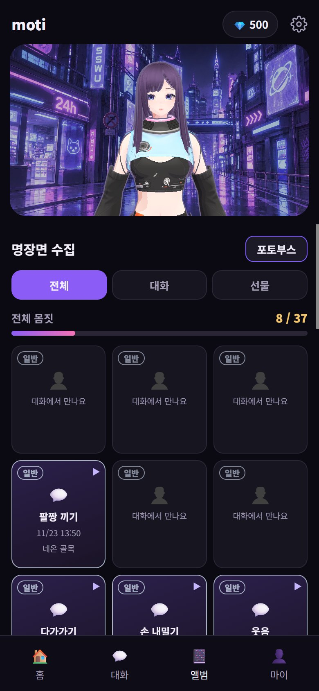 | 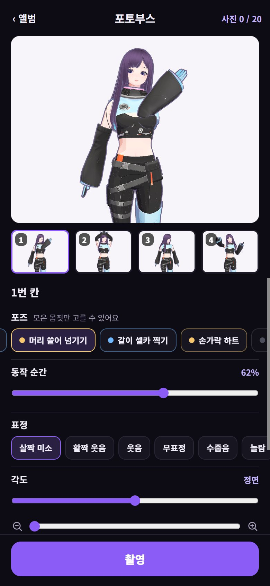 | 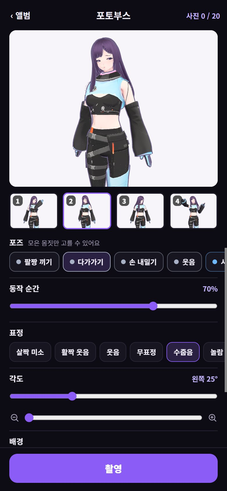 |

| 잠긴 포즈를 눌렀을 때 | 카운트다운(2 / 4 의 「2」) | 결과 |
| --- | --- | --- |
| 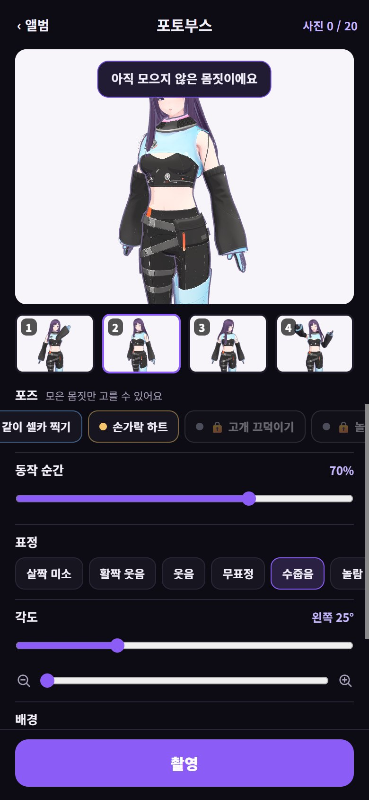 | 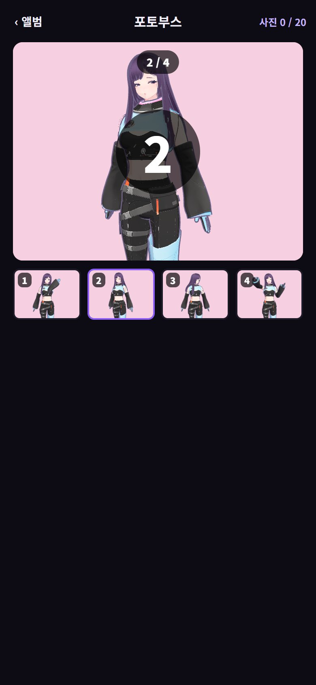 | 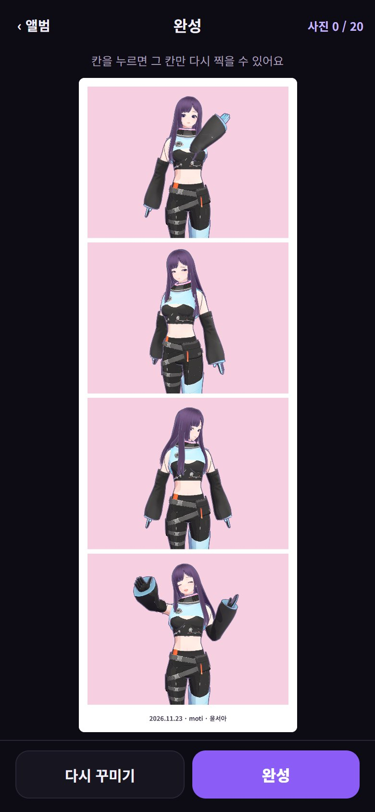 |

| 한 칸 다시 꾸미기(3번 칸) | 한 칸 다시 찍기(「1」) | 다시 찍은 결과 |
| --- | --- | --- |
| 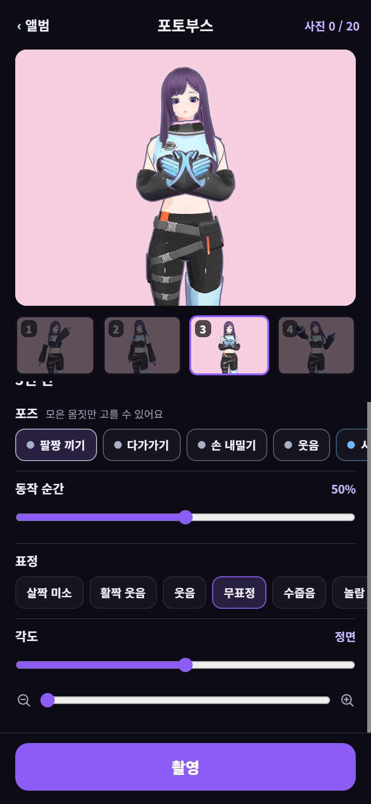 | 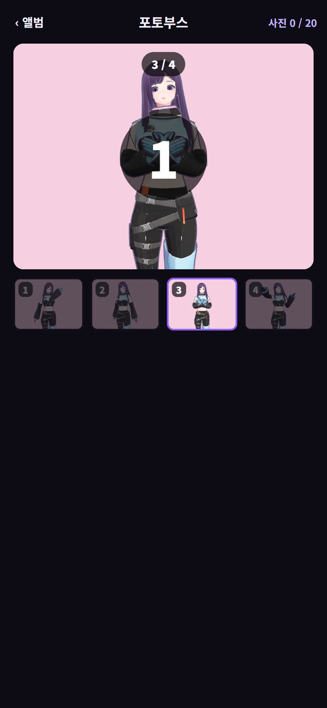 | 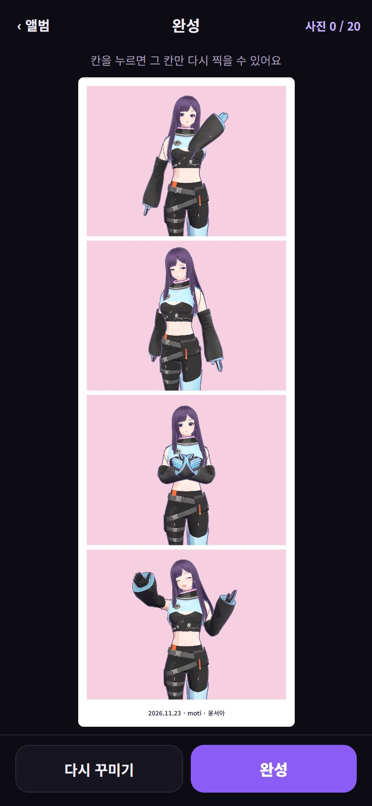 |

| 완성 후 공유 버튼 | 공유 창을 못 여는 브라우저의 내려받기 메뉴 | 장소 배경 · 검정 프레임 완성 |
| --- | --- | --- |
| 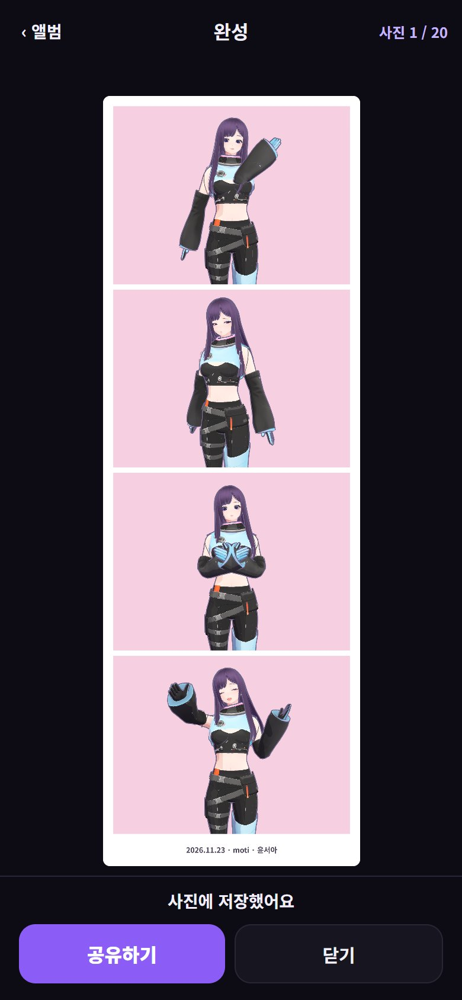 | 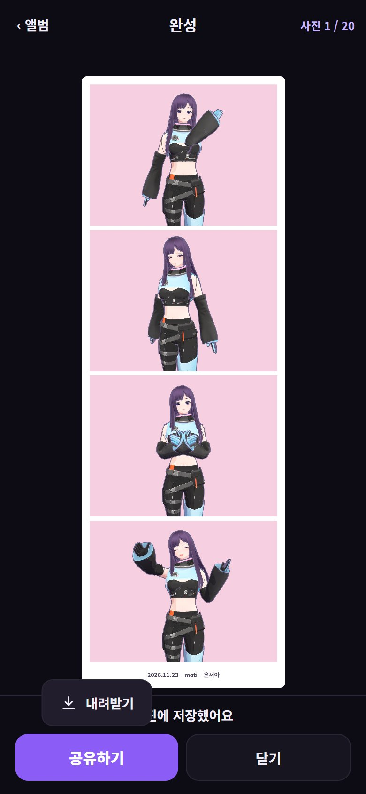 | 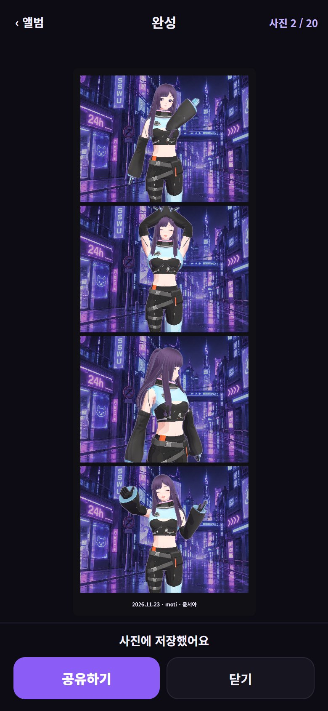 |

| 사진 화면 「포토부스」 | 포토부스 사진 크게 보기 | 사진 화면 「전체」(카메라 사진과 섞임) |
| --- | --- | --- |
| 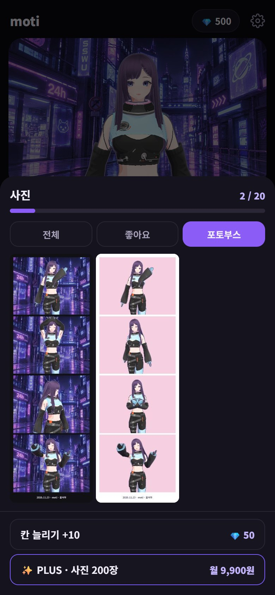 | 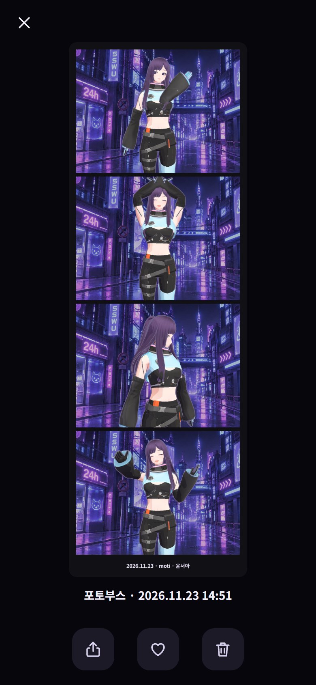 | 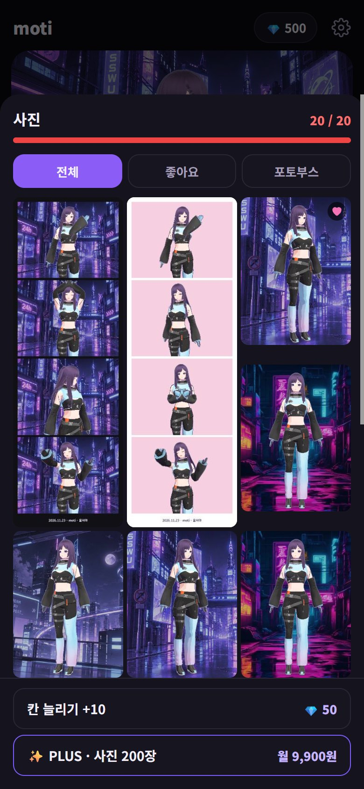 |

| 가득 찼을 때 들어간 안내 | 「촬영」 때 가득 참 시트 | 시연 패널 「명장면 모두 열기」 | 모두 연 뒤 포즈 |
| --- | --- | --- | --- |
| 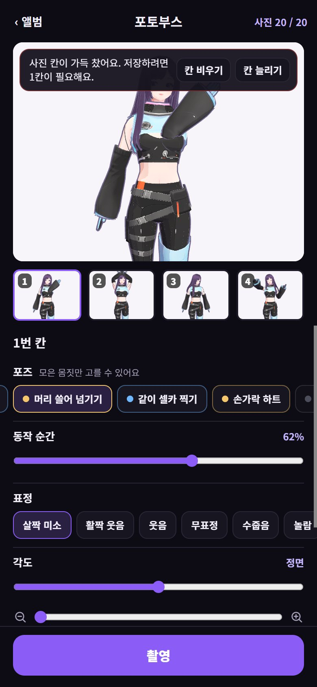 | 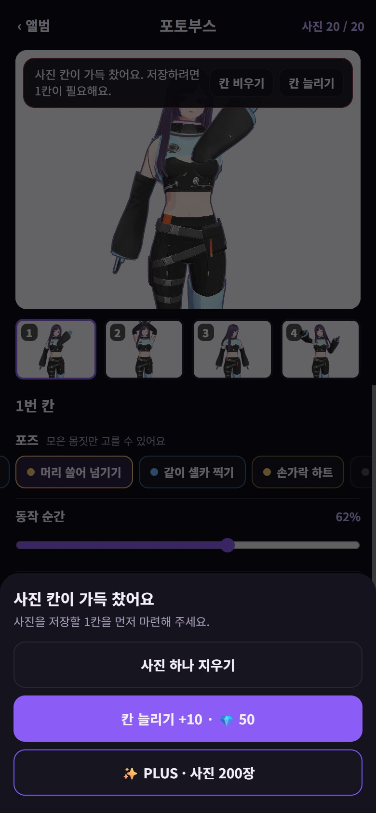 | 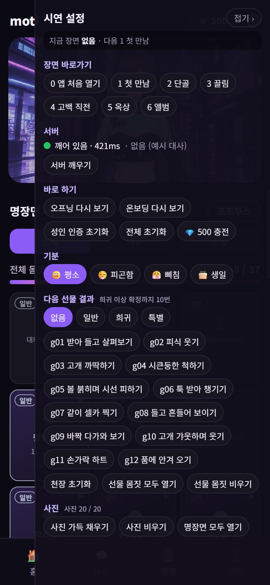 | 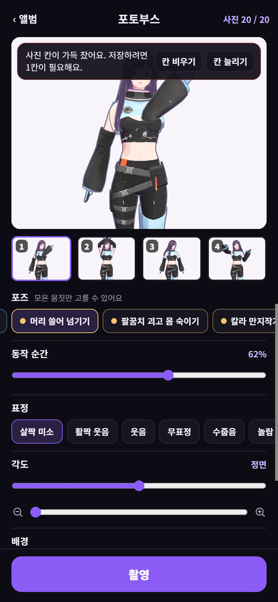 |

- 미리보기 끌어 돌리기는 실제 터치 입력(크롬 터치 흉내)으로 해서 「왼쪽 25°」가 됨
- 「내려받기 메뉴」 캡처는 `navigator.canShare` 를 거짓으로 바꿔 흉내 냄

### 완성 사진 파일

| 분홍 배경 · 흰색 프레임 (1200×3582, 269KB) | 장소(네온 골목) 배경 · 검정 프레임 (1200×3582, 690KB) |
| --- | --- |
| 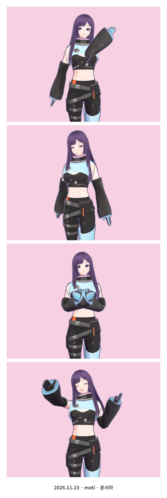 | 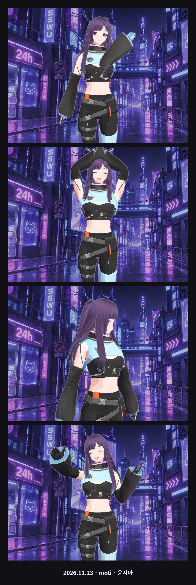 |

두 번째 사진의 3번 칸은 왼쪽 30° · 확대 60%.

## 크기·시간

헤드리스 Chrome(소프트웨어 WebGL, Windows 노트북). 아이폰 값이 아님.

| 항목 | 값 |
| --- | --- |
| 완성 사진 | 1200×3582 jpeg(품질 0.9). 단색 배경 269KB, 장소 배경 690KB(상한 900KB 안이라 품질을 낮추지 않음). 목록용 작은 사진 241×720, 20~47KB |
| 촬영 시작(「촬영」) → 결과 | 약 15.4초(네 칸 × (넘어가기 0.5 + 쉼 0.3 + 3·2·1 2.4 + 찰칵 0.45) − 첫 칸 넘어가기). 화면 연출 시간이 거의 전부 |
| 결과 → 「완성」 저장 | 약 0.2초(jpeg 만들기 55~190ms + 저장 4ms) |
| 촬영 시작 → 완성(결과에서 바로 「완성」) | 15.6초 |
| 한 칸 찍기(1104×828 다시 그리기) | 약 0.27~0.3초(소프트웨어 WebGL). 앱 안 브라우저 창(GPU)에서는 10ms |

## 확인한 것

- 포즈를 바꾸면 그 몸짓의 기본 순간·표정으로 0.5초 동안 넘어감. 동작 순간 막대를 움직이면 바로 그 순간 자세
- 잠긴 포즈 → 안내 토스트만, 칸은 그대로
- 배경을 바꾸면 미리보기와 네 칸 썸네일이 모두 새 배경으로
- 한 칸 다시 찍기: 3번 칸만 「3 / 4」로 찍고 결과로, 나머지 칸은 그대로. 저장은 「완성」을 누른 1장뿐(사진 1 / 20)
- 「다시 꾸미기」 → 꾸미기 화면, 「촬영」은 네 칸 모두 다시
- 사진 20 / 20 에서 들어가면 안내 한 줄, 「촬영」 → 가득 참 시트(카운트다운 시작 안 함)
- 「명장면 모두 열기」 → 못 모은 몸짓이 모두 기록돼 포즈 줄의 🔒 가 사라짐(특별 등급 c03·c01 등도 고를 수 있음). 꾸며 둔 네 칸은 그대로
- 탭을 옮기거나 시연 초기화를 하면 포토부스가 닫히고 3D 는 대화·앨범 칸으로 돌아감. 포토부스 중 서아는 다른 몸짓·표정·입 움직임을 받지 않음
- 콘솔 오류 없음

## 아이폰 사파리 확인 항목 (기획자 확인 필요)

- [ ] **촬영 연출이 끊기지 않는지:** 3·2·1 숫자가 고르게 넘어가는지, 「찰칵」 때 하얀 깜빡임이 보이는지, 칸을 찍는 순간(큰 사진 다시 그리기) 화면이 멈칫하지 않는지, 다음 포즈로 부드럽게 넘어가는지
- [ ] **셔터 소리**가 네 번 모두 나는지(무음 스위치를 끄고). 「촬영」을 누른 순간 소리 장치를 깨우게 했지만 카운트다운 뒤 타이머에서 소리를 내는 것이라 사파리에서 확인 필요
- [ ] **미리보기 끌어 돌리기:** 한 손가락 좌우 밀기가 페이지 스크롤·뒤로 가기로 새지 않는지, 두 손가락 확대가 페이지 확대로 새지 않는지. 꾸미기 항목(아래) 세로 넘기기·포즈 줄 가로 넘기기는 그대로 되는지
- [ ] 각도·동작 순간·확대 막대가 손가락으로 잘 움직이는지(세로 넘기기와 헷갈리지 않는지)
- [ ] **완성 사진 해상도:** 사진 앱에 저장한 사진이 1200×3582 인지, 글자(아래 줄)가 또렷한지. 아이폰 사파리는 캔버스 크기 제한이 있어 1200×3582(약 430만 화소)는 안 넘지만 확인 필요
- [ ] **공유:** 완성 뒤 「공유하기」 → 공유 창이 열리는지, 「이미지 저장」으로 사진 앱에 들어가는지. 사진 화면 크게 보기에서 포토부스 사진을 공유할 때 표시가 두 번 들어가지 않는지
- [ ] 사진 화면 「포토부스」 칸이 세로로 길게 보이는지
- [ ] 포토부스 화면 맨 아래 「촬영」·「공유하기 · 닫기」가 홈 막대에 가리지 않는지, 위 「‹ 앨범」이 노치에 가리지 않는지

## 원고와 다른 곳

- **동작 순간 값 표시:** 막대 오른쪽에 「70%」처럼 숫자를 보여 줌. 원고에 없어서 `data/ui.json booth.momentValue` 「{n}%」로 둠
- **확대 막대:** 원고 항목 이름에 확대가 없어서 「각도」 아래에 글자 없이 돋보기 −/+ 아이콘만 둔 막대로 넣음(접근성 이름 「멀리 · 가까이」는 원고에 없는 말)
- **「사진에 저장했어요」:** 토스트가 아니라 공유하기·닫기 버튼 바로 위에 글로 둠(버튼과 함께 보이게)
- **결과 화면 제목 「완성」과 버튼 「완성」이 같은 말:** 원고 그대로 둠
- **모은 몸짓이 하나도 없을 때:** 원고에 없음. 네 칸 모두 「기본 자세」(대기 자세)로 채움. 포즈 줄은 모두 🔒

## 제가 정한 것

- **한 칸 비율 4:3(가로로 긴 칸), 완성 사진 1200×3582:** 흔한 네 컷 사진처럼 세로로 길게(약 1:3). 칸 1104×828, 여백 48, 칸 사이 24, 아래 줄 자리 150, 글자 34px. 모두 `data/booth.json strip`
- **구도:** 가장 멀리 = 키의 34%~105%(무릎 바로 위까지), 가장 가까이 = 55%~105%(상반신). 돌 중심은 [10] 카메라처럼 서아를 따라감(가까이 볼수록 머리 쪽)
- **각도 이름:** 서아가 화면 왼쪽을 보도록 돈 것이 「왼쪽」. 막대를 오른쪽으로 밀면 「오른쪽」. 3° 안이면 「정면」으로 붙임
- **포즈 줄 순서:** 모은 몸짓 먼저, 그 안에서 앨범 순서(대화 → 선물, 일반 → 희귀 → 특별). 재생할 몸짓이 없는 도감 칸은 빼지만 지금은 37개 모두 재생됨
- **포즈를 바꾸면** 동작 순간과 표정이 그 몸짓의 기본값으로 바뀜(각도·확대는 그대로)
- **선물 몸짓의 기본값:** 재생하는 몸짓(`play.m`)의 필름 사진 값 → 도감 id 의 `moments.byId` → 50. 표정은 필름 사진 → 선물 몸짓 `play.f` → 살짝 미소. 대화 몸짓 기본 순간은 대부분 50%, 고개 끄덕이기 62%·놀라기 40%·다정하게 인사하기 65%(손을 드는 때)
- **기본 꾸밈 네 개:** 모은 몸짓 중 등급 높은 것부터(같은 등급은 앨범 순서). 배경 흰색, 프레임 흰색
- **가 본 장소:** 지금까지 기록이 없어서 새로 기록함 — 대화 장소가 바뀔 때마다 `S.places` 에 넣음(+ 명장면을 얻은 장소 + 지금 장소). 이미 쓰던 사람은 처음엔 지금 장소와 명장면 장소만 보임. 전체 초기화로 지워짐
- **장소 배경은** 카메라처럼 배경 어둡게 층(4-2B)까지 같게, 서아 테두리 빛도 그 장소 색. 단색 배경은 테두리 빛 기본 색
- **꾸민 내용은 앱을 켜 둔 동안만 기억:** 앨범으로 나갔다 다시 들어오면 그대로, 「완성」 뒤나 새로고침 뒤에는 기본 꾸밈부터. 저장값에는 넣지 않음
- **「‹ 앨범」은 어느 단계에서나 포토부스를 닫음**(한 칸 다시 꾸미는 중이어도). 저장 전이면 찍은 사진은 남지 않음
- **촬영 중:** 꾸미기 항목·「촬영」을 숨기고(누르기 막음) 미리보기·네 칸만. 첫 칸이 지금 칸이면 넘어가는 시간 없이 바로 카운트다운
- **찍는 순간 눈 깜빡임 끔:** 포토부스에 있는 동안은 깜빡이지 않음(찍은 칸에 감은 눈이 들어가지 않게). 「살짝 미소」처럼 눈 표정은 그대로
- **포토부스 중 서아 잠금:** 다른 곳에서 오는 몸짓·표정·입 움직임(늦게 온 답장 등)은 무시. 대화 기록·도감 기록은 그대로 됨
- **썸네일:** 그 칸이 지금 미리보기일 때만 찍음(바뀐 뒤 0.2~0.4초). 처음 열 때·배경을 바꿀 때는 네 칸을 차례로 잠깐 세워 찍음(미리보기가 1초쯤 칸을 돌아봄)
- **사진 칸 확인은 두 번:** 「촬영」을 누를 때와 「완성」을 누를 때(그사이 칸이 찰 일은 거의 없지만)
- **저장 정보:** 종류 `booth`, 날짜 = 결과를 만든 때, 프레임 색·배경·칸별 몸짓 id. 목록 칸 바탕을 프레임 색으로 칠함
- **카운트다운 글자는** 어두운 반투명 원 안 흰 숫자(흰 배경에서도 보이게). 원고 「3 · 2 · 1 · 찰칵」 그대로
- 로컬 확인 서버 설정 `moti-11`(포트 8791)을 `.claude/launch.json` 에 더함(이 폴더는 git 이 무시함)

## 11-1 포토부스 구도·촬영 시간·아래 줄

설계 대화(Claude)에서 직접 고쳐 올림. 기획자가 밖에 있어 데스크톱 Claude Code 대신 진행.

### 바뀐 파일

| 파일 | 내용 |
| --- | --- |
| `data/booth.json` | `camera.far.top` 1.05 → **1.11**(가장 멀리 구도에서 머리 위 여유 키의 약 8%, 손을 머리 위로 들어도 컷 위로 잘리지 않음. 가장 가까이 `near` 는 그대로). `shoot.stepMs` 800 → **600**. `strip.foot` 150 → **180**, `strip.footSize` 34 → **44**, 새 값 `footWeight` 500 · `footBold` 「moti」 · `footBoldWeight` 800 |
| `booth.js` | `compose()` 아래 줄: 「{date} · moti · 윤서아」 중 `footBold` 낱말만 굵게, 나머지는 보통 굵기로 이어 그려 가운데 맞춤 |

### 확인 (헤드리스 Chrome, 소프트웨어 WebGL, 390×844, 서버 없음 모드)

- 「명장면 모두 열기」 상태의 기본 꾸밈(c02 머리 쓸어 넘기기 · c03 · c01 · c04)으로 찍음. 1번 칸의 든 손이 컷 안에 들어오고 머리 위에 여유가 있음
- 완성 사진 1200×3612(아래 줄 자리가 30px 늘어서). 아래 줄 44px, 「moti」만 굵게
- 카운트다운 숫자 하나당 0.6초. 연출 시간 합계는 약 11.7초(네 칸 × (넘어가기 0.5 + 쉼 0.3 + 3·2·1 1.8 + 찰칵 0.45) − 첫 칸 넘어가기). 이 작업 공간의 느린 소프트웨어 렌더링에서는 촬영 → 결과가 22초 걸렸음(칸 다시 그리기가 느려서). 실제 기기에서 다시 재 볼 것
- 이 작업 공간은 외부 CDN 에 접속할 수 없어서, 확인할 때만 저장소 밖 복사본에서 Three.js r128 을 로컬 파일로 바꿔 불러옴. 저장소의 `index.html` 은 바꾸지 않음

| 포토부스 첫 화면 | 결과 화면 | 완성 사진(손 든 포즈) |
| --- | --- | --- |
| 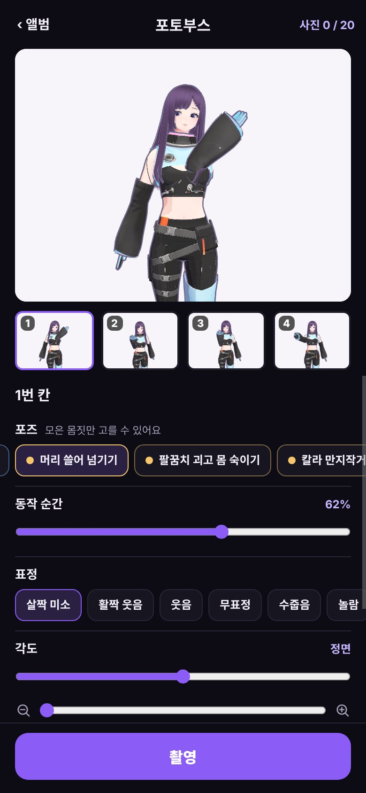 | 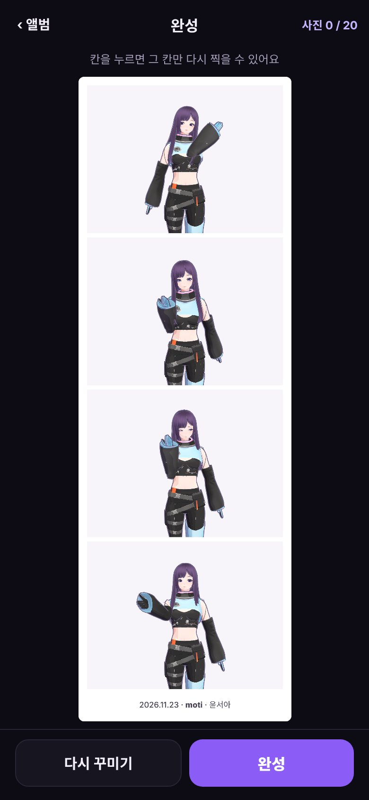 | 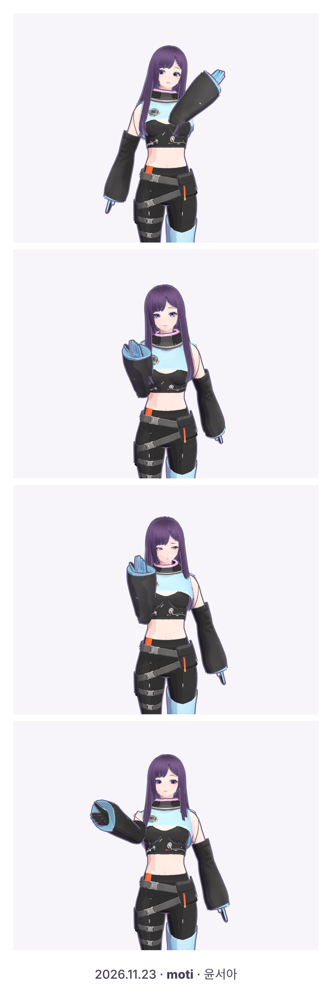 |

### 제가 정한 것

- 머리 위 여유: 처음 1.15 로 해 보니 서아가 컷에서 너무 작아져서 1.11 로 맞춤
- 「moti」 굵기 800, 나머지 500(예전에는 전부 700)
