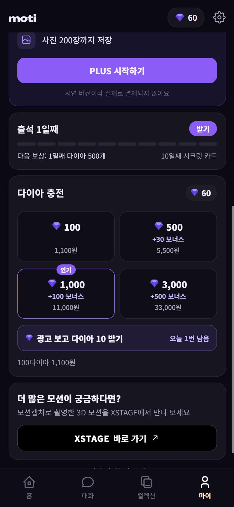

# 110-1 마이 광고 보상 버튼 (시연용)

브랜치 `step/110-1-ad-reward`. 실제 광고는 붙이지 않았다. 버튼을 누르면 충전처럼 바로 다이아가 들어온다.

## 바뀐 것
- 마이 「다이아 충전」 칸 안, 충전 상품 바로 아래에 한 줄 버튼이 있다.
  - 왼쪽: 「광고 보고 다이아 10 받기」. PLUS 이용 중이면 「PLUS · 광고 없이 다이아 10 받기」.
  - 오른쪽: 「오늘 n번 남음」. 다 쓰면 버튼이 흐려지고 「내일 다시 받을 수 있어요」로 바뀐다.
- 누르면 알림 「시연 버전이라 광고 없이 바로 받아요 · 다이아 10」, 다이아 +10, 남은 횟수 −1.
- 하루 3번까지. 한국 시간 자정에 다시 3번이 된다.
- 시연 패널 「출석 초기화」를 누르면 광고 횟수도 함께 되돌아간다.

## 바뀐 파일
- `data/ui.json` my
  - 숫자: `ad` `{dia 10, perDay 3}`.
  - 문구: `adBtn`, `adBtnPlus`, `adLeft`, `adDone`, `adToast`, 설명 `_ad`.
- `index.html`
  - 함수 `adCfg`·`adLeft`·`adHTML`·`adTake`. 저장값 `S.ad` = `{day, n 오늘 쓴 횟수}`.
  - 버튼 모양 `.adrw`.
- `attendance.js`: `debugReset` 이 `S.ad` 도 지운다.
- `data/version.json`, `index.html`: 버전 꼬리표.
- `docs/reports/img/110-1/ad.jpg`

## 확인 (390px)
| 항목 | 결과 |
|---|---|
| 3번 받기 | 0 → 10 → 20 → 30, 「오늘 2·1번 남음」 순서로 줄어듦. 세 번째 뒤 버튼이 흐려지고(disabled) 「내일 다시 받을 수 있어요」. 네 번째는 눌러도 그대로 |
| 새로고침 | 다이아 30, 횟수 3/3, 버튼 흐림 그대로 |
| 「다음 날로」 | 「오늘 3번 남음」 → 한 번 받으면 40, 「2번 남음」 |
| PLUS 이용 중 | 「PLUS · 광고 없이 다이아 10 받기」, 횟수 제한은 같음 |
| 「출석 초기화」 | 「오늘 3번 남음」으로 돌아감 |
| 콘솔 | 코드 오류 없음 · data JSON 23개 모두 읽힘 |

캡처는 오늘 두 번 받은 뒤(1번 남음) 찍었다.

## 제가 정한 것
- **숫자와 문구 위치**: 둘 다 `data/ui.json` my 에 넣었다. 충전 상품(`packs`) 숫자도 여기 있어서 한곳에 모았다.
- **날짜 기준**: 출석과 같은 날짜 함수(`Attend.today()`)를 쓴다. 한국 자정 기준이고, 시연 「다음 날로」도 그대로 따른다.
- **버튼 위치·모양**
  - 충전 상품 2×2 아래, 안내 줄 「100다이아 1,100원」 위에 둔다.
  - 어두운 보라 바탕에 보라 테두리, 왼쪽에 다이아 아이콘. 충전 상품보다 눈에 덜 띄게 했다.
  - 다 쓰면 흐리게(opacity .45). 새 효과는 없다.
- **클래스 이름 `.adrw`**: 처음에 쓴 `.adbtn` 이 19+ 인증 시트 버튼(onboarding.css)과 이름이 겹쳐서, 광고 버튼이 보라로 꽉 차 보였다. 그래서 광고 버튼만 이름을 바꿨다. 인증 버튼은 그대로다.
- **「출석 초기화」**: 광고 횟수 기록(`S.ad`)을 지워 오늘 3번으로 되돌린다. 이미 받은 다이아는 그대로 둔다.
- **넣지 않은 곳**: 대화방, 선물 창, 홈, 「다이아가 부족해요」 알림.

## 아이폰에서 나중에 볼 것
- 광고 버튼 한 줄에 「PLUS · 광고 없이 다이아 10 받기」와 「오늘 n번 남음」이 줄바꿈 없이 들어가는지(사파리 글자 크기).
- 흐린 버튼을 눌러도 아무 일이 없는지.
