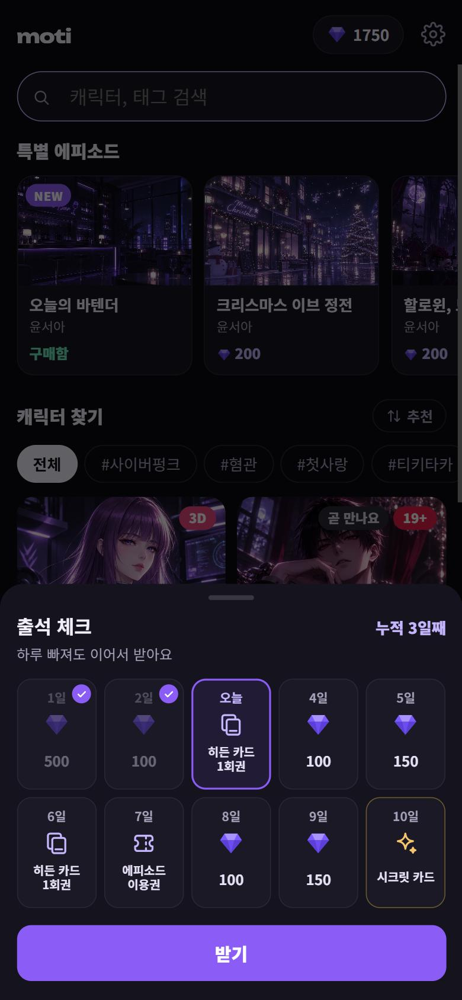
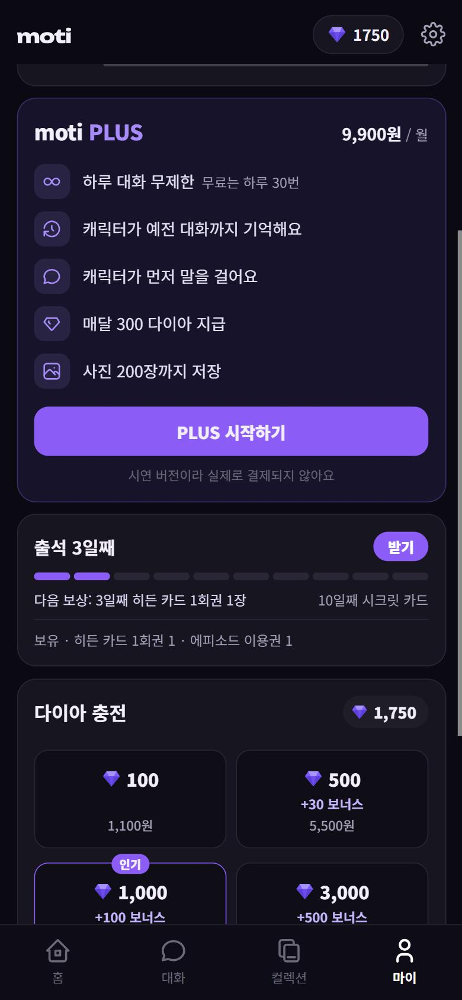

# 110 출석 보상 (누적 10일)

브랜치 `step/110-attendance`. main 에 110 번이 없어 지시문 번호 그대로 썼다.

하루 첫 접속 때 홈에서 출석 창(아래에서 올라오는 시트)이 한 번 뜨고, 받기를 누르면 그날 보상이 들어온다. 마이에는 「출석 ○일째」 카드가 생겼다. 받은 이용권은 히든 카드 화면(1회권 뽑기)과 특별 에피소드(이용권으로 열기)에서 쓴다.

## 보상표 (`data/attendance.json`)

| 칸 | 보상 | 대신 줄 것 |
|---|---|---|
| 1일 | 다이아 500 (처음 한 번만) | |
| 2일 | 다이아 100 | |
| 3일 | 히든 카드 1회권 1장 | |
| 4일 | 다이아 100 | |
| 5일 | 다이아 150 | |
| 6일 | 히든 카드 1회권 1장 | |
| 7일 | 특별 에피소드 이용권 1장 | 열 수 있는 특별 에피소드가 남지 않았으면 다이아 200 |
| 8일 | 다이아 100 | |
| 9일 | 다이아 150 | |
| 10일 | 시크릿 확정 카드 1장 | 히든 카드 시크릿을 모두 가졌으면 다이아 200 |

- 누적 방식이다. 하루 빠져도 처음으로 돌아가지 않는다. 하루는 기기 시계 기준이고, 한국 시간 자정(`tzHours` 9)에 바뀐다.
- 11일째부터는 2~10일 칸(9칸)을 반복한다(`repeatFrom` 2). 11일째 = 2일 칸, 19일째 = 10일 칸, 20일째 = 다시 2일 칸.
- 시작 다이아는 0이다(`blank()` dia 500 → 0). 새 사용자는 출석 1일째에 500을 받는다. 이미 저장된 사용자의 다이아는 그대로 둔다.

## 바뀐 파일
- **새 파일**
  - `data/attendance.json`: 보상표, 반복 칸, 대신 줄 것, 창이 닫히는 시간(closeMs 1000)·뜨는 시간(showDelayMs 450).
  - `attendance.js`: 출석 기록, 보상 지급, 출석 창, 마이 카드, 시연 패널용 함수. 저장값은 `S.att` `{n 누적, last 마지막 받은 날, seen 창이 저절로 뜬 날, off 시연용 날짜 밀기}`, `S.tix` `{pack 히든 카드 1회권, ep 특별 에피소드 이용권}`.
  - `attendance.css`: 출석 창, 마이 카드, 이용권 고르기 창의 모양.
- `data/ui.json`: 새 묶음 `attend`. 출석 창·마이 카드·이용권 버튼·고르기 창·알림·시연 패널 문구가 모두 여기 있다.
- `index.html`
  - `attendance.json` 불러오기, `attendance.js`·`attendance.css` 불러오기, `#attSheet` 시트.
  - `blank()` 시작 다이아 0.
  - `setTab("home")` 때 `Attend.maybeShow()` 호출.
  - 마이: 다이아 충전 바로 위에 출석 카드.
  - `startStory(id, how)`: 이용권이 있으면 `epChoose` 작은 창(이용권으로 / 다이아로)을 띄운다.
  - 시연 패널(?debug=1): 「출석」 줄(누적·마지막 받은 날·오늘), 「출석: 다음 날로」「출석 초기화」 버튼.
  - 시작할 때 위쪽 다이아 숫자가 안 그려지던 버그 고침(아래 「제가 정한 것」).
- `pack.js`
  - 배너 아래 「1회권으로 뽑기 (n장)」(이용권이 있을 때만). `pull(n, {ticket})`.
  - `grant(item)`: 뽑기 없이 카드를 가진 것으로 기록. 천장은 그대로.
  - `showSecret(item)`: 1장 뽑기와 같은 연출. 결과 화면에는 「확인」만.
- `pack.css`: 1회권 버튼 모양.
- `icons.js`: `ticket` 아이콘(에피소드 이용권).
- `data/version.json`, `index.html`: 버전 꼬리표.
- `docs/reports/img/110/`: 캡처 3장.

## 확인 (390px)
| 항목 | 결과 |
|---|---|
| 새 사용자 다이아 | 0 → 1일째 받기 → 500, 알림 「다이아 500개 받았어요」, 약 1초 뒤 창 닫힘 |
| 「다음 날로」로 2~10일 | 차례대로 100 · 1회권 · 100 · 150 · 1회권 · 에피소드 이용권 · 100 · 150 · 시크릿 카드 |
| 같은 날 다시 홈에 오기 | 창이 다시 뜨지 않음 |
| 바깥(어두운 곳)을 눌러 닫은 날 | 홈에 다시 와도 안 뜸. 마이 출석 카드 「받기」 → 창 → 받기 → 「오늘 받음」 |
| 새로고침 | 누적·마지막 받은 날·이용권·다이아가 그대로 |
| 11일째 · 12일째 | 다이아 100(2일 칸) · 히든 카드 1회권(3일 칸) |
| 3일째 받기 → 히든 카드 화면 | 「1회권으로 뽑기 (1장)」 → 뽑기 → 다이아 그대로, 천장 남은 장 10 → 9, 이용권 0, 버튼 사라짐 |
| 7일째 받기 → 특별 에피소드 | 「오늘의 바텐더」를 누르면 「이용권으로 열기 (1장) / 다이아로 열기 · 200」. 이용권으로 열면 다이아 그대로, 이용권 0, 에피소드 시작(대화방 열림) |
| 10일째 받기 | 창이 닫힌 뒤 히든 카드 연출로 아직 없던 시크릿 p03 「온몸으로 하트」. 천장 값은 그대로(9) |
| 다 가진 경우 | 특별 에피소드 3개와 시크릿 4장을 모두 가진 상태에서 16일째(7일 칸)·19일째(10일 칸) 모두 다이아 200. 알림에 「…모두 가지고 있어 다이아로 드려요」 |
| data JSON | 23개 모두 읽힘 |
| 콘솔 | 코드 오류 없음. 앞쪽 확인 중에 로컬 Python 서버가 연결 몇 개를 거절했다(109 와 같은 현상). 기다리는 연결 수를 늘린 시험용 서버로 바꾼 뒤에는 전부 200 |

캡처:

| 홈 출석 창 | 마이 출석 카드 | 10일째 시크릿 카드 |
|---|---|---|
|  |  |  |

캡처는 보기 좋은 상태를 만들려고 **시험 브라우저 저장값만** 바꿔서 찍었다(누적 2일 받음·오늘 3일째, 이용권 각 1장). 코드와 data 는 그대로다. 미리보기 창이 화면에 안 보이는 상태라 시트가 올라오는 효과가 멈춰 있어서, 시험 페이지에서만 transition 을 끄고 찍었다.

## 제가 정한 것
- **「누적 ○일째」 숫자**: 오늘 아직 안 받았으면 오늘 받을 날(누적+1), 받았으면 누적 그대로. 그래서 새 사용자는 처음부터 「누적 1일째」를 본다. 마이 카드 「출석 ○일째」도 같은 숫자.
- **11일째부터 1일 칸**: 칸은 열 개 그대로 두고, 반복 바퀴에서는 1일 칸을 받은 칸(흐리게 + 체크)으로 보인다. 칸 이름은 「1일~10일」(보상표의 칸 번호)이고, 실제 누적 일수는 위의 「누적 ○일째」에 나온다.
- **대신 줄 것이 미리 보임**: 아직 받지 않은 칸은 대신 줄 것이 정해지면 그것(예: 다이아 200)으로 보인다. 이미 받은 칸은 원래 보상으로 보인다.
- **에피소드 이용권 대신 줄 조건**: 특별 에피소드를 모두 가졌을 때뿐 아니라, 이미 가진 이용권으로 남은 에피소드를 다 열 수 있을 때도 다이아 200을 준다. 쓸 곳 없는 이용권이 쌓이지 않게 하려고 이렇게 했다. 무료 에피소드는 세지 않는다.
- **시크릿 카드를 받는 때**: 받기를 누르는 순간 카드를 `S.col` 에 기록하고, 연출은 그 뒤에 보여 준다. 연출 중에 앱이 닫혀도 카드는 남는다. 아직 안 가진 시크릿(g13·g14·g15·p03) 중에서 무작위로 고른다. 지시문은 `S.packNext` 를 써도 된다고 했지만 쓰지 않았다. `S.packNext` 는 시연 패널 값이고, 천장 계산을 아예 거치지 않는 쪽이 「천장 값은 건드리지 않음」에 맞기 때문이다.
- **시크릿 연출 결과**: 「한 번 더」 없이 「확인」만 둔다(공짜 뽑기라 다이아 뽑기로 이어지면 헷갈리므로).
- **1회권 뽑기 뒤 「한 번 더」**: 이용권이 남아 있으면 「한 번 더 · 1회권으로 뽑기」, 없으면 원래 「한 번 더 · 1장 뽑기 💎50」.
- **1회권 버튼 위치**: 히든 카드 배너 바로 아래, 「확률 보기 ›」 위에 넓은 버튼으로 둔다. 배너 안의 1장·10장 버튼은 그대로다.
- **마이 「받기」 작은 버튼**: 바로 받지 않고 출석 창을 연다(카드를 누를 때와 같다). 창에서 「받기」를 누르면 받는다.
- **창이 저절로 뜨는 조건**: 홈 탭으로 올 때(앱 시작, 온보딩 끝, 탭 이동, 앱으로 돌아올 때), 약 0.45초 뒤에 한 번 확인한다. 온보딩·이름 정하기·첫 만남 연출·다른 시트·작은 창·카드 뽑기 연출·카드 크게 보기가 열려 있으면 띄우지 않는다. 창이 한 번 뜨면 그날은 저절로 다시 뜨지 않는다(`S.att.seen`).
- **아래로 내려 닫기**: 창 맨 위에서 60px 넘게 끌어내리면 받지 않고 닫는다. 손가락을 따라 창이 움직이는 효과는 없다(새 애니메이션을 넣지 않음).
- **10일째 칸 테두리 색**: 다른 칸은 보라·회색인데, 10일째 칸만 어두운 금색(#6b5a2e)으로 아주 살짝 다르게 했다. 시크릿 아이콘도 금색이다.
- **아이콘**: 다이아 = 기존 다이아, 히든 카드 1회권 = 컬렉션 탭 카드 아이콘, 에피소드 이용권 = 새 `ticket` 아이콘(직접 그림), 시크릿 카드 = 반짝이 아이콘.
- **이미 저장된 사용자**: 출석 기록이 없으니 첫 출석은 1일째(다이아 500)부터 받는다.
- **시연 「다음 날로」**: 실제 시계를 바꾸지 않고 저장값 `S.att.off` 에 하루를 더한다. 진행 중인 연출을 멈추고 홈으로 간다(좁은 화면이면 패널을 접음). 「출석 초기화」는 출석 기록과 날짜 밀기만 지우고, 가진 이용권은 그대로 둔다. 두 버튼 모두 ?debug=1 일 때만 보인다.
- **시작할 때 위쪽 다이아 숫자 버그 고침**: 시작 코드 한 줄에서 `renderTop()`·`renderBond()`·탭 이름 넣기가 주석(`// 51-1: …`) 뒤에 붙어 있어 실행되지 않았다. 그래서 새로고침하면 위쪽 다이아가 다른 동작 전까지 HTML 기본값으로 보였다. 시작 다이아가 0이 되면 이 문제가 바로 드러나서, 코드를 주석 앞으로 옮겼다. 탭 이름은 HTML 과 같은 「컬렉션」이라 화면은 그대로다.
- **사용자 작업 폴더 보호**: 원래 폴더(`step/4-seoa-look`)에 커밋되지 않은 변경이 있어서, 저장소 안 `.wt110` 폴더(git worktree, `.git/info/exclude` 로 숨김)에서 작업했다. 원래 폴더 파일은 건드리지 않았다. 커밋하지 않는 `.claude/launch.json` 에 미리보기 설정 `moti-110` 한 줄만 더했다.

## 아이폰에서 나중에 볼 것
- 출석 창 5칸×2줄: 사파리 글자 크기에서 「히든 카드 1회권」「에피소드 이용권」이 칸 안에서 두 줄로 끊기고 넘치지 않는지.
- 창 아래 「받기」 버튼이 홈 바(safe area) 위에 떠 있는지.
- 창을 아래로 끌어내리면 닫히는지(새 효과는 없고, 사파리에서 손가락 끌기가 페이지 스크롤로 먹히지 않는지).
- 10일째 받기 → 창이 닫힌 뒤 시크릿 카드 연출이 기존 1장 뽑기처럼 보이는지.
- 이용권/다이아 고르기 작은 창의 두 버튼이 한 줄씩 들어가는지.
