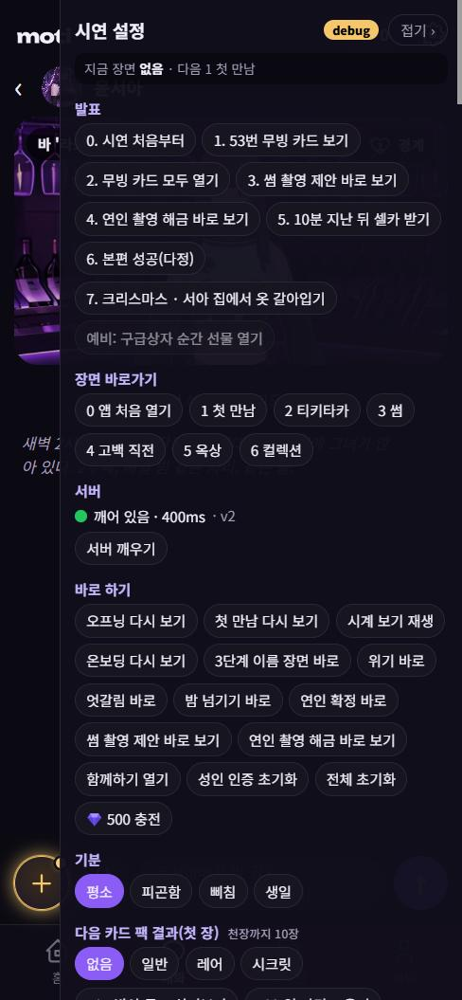
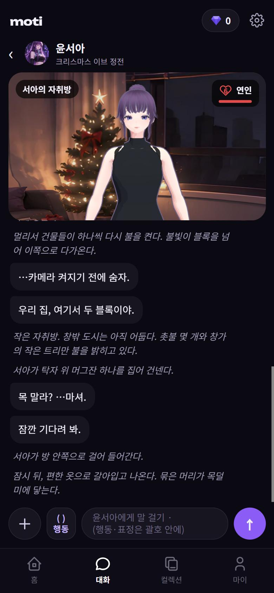

# 111 시연 패널 「발표」 메뉴

브랜치 `step/111-present-menu`. 시연 패널(`?debug=1`)의 「장면 바로가기」 바로 위에 「발표」 묶음을 넣었다. 기존 버튼은 그대로 두고, 발표 묶음은 기존 기능을 불러 쓴다.

## 버튼
| 버튼 | 하는 일 |
|---|---|
| 0. 시연 처음부터 | 「전체 초기화」 + 「출석 초기화」 → 온보딩 첫 화면 (다이아 0, 온보딩 뒤 홈에서 출석 1일째 창) |
| 1. 53번 무빙 카드 보기 | collection `no 53`(g14)이 없으면 가진 것으로(seenNow, 카드 팩 카드라 `pack:1`) → 컬렉션 「전체」 → 크게 보기 |
| 2. 무빙 카드 모두 열기 | `colOpenAll` 그대로 → 컬렉션 탭 |
| 3. 썸 촬영 제안 바로 보기 | `photoAskSo` 그대로 |
| 4. 연인 촬영 해금 바로 보기 | `photoAskLover` 그대로 |
| 5. 10분 지난 뒤 셀카 받기 | `seoaPhotoNow` 그대로 |
| 6. 본편 성공(다정) | `stayWin care` 그대로 |
| 7. 크리스마스 · 서아 집에서 옷 갈아입기 | s2 를 가진 것으로(다이아 차감 없음, 성인 확인 통과) → 그 대화방 → 단계 4 장면을 처음부터 |
| 예비: 구급상자 순간 선물 열기 (흐린 글씨) | 본편 서아 대화방 → `Moment.start("firstaid")`. 열린 순간 선물이 있거나 준 적 있거나 지금 열 수 없으면 알림만 |

## 바뀐 파일
- `index.html`
  - Demo: `presentHtml`·`present`. 버튼 처리를 `onClick` → `act(a,v)` 로 떼어 발표 묶음이 기존 처리를 그대로 부름(동작은 같음).
  - `Scenes.html(T,B,pre)`: 「장면 바로가기」 제목 바로 위에 발표 묶음(`?debug=1` 일 때만).
  - EpStage/EpScene: `redress` 표시 — 7번을 이미 5단계 이상(처음부터 자취방 옷)에서 눌러도 갈아입기 전 옷으로 장면을 시작하고, 장면 안에서 갈아입으면 지움. 장면이 끊겨도 지움.
  - 스타일 `.dp button.dim` (예비 버튼 흐린 글씨, opacity만).
- `data/demo.json` `present`: 묶음 제목·버튼 글자·알림 문구, `cardNo 53`, `xmas "s2"`, `xmasStage 4`, `spareGift "firstaid"`.
- `data/version.json`, `index.html`: 버전 꼬리표(node 가 없어 Python 으로 `tools/version.mjs` 와 같은 치환).
- `docs/reports/img/111/panel.jpg`, `docs/reports/img/111/7-xmas-dress.jpg`

## 확인 (390px)
| 항목 | 결과 |
|---|---|
| 0 | 다이아 999 → 0, 온보딩 첫 화면, 온보딩 뒤 홈에서 「출석 체크 · 누적 1일째」 창 |
| 1 | 53번 없는 상태에서 눌러 → 컬렉션, 53번 「시간 날 때마다 연습한 춤」 크게 보기 |
| 2~6 | 기존 버튼과 같은 결과(72/72 열림 · 3단계 촬영 제안 · 6단계 연인 촬영 · 홈으로 나가 셀카 · 6단계 care stayed), 패널 닫힘 |
| 7 (처음 상태) | 다이아 0 그대로, 거리(6) → 자취방(7)으로 바뀌고 걸어 나감 → `xmas` → `xmasRoom` 옷으로 걸어 들어옴. 문단 8개 그대로 |
| 7 (에피소드 6단계에서) | 단계 6·호감 55 그대로, 같은 장면에서 다시 갈아입음 |
| 예비 | ＋ 버튼과 선물하기 금색, 선물 창 맨 위 구급상자. 다시 누르면 「이미 열린 순간 선물이 있어요」 |
| 일반 화면 | `?debug=1` 없으면 발표 묶음 없음. 콘솔 오류 없음, data JSON 23개 모두 읽힘 |

새 시각 효과는 없다(예비 버튼 투명도만) — 아이폰 사파리 별도 확인 항목 없음.

## 제가 정한 것
- 묶음은 다른 묶음처럼 제목(h4) + 버튼 줄이라 접히지 않고 늘 펼쳐져 있다.
- 「지금 장면 · 다음」 줄은 장면 바로가기 것이라 그 줄 아래, 「장면 바로가기」 제목 바로 위에 두었다.
- 0번에는 확인 창이 없다(기존 「전체 초기화」·「출석 초기화」에도 없음).
- 1·2번은 컬렉션 첫 방문 소개 창이 카드를 가리지 않게 소개 창을 본 것으로 둔다(`S.colIntro`). 2번은 기존 버튼이 화면을 옮기지 않아서, 패널을 닫고 컬렉션 탭으로 간다.
- 1~7·예비는 온보딩 중이면 장면 바로가기처럼 온보딩을 저장 없이 닫고 그 화면으로 간다(0번 바로 뒤에 눌러도 됨).
- 7번: 에피소드 단계가 4보다 낮으면 4로 맞춘다(그 단계 시작 호감). 4 이상이면 단계·호감·플래그는 그대로 두고 장면만 다시 재생. 본편 오프닝을 아직 안 봤으면 에피소드 시작 때처럼 본 것으로 처리(안 하면 본편 오프닝 문단이 에피소드 방에 섞임). 처음 여는 경우 「특별 이야기 …」 시스템 줄을 넣는다. 크리스마스 실패 기록(`rw.end`)은 「크리스마스 성공」 버튼처럼 지운다.
- 예비: 본편이 아니면 본편 대화방으로 옮긴 뒤 연다. 단계 등으로 열 수 없으면 「지금은 구급상자 순간 선물을 열 수 없어요」.
