# [12] 서아가 먼저 보내는 사진

- 브랜치: `step/12-seoa-photo` (main 병합 안 함)
- 시작 전 확인: `step/11-photobooth` 는 main 에 병합돼 있음(`a378fc4`, 현황 커밋 `b0ae4ff`)
- 원고: `docs/drafts/12-서아가-보내는-사진-원고.md` — 메시지·사진 이름·화면 문구는 그대로 넣음. 그대로 못 넣은 곳은 아래 「원고와 다른 곳」
- 커밋: `[12-A] 서아 사진 만들기와 사진 말풍선` → `[12-B] 보내는 때와 받은 사진 화면`

## 바뀐 파일

| 파일 | 내용 |
| --- | --- |
| `seoaphoto.js` | **새 파일.** `SeoaPhoto` — 사진 만들기(열린 몸짓의 한 순간 + 장소, 셀카·풍경), 보내기(「보내는 중…」 → 사진 저장 → 사진 말풍선), 보내는 때(단계·오랜만·대화 중·시연), 서버에 알리는 한 줄 |
| `data/seoa_photo.json` | **새 파일.** 원고 1~3절(단계 사진 5장, 오랜만 6줄, 대화 중 묶음 4개)과 5절 서버 한 줄 그대로. 숫자: 오랜만 3단계·6시간, 대화 중 최소 간격 10턴·확률 0.2, 「보내는 중」 1.5초, 셀카·풍경 구도·각도·표정·피할 몸짓 |
| `data/ui.json` | `seoaPhoto` 묶음(원고 4절 문구), `photo.seg.received` 「받은 사진」 |
| `data/demo.json` | `seoaPhotoNow` 「서아 사진 지금 받기」 |
| `index.html` | Stage: `still`(몸짓 한 순간 자세로 잠깐 세워 그리고 같은 작업 안에서 되돌림, 눈 뜸·입 다묾), `aimAt`(셀카에서 목·머리·눈을 렌즈 쪽으로). 대화 기록 사진 말풍선(`r:"ph"`), 「보내는 중…」, 서버 요청 v1·v2·Claude 미리보기에 사진 한 줄, 단계 상승·답장·대화방 들어가기에서 `SeoaPhoto` 부르기, 시연 장면 들어갈 때 단계 사진 기록 정리, 시연 패널 버튼, 대화 목록 미리보기 「🖼」·안 읽은 수 |
| `look.js` | `rimFor(장소)`: 사진을 그 장소 테두리 빛으로 한 번 그릴 때 바로 바꾸고 되돌림 |
| `photos.js` | 사진 칸 수에서 받은 사진 빼기, 카메라 「마지막 사진」 칸에서 받은 사진 빼기, 크게 보기 정보 줄(받은 사진·단계 사진), 말풍선에서 열 때 넘겨 볼 목록, 사진 화면 「받은 사진」, `closeView` 오류 고침(아래) |
| `photos.css` | 사진 말풍선·저장 알림 줄, 「받은 사진」 화면. blur·filter·그림자 없음 |
| `docs/drafts/12-…원고.md` | 원고(main 에 커밋 안 된 채 있던 것을 12-A 에 같이 넣음) |
| `docs/reports/img/12/*.jpg` | 캡처·만든 사진 |

### A. 사진 만들기와 대화 표시

- **만들기:** 지금 열린 몸짓(`unlockedIds()`, 종류별 피할 몸짓 빼고, 바로 앞 사진 몸짓은 되도록 빼고) 중 하나를 그 몸짓의 한 순간(입장권 필름 사진 값 → 포토부스 `moments` → 50%)에서 멈춰, 장소 그림(배경 어둡게 층 포함) 위에 1080×1440(3:4) jpeg 로 그림. 장소 테두리 빛도 그 장소 색. 발밑 그림자 포함
- **셀카:** 얼굴~허리(키의 63%~104%), 카메라를 키의 10% 위에서 내려다봄, 좌우 ±8~14°. 목 30%·머리 70%·눈 100% 를 렌즈 쪽으로 돌림(최대 20°·35°·12°) → 고개를 숙이는 몸짓이어도 렌즈를 봄
- **풍경:** 전신 + 장소 넓게(키의 −18%~132%, 최소 너비 1.25), 좌우 30~42° 옆에서, 서아를 한쪽으로 비킴(키의 ±20%). 서아는 앞을 봐서 렌즈가 아닌 다른 곳을 봄
- **눈 깜빡임 끔:** 찍는 순간 `Fcl_EYE_Close` 0, 말하는 입 모양도 0
- **화면 밖에서:** 대화 무대 3D 그림판을 같은 작업 안에서 1080×1440 으로 한 번 더 그리고 곧바로 크기·카메라·자세·표정을 되돌림(카메라 촬영 `Shot.take` 와 같은 방식). 브라우저는 그 사이 화면을 그리지 않으므로 대화 무대에 바뀐 자세가 비치지 않음. 구도의 중심은 서아 위치(`Stage.center`)라 앞으로 걸어오는 몸짓도 화면 안
- **보내는 중:** 대화 기록 맨 아래 「서아가 사진을 보내는 중…」(입력 중 말풍선과 같은 모양) 1.5초(사진이 더 늦으면 다 만들 때까지)
- **사진 말풍선:** 사진(폭 52%, 최대 200px, 3:4) → 아래 메시지 말풍선 → 「🖼 받은 사진에 저장됐어요」(단계 사진이면 「 · 단계 사진 n / 5」). 사진을 누르면 [10]의 크게 보기(공유하기 · 좋아요 · 지우기, 좌우로 받은 사진끼리 넘김)
- **저장:** 사진 저장소에 종류 `received`(보낸 때·단계·사진 이름·메시지·장소·종류·몸짓). 사진 칸(20장) 계산에서 뺌 — 사진 화면·카메라·포토부스의 「n / cap」과 가득 참 판정 모두
- **서버에 알리는 한 줄:** 사진을 보낸 뒤 다음 대화 요청의 `history` 끝(이번 내 메시지 바로 앞)에 서아 쪽 기록 `{r:"c", t:"(서아가 {장소}에서 찍은 사진을 보냈다. 함께 보낸 말: \"{메시지}\")"}`. v1·v2·Claude 미리보기 모두. 서버가 답하면 지움(화면에는 안 보임)
- **시연 패널** 「사진」 묶음에 「서아 사진 지금 받기」: 대화방으로 가서 지금 단계 묶음·지금 장소에서 바로 한 장

### B. 보내는 때와 사진 화면

- **단계 사진:** 관계가 2~6단계로 오를 때(대화 횟수·v2 판정·시연 예약 모두 `stageUp` 을 지나감) 그 단계를 기다림 줄에 넣고, 대표 몸짓 해금 연출·답장 몸짓이 끝난 뒤 원고 1절의 장소·종류·이름·메시지로 보냄. 받은 단계(`S.sp.got`)는 다시 보내지 않음
- **오랜만:** 관계 3단계 이상, 서아 대화방의 마지막 대화(내 메시지·서아 답장·선물·받은 사진) 뒤 6시간 이상 지나 대화방에 들어오면 1.5초 뒤 원고 2절에서 한 장. 바로 앞 오랜만 메시지는 다시 고르지 않음
- **대화 중:** 서아 답장마다 하나씩 세서, 마지막 사진 뒤 10번째 답장부터 답장마다 20% 확률(평균 약 14번에 한 번). 지금 장소, 지금 단계 묶음, 셀카·풍경 번갈아, 같은 묶음 바로 앞 메시지 빼고
  - 어떤 사진이든 받으면 다시 0부터 세므로 단계·오랜만 사진 직후 10턴 안에는 안 옴
  - 시연 장면(①~⑥) 중에는 세지도 보내지도 않음
  - 카메라가 열려 있으면 기다렸다가 닫힌 뒤 보냄. 포토부스(앨범 탭)·다른 화면에 있으면 서아 대화방에 다시 들어올 때 보냄
- **사진 화면:** 위 버튼 「전체 / 좋아요 / 포토부스 / 받은 사진」
  - 받은 사진: 「단계 사진 n / 5」 + 막대 → 2~6단계 다섯 칸(받은 칸은 사진 + 「k단계」, 못 받은 칸은 점선 「k단계 사진」) → 「그 밖에 받은 사진」(있을 때만) → 「받은 사진은 사진 칸(20장)에 포함되지 않아요」. 하나도 없으면 다섯 칸 아래 「아직 서아가 보낸 사진이 없어요.」
  - 전체 목록에 받은 사진이 날짜 순으로 섞임
- **전체 초기화:** 저장값(`S.sp` 받은 기록·기다림 줄·센 횟수)과 사진 저장소(받은 사진 포함)를 모두 비움

## 캡처 (390×844, 픽셀 비율 2, 헤드리스 Chrome + 소프트웨어 WebGL)

서버 v1 모드 + 서버 응답을 가짜로 돌려주는 방식(요청 내용 확인용). 2단계 사진은 대화 한 번으로 대화 횟수 4 → 2단계가 돼서 온 것.

| 보내는 중 표시 | 단계 사진 도착(2단계 「창가 자리」) | 오랜만 사진(3단계, 7시간 뒤) |
| --- | --- | --- |
| 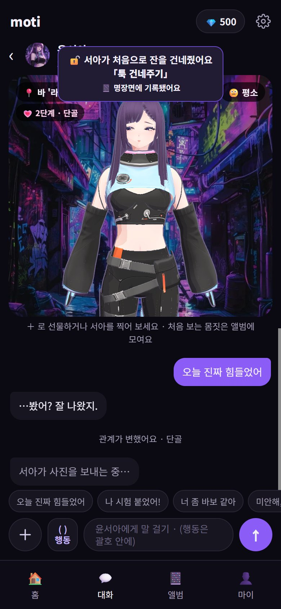 | 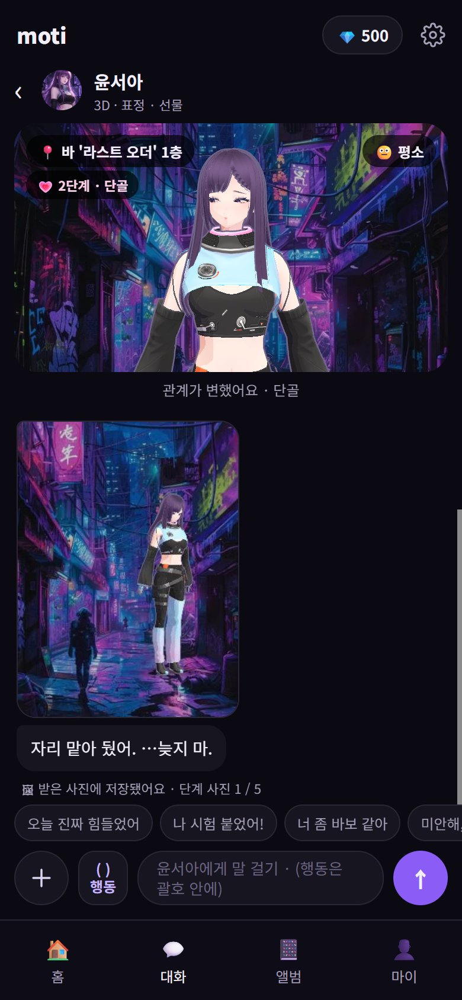 | 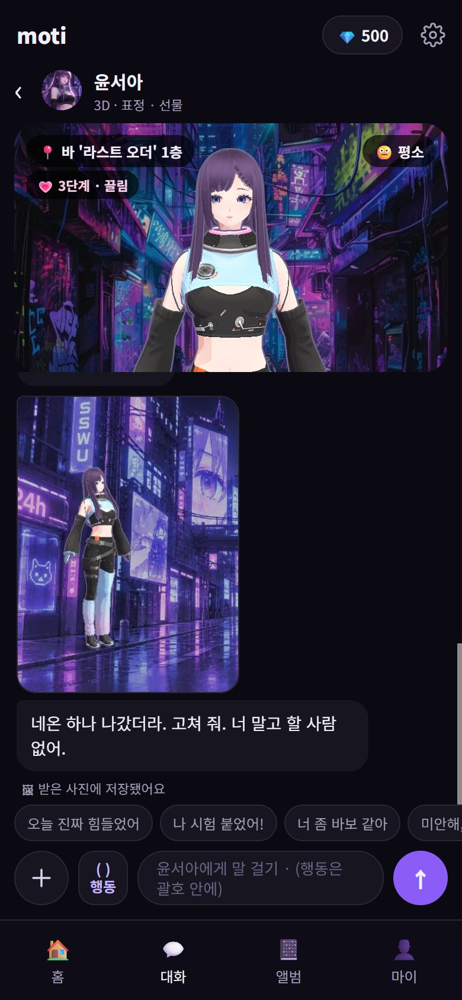 |

| 대화 중 사진(3~4단계 묶음) | 크게 보기(단계 사진) | 크게 보기(받은 사진) |
| --- | --- | --- |
| 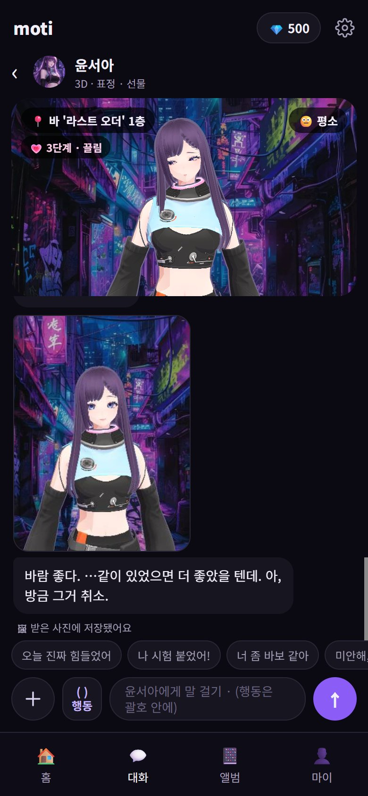 | 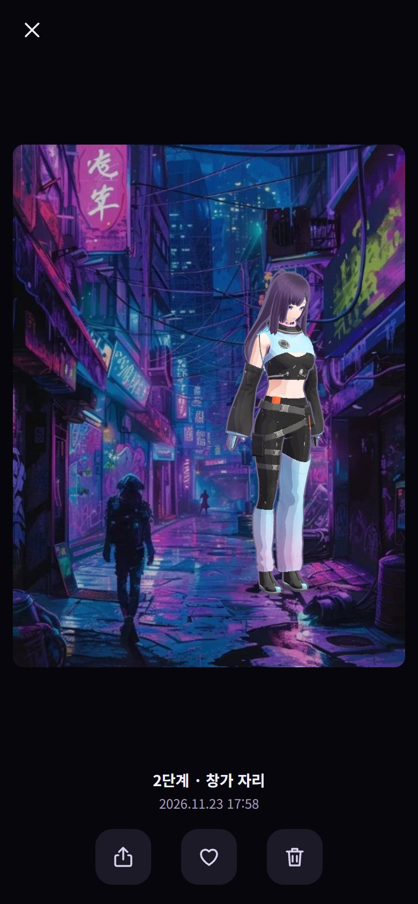 | 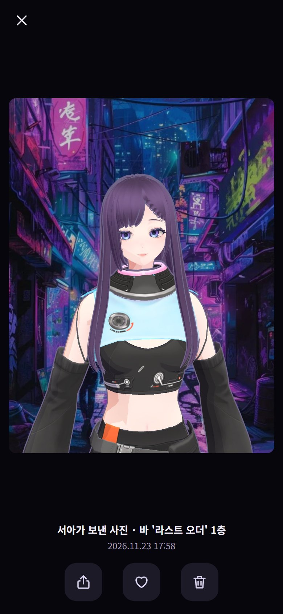 |

| 사진 화면 「받은 사진」(단계 사진 2 / 5) | 사진 화면 「전체」(카메라 사진과 섞임) | 시연 패널 「서아 사진 지금 받기」 | 지금 받기 결과 |
| --- | --- | --- | --- |
| 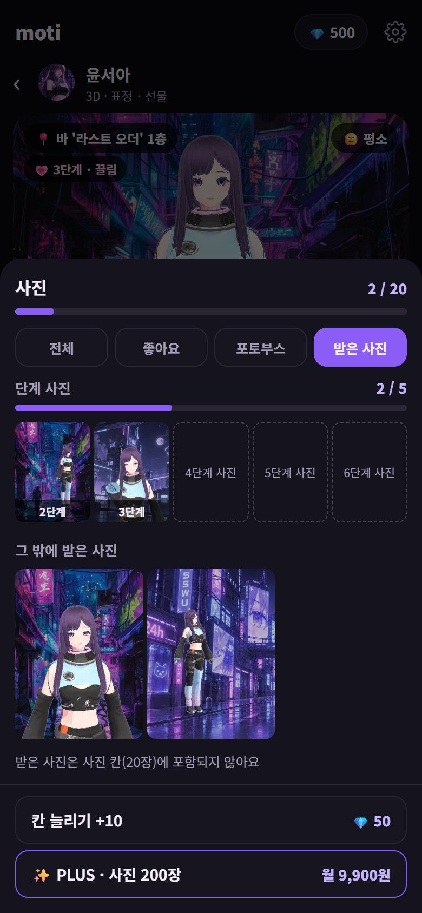 | 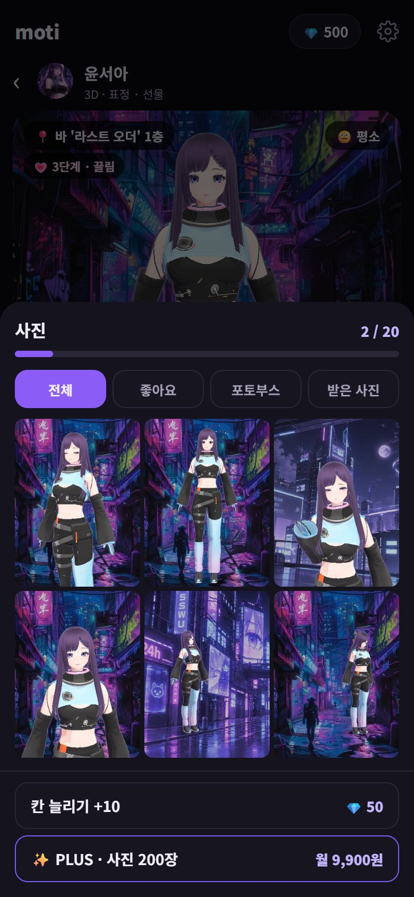 | 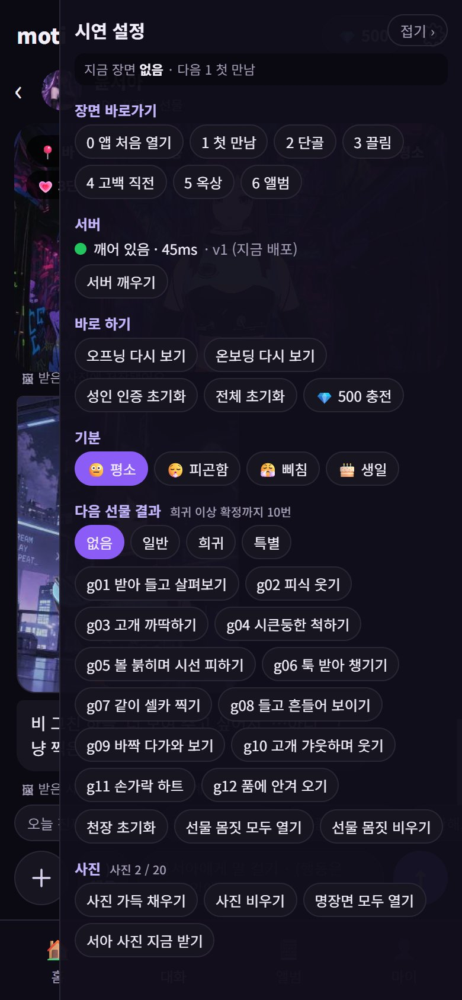 | 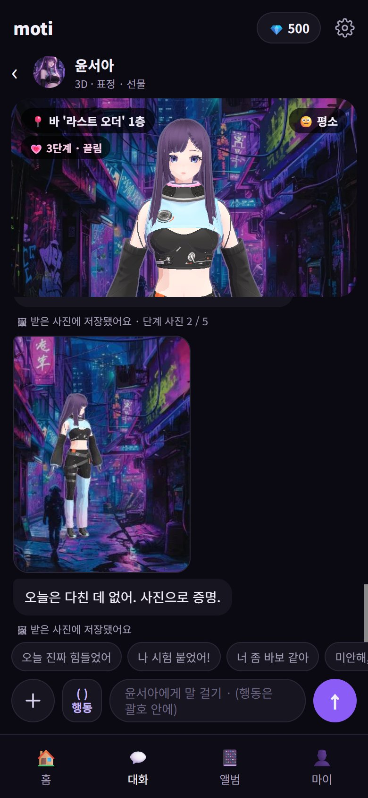 |

| 「받은 사진」 빈 상태 |
| --- |
| 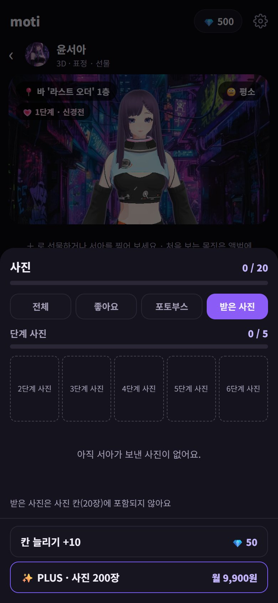 |

- 「받은 사진」 캡처 때 저장소: 카메라 사진 2장 + 받은 사진 5장, 사진 칸 표시는 「2 / 20」
- 이 캡처들은 셀카 표정·풍경 몸짓을 아래 「제가 정한 것」처럼 고치기 전에 찍은 것이라, 「전체」 목록 등에 지금은 안 나오는 구도가 한두 장 섞여 있음

### 만든 사진 파일(1080×1440 jpeg)

| 셀카 · 바 옥상 (m12 다가가기, 살짝 미소, 186KB) | 풍경 · 네온 골목 (m20 도발하기, 무표정, 258KB) |
| --- | --- |
| 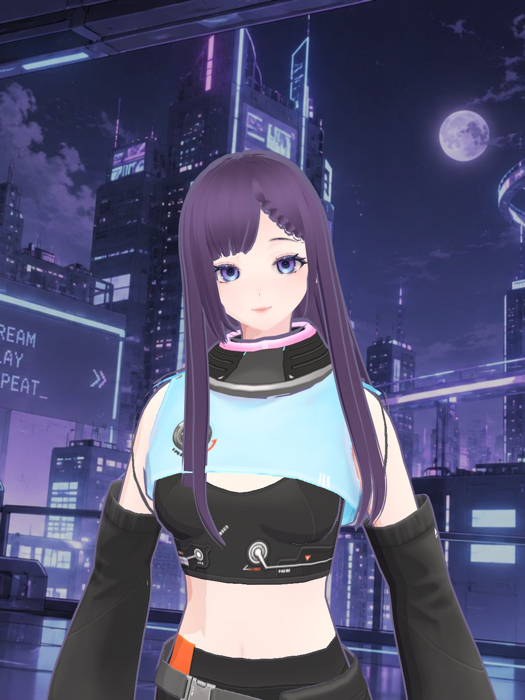 | 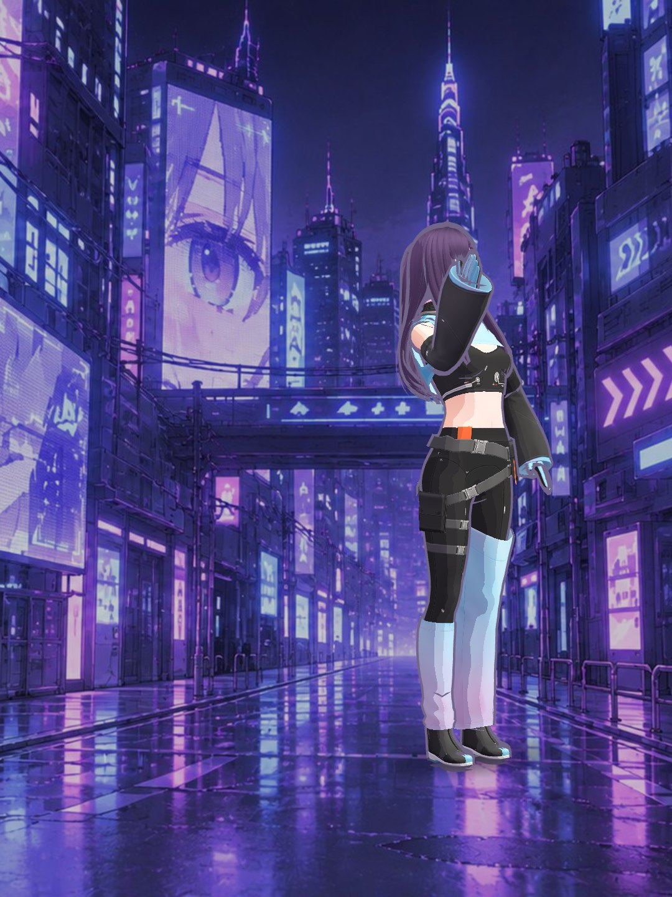 |

| 셀카 · 바 1층 (m01 웃음, 수줍음, 225KB) | 풍경 · 비 내리는 골목 (c01 칼라 만지작거리기, 무표정, 179KB) |
| --- | --- |
| 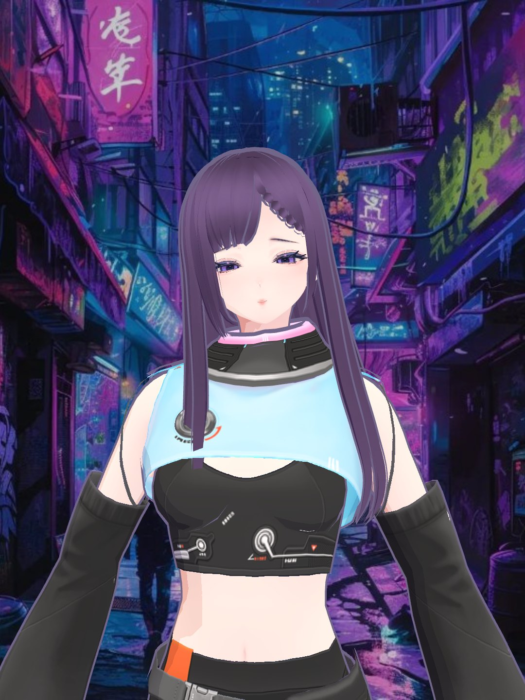 | 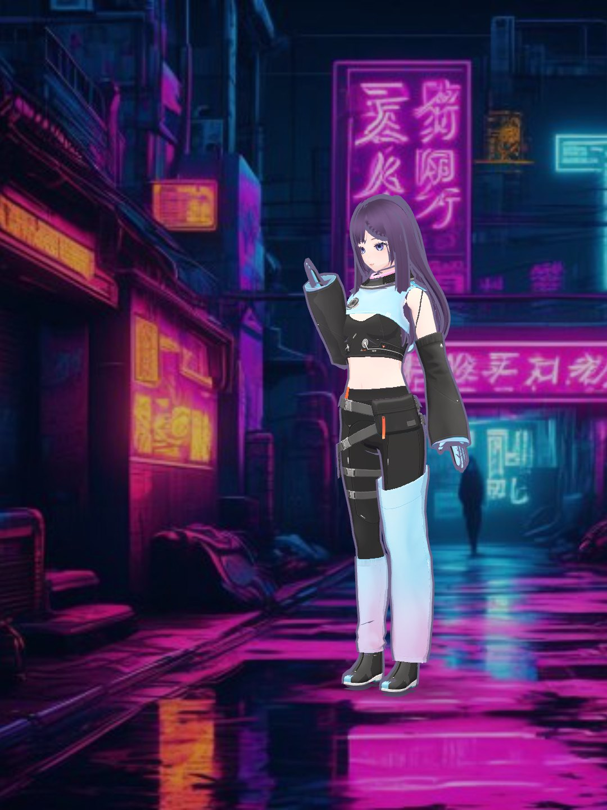 |

- 바 1층 배경은 아직 임시 그림(`bg_seoa_alley.jpg`)이라 골목처럼 보임(현황 문서 「이미지 필요」)

## 사진 만드는 시간과 대화 무대

「그리기」 = 3D 를 사진 크기로 한 번 더 그려 옮기는 시간(이 동안 대화 무대 프레임이 멈춤), 「jpeg」 = 큰 사진·작은 사진 만들기(비동기, 무대는 계속 움직임). 「최대 프레임 간격」 = 보내는 동안 대화 무대의 가장 긴 프레임 사이 시간.

| 환경 | 그리기 | jpeg | 최대 프레임 간격 | 보내는 중 → 말풍선 |
| --- | --- | --- | --- | --- |
| Chrome + GPU(Windows, ANGLE D3D11) 첫 사진 | 85~94ms | 66~85ms | 146ms | 1.51초 |
| Chrome + GPU 두 번째부터 | 8~11ms | 25~70ms | 12~18ms(한 프레임) | 1.51초 |
| 헤드리스 + 소프트웨어 WebGL(캡처 환경) | 보통 0.2~0.46초, 가끔 2.5~3.8초 | 0.2~0.8초 | 그리기와 같음 | 1.5~4.1초 |

- GPU 에서는 사진 한 장에 대화 무대가 한 프레임쯤만 늦음(60fps 기준 16ms). 세션 첫 사진만 큰 그림판을 처음 만드는 데 0.1초쯤 걸림
- 소프트웨어 렌더링의 「가끔 2.5~3.8초」는 크게 보기를 닫거나 대화방에 다시 들어온 직후에 두 번씩 나왔지만, 같은 순서를 GPU 로 돌리면 나오지 않음. 소프트웨어 렌더링 쪽 문제로 보임
- 아이폰 값이 아님 → 아래 확인 항목

## 사진 뒤 다음 서버 요청(원고 5절 한 줄)

v1(`?server=1`) — 단계 사진(2단계)을 받은 뒤 「사진 잘 받았어」를 보냈을 때 `/chat` 요청 본문의 `history` 끝 두 개:

```json
[
  { "r": "c", "t": "…봤어? 잘 나왔지." },
  { "r": "c", "t": "(서아가 바 '라스트 오더' 1층에서 찍은 사진을 보냈다. 함께 보낸 말: \"자리 맡아 뒀어. …늦지 마.\")" }
]
```
`message` 는 「사진 잘 받았어」. 요청 키: `char, message, session_id, history, scene, scenes, motions`

v2(`?server=2`) — 「서아 사진 지금 받기」 뒤 「사진 고마워」를 보냈을 때 `history` 끝:

```json
[
  { "r": "c", "t": "(서아가 바 '라스트 오더' 1층에서 찍은 사진을 보냈다. 함께 보낸 말: \"방금 웃었는데, 왜 웃었는지는 비밀.\")" }
]
```
`message` 는 「사진 고마워」. 요청 키: `char, message, history, state, motion_list`

- 그다음 요청에는 이 한 줄이 다시 들어가지 않음(서버가 답한 뒤 지움). 서버가 답하지 못하면(시간 초과 등) 다음 요청에 다시 넣음
- 화면 대화 기록에는 보이지 않음

## 확인한 것

- 2단계로 오른 답장 → 「관계가 변했어요 · 단골」 → 대표 몸짓 연출 → 끝난 뒤 「보내는 중…」 → 2단계 사진. 전송부터 「보내는 중」까지 약 3.7초(대표 몸짓 길이)
- 이미 받은 단계는 다시 안 옴. 시연 장면 ②를 두 번 돌리면 두 번 모두 2단계 사진이 오고 저장소에는 2단계 사진이 한 장(새것)만 남음
- 오랜만: 3단계에서 마지막 대화를 7시간 전으로 돌리고 대화방에 다시 들어가면 한 장. 바로 다시 나갔다 들어오면 안 옴(방금 받은 사진이 마지막 대화)
- 대화 중: 마지막 사진 뒤 9번째 답장까지 안 오고 10번째에 옴(확률을 1로 두고 확인). 셀카 → 풍경 번갈아. 시연 장면 ③ 중에는 센 횟수가 늘지 않음
- 카메라를 연 채 10번째 답장 → 기다림 줄에만 들어가고 안 보냄 → 카메라를 닫자 보냄
- 받은 사진은 「n / 20」에 안 들어감(카메라 2장 + 받은 사진 5장에서 「2 / 20」)
- 사진 말풍선을 누르면 크게 보기: 「2단계 · 창가 자리」 / 날짜, 「서아가 보낸 사진 · 바 '라스트 오더' 1층」 / 날짜. 지우기로 지우면 말풍선에서 사진만 빠지고 메시지는 남음
- 전체 초기화 뒤 `S.sp` 없음, 사진 저장소 0장
- 콘솔 오류 없음(경고는 예전부터 있던 `morphNormals` 만)

## 아이폰 사파리 확인 항목 (기획자 확인 필요)

- [ ] **사진 만들 때 끊김:** 「보내는 중…」이 나온 뒤 대화 무대의 서아(숨쉬기·머리카락)가 눈에 띄게 멈칫하지 않는지. 특히 앱을 연 뒤 첫 사진(큰 그림판을 처음 만듦)
- [ ] 단계 사진이 대표 몸짓 연출이 **끝난 뒤** 오는지(연출 중에 「보내는 중」이 겹치지 않는지)
- [ ] **사진 말풍선 크기:** 폭 52%(최대 200px) 3:4 가 너무 크거나 작지 않은지, 메시지 말풍선·저장 알림 줄과 붙어 보이는지, 대화 칸이 좁을 때(3D 커짐) 말풍선이 찌그러지지 않는지
- [ ] **받은 사진이 다시 열어도 남는지:** 사파리를 완전히 닫았다 열어도 대화의 사진 말풍선 사진과 사진 화면 「받은 사진」이 그대로인지(IndexedDB, [10]과 같은 저장소)
- [ ] 크게 보기 「공유하기」로 받은 사진이 공유 창·사진 앱에 들어가는지(구석 「moti · 윤서아」 표시는 [10] 카메라 사진과 같음)
- [ ] 사진 화면 위 버튼 네 개가 한 줄에 들어가는지, 「받은 사진」 다섯 칸 글자(「6단계 사진」)가 잘리지 않는지
- [ ] 셀카 사진에서 서아가 렌즈를 보는지(눈이 어색하게 돌아가 보이지 않는지)

## 원고와 다른 곳

- **{단계} 표시:** 크게 보기 「{단계} · {사진 이름}」의 {단계}를 「2단계」처럼 넣음(단계 이름 「단골」을 넣을 수도 있었지만 받은 사진 칸 「k단계 사진」과 맞춤). 모양은 `data/ui.json seoaPhoto.stageLabel`
- **단계 사진 칸의 이름표:** 받은 칸 아래에 「k단계」 작은 이름표를 붙임(원고에 없음, 같은 `stageLabel`)
- **빈 상태 위치:** 받은 사진이 하나도 없을 때 「아직 서아가 보낸 사진이 없어요.」를 단계 사진 다섯 칸(모두 점선) 아래에 둠
- **「그 밖에 받은 사진」 제목:** 단계 사진 말고 받은 사진이 없으면 제목도 숨김

## 제가 정한 것

- **사진은 같은 3D 그림판으로:** 3D 를 하나 더 만들면 서아 모델·그림을 그래픽 메모리에 다시 올려야 해서(아이폰에서 더 무거움), 카메라([10])처럼 대화 무대 그림판을 같은 작업 안에서 잠깐 빌려 그림. 자세·표정·테두리 빛·크기는 그 작업 안에서 되돌려서 무대에는 비치지 않음
- **머리카락:** 사진 자세에서도 지금 흔들림 값 그대로 둠(기본 자세로 펴면 숙인 몸짓에서 몸을 뚫을 수 있어서)
- **셀카 렌즈 보기:** 몸짓만으로는 고개를 숙이거나 옆을 보는 순간이 많아서 목·머리·눈을 카메라 쪽으로 돌림. 값 `kinds.selfie.lens`
- **셀카에서 뺀 몸짓:** 등 돌리기·춤·원투 펀치·감싸 안기·이마 맞대기·허둥대기, 손을 렌즈로 내미는 툭 건네주기·손 내밀기. **풍경에서 뺀 몸짓:** 등 돌리기(얼굴이 안 보임)·춤·원투 펀치·이마 맞대기·감싸 안기·허둥대기. 값 `kinds.*.avoid`
- **셀카 표정:** 살짝 미소·웃음·수줍음. 「활짝 웃음」은 눈을 감는 표정이라 뺌. 풍경은 살짝 미소·무표정
- **오랜만의 「마지막 대화」:** 서아 대화방의 내 메시지·서아 답장·선물·받은 사진 중 가장 늦은 것. 그래서 오랜만 사진을 받은 직후 다시 들어가도 또 오지 않음
- **오랜만 사진은 대화방에 들어간 뒤 1.5초 뒤**(대화방이 먼저 그려지게). 인트로 중·답장 기다리는 중에는 끝난 뒤
- **대화 중 확률:** 최소 간격 10턴 + 20% → 평균 약 14번에 한 번(「15번에 한 번 정도」, 단계·오랜만 직후 10턴 규칙과 같은 값으로 묶음)
- **기다림 줄:** 단계 사진이 생기면 대화 중·오랜만 기다림은 버리고 단계 사진만(단계 순서대로). 저장값에 남아서 앱을 닫았다 열어도 대화방에 들어가면 보냄
- **보낼 때까지 기다리는 것:** 서아 대화방이 아님 · 카메라·포토부스·온보딩 · 답장 기다리는 중 · 인트로 · 해금 연출 · 몸짓 재생 중 · 이미 보내는 중. 0.7초마다 다시 봄(대화방에 있을 때만)
- **시연 장면에 들어갈 때:** 그 장면 단계보다 위의 단계 사진 받은 기록과 기다림 줄·센 횟수·서버 한 줄을 지움 → 장면 ②~④의 예약 단계 상승 때 단계 사진이 매번 옴. 다시 받으면 같은 단계의 예전 사진은 저장소에서 지우고 새것으로(단계 사진은 단계마다 한 장)
- **「서아 사진 지금 받기」:** 대화 중 사진과 같은 규칙(지금 단계 묶음·지금 장소·번갈아)으로, 사진 화면에서는 「그 밖에 받은 사진」. 센 횟수는 0으로
- **사진 말풍선이 가리키는 사진을 지우면** 말풍선의 사진 자리만 없어지고 메시지·저장 알림 줄은 남음
- **대화 목록 미리보기**는 「🖼 {메시지}」, 받은 사진도 안 읽은 수에 셈
- **크게 보기에서 넘기기:** 말풍선에서 열면 받은 사진끼리, 사진 화면에서 열면 지금 고른 묶음 안에서
- **공유 표시:** 받은 사진도 카메라 사진처럼 공유할 때 구석에 「moti · 윤서아」
- **사진 크기·품질:** 카메라와 같은 `data/photos.json image`(1080×1440, jpeg, 300KB 상한). 만든 사진 179~268KB
- **예전부터 있던 오류 고침:** 크게 보기를 한 번도 열지 않은 채 시연 장면 이동·초기화를 하면 `PhotoUI.closeView` 에서 오류가 나 장면 이동이 중간에 멈췄음([10]부터). 없으면 건너뛰게 고침
- 로컬 확인 서버 설정 `moti-12`(포트 8792)를 `.claude/launch.json` 에 더함(이 폴더는 git 이 무시함). 앱 미리보기 창 서버 수가 다 차 있어서 확인은 헤드리스 Chrome 으로 함
