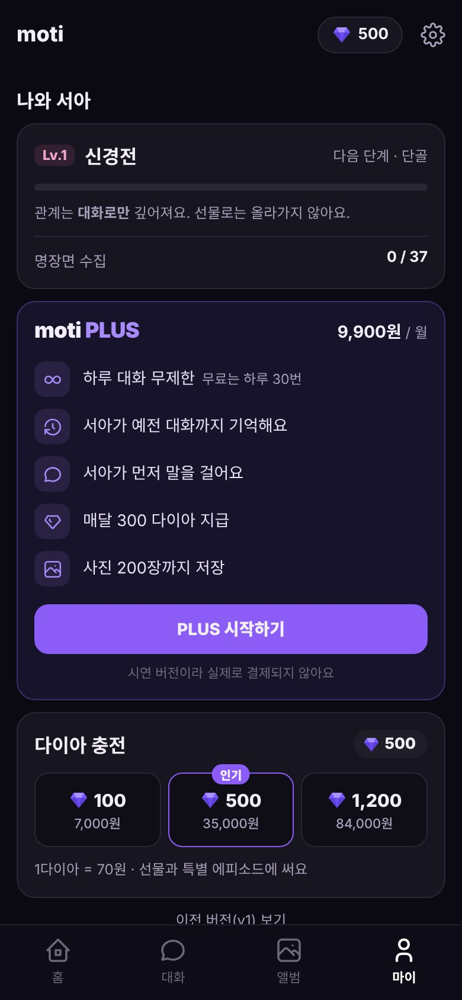
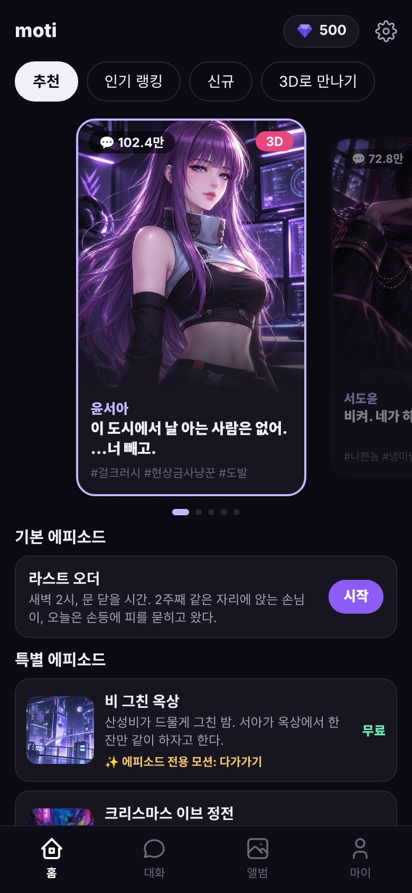
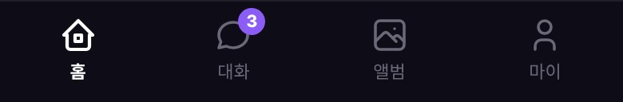

# 12단계 보고서 · 탭바와 마이 페이지 아이콘 정리

이모지(🏠💬📔👤, 💗✨💬🧠📩💎🖼)가 프로토타입처럼 보여서, 한 세트의 라인 아이콘과 전용 다이아 아이콘으로 바꿨다.

## 바뀐 파일
- `index.html`
  - 아래 탭바: 이모지 → 라인 아이콘(홈·대화·앨범·마이). 비활성 회색, 활성 흰색 + 굵게. 안 읽은 수 뱃지는 아이콘 오른쪽 위 보라 원
  - 헤더 재화 표시: 💎 → 다이아 아이콘
  - 마이 페이지 `renderMy()`: 관계 카드(Lv 배지·다음 단계·명장면 수집 줄), PLUS 카드(워드마크·가격 오른쪽 위·혜택 라인 아이콘·버튼 아래 시연 안내), 다이아 충전 카드(보유량 칩·다이아 아이콘·「인기」 태그)
  - 아이콘 모음 `MYI`, 다이아 아이콘 `GEM()`
- `data/ui.json` `my`: 마이 페이지 문구·혜택 목록·충전 상품(개수·가격·태그)을 코드에서 옮김. `plusPhotos` 의 🖼 이모지 뺌
- `docs/CREDITS.md`: 아이콘 출처 추가

## 캡처 (390px)
| 마이 | 탭바(홈 선택) | 안 읽은 수 뱃지 |
| --- | --- | --- |
|  |  |  |

## 제가 정한 것
- 아이콘 모양은 Tabler Icons(MIT)를 옮겨 쓰고, 선 굵기를 기존 코드 아이콘과 같은 1.8로 맞췄다
- 다이아 아이콘은 직접 그린 임시 그림. 디자이너 아이콘이 오면 `GEM()` 과 헤더 SVG만 바꾸면 된다
- 선물·충전 토스트, 선물 시트 가격, 사진 칸 늘리기 등 **다른 화면의 💎·✨ 는 이번에 손대지 않았다** (기획자 요청 범위: 탭바와 마이 카드)
- PLUS 버튼 문구 「월 9,900원으로 시작 (시연)」 → 「PLUS 시작하기」, 가격은 카드 오른쪽 위, 「(시연)」은 버튼 아래 작은 안내로
- 충전 500개 상품에 「인기」 태그 (`data/ui.json` `my.packs[].tag` 로 바꿀 수 있음)
- 관계 진행 바는 마이 카드에서만 핑크 단색(홈의 관계 칩·다른 진행 바는 그대로)

## 아이폰 사파리 확인 항목
- 탭바 아이콘을 누를 때 살짝 작아지는 효과(`transform: scale(.9)`)
- SVG 아이콘 선 굵기·정렬, 안 읽은 수 뱃지 위치
