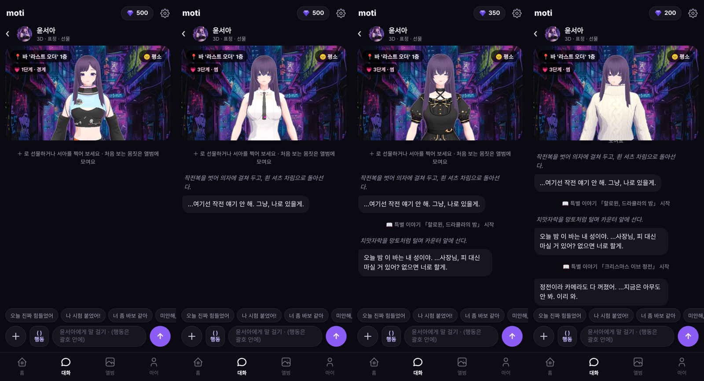

# 14단계 · 서아 의상 바꾸기

왼쪽부터: 1단계 작전복 → 3단계 썸 흰 옷(처음 바뀔 때 서아 한마디) → 드라큘라 에피소드 → 크리스마스 에피소드

## 한 일
- 서아 모델을 의상별로 4개 둠: 작전복(지금 `seoa_vroid.glb`), 흰 옷 `seoa_private.glb`, 크리스마스 `seoa_xmas.glb`, 드라큘라 `seoa_dracula.glb` (VRoid `.vrm`을 앱용 `.glb`로 변환, 원본은 저장소 밖)
- 관계 3단계(썸) 이상이면 흰 옷. 처음 바뀌는 순간 서아 한마디가 대화에 한 번 나옴
- 특별 에피소드에 `outfit` 칸: 크리스마스 이브 정전 = 크리스마스 니트, 새 에피소드 「할로윈, 드라큘라의 밤」(💎 150) = 드라큘라 드레스
- 의상을 바꿀 때 모델만 갈아 끼우고, 몸짓·표정·머리카락 흔들림(Alive)·만화풍 명암(Look)은 새 모델에 다시 붙임. 한 번 불러온 의상은 다시 받지 않음

## 바뀐 파일
- `index.html`: 모델 불러오기를 의상별로 바꿀 수 있게(Stage.outfit), 의상 규칙(Outfit), 관계 단계·에피소드 시작 때 의상 맞추기
- `data/config.json`: `outfits`(의상별 파일, comfortStage 3)
- `data/episodes.json`: s2 `outfit:"xmas"`, 새 s3 드라큘라 에피소드
- `data/ui.json`: `outfit.firstPrivate`
- 원고: `docs/drafts/14-의상-원고.md`

## 제가 정한 것
- "편해지면" = 관계 3단계(썸)부터로 정함. 숫자는 `data/config.json outfits.comfortStage`에서 바꿈
- 에피소드 의상은 그 에피소드를 시작한 뒤 계속 유지하고, 오프닝 다시 보기·다른 에피소드 시작·초기화 때 풀림 (에피소드 끝 개념이 아직 없어서)
- 드라큘라 에피소드의 전용 몸짓은 지금 있는 m12(다가가기)로 임시. XSTAGE 모션이 오면 바꿈
- 처음 열 때 지금 상황에 맞는 의상을 바로 불러옴(작전복을 먼저 띄웠다가 바꾸지 않음)

## 확인 필요
- **작전복 머리 모양이 다름:** 새 의상 3개는 최종 머리(일자 앞머리)인데 작전복은 예전 머리라 바뀔 때 머리가 달라 보임. 작전복도 최종 머리로 VRoid에서 다시 내보내야 함
- 드라큘라 의상의 악마 꼬리: 드라큘라와 안 맞으면 VRoid에서 빼기
- 아이폰 사파리: 의상이 바뀔 때 멈칫하는지(모델 7~9MB를 처음 받을 때), 메모리(모델 여러 개를 들고 있음)

## 14-1 (11/23 밤) 의상별 머리 바꿈
- 흰 옷(사적): 단발 머리 버전으로 교체 · 드라큘라: 양갈래 머리 버전으로 교체
- 같은 파일 이름이라 브라우저에 예전 모델이 남지 않도록 `data/config.json outfits.files` 에 `?v=2` 를 붙임
- 의상마다 머리 모양이 다른 건 기획 의도(사적 = 단발, 드라큘라 = 양갈래)로 봄

## 14-2 크리스마스 머리 바꿈
- 크리스마스 니트 서아를 옆으로 넘긴 앞머리 버전으로 교체(`seoa_xmas.glb?v=2`)

## 14-3 표정 다듬기
- 기본(무표정)·살짝 미소·뾰로통·슬픔·수줍음을 눈을 뜬 채 부드럽게 바꿈. 특히 삐짐 때 눈을 가늘게 뜨던 얼굴이 어색했음
- 기본 얼굴은 입꼬리만 살짝 올림. 값은 index.html FACE (예전 값은 주석)
