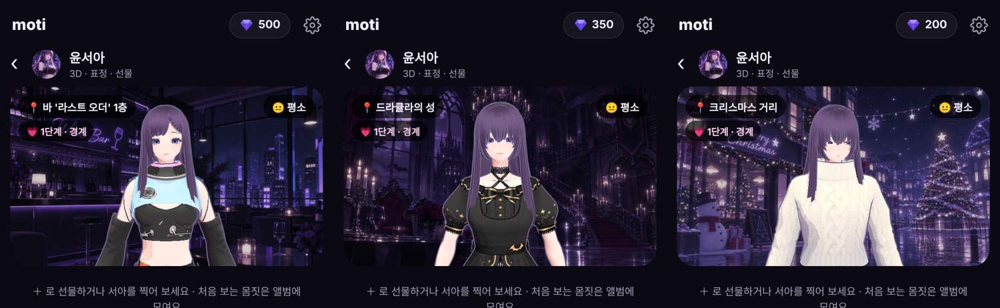

# 15단계 · 바 1층과 특별 에피소드 배경

왼쪽부터: 바 '라스트 오더' 1층(본편) · 드라큘라의 성(할로윈 에피소드) · 크리스마스 거리(크리스마스 이브 에피소드)

## 한 일
- 바 '라스트 오더' 1층 전용 배경 `bg_seoa_bar.jpg` (임시 표시 temp 해제)
- 특별 에피소드 전용 장소 2곳 추가: 5 드라큘라의 성 `bg_seoa_castle.jpg`, 6 크리스마스 거리 `bg_seoa_xmas.jpg`
- 에피소드 장소: 「할로윈, 드라큘라의 밤」 → 드라큘라의 성, 「크리스마스 이브 정전」 → 크리스마스 거리
- 그림은 기획자가 준 것을 다른 배경과 같은 1600×900 jpg로 줄임

## 바뀐 파일
- `data/seoa_story.json` locations, `data/episodes.json` scene 번호, `index.html` 한 줄, 배경 그림 3장

## 제가 정한 것
- 에피소드 전용 장소에는 `episode: true` 를 달고, 서버에 보내는 장소 목록에서는 뺐다. 평소 대화 중에 서아가 갑자기 드라큘라의 성으로 가지 않게.
- 바 2층은 아직 전용 그림이 없어 임시 그대로.

## 확인 필요
- 바 1층 그림에 "Wine Bar" 네온 글자가 있음. 가게 이름이 '라스트 오더'라 글자를 지우거나 바꾸면 더 맞음
- 「크리스마스 이브 정전」은 제목이 정전인데 새 배경은 불이 환한 거리라, 제목이나 소개 문구를 조정할지 기획 확인
- 서버 장소 목록(location)에 새 장소 이름이 없음. 서버 v2에서 장소를 판정할 때 문제 없는지 서버 팀원 확인
