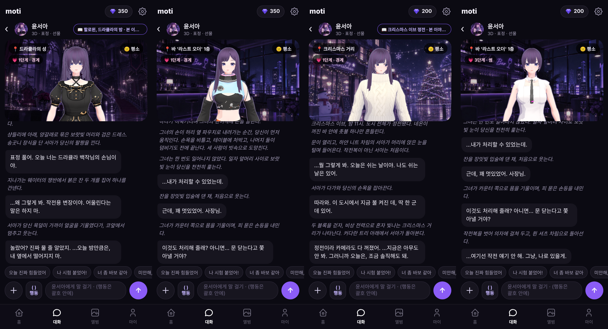

# 16단계 · 에피소드마다 따로 이어지는 이야기, 첫 장면, 흰 옷은 와인 바에서만

왼쪽부터: 드라큘라 에피소드 첫 장면 · 「본 이야기로」 눌러 돌아온 본 이야기 · 크리스마스 에피소드 첫 장면 · 썸 단계 + 와인 바 = 흰 옷

## 한 일
- **이야기 줄기:** 본 이야기와 특별 에피소드는 대화·서버 세션·장소·최근 대사가 따로 보관되고 따로 이어짐. 에피소드 중에는 대화방 머리에 「본 이야기로」 단추와 "📖 에피소드 이름"
- **첫 장면:** 크리스마스·드라큘라 에피소드에 여러 문단짜리 첫 장면(몸짓·표정·장소 바뀜 포함). 크리스마스는 바 1층에서 시작해 크리스마스 거리로 이동
- **표정:** 본 이야기·에피소드 첫 장면은 부드러운 얼굴(soft)로 시작
- **흰 옷:** 본 이야기에서 흰 옷(묶은 머리)은 썸 단계 이상 + 와인 바(바 1층)일 때만. 다른 장소는 작전복
- 에피소드 소개 문구를 새 배경에 맞게 고침

## 바뀐 파일
- `index.html`: Thread(이야기 줄기), runOpening(에피소드 첫 장면), 에피소드 시작, 「본 이야기로」 단추, 흰 옷 장소 규칙
- `data/episodes.json`: s2·s3 `opening`, `face`, 소개 문구 · `data/config.json`: `outfits.privatePlaces` · `data/ui.json`: `thread`
- 원고: `docs/drafts/16-이야기-줄기-원고.md`

## 제가 정한 것
- 관계 단계·명장면·💎는 줄기와 상관없이 같이 씀(같은 서아와 쌓는 관계라서)
- 「비 그친 옥상」(무료)도 따로 이어지는 에피소드로 처리(첫 장면은 예전 한 줄 그대로)
- 서버에는 첫 장면 문단이 대화 기록(history)으로 같이 가서, 서아가 에피소드 상황을 이어받게 함. 서버 프롬프트에 에피소드 설정이 따로 있으면 더 좋음
- 본 이야기 첫 장면은 서버 OPENING 원고를 그대로 둠

## 확인 필요
- 아이폰 사파리: 에피소드 ↔ 본 이야기를 오갈 때 의상·배경이 같이 바뀌는지, 단추가 머리 줄에 들어가는지
- 서버 팀원: 에피소드 대화에서 서아가 바 설정으로 돌아가 버리지 않는지(필요하면 장소 이름으로 에피소드 분위기를 프롬프트에 추가)

## 16-1 에피소드 정리
- 「비 그친 옥상」 특별 에피소드 삭제(본 이야기에서 다룸)
- 크리스마스: 바 장면을 빼고 크리스마스 거리에서 바로 시작. 문단마다 몸짓(머리 쓸어 넘기기 → 다정하게 인사하기 → 시선 피하기 → 손 내밀기 → 다가가기 → 부끄러워하기)
- 드라큘라: 문단마다 몸짓(손 내밀기 → 툭 건네주기 → 시선 피하기 → 다가가기 → 도발하기)
- 첫 장면 표정을 부드러운 얼굴·웃음 위주로(수줍음 표정이 크리스마스 모델에서 슬퍼 보였음)
- 몸짓은 XSTAGE 모션이 오기 전 임시. 에피소드 전용 모션 표시는 마지막 몸짓(크리스마스 = 부끄러워하기, 드라큘라 = 도발하기)

## 16-2 바 에피소드 · 에피소드 의상 버그
- 특별 에피소드 3개: 「오늘의 바텐더」(새 바 의상, 와인 바) · 크리스마스 · 드라큘라
- 버그: 본 이야기 와인 바에 크리스마스 옷이 나옴 → 예전 저장값(에피소드 의상)이 남아 있었음. 에피소드 의상은 에피소드 줄기에서만 쓰게 고침
