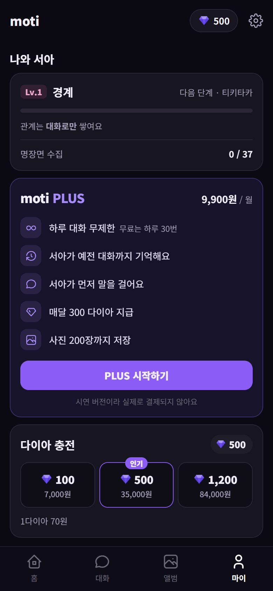
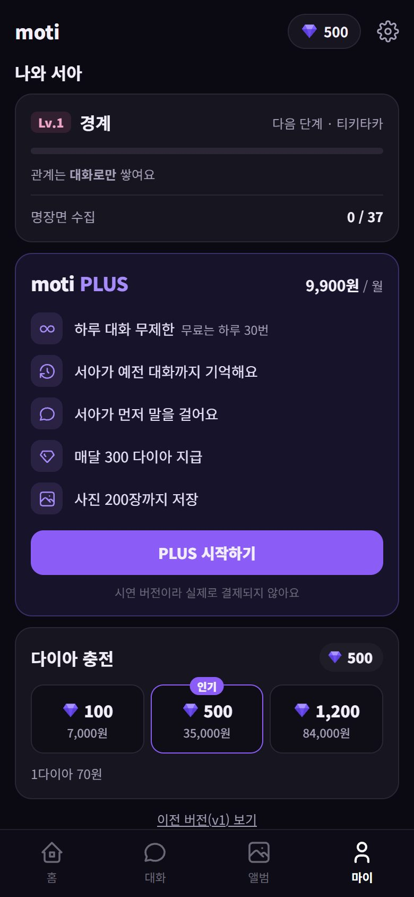
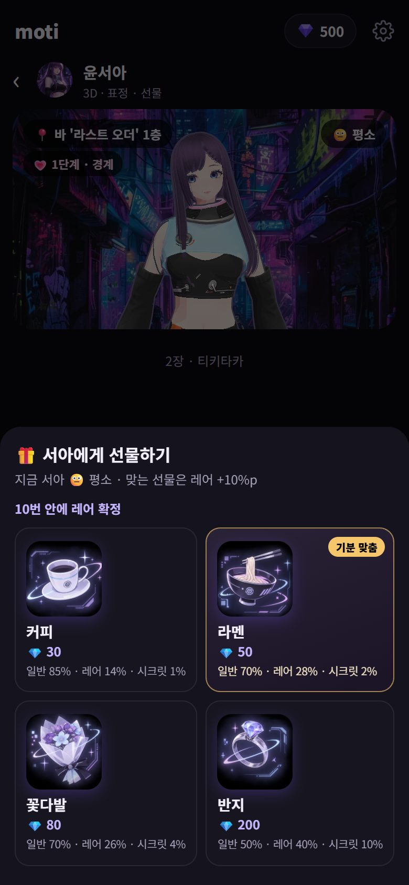
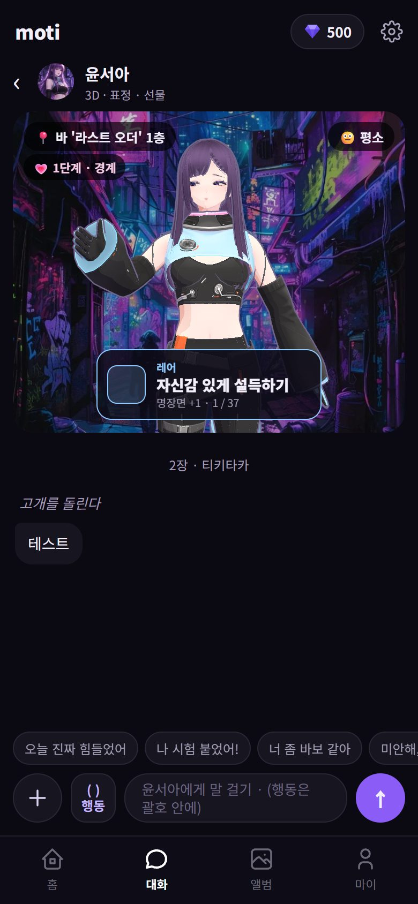
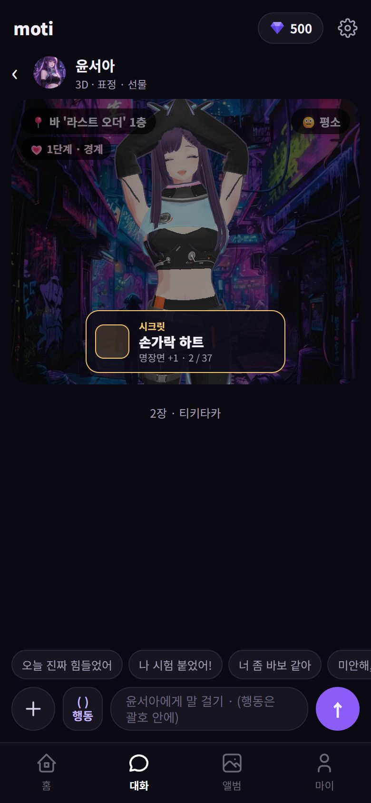
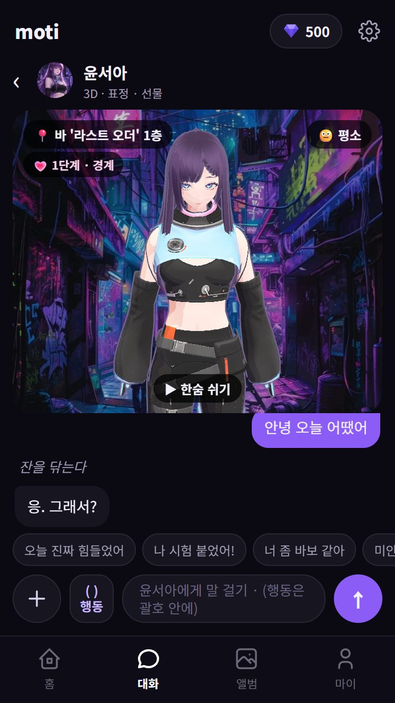
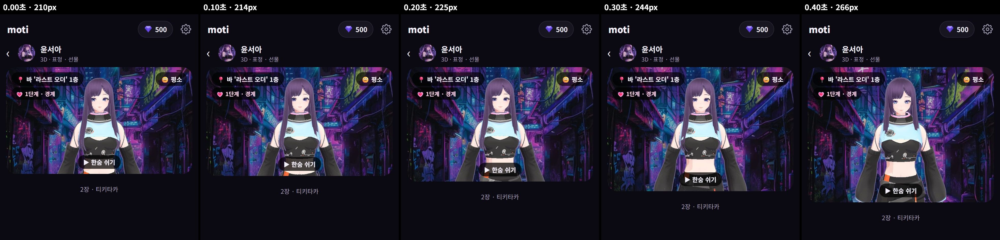

# 17단계 · 말투 정리, 새 몸짓 알림 카드, 특별한 순간만 화면 확대

브랜치: `step/17-tone-notice` (main 병합 안 함)

## 바뀐 파일

| 파일 | 내용 |
| --- | --- |
| `data/ui.json` | A. 문구 17곳 값만 바꿈(아래 표) |
| `data/collection.json` | B. `notify` 를 카드 값으로 바꿈: `card`(가로·모서리·높이·올라오는 거리·왼쪽 칸·바탕·시간) + 등급별 `color`·`soft`·`dim` |
| `data/config.json` | D. `stage` 값 바꿈·추가(`bigAspect` 0.82, `bigMaxRatio` 0.50, `growMs` 700, `ease`, `motionDelayMs` 250, `backDelayMs` 1500, `shrinkMs` 800) |
| `index.html` | B. 알림 카드(CSS·HTML·`gradeFx`) · C. `Stage.play(…,{big})`, `View.motion(mid,sp,on)`, 부르는 곳마다 big 넘김, `isFirstChat` · D. 커지는 곡선·시간·몸짓 지연, 커지기 시작이 늦던 문제 고침 |
| `photos.js` | C. 촬영 화면을 나온 뒤 재생하는 답장 몸짓도 「처음 보는 몸짓」일 때만 크게 |
| `docs/reports/17-말투-알림-확대.md`, `docs/reports/img/17/*.jpg` | 이 보고서·캡처 |
| `docs/status.md` | 17단계 절·브랜치 표 |

## A. 말투 정리 (`data/ui.json`)

| 키 | 전 | 후 |
| --- | --- | --- |
| `my.bondNote1`+`bondNoteB`+`bondNote2` | 관계는 **대화로만** 깊어져요. 선물로는 올라가지 않아요. | 관계는 **대화로만** 쌓여요 (`bondNote2` 만 「 쌓여요」로) |
| `my.chargeNote` | 1다이아 = 70원 · 선물과 특별 에피소드에 써요 | 1다이아 70원 |
| `gift.moodNote` | 지금 서아는 {mood} 상태예요 · 기분에 맞는 선물은 레어 확률 +{bonus}%p | 지금 서아 {mood} · 맞는 선물은 레어 +{bonus}%p |
| `gift.pity` | 레어 이상 확정까지 {n}번 | {n}번 안에 레어 확정 |
| `chat.seoaFirst` | ＋ 로 선물하거나 서아를 찍어 보세요 · 처음 보는 몸짓은 앨범에 모여요 | ＋ 에서 선물하고 사진도 찍어요 |
| `home.specialNote` | 에피소드를 사면 그 이야기 속 장면과 전용 모션을 볼 수 있어요. | 이 이야기에서만 보는 모습이 있어요 |
| `home.motion` | ✨ 에피소드 전용 모션: {name} | 전용 모션 · {name} |
| `album.unlockSaved` | 📔 명장면에 기록됐어요 | 명장면 +1 |
| `chatList.empty` | 홈에서 캐릭터를 골라 대화를 시작해 보세요 | 아직 대화가 없어요 |
| `photoFull.notice` | 사진 칸이 가득 찼어요. 저장하려면 1칸이 필요해요. | 사진 칸이 가득 찼어요 |
| `photoFull.desc` | 사진을 저장할 1칸을 먼저 마련해 주세요. | 한 장 지우거나 칸을 늘려 주세요 |
| `photo.empty.all` | 아직 찍은 사진이 없어요. ＋ 의 카메라로 서아를 찍어 보세요. | 아직 사진이 없어요 |
| `seoaPhoto.note` | 받은 사진은 사진 칸({cap}장)에 포함되지 않아요 | 받은 사진은 칸을 차지하지 않아요 |
| `seoaPhoto.saved` | 🖼 받은 사진에 저장됐어요 | 받은 사진에 저장 |
| `booth.poseNote` | 모은 몸짓만 고를 수 있어요 | 모은 몸짓만 |
| `booth.locked` | 아직 모으지 않은 몸짓이에요 | 아직 못 모았어요 |
| `booth.resultNote` | 칸을 누르면 그 칸만 다시 찍을 수 있어요 | 칸을 누르면 다시 찍어요 |

- 키 이름은 표와 모두 같았고, 코드에 들어 있던 문구는 없었다.

## B. 새 몸짓 알림 카드 (레어·시크릿)

- 무대 한가운데 큰 글씨 상자를 없애고, 무대 아래쪽(바닥에서 12px)에 가로 210px 카드가 18px 아래에서 올라옴 0.4초 → 머무름 → 사라짐 0.4초, 전체 2.6초
- 카드: 어두운 반투명 바탕 `rgba(13,11,22,.85)`, 등급 색 1px 테두리, 둥근 모서리 14px. 왼쪽 36px 칸(등급 색 테두리 + 등급 색 18% 바탕), 오른쪽 세 줄: 등급 이름(10px, 등급 색) / 몸짓 이름(14px 굵게) / 「명장면 +1 · n / 전체」(10px, 흐린 색)
- 등급 색: 레어 `#8ec9ff`(푸른색), 시크릿 `#f5c66b`(금색). 일반은 예전 작은 알림 그대로
- 시크릿만 그동안 무대를 어둡게(0.45, 예전 값). 레어는 0
- 카드가 떠 있는 동안 무대 아래 「▶ 몸짓 이름」 칩(`#cap`)을 숨김(`.stage.gfon`), 카드가 사라진 뒤 다시 보임
- 문구: 등급 이름 `collection.grade`, 셋째 줄 `album.unlockSaved` + 「 · 」 + `album.count`. 블러·필터 없음

## C. 화면이 커지는 때

`Stage.play(mid, {big:true})` 일 때만 3D 칸이 커지고 카메라가 허벅지 중간(춤은 전신)으로 바뀐다. `big` 이 없으면 크기·카메라 모두 그대로(상반신).

| 때 | 부르는 곳 | 커짐 |
| --- | --- | --- |
| 처음 보는 몸짓(명장면 기록) | `send` → `react(…, isFirstChat(mid))` | ○ |
| 촬영 화면을 나온 뒤 재생하는 마지막 답장 몸짓 | `photos.js` `Cam.close` → `react(…, isFirstChat(mid))` | 처음 보는 몸짓일 때만 |
| 관계 단계 상승 대표 몸짓 · 사건 해금 몸짓 | `unlockShow` → `unlockNext` → `unlockFx` | ○ |
| 선물 반응 | `give` → `playGift` | ○ |
| 오프닝 몸짓(m07 → m01 → m11) | `runIntro` | ○ |
| 특별 에피소드 시작 몸짓 | `startStory` → `react(…, true)` | ○ |
| 시연 장면 이동 | ① 은 오프닝(`runIntro`), ②~⑤ 는 다음 답장 뒤 예약된 단계 상승·사건 해금(`Scenes.runReserve` → `unlockFx`) | ○ |
| 시연 패널 「몸짓 재생」·「연출 미리보기」 | `Demo.playMotion` · `Demo.preview` → `unlockFx` | ○ |
| 앨범 다시 보기 | `replayCol` | 카메라만(앨범 탭에서는 원래 칸이 안 커짐) |
| 평소 답장 몸짓(이미 본 몸짓) | `send` → `react(…, false)` | × (지금 크기·상반신) |
| 답장 기다리는 동안 대기 몸짓(m25) | `send` → `Stage.play(IDLE)` | × (예전과 같음) |
| 온보딩 인사·필름 사진 | `Stage.play(…,{quiet:true})` | × (예전과 같음) |

- 이미 커져 있는 동안 평소 답장 몸짓이 오면 줄이지 않고, 그 몸짓이 끝날 때까지 커진 채로 둔다(중간에 줄었다 커졌다 하지 않게)

## D. 커지는 크기·속도 (`data/config.json` `stage`)

| 값 | 전 | 후 |
| --- | --- | --- |
| `bigAspect` | 1 | 0.82 |
| `bigMaxRatio` | 0.58 | 0.50 |
| `growMs` | 350 | 700 (`ease` `ease-in-out`, 카메라도 같은 700ms 동안 부드럽게) |
| `motionDelayMs` | 없음 | 250 (커지기 시작하고 몸짓 시작) |
| `backDelayMs` | 1000 | 1500 |
| `shrinkMs` | 없음(= growMs) | 800 (카메라도 800ms 동안 상반신으로) |
| `minLogPx` | 80 | 80 그대로 |

- 390×844: 3D 칸 210px → 300px(가로 366 × 0.82). 375×667: 210px → 288px, 대화 목록 114px(최소 80px 지킴)
- **예전부터 있던 문제 고침:** 커지기 직전 지금 높이를 px로 고정하는 순간에도 전환이 켜져 있어서 「36% → 210px」 전환이 먼저 생기고, 그 위에 「→ 300px」 전환이 이어졌다. 그래서 처음 0.3초쯤은 `min-height`(210px)에 걸려 안 커지다가 뒤에 몰아서 커졌다. 고정할 때는 전환을 끄도록 바꿔, 0초부터 부드럽게 커진다(아래 0.1초 간격 캡처)

## 캡처 (390×844, 픽셀 비율 2, 헤드리스 Chrome + 소프트웨어 WebGL)

| 마이 · 관계 안내 | 마이 · 충전 | 선물 창 |
| --- | --- | --- |
|  |  |  |

| 레어 카드 (처음 보는 몸짓이라 커짐) | 시크릿 카드 (무대 어두워짐) | 사진 가득 시트 |
| --- | --- | --- |
|  |  |  |

| 평소 답장 (안 커짐, 210px) | 처음 보는 몸짓 (커짐, 300px) | 375×667 커진 상태 |
| --- | --- | --- |
|  |  |  |

커지는 장면 0.1초 간격 5장 (0.00 210px → 0.10 214px → 0.20 225px → 0.30 244px → 0.40 266px, 0.70초에 300px)

- 헤드리스 캡처는 한 장에 0.3~0.4초가 걸려 실제 시간으로는 0.1초 간격을 맞출 수 없었다. 그래서 페이지 시계(`performance.now`·화면 그리기 시각)를 고정하고 3D 칸 높이 전환도 같은 시각으로 맞춘 뒤 0.1초씩 넘기며 찍었다. 높이·카메라·몸짓이 모두 같은 시각이다
- 시크릿 카드 캡처는 선물 반응을 바로 부른 것이라 대화 기록에 선물 줄이 없다

## 아이폰 사파리 확인 (기획자)

- [ ] 처음 보는 몸짓·선물에서 3D 칸이 커질 때 끊기지 않는지(0.7초, 부드럽게 시작하고 멈춤). 3D 그림판 크기가 매 프레임 바뀌는 것은 예전과 같음
- [ ] 줄어들 때(0.8초) 끊기지 않는지, 줄어든 뒤 칸 높이가 튀지 않는지
- [ ] 평소 답장에서는 칸 크기·카메라가 그대로인지
- [ ] 레어·시크릿 카드가 상태줄(노치)·헤더·「▶ 몸짓 이름」 칩과 겹치지 않는지(카드는 무대 안 아래쪽, 칩은 카드가 떠 있는 동안 숨김)
- [ ] 카드가 서아 얼굴·상반신을 가리지 않는지(커진 상태·안 커진 상태 둘 다. 안 커진 210px 칸에서는 허리 아래에 걸침)
- [ ] 시크릿 카드 때 무대만 어두워지고 깜빡이지 않는지
- [ ] 375×667(아이폰 SE 크기)에서 커진 상태에 대화 목록이 두 줄 이상 보이는지

## 제가 정한 것

- **카드 왼쪽 칸:** 몸짓 그림이 없어서 등급 색 테두리 + 연한 등급 색 바탕만 있는 빈 칸으로 두었다. 이모지·글자를 새로 넣지 않음
- **카드 위치:** 무대 바닥에서 12px, 가운데. 210px 칸(안 커진 상태)에서도 허리 아래라 얼굴·가슴을 가리지 않는다
- **카드 셋째 줄의 n / 전체:** 앨범 「전체」 묶음 기준(대화 + 선물, 지금 37칸). 카드가 뜨는 시점에는 이미 기록된 뒤라 새 칸을 포함한 수
- **`collection.notify`(ui.json, 「레어 · {name}」)는 더 이상 쓰지 않는다.** 카드는 등급 이름과 몸짓 이름을 두 줄로 나눠 `collection.grade` 와 몸짓 이름을 쓴다. 키는 지우지 않고 남겨 둠
- **`seoaPhoto.note`:** 새 문구에 `{cap}` 자리가 없어 코드가 넘기는 값은 그냥 쓰이지 않는다
- **이미 커져 있을 때 평소 몸짓:** 줄이지 않고 그 몸짓 끝까지 커진 채(위 C 절)
- **앨범 다시 보기:** 지시문 목록에 없지만 예전처럼 카메라 구도는 바꾸도록 `big` 을 넘겼다. 앨범 탭에서는 3D 칸이 원래 커지지 않으므로 화면 크기는 그대로
- **시연 패널 「몸짓 재생」:** 몸짓을 크게 보려고 쓰는 버튼이라 커지게 했다
- **몸짓 시작 지연(250ms)은 실제로 커지기 시작할 때만.** 이미 커져 있거나, 입력창에 포커스가 있어(키보드) 안 커질 때는 바로 시작
- **카메라 이동 시간:** 커질 때는 `growMs`(700), 줄어들 때는 `shrinkMs`(800)를 같이 쓴다. 다른 구도 이동은 예전 `camera.moveMs`(350) 그대로
- **줄어들 때도** 끝나고 높이 고정을 풀 때 전환을 끄도록 같이 고쳤다(보이는 변화는 없음, 쓸데없는 전환 제거)
- 데이터 파일 줄바꿈: `index.html`·`photos.js` 는 원래대로 CRLF 유지

## 문구 후보 목록 (바꾸지 않음)

기준: 「~할 수 있어요」「~해 보세요」「~해 주세요」 어미, 문장 앞 이모지, `{…}` 를 빼고 36자가 넘는 설명. 서아·캐릭터 대사와 선물 반응 대사, 서아 사진 메시지, 오프닝 원고는 뺐다. 시연 패널(`demo.json`)과 캐릭터·에피소드 소개는 화면에 보이므로 넣었다.

| 파일 | 키·위치 | 지금 문구 | 걸린 이유 |
| --- | --- | --- | --- |
| characters.json | list[0].desc | 차갑게 밀어내면서, 위험한 순간엔 제일 먼저 당신 앞을 막아서는 남자. | 길이 |
| characters.json | list[1].desc | 첫사랑, 기억을 잃은 연인, 호위기사. 어떤 이야기에서도 끝까지 당신 편. | 길이 |
| characters.json | list[2].desc | IQ 168, 생활력 0. 당신 앞에서만 계산이 자꾸 틀리는 허당 천재. | 길이 |
| characters.json | list[4].desc | 도시에서 가장 위험한 현상금 사냥꾼. 일이 끝나면 매일 밤, 당신의 바 같은 자리에 앉는다. | 길이 |
| demo.json | dia | 💎 500 충전 | 이모지 |
| demo.json | diaToast | 💎 500 충전 (시연) | 이모지 |
| demo.json | keysNote | 단축키: 0 앱 처음 열기 · 1~6 장면 · ← → 이전/다음 · R 다시 · D 패널 · W 서버 깨우기 | 길이 |
| episodes.json | basic.seoa.situation | 새벽 2시, 문 닫을 시간. 2주째 같은 자리에 앉는 손님이, 오늘은 손등에 피를 묻히고 왔다. | 길이 |
| episodes.json | basic.doyun.situation | 골목에서 시비가 붙은 순간, 낯선 남자가 말없이 당신 앞을 막아선다. | 길이 |
| episodes.json | basic.jihu.situation | 10년 만에 도착한 편지. 보낸 사람은 당신을 기억하지 못하는 첫사랑이다. | 길이 |
| episodes.json | basic.ijun.situation | 연구실 문을 열자 서류 더미가 무너진다. 그 아래에서 천재가 태연하게 손을 든다. | 길이 |
| episodes.json | basic.haram.situation | 데뷔 30일 전 새벽, 불 꺼진 연습실. 거울 앞에 혼자 남은 연습생이 당신을 돌아본다. | 길이 |
| episodes.json | special[0].desc | 산성비가 드물게 그친 밤. 서아가 옥상에서 한 잔만 같이 하자고 한다. | 길이 |
| episodes.json | special[1].desc | 도시 전체가 정전된 밤. 네온이 꺼진 바에 서아가 젖은 채로 들어온다. | 길이 |
| onboarding.json | ticket.ai | 이곳의 캐릭터들은 AI예요. 대화는 AI가 만들어서 가끔 사실과 다를 수 있어요. | 어미·길이 |
| onboarding.json | ticket.punchLocked | 필수 항목에 동의해 주세요 | 어미 |
| onboarding.json | terms.terms.body | 시연용 임시 문구예요. 실제 서비스 전에 법률 검토를 거친 약관으로 바꿔요. | 길이 |
| onboarding.json | terms.privacy.body | 시연용 임시 문구예요. 실제 서비스 전에 법률 검토를 거친 약관으로 바꿔요. | 길이 |
| onboarding.json | login.desc | 계정에 저장하면 휴대폰을 바꿔도 대화와 명장면을 이어서 볼 수 있어요. | 어미·길이 |
| onboarding.json | adult.desc | 이 캐릭터와의 대화에는 성인 이용자를 위한 표현이 포함돼요. 본인 인증 후 이용할 수 있어요. | 어미·길이 |
| seoa_story.json | firstSeenText | ✨ 새 명장면 · {name} | 이모지 |
| seoa_story.json | hints.m19 | 그녀의 도발을 받아쳐 보세요. 지지 않으려 할 거예요. | 어미 |
| ui.json | album.unlockTag | 🔓 새 명장면 | 이모지 |
| ui.json | gift.noDia | 💎가 부족해요 | 이모지 |
| ui.json | home.storyStart | 📖 특별 이야기 「{name}」 시작 | 이모지 |
| ui.json | home.storyTag | 📖 이야기 전용 장면 · {name} | 이모지 |
| ui.json | home.noDia | 💎가 부족해요 | 이모지 |
| ui.json | photoFull.optPlus | ✨ PLUS · 사진 {plusCap}장 | 이모지 |
| ui.json | photoFull.noDia | 💎가 부족해요 | 이모지 |
| ui.json | photo.empty.booth | 앨범의 포토부스에서 네 컷 사진을 만들어 보세요. | 어미 |
| ui.json | photo.plusRow | ✨ PLUS · 사진 {plusCap}장 | 이모지 |
| ui.json | photo.plusStart | ✨ PLUS 시작 · 💎 300 지급 | 이모지 |
| index.html | 줄 360 | 📍 네온 거리 | 이모지 |
| index.html | 줄 361 | 😐 평소 | 이모지 |
| index.html | 줄 561 | 3D를 불러오지 못했어요. 새로고침해 주세요. | 어미 |
| index.html | 줄 1183 | 🎁 서아에게 선물하기 | 이모지 |
| index.html | 줄 1484 | 💗 ${i+1}단계 · ${stageName(i+1)} | 이모지 |
| index.html | 줄 1561 | 📖 이야기 장면 | 이모지 |
| index.html | 줄 1586 | ✨ PLUS 시작 · 💎 300 지급 | 이모지 |
| index.html | 줄 1587 | 💎 ${b.dataset.p} 충전 (시연) | 이모지 |

| index.html | 줄 1039 (`unlockFx` 해금 토스트) | 🔓 {단계 문구} 「{몸짓 이름}」 {album.unlockSaved} | 이모지 |
| index.html | 줄 1145 (장소 바뀜 대화 줄) | 📍 장소가 바뀌었어요 · {장소} | 이모지 |
| index.html | 줄 1165 (기분 바뀜 토스트) | {기분 이모지} 서아가 **{기분}** 상태가 됐어요 / 🎁 {선물 이모지} {선물}을(를) 주면 특별한 반응이 있을지도…? | 이모지·길이 |

- 코드에 들어 있는 화면 문구(위 `index.html` 줄들, 선물 창 제목 「🎁 서아에게 선물하기」, 「📖 이야기 장면」, 「3D를 불러오지 못했어요. 새로고침해 주세요.」 등)는 문구가 정해지면 `data/ui.json` 으로 옮기면서 바꾸는 게 좋다
- `demo.json` 은 시연 패널(발표자용) 문구다
