# 17단계 · 말투 정리, 새 몸짓 알림 카드, 특별한 순간만 화면 확대

브랜치: `step/17-tone-notice` (main 병합 안 함)

## 바뀐 파일

| 파일 | 내용 |
| --- | --- |
| `data/ui.json` | A. 문구 17곳 값만 바꿈(아래 표) |
| `data/collection.json` | B. `notify` 를 카드 값으로 바꿈: `card`(가로·모서리·높이·올라오는 거리·왼쪽 칸·바탕·시간) + 등급별 `color`·`soft`·`dim` |
| `data/config.json` | D. `stage` 값 바꿈·추가(`bigAspect` 0.82, `bigMaxRatio` 0.50, `growMs` 700, `ease`, `motionDelayMs` 250, `backDelayMs` 1500, `shrinkMs` 800) |
| `index.html` | B. 알림 카드(CSS·HTML·`gradeFx`) · C. `Stage.play(…,{big})`, `View.motion(mid,sp,on)`, 부르는 곳마다 big 넘김, `isFirstChat` · D. 커지는 곡선·시간·몸짓 지연, 커지기 시작이 늦던 문제 고침 |
| `photos.js` | C. 촬영 화면을 나온 뒤 재생하는 답장 몸짓도 「처음 보는 몸짓」일 때만 크게 |
| `docs/reports/17-말투-알림-확대.md`, `docs/reports/img/17/*.jpg` | 이 보고서·캡처 |
| `docs/status.md` | 17단계 절·브랜치 표 |

## A. 말투 정리 (`data/ui.json`)

| 키 | 전 | 후 |
| --- | --- | --- |
| `my.bondNote1`+`bondNoteB`+`bondNote2` | 관계는 **대화로만** 깊어져요. 선물로는 올라가지 않아요. | 관계는 **대화로만** 쌓여요 (`bondNote2` 만 「 쌓여요」로) |
| `my.chargeNote` | 1다이아 = 70원 · 선물과 특별 에피소드에 써요 | 1다이아 70원 |
| `gift.moodNote` | 지금 서아는 {mood} 상태예요 · 기분에 맞는 선물은 레어 확률 +{bonus}%p | 지금 서아 {mood} · 맞는 선물은 레어 +{bonus}%p |
| `gift.pity` | 레어 이상 확정까지 {n}번 | {n}번 안에 레어 확정 |
| `chat.seoaFirst` | ＋ 로 선물하거나 서아를 찍어 보세요 · 처음 보는 몸짓은 앨범에 모여요 | ＋ 에서 선물하고 사진도 찍어요 |
| `home.specialNote` | 에피소드를 사면 그 이야기 속 장면과 전용 모션을 볼 수 있어요. | 이 이야기에서만 보는 모습이 있어요 |
| `home.motion` | ✨ 에피소드 전용 모션: {name} | 전용 모션 · {name} |
| `album.unlockSaved` | 📔 명장면에 기록됐어요 | 명장면 +1 |
| `chatList.empty` | 홈에서 캐릭터를 골라 대화를 시작해 보세요 | 아직 대화가 없어요 |
| `photoFull.notice` | 사진 칸이 가득 찼어요. 저장하려면 1칸이 필요해요. | 사진 칸이 가득 찼어요 |
| `photoFull.desc` | 사진을 저장할 1칸을 먼저 마련해 주세요. | 한 장 지우거나 칸을 늘려 주세요 |
| `photo.empty.all` | 아직 찍은 사진이 없어요. ＋ 의 카메라로 서아를 찍어 보세요. | 아직 사진이 없어요 |
| `seoaPhoto.note` | 받은 사진은 사진 칸({cap}장)에 포함되지 않아요 | 받은 사진은 칸을 차지하지 않아요 |
| `seoaPhoto.saved` | 🖼 받은 사진에 저장됐어요 | 받은 사진에 저장 |
| `booth.poseNote` | 모은 몸짓만 고를 수 있어요 | 모은 몸짓만 |
| `booth.locked` | 아직 모으지 않은 몸짓이에요 | 아직 못 모았어요 |
| `booth.resultNote` | 칸을 누르면 그 칸만 다시 찍을 수 있어요 | 칸을 누르면 다시 찍어요 |

- 키 이름은 표와 모두 같았고, 코드에 들어 있던 문구는 없었다.

## B. 새 몸짓 알림 카드 (레어·시크릿)

- 무대 한가운데 큰 글씨 상자를 없애고, 무대 아래쪽(바닥에서 12px)에 가로 210px 카드가 18px 아래에서 올라옴 0.4초 → 머무름 → 사라짐 0.4초, 전체 2.6초
- 카드: 어두운 반투명 바탕 `rgba(13,11,22,.85)`, 등급 색 1px 테두리, 둥근 모서리 14px. 왼쪽 36px 칸(등급 색 테두리 + 등급 색 18% 바탕), 오른쪽 세 줄: 등급 이름(10px, 등급 색) / 몸짓 이름(14px 굵게) / 「명장면 +1 · n / 전체」(10px, 흐린 색)
- 등급 색: 레어 `#8ec9ff`(푸른색), 시크릿 `#f5c66b`(금색). 일반은 예전 작은 알림 그대로
- 시크릿만 그동안 무대를 어둡게(0.45, 예전 값). 레어는 0
- 카드가 떠 있는 동안 무대 아래 「▶ 몸짓 이름」 칩(`#cap`)을 숨김(`.stage.gfon`), 카드가 사라진 뒤 다시 보임
- 문구: 등급 이름 `collection.grade`, 셋째 줄 `album.unlockSaved` + 「 · 」 + `album.count`. 블러·필터 없음

## C. 화면이 커지는 때

`Stage.play(mid, {big:true})` 일 때만 3D 칸이 커지고 카메라가 허벅지 중간(춤은 전신)으로 바뀐다. `big` 이 없으면 크기·카메라 모두 그대로(상반신).

| 때 | 부르는 곳 | 커짐 |
| --- | --- | --- |
| 처음 보는 몸짓(명장면 기록) | `send` → `react(…, isFirstChat(mid))` | ○ |
| 촬영 화면을 나온 뒤 재생하는 마지막 답장 몸짓 | `photos.js` `Cam.close` → `react(…, isFirstChat(mid))` | 처음 보는 몸짓일 때만 |
| 관계 단계 상승 대표 몸짓 · 사건 해금 몸짓 | `unlockShow` → `unlockNext` → `unlockFx` | ○ |
| 선물 반응 | `give` → `playGift` | ○ |
| 오프닝 몸짓(m07 → m01 → m11) | `runIntro` | ○ |
| 특별 에피소드 시작 몸짓 | `startStory` → `react(…, true)` | ○ |
| 시연 장면 이동 | ① 은 오프닝(`runIntro`), ②~⑤ 는 다음 답장 뒤 예약된 단계 상승·사건 해금(`Scenes.runReserve` → `unlockFx`) | ○ |
| 시연 패널 「몸짓 재생」·「연출 미리보기」 | `Demo.playMotion` · `Demo.preview` → `unlockFx` | ○ |
| 앨범 다시 보기 | `replayCol` | 카메라만(앨범 탭에서는 원래 칸이 안 커짐) |
| 평소 답장 몸짓(이미 본 몸짓) | `send` → `react(…, false)` | × (지금 크기·상반신) |
| 답장 기다리는 동안 대기 몸짓(m25) | `send` → `Stage.play(IDLE)` | × (예전과 같음) |
| 온보딩 인사·필름 사진 | `Stage.play(…,{quiet:true})` | × (예전과 같음) |

- 이미 커져 있는 동안 평소 답장 몸짓이 오면 줄이지 않고, 그 몸짓이 끝날 때까지 커진 채로 둔다(중간에 줄었다 커졌다 하지 않게)

## D. 커지는 크기·속도 (`data/config.json` `stage`)

| 값 | 전 | 후 |
| --- | --- | --- |
| `bigAspect` | 1 | 0.82 |
| `bigMaxRatio` | 0.58 | 0.50 |
| `growMs` | 350 | 700 (`ease` `ease-in-out`, 카메라도 같은 700ms 동안 부드럽게) |
| `motionDelayMs` | 없음 | 250 (커지기 시작하고 몸짓 시작) |
| `backDelayMs` | 1000 | 1500 |
| `shrinkMs` | 없음(= growMs) | 800 (카메라도 800ms 동안 상반신으로) |
| `minLogPx` | 80 | 80 그대로 |

- 390×844: 3D 칸 210px → 300px(가로 366 × 0.82). 375×667: 210px → 288px, 대화 목록 114px(최소 80px 지킴)
- **예전부터 있던 문제 고침:** 커지기 직전 지금 높이를 px로 고정하는 순간에도 전환이 켜져 있어서 「36% → 210px」 전환이 먼저 생기고, 그 위에 「→ 300px」 전환이 이어졌다. 그래서 처음 0.3초쯤은 `min-height`(210px)에 걸려 안 커지다가 뒤에 몰아서 커졌다. 고정할 때는 전환을 끄도록 바꿔, 0초부터 부드럽게 커진다(아래 0.1초 간격 캡처)

## 캡처 (390×844, 픽셀 비율 2, 헤드리스 Chrome + 소프트웨어 WebGL)

| 마이 · 관계 안내 | 마이 · 충전 | 선물 창 |
| --- | --- | --- |
|  |  |  |

| 레어 카드 (처음 보는 몸짓이라 커짐) | 시크릿 카드 (무대 어두워짐) | 사진 가득 시트 |
| --- | --- | --- |
|  |  | 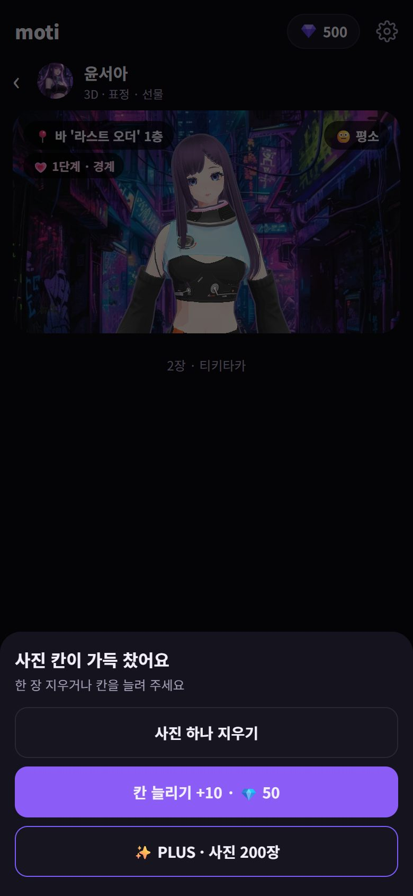 |

| 평소 답장 (안 커짐, 210px) | 처음 보는 몸짓 (커짐, 300px) | 375×667 커진 상태 |
| --- | --- | --- |
| 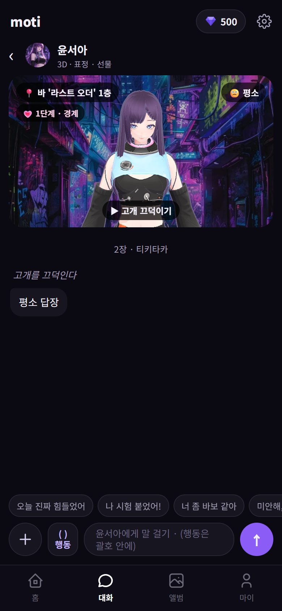 | 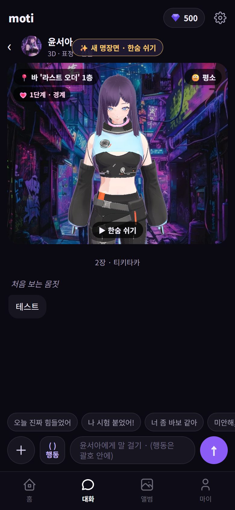 |  |

커지는 장면 0.1초 간격 5장 (0.00 210px → 0.10 214px → 0.20 225px → 0.30 244px → 0.40 266px, 0.70초에 300px)

- 헤드리스 캡처는 한 장에 0.3~0.4초가 걸려 실제 시간으로는 0.1초 간격을 맞출 수 없었다. 그래서 페이지 시계(`performance.now`·화면 그리기 시각)를 고정하고 3D 칸 높이 전환도 같은 시각으로 맞춘 뒤 0.1초씩 넘기며 찍었다. 높이·카메라·몸짓이 모두 같은 시각이다
- 시크릿 카드 캡처는 선물 반응을 바로 부른 것이라 대화 기록에 선물 줄이 없다

## 아이폰 사파리 확인 (기획자)

- [ ] 처음 보는 몸짓·선물에서 3D 칸이 커질 때 끊기지 않는지(0.7초, 부드럽게 시작하고 멈춤). 3D 그림판 크기가 매 프레임 바뀌는 것은 예전과 같음
- [ ] 줄어들 때(0.8초) 끊기지 않는지, 줄어든 뒤 칸 높이가 튀지 않는지
- [ ] 평소 답장에서는 칸 크기·카메라가 그대로인지
- [ ] 레어·시크릿 카드가 상태줄(노치)·헤더·「▶ 몸짓 이름」 칩과 겹치지 않는지(카드는 무대 안 아래쪽, 칩은 카드가 떠 있는 동안 숨김)
- [ ] 카드가 서아 얼굴·상반신을 가리지 않는지(커진 상태·안 커진 상태 둘 다. 안 커진 210px 칸에서는 허리 아래에 걸침)
- [ ] 시크릿 카드 때 무대만 어두워지고 깜빡이지 않는지
- [ ] 375×667(아이폰 SE 크기)에서 커진 상태에 대화 목록이 두 줄 이상 보이는지

## 제가 정한 것

- **카드 왼쪽 칸:** 몸짓 그림이 없어서 등급 색 테두리 + 연한 등급 색 바탕만 있는 빈 칸으로 두었다. 이모지·글자를 새로 넣지 않음
- **카드 위치:** 무대 바닥에서 12px, 가운데. 210px 칸(안 커진 상태)에서도 허리 아래라 얼굴·가슴을 가리지 않는다
- **카드 셋째 줄의 n / 전체:** 앨범 「전체」 묶음 기준(대화 + 선물, 지금 37칸). 카드가 뜨는 시점에는 이미 기록된 뒤라 새 칸을 포함한 수
- **`collection.notify`(ui.json, 「레어 · {name}」)는 더 이상 쓰지 않는다.** 카드는 등급 이름과 몸짓 이름을 두 줄로 나눠 `collection.grade` 와 몸짓 이름을 쓴다. 키는 지우지 않고 남겨 둠
- **`seoaPhoto.note`:** 새 문구에 `{cap}` 자리가 없어 코드가 넘기는 값은 그냥 쓰이지 않는다
- **이미 커져 있을 때 평소 몸짓:** 줄이지 않고 그 몸짓 끝까지 커진 채(위 C 절)
- **앨범 다시 보기:** 지시문 목록에 없지만 예전처럼 카메라 구도는 바꾸도록 `big` 을 넘겼다. 앨범 탭에서는 3D 칸이 원래 커지지 않으므로 화면 크기는 그대로
- **시연 패널 「몸짓 재생」:** 몸짓을 크게 보려고 쓰는 버튼이라 커지게 했다
- **몸짓 시작 지연(250ms)은 실제로 커지기 시작할 때만.** 이미 커져 있거나, 입력창에 포커스가 있어(키보드) 안 커질 때는 바로 시작
- **카메라 이동 시간:** 커질 때는 `growMs`(700), 줄어들 때는 `shrinkMs`(800)를 같이 쓴다. 다른 구도 이동은 예전 `camera.moveMs`(350) 그대로
- **줄어들 때도** 끝나고 높이 고정을 풀 때 전환을 끄도록 같이 고쳤다(보이는 변화는 없음, 쓸데없는 전환 제거)
- 데이터 파일 줄바꿈: `index.html`·`photos.js` 는 원래대로 CRLF 유지

## 문구 후보 목록 (바꾸지 않음)

기준: 「~할 수 있어요」「~해 보세요」「~해 주세요」 어미, 문장 앞 이모지, `{…}` 를 빼고 36자가 넘는 설명. 서아·캐릭터 대사와 선물 반응 대사, 서아 사진 메시지, 오프닝 원고는 뺐다. 시연 패널(`demo.json`)과 캐릭터·에피소드 소개는 화면에 보이므로 넣었다.

| 파일 | 키·위치 | 지금 문구 | 걸린 이유 |
| --- | --- | --- | --- |
| characters.json | list[0].desc | 차갑게 밀어내면서, 위험한 순간엔 제일 먼저 당신 앞을 막아서는 남자. | 길이 |
| characters.json | list[1].desc | 첫사랑, 기억을 잃은 연인, 호위기사. 어떤 이야기에서도 끝까지 당신 편. | 길이 |
| characters.json | list[2].desc | IQ 168, 생활력 0. 당신 앞에서만 계산이 자꾸 틀리는 허당 천재. | 길이 |
| characters.json | list[4].desc | 도시에서 가장 위험한 현상금 사냥꾼. 일이 끝나면 매일 밤, 당신의 바 같은 자리에 앉는다. | 길이 |
| demo.json | dia | 💎 500 충전 | 이모지 |
| demo.json | diaToast | 💎 500 충전 (시연) | 이모지 |
| demo.json | keysNote | 단축키: 0 앱 처음 열기 · 1~6 장면 · ← → 이전/다음 · R 다시 · D 패널 · W 서버 깨우기 | 길이 |
| episodes.json | basic.seoa.situation | 새벽 2시, 문 닫을 시간. 2주째 같은 자리에 앉는 손님이, 오늘은 손등에 피를 묻히고 왔다. | 길이 |
| episodes.json | basic.doyun.situation | 골목에서 시비가 붙은 순간, 낯선 남자가 말없이 당신 앞을 막아선다. | 길이 |
| episodes.json | basic.jihu.situation | 10년 만에 도착한 편지. 보낸 사람은 당신을 기억하지 못하는 첫사랑이다. | 길이 |
| episodes.json | basic.ijun.situation | 연구실 문을 열자 서류 더미가 무너진다. 그 아래에서 천재가 태연하게 손을 든다. | 길이 |
| episodes.json | basic.haram.situation | 데뷔 30일 전 새벽, 불 꺼진 연습실. 거울 앞에 혼자 남은 연습생이 당신을 돌아본다. | 길이 |
| episodes.json | special[0].desc | 산성비가 드물게 그친 밤. 서아가 옥상에서 한 잔만 같이 하자고 한다. | 길이 |
| episodes.json | special[1].desc | 도시 전체가 정전된 밤. 네온이 꺼진 바에 서아가 젖은 채로 들어온다. | 길이 |
| onboarding.json | ticket.ai | 이곳의 캐릭터들은 AI예요. 대화는 AI가 만들어서 가끔 사실과 다를 수 있어요. | 어미·길이 |
| onboarding.json | ticket.punchLocked | 필수 항목에 동의해 주세요 | 어미 |
| onboarding.json | terms.terms.body | 시연용 임시 문구예요. 실제 서비스 전에 법률 검토를 거친 약관으로 바꿔요. | 길이 |
| onboarding.json | terms.privacy.body | 시연용 임시 문구예요. 실제 서비스 전에 법률 검토를 거친 약관으로 바꿔요. | 길이 |
| onboarding.json | login.desc | 계정에 저장하면 휴대폰을 바꿔도 대화와 명장면을 이어서 볼 수 있어요. | 어미·길이 |
| onboarding.json | adult.desc | 이 캐릭터와의 대화에는 성인 이용자를 위한 표현이 포함돼요. 본인 인증 후 이용할 수 있어요. | 어미·길이 |
| seoa_story.json | firstSeenText | ✨ 새 명장면 · {name} | 이모지 |
| seoa_story.json | hints.m19 | 그녀의 도발을 받아쳐 보세요. 지지 않으려 할 거예요. | 어미 |
| ui.json | album.unlockTag | 🔓 새 명장면 | 이모지 |
| ui.json | gift.noDia | 💎가 부족해요 | 이모지 |
| ui.json | home.storyStart | 📖 특별 이야기 「{name}」 시작 | 이모지 |
| ui.json | home.storyTag | 📖 이야기 전용 장면 · {name} | 이모지 |
| ui.json | home.noDia | 💎가 부족해요 | 이모지 |
| ui.json | photoFull.optPlus | ✨ PLUS · 사진 {plusCap}장 | 이모지 |
| ui.json | photoFull.noDia | 💎가 부족해요 | 이모지 |
| ui.json | photo.empty.booth | 앨범의 포토부스에서 네 컷 사진을 만들어 보세요. | 어미 |
| ui.json | photo.plusRow | ✨ PLUS · 사진 {plusCap}장 | 이모지 |
| ui.json | photo.plusStart | ✨ PLUS 시작 · 💎 300 지급 | 이모지 |
| index.html | 줄 360 | 📍 네온 거리 | 이모지 |
| index.html | 줄 361 | 😐 평소 | 이모지 |
| index.html | 줄 561 | 3D를 불러오지 못했어요. 새로고침해 주세요. | 어미 |
| index.html | 줄 1183 | 🎁 서아에게 선물하기 | 이모지 |
| index.html | 줄 1484 | 💗 ${i+1}단계 · ${stageName(i+1)} | 이모지 |
| index.html | 줄 1561 | 📖 이야기 장면 | 이모지 |
| index.html | 줄 1586 | ✨ PLUS 시작 · 💎 300 지급 | 이모지 |
| index.html | 줄 1587 | 💎 ${b.dataset.p} 충전 (시연) | 이모지 |

| index.html | 줄 1039 (`unlockFx` 해금 토스트) | 🔓 {단계 문구} 「{몸짓 이름}」 {album.unlockSaved} | 이모지 |
| index.html | 줄 1145 (장소 바뀜 대화 줄) | 📍 장소가 바뀌었어요 · {장소} | 이모지 |
| index.html | 줄 1165 (기분 바뀜 토스트) | {기분 이모지} 서아가 **{기분}** 상태가 됐어요 / 🎁 {선물 이모지} {선물}을(를) 주면 특별한 반응이 있을지도…? | 이모지·길이 |

- 코드에 들어 있는 화면 문구(위 `index.html` 줄들, 선물 창 제목 「🎁 서아에게 선물하기」, 「📖 이야기 장면」, 「3D를 불러오지 못했어요. 새로고침해 주세요.」 등)는 문구가 정해지면 `data/ui.json` 으로 옮기면서 바꾸는 게 좋다
- `demo.json` 은 시연 패널(발표자용) 문구다

---

# 17-1 · 최신 main 합치기, 화면이 커지는 때와 빈도, 결정적 순간

커밋: `fef1937` [17-1] 최신 main 합치기 · `e9d6f7a` [17-1A] 화면 확대 규칙과 5턴 쿨다운 · [17-1B] 결정적 순간과 시연 패널

## 최신 main 합치기 (`fef1937`)

`origin/main`([14]~[16] 의상·배경·이야기 줄기·장소 고정, 20개 커밋)을 `step/17-tone-notice` 에 merge 했다. 충돌은 두 곳.

| 파일 | 충돌 | 푼 방법 |
| --- | --- | --- |
| `data/config.json` | `stage` 줄(17: 새 값 / main: 예전 값 + 다음 줄에 `_outfits`·`outfits` 추가) | `stage` 는 17 값, 그 뒤에 main 의 `_outfits`·`outfits` 를 그대로 |
| `index.html` `startStory` | 17: 첫 대사 `react(…, big)` / main(16): 이야기 줄기(`Thread.go`)·첫 장면 원고(`runOpening`)·의상·표정 | main 의 16 코드 전체를 쓰고, 마지막 `react` 에만 17 인자를 붙임 |

- 자동으로 합쳐진 곳: `data/ui.json`, `docs/status.md`, `index.html` 나머지(17의 카드·확대 코드와 16의 의상·줄기 코드는 겹치지 않음)
- main 이 새로 만든 `runOpening`(에피소드 첫 장면) 몸짓에도 그때의 17 규칙(확대)을 맞춰 넣었다가, 17-1A 에서 확대 없음으로 바꿈
- 합친 뒤 확인(브라우저에서 함수로): 장면 ④(3단계 썸, 바 1층) → 흰 옷(`private`)·배경 `bg_seoa_bar.jpg` / 장면 ②(1단계) → 작전복 / 「크리스마스 이브 정전」 시작 → 줄기 `s2`, 크리스마스 의상, 크리스마스 거리, 그 사이 `setScene(0)` 을 불러도 장소 그대로(고정) / 「본 이야기로」 → 작전복. 콘솔 오류 없음

## A. 화면이 커지는 때와 빈도 (`e9d6f7a`)

새 모듈 `Fx`(`index.html`, View 바로 뒤)가 몸짓마다 연출을 정한다: `big` 화면 확대 · `push` 화면 그대로 카메라만 다가감 · 없음.

### 커지는 곳 (17 절의 표를 새 규칙으로 바꿈)

| 때 | 부르는 곳 | 종류 | 연출 |
| --- | --- | --- | --- |
| 관계 단계 상승 대표 몸짓 | `unlockShow`(`g.lead`) → `unlockFx` | stage | **늘 확대**, 쿨다운을 다시 셈 |
| 선물 반응 | `give` → `playGift` | zoom | 확대, 쿨다운 안이면 카메라만 |
| 레어·시크릿 몸짓을 처음 볼 때(대화) | `send` → `react(…, Fx.first(mid))` | zoom | 확대(+ 수집 카드), 쿨다운 안이면 카메라만 |
| 판정·사건으로 열린 몸짓 처음 | `unlockShow`(대표 몸짓 없음) → `unlockFx` | 등급대로 | 레어 = 위와 같음, 일반 = 카메라만 |
| 일반 몸짓을 처음 볼 때 | `send` → `react` | push | 카메라만 + 위쪽 「새 명장면」 작은 알림 그대로 |
| 결정적 순간(B) | `send` → `react` | push | 카메라만 |
| 촬영 화면을 나온 뒤 마지막 답장 몸짓 | `photos.js` `Cam.close` → `react(…, Fx.first(mid))` | 처음 보는 몸짓 규칙과 같음 | |
| 오프닝 몸짓(m07 → m01 → m11) | `runIntro` | 없음 | 그대로 |
| 특별 에피소드 첫 장면 몸짓 | `runOpening` · `startStory` 의 `react` | 없음 | 그대로 |
| 평소 답장 | `send` → `react` | 없음 | 그대로 |
| 앨범 다시 보기 | `replayCol` | view | 카메라 구도만(앨범 탭은 칸이 안 커짐), 쿨다운 안 셈 |
| 시연 패널 「몸짓 재생」·「연출 미리보기」 | `Demo.playMotion` · `Demo.preview` | view | 확대, 쿨다운 안 셈 |
| 시연 장면 이동 | `Scenes.go` | — | 쿨다운을 비우고, 그 뒤 나오는 몸짓은 위 규칙대로(① 오프닝 = 없음, ②~⑤ 예약 단계 상승 = 늘 확대) |

- 쿨다운: 내 메시지 수(`S.fx.turn`, 서아 방에서 보낼 때마다 1) 기준. 확대한 턴에서 `zoomCooldownTurns`(5)턴이 지나야 다시 확대
- 카메라 다가가기: 평소 구도(`camera.normal`)의 위·아래 폭과 너비를 `pushIn`(0.08)만큼 줄인 구도(가운데 그대로)로 `pushInMs`(600ms) 동안 → 몸짓이 끝나고 `backDelayMs`(1500ms) 뒤 `pushBackMs`(1200ms) 동안 천천히 돌아옴. 둘 다 부드럽게 시작하고 멈춤(smoothstep)
- 이미 커져 있거나 다가가 있는 동안 다음 몸짓이 오면 그 상태로 그 몸짓 끝까지(줄었다 커졌다 하지 않게)

| 값 (`data/config.json` `stage`) | |
| --- | --- |
| `pushIn` | 0.08 |
| `pushInMs` / `pushBackMs` | 600 / 1200 |
| `zoomCooldownTurns` | 5 |

## B. 결정적 순간 (17-1B)

| 신호 | 조건 | 패널 이유 |
| --- | --- | --- |
| 괄호 행동이 닿음 | 내 메시지 `( )`(전각 `（ ）` 포함) 안에 `touchWords` 단어 | 괄호 행동 · 손 |
| 처음 이름 | 내 메시지에 처음 `nameWords`(서아·윤서아). 한 번만 | 처음 · 이름 |
| 처음 마음 표현 | 처음 `heartWords`(좋아해·좋아한다·사랑해·보고 싶었·보고싶었). 한 번만 | 처음 · 마음 표현 · 좋아해 |
| 다시 만남 | 이번 내 메시지 전 마지막 대화(내 말·서아 말·선물·사진)가 `reunionHours`(6)시간보다 전 | 다시 만남 |
| 감정이 확 바뀜 | 답장에 감정 값(`emotion`)이 있을 때만. 직전 답장 감정과 다르고 `strongEmotions` 에 듦 | 감정 · 슬픔 |
| 판정(서버 v2) | 판정 뒤 호감 변화 ≥ `judgeAffection`(5) 또는 새 플래그 → 다음 답장 | 판정 · 호감 +6 / 판정 · 플래그 care |
| 시연 지정 | 패널 「다음 답장 결정적 순간으로」(쿨다운 무시, 한 번) | (같이 걸린 신호, 없으면) 시연 지정 |

- 내 메시지 `cooldownTurns`(8)턴에 한 번까지
- 몸짓: ① 답장이 고른 몸짓(서버·지문 단어) → ② 그 순간 감정(답장 감정, 없으면 표정에서 나온 감정)에 맞는 `emotionMotions` 중 열린 것 → ③ 지금 단계의 열린 몸짓 중 최근 3번에 안 나온 것(없으면 열린 몸짓 전체). 고른 몸짓이 레어·시크릿 처음이면 A 의 확대 규칙이 우선
- 촬영·포토부스 중엔 세지 않음. 오프닝·에피소드 첫 장면 중엔 보내기가 막혀 있어 세질 일이 없음
- 화면에는 아무 글자도 안 나옴. 이유는 시연 패널 「연출」 줄에만
- 값·단어·감정→몸짓 표: `data/config.json` `keyMoment`. 「처음 한 번」·쿨다운 기록: 저장값 `S.fx`(전체 초기화·서아 초기화로 비움)
- 시연 패널 「연출」(항상 보임): 「다음 답장 결정적 순간으로」(켜면 강조) · 「확대 쿨다운 비우기」 · 「확대 n턴 · 결정적 순간 n턴 남음 · 내 메시지 n」 · 「마지막 결정적 순간: 이유 (n번째)」. 문구 `data/demo.json`

## 시뮬레이션 (20턴)

서버 없음(예시 대사), 장면 ②(1단계)에서 시작, 저장값 `S.fx`·명장면 비움. 서버 v2 를 흉내 내려고 일부 턴에 답장 감정 값을 붙였고(`[감정 …]`), 11턴 뒤 판정 호감 +6 을 넣었고, 16턴 전에 대화 시각을 7시간 앞으로 당겼다. 단계 상승은 대화 횟수(4·9·15번째)로 자연히 일어남. 브라우저에서 실제 `send()`·`give()` 로 돌림.

| 턴 | 내 메시지 | 단계 | 답장 몸짓 | 연출(종류 → 결과, 몸짓) | 결정적 순간 | 확대 남은 턴 | 결정적 남은 턴 |
| --- | --- | --- | --- | --- | --- | --- | --- |
| 1 | 안녕, 오늘 바 조용하네 | 1 | | | | 0 | 0 |
| 2 | (손을 잡는다) 잠깐만 이리 와 | 1 | m01 | push → **카메라**(m01) | **괄호 행동 · 손** | 0 | 8 |
| 3 | 서아는 오늘 뭐 했어? + 선물 | 1 | | zoom → **확대**(선물 m25) | (이름: 쿨다운 안) | 5 | 7 |
| 4 | 술 한 잔 줄래? | 1→2 | | stage → **확대**(m09) | | 5 | 6 |
| 5 | 오늘 비 온대 | 2 | | | | 4 | 5 |
| 6 | (어깨를 툭 친다) 괜찮아? | 2 | | | (쿨다운 안) | 3 | 4 |
| 7 | 그냥 왔어 [감정 평온] | 2 | | | | 2 | 3 |
| 8 | 아무것도 아니야 [감정 평온] | 2 | m02 | push → **카메라**(m02, 일반 처음) | | 1 | 2 |
| 9 | (머리를 쓰다듬는다) [감정 평온] | 2→3 | | stage → **확대**(c01) | (쿨다운 안) | 5 | 1 |
| 10 | 사실 나 너 좋아해 [감정 당황] | 3 | m06 | zoom → **카메라**(m06, 레어 처음이지만 확대 쿨다운 안) | **처음 · 마음 표현 · 좋아해** | 4 | 8 |
| 11 | 오늘은 일찍 닫아? [판정 호감+6] | 3 | m04 | push → **카메라**(m04, 일반 처음) | | 3 | 7 |
| 12 | (우산을 씌워 준다) 같이 가자 | 3 | m01 | | (판정·괄호: 쿨다운 안) | 2 | 6 |
| 13 | 내일도 올게 | 3 | | | | 1 | 5 |
| 14 | (손을 잡는다) 춥다 | 3 | m05 | zoom → **확대**(m05, 레어 처음) | (쿨다운 안) | 5 | 4 |
| 15 | 이 노래 좋다 [감정 평온] | 3→4 | | stage → **확대**(c05, 확대 쿨다운 안이어도) | | 5 | 3 |
| 16 | 오랜만이야 [7시간 뒤] | 4 | m02 | | (다시 만남: 쿨다운 안) | 4 | 2 |
| 17 | (껴안는다) | 4 | | | (쿨다운 안) | 3 | 1 |
| 18 | 오늘 기분 어때? [감정 슬픔] | 4 | m01 | push → **카메라**(m01) | **감정 · 슬픔** | 2 | 8 |
| 19 | (손을 꼭 잡는다) 고마워 | 4 | | | (쿨다운 안) | 1 | 7 |
| 20 | 잘 자 + 선물 | 4 | m05 | zoom → **확대**(선물 m25) | | 5 | 6 |

- 확대: 3·4·9·14·15·20턴. 단계 상승(4·9·15)을 빼면 3 → 14 → 20, 각각 앞의 확대(단계 상승 포함)에서 5턴 이상 뒤 → 5턴에 한 번 지킴. 4턴(3턴 확대 바로 뒤)과 15턴(14턴 확대 바로 뒤)은 단계 상승 예외
- 결정적 순간: 2·10·18턴, 정확히 8턴 간격 → 8턴에 한 번 지킴
- 카메라만: 2·8·10·11·18턴
- 20턴 중 화면이 커진 턴 6번(단계 상승 3번 포함). 17 규칙이었다면 처음 보는 몸짓·선물마다 커졌으므로 2·8·10·11턴도 커져 10번
- 표의 빈 「답장 몸짓」은 그 턴 예시 대사에 지문 단어가 없어 대기 동작을 유지한 것
- 선물 반응 몸짓이 m25 인 것은 선물 몸짓 임시 재생값(`data/collection.json` 선물 칸 `play`) 그대로라서
- 3턴 「서아」는 결정적 순간 쿨다운 안이라 순간이 되지 않았고, 「처음 한 번」 기록은 그때 쓰였다(아래 「제가 정한 것」)

## 캡처 (390×844)

| 일반 몸짓 처음 (카메라만) | 레어 처음 (확대) | 쿨다운 안에서 레어 처음 (카메라만) |
| --- | --- | --- |
| 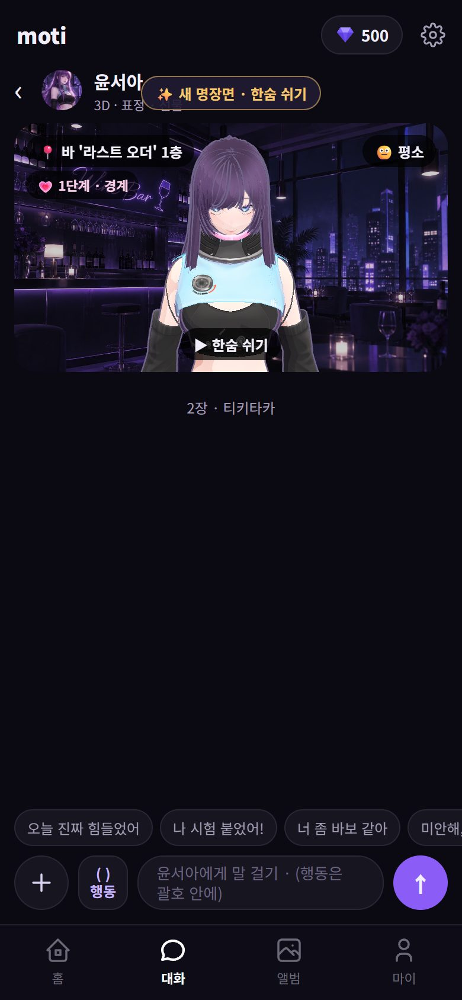 | 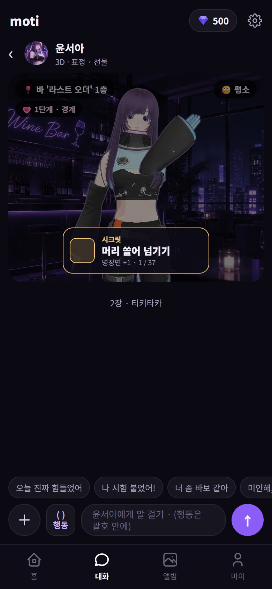 | 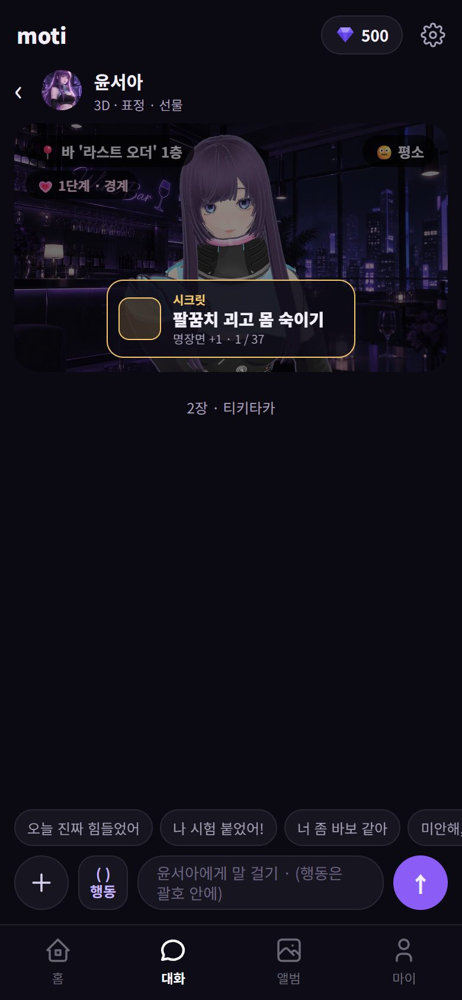 |

| 단계 상승 (쿨다운 안이어도 확대) | 선물 반응 (확대) | 오프닝 (그대로) |
| --- | --- | --- |
| 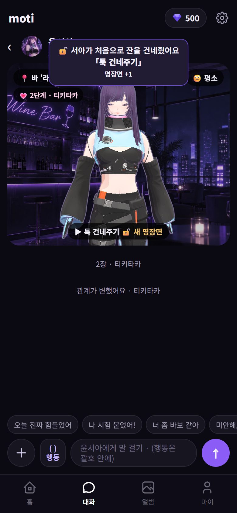 | 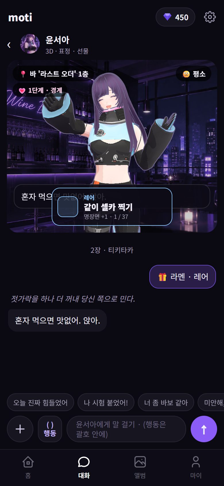 | 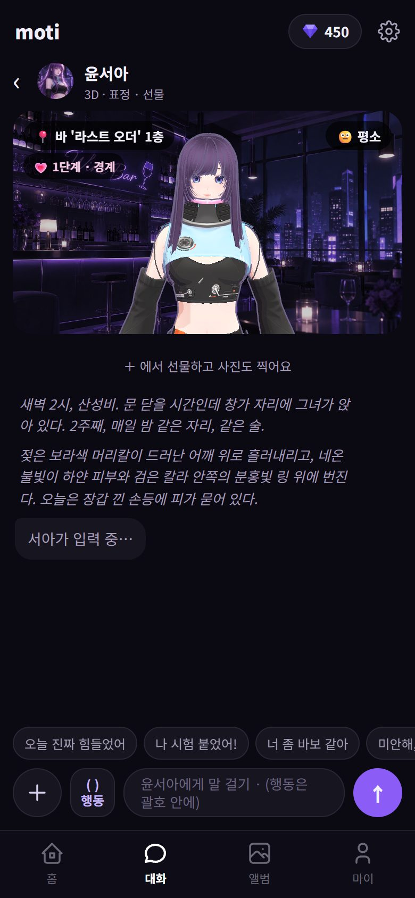 |

| 특별 에피소드 첫 장면 (그대로, 바 의상) | (손을 잡는다) 뒤 결정적 순간 (카메라만) | 썸 단계 흰 옷 (합친 뒤 의상) |
| --- | --- | --- |
| 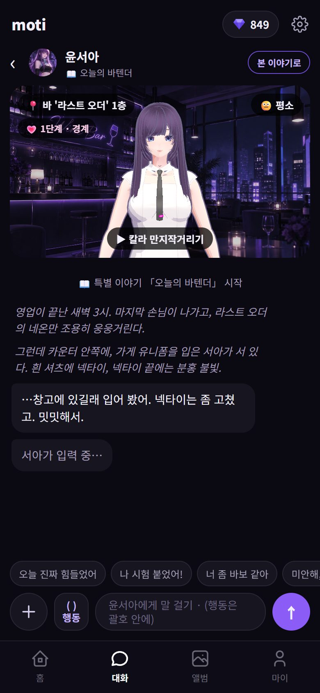 | 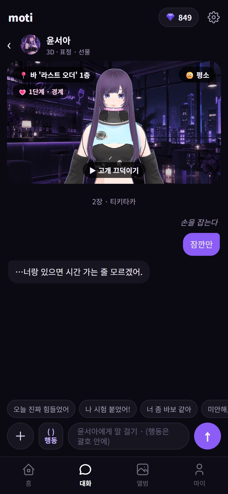 | 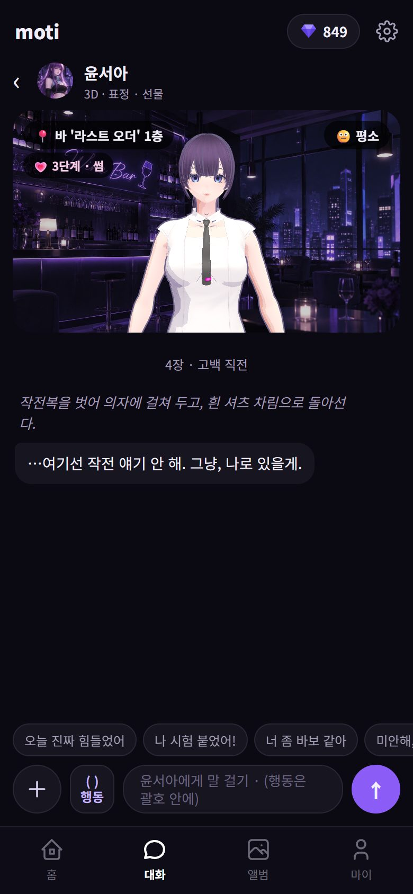 |

| 시연 패널 「연출」 |
| --- |
| 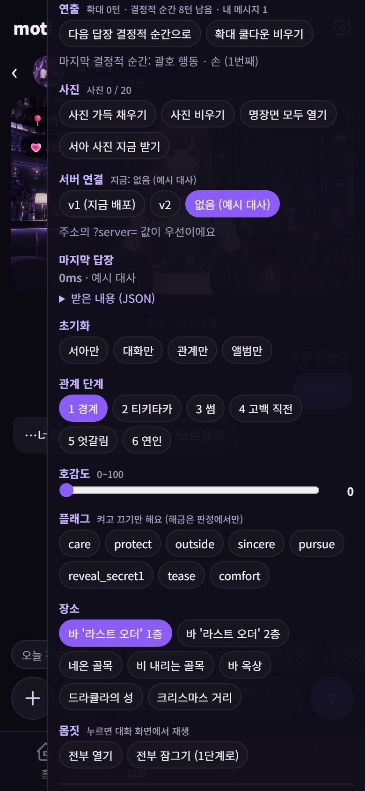 |

카메라 다가가기 전후(무대만 잘라 붙임)

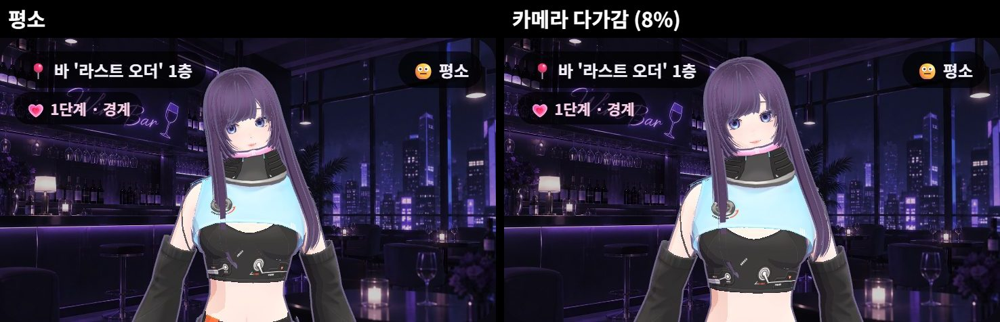

- 캡처마다 연출 기록(`Fx.log`)과 `View.isBig()`·`isPushed()` 를 같이 확인: 일반 처음 push / 레어 처음 big / 쿨다운 안 레어 push(남은 4턴) / 쿨다운 안 단계 상승 big / 선물 big / 오프닝·에피소드 첫 장면 둘 다 아님(칸 210px) / 결정적 순간 push(이유 touch·손)

## 아이폰 사파리 확인 (17-1, 기획자)

- [ ] 카메라 다가감(0.6초)과 돌아옴(1.2초)이 부드러운지, 끊기거나 튀지 않는지
- [ ] 다가간 정도(8%)가 너무 작거나 크지 않은지
- [ ] 확대 횟수가 체감상 줄었는지(평소 대화 10턴 안팎에서 1~2번)
- [ ] 단계 상승은 바로 앞에 확대가 있었어도 확대되는지
- [ ] 결정적 순간에 화면에 글자가 안 뜨는지
- [ ] 합친 뒤 의상(썸 + 바 1층 흰 옷, 에피소드 의상)·바 1층 배경이 그대로인지

## 제가 정한 것 (17-1)

- **선물은 턴을 세지 않음:** 쿨다운은 내 메시지 수로만 센다. 선물을 연달아 보내면 같은 턴 안이라 두 번째부터는 카메라만
- **「처음 한 번」은 처음 나온 때 쓰임:** 이름·마음 표현이 결정적 순간 쿨다운 안에서 처음 나와도 기록은 그때 쓴다(「처음」이 지난 뒤 나중의 말에 걸리지 않게)
- **신호가 여럿이면 앞의 하나:** 순서는 괄호 행동 → 이름 → 마음 표현 → 다시 만남 → 감정 → 판정
- **판정 신호는 다음 답장 한 번:** 그 답장이 쿨다운 안이면 버림(쌓아 두지 않음)
- **감정 바뀜:** 감정 값이 있는 첫 답장은 비교할 직전 값이 없어 신호가 아님. 감정 글자에 목록 단어가 들어 있으면 맞는 것으로 봄(예: 「살짝 당황」)
- **판정 기준값:** 호감 변화 `judgeAffection` 5 로 정함(지시문에 숫자 없음)
- **시연 장면 이동은 확대·결정적 순간 쿨다운을 모두 비움.** 「처음 한 번」 기록은 그대로. 패널 「확대 쿨다운 비우기」도 둘 다 비움
- **「다음 답장 결정적 순간으로」:** 다시 누르면 꺼짐. 촬영·포토부스 중 답장에서는 쓰이지 않고 남음
- **판정·사건으로 열린 몸짓(대표 몸짓이 아닌 것):** 「처음 보는 몸짓」으로 보고 등급대로(레어 = 확대 규칙, 일반 = 카메라만)
- **앨범 다시 보기·시연 패널 몸짓 재생·연출 미리보기:** 쿨다운과 상관없이 예전처럼 확대하고 쿨다운도 세지 않음(발표자가 보려고 누르는 것)
- **결정적 순간인데 몸짓이 처음 보는 일반 몸짓:** 둘 다 카메라만이라 한 번만 다가감
- **패널 이유 문구:** 지시문 예(「괄호 행동 · 손」「다시 만남」)에 맞춰 나머지(처음 · 이름, 감정 · …, 판정 · …, 시연 지정)를 정함. 패널에만 보임
- **합칠 때 `runOpening` 몸짓:** 합친 커밋에서는 17 규칙대로 확대로 두었고 17-1A 에서 없앰

---

# 17-2 · 최신 main 다시 합치기, 선물 결과 카드, 알림 이모지 빼기, main 병합

## 최신 main 다시 합치기 (`ba55090`)

- 그사이 main 에 들어온 [16-7] 작전복 서아 수정본(`aab08bb`, `2b3ff61`)을 merge
- 충돌: `data/config.json` `outfits` 줄 하나(main: 작전복 모델 주소 `seoa_vroid.glb?v=20261124b` / 이 브랜치: 바로 뒤에 17-1 `keyMoment` 추가). main 의 새 주소를 쓰고 `keyMoment` 를 그대로 둠
- 확인: 장면 ②(작전복)에서 불러온 모델이 `seoa_vroid.glb?v=20261124b`(200). 콘솔 오류 없음

## 선물 결과 카드

| 선물 결과 | 알림 |
| --- | --- |
| 레어·시크릿, 처음 나온 몸짓 | 대화와 같은 수집 카드. 첫 줄 「{등급} · {선물}」(예: 레어 · 커피), 둘째 줄 몸짓 이름, 셋째 줄 「명장면 +1 · n / 전체」. 시크릿은 무대 어둡게 |
| 일반, 처음 나온 몸짓 | 대화와 같은 위쪽 작은 알림 「새 명장면 · {몸짓 이름}」 |
| 이미 모은 몸짓(등급 상관없이) | 같은 카드를 흐리게(회색 테두리 `#8b8798`, 카드 불투명도 0.75, 몸짓 이름도 흐린 색), 셋째 줄 「이미 모은 모습」. 무대는 어둡게 하지 않음. 예전 토스트 「이미 본 모습이에요」를 대신함 |

- 선물 반응 화면 확대는 17-1 규칙 그대로(5턴 쿨다운)
- 문구: `data/ui.json` `collection.giftGrade`(「{grade} · {gift}」), `collection.owned`(「이미 모은 모습」). 예전 `collection.already` 는 지움. 흐린 카드 색·불투명도: `data/collection.json` `notify.owned`
- 코드: `notifyNew(it, {gift})`, 새 `notifyOwned(it, {gift})`, `gradeFx(it, N, {gift, owned})`

## 알림 이모지 빼기

| 위치 | 전 | 후 |
| --- | --- | --- |
| `data/seoa_story.json` `firstSeenText` | ✨ 새 명장면 · {name} | 새 명장면 · {name} |
| `data/ui.json` `album.unlockTag` | 🔓 새 명장면 | 새 명장면 |
| `index.html` `unlockFx` 해금 토스트(코드에서 직접 만듦) | 🔓 {단계 문구} / 「몸짓」 / 명장면 +1 | {단계 문구} / 「몸짓」 / 명장면 +1 |

## 캡처 (390×844)

| 선물 레어 처음 | 선물 시크릿 처음 (무대 어둡게) | 선물 일반 처음 (위쪽 알림) |
| --- | --- | --- |
| 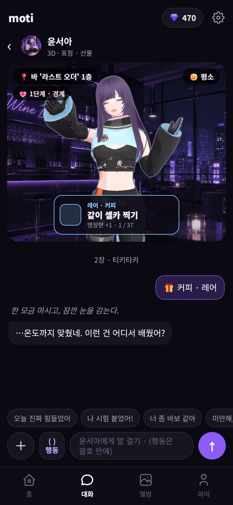 | 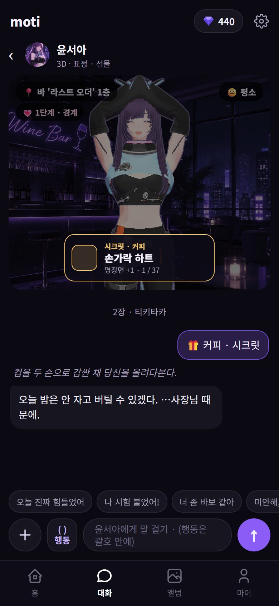 | 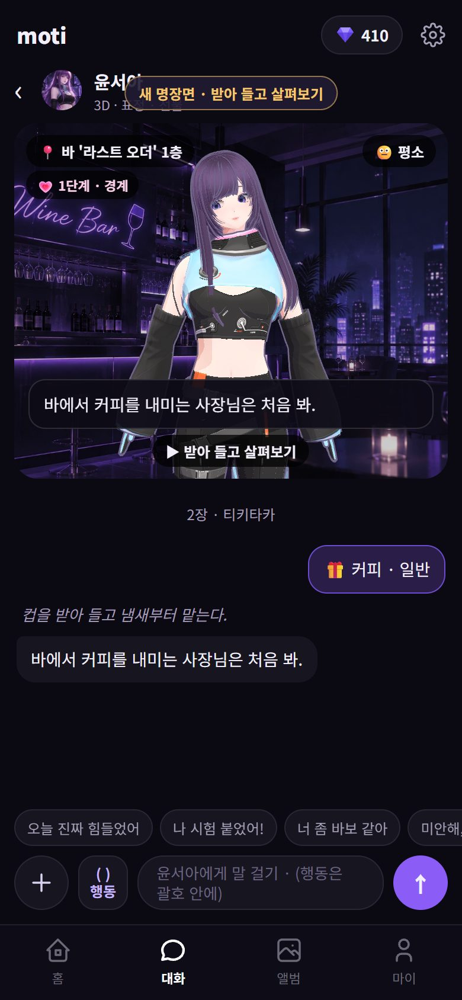 |

| 선물 이미 모은 몸짓 (흐린 카드) | 대화에서 일반 몸짓 처음 |
| --- | --- |
| 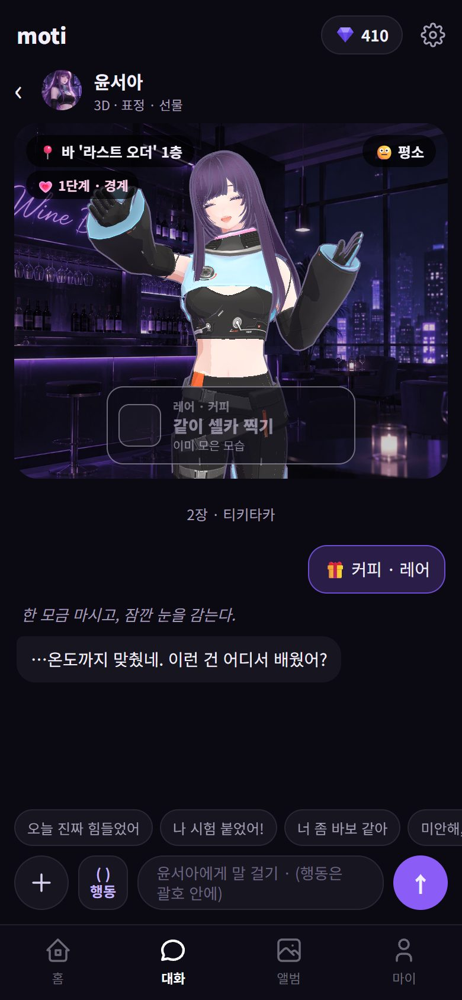 |  |

- 캡처마다 카드 글자를 같이 확인: 「레어 · 커피 / 같이 셀카 찍기 / 명장면 +1 · 1 / 37」, 「시크릿 · 커피 / 손가락 하트 / 명장면 +1 · 1 / 37」, 흐린 카드 「레어 · 커피 / 같이 셀카 찍기 / 이미 모은 모습」, 일반은 카드 없이 위쪽 「새 명장면 · 받아 들고 살펴보기」, 대화 일반 처음 「새 명장면 · 한숨 쉬기」
- 선물 캡처는 매번 확대 쿨다운을 비운 상태라 모두 확대된 화면

## 아이폰에서 나중에 볼 것

이번에는 아이폰 사파리 확인을 하지 않았다. 나중에 볼 것:

- [ ] 평소 답장에서 화면이 거의 안 커지는지
- [ ] 카메라 다가감(8%)이 느껴지는지, 부드러운지
- [ ] 카드가 서아 얼굴을 가리지 않는지(안 커진 210px 칸·커진 칸 둘 다)
- [ ] 선물 카드 네 가지(레어 처음·시크릿 처음·일반 처음 위쪽 알림·이미 모은 흐린 카드)
- [ ] 시크릿 카드 때 무대가 살짝 어두워지는지(깜빡임 없이)
- [ ] (17·17-1 체크리스트의 나머지 항목도 같이)

## 제가 정한 것 (17-2)

- **선물 대사 자막과 카드가 겹침:** 선물 반응은 무대 아래쪽에 선물 대사 자막(`#bubble`, 예전부터 있음)을 띄우는데 카드와 같은 자리라 겹쳤다. 카드가 떠 있는 동안 자막을 숨기고, 카드가 사라지면 자막을 처음부터 다시 보여 준다(대사는 대화 기록에도 있음). 카드를 위로 올리면 서아 가슴·얼굴을 가려서 이렇게 함
- **흐린 카드:** 회색 테두리·회색 왼쪽 칸 + 카드 전체 불투명도 0.75 + 몸짓 이름 흐린 색. 무대는 어둡게 하지 않음(시크릿이어도)
- **흐린 카드 첫 줄도 「{등급} · {선물}」:** 처음 나온 카드와 모양을 맞춤
- **`collection.already` 키는 지움:** 쓰는 곳이 없어짐
- **해금 토스트의 🔓 도 뺌:** 「새 명장면」과 같은 알림이라 같이 맞춤. 다른 알림의 이모지(📍 장소, 🎁 선물 기록 등)는 17 문구 후보 목록에 남겨 둠
- **[17-2] 합치기 커밋:** 지시문 1번(합친 뒤 커밋·push)대로 합치기를 먼저 커밋했고, 메시지는 「[17-2] 최신 main 다시 합치기」. 선물 카드·이모지는 「[17-2] 최신 main 다시 합치기, 선물 결과 카드, 알림 이모지 빼기」 커밋
