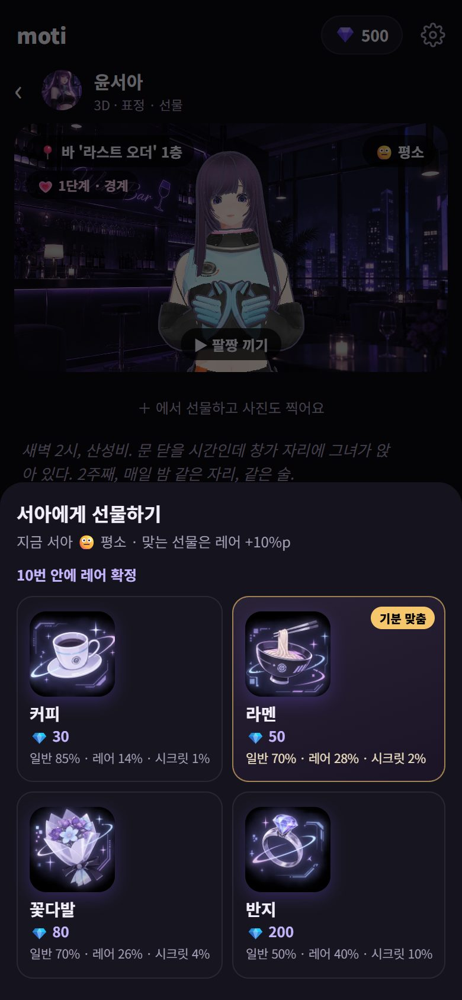
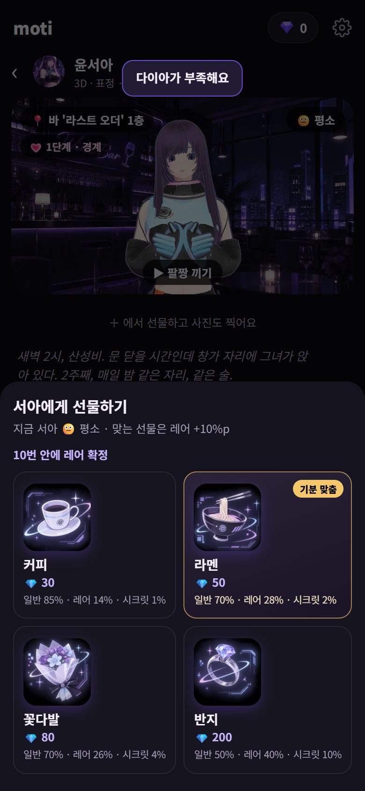
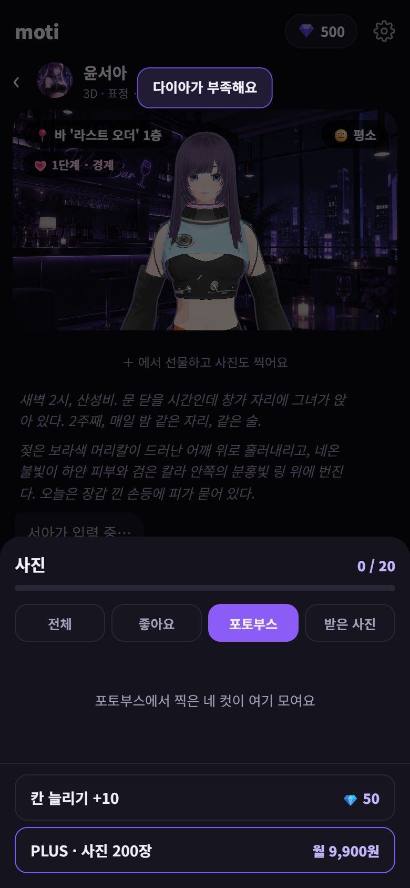
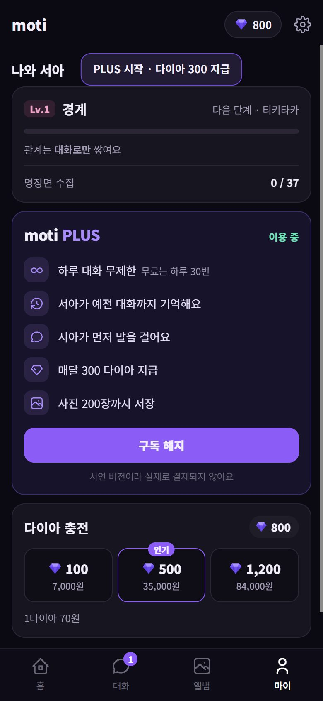
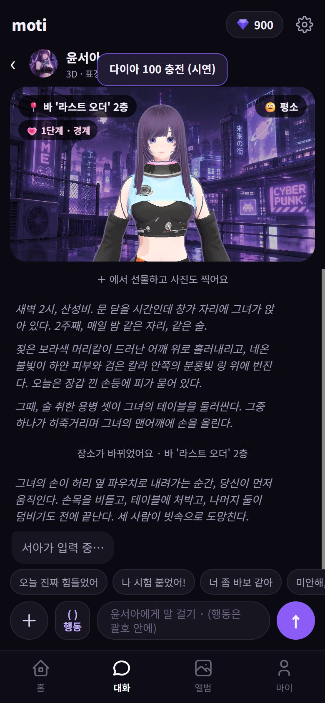

# 18단계 · 문구 정리: 장식 이모지와 안내 어미

브랜치: `step/18-copy`

## 바뀐 파일

| 파일 | 내용 |
| --- | --- |
| `data/ui.json` | 문구 바꿈(아래 표) + 새 키 4개: `gift.title`, `home.storySceneTag`, `chat.placeChanged`, `my.charged`. 각 묶음의 `_설명` 에 새 키 설명 추가 |
| `data/seoa_story.json` | `hints.m19` |
| `data/onboarding.json` | `login.desc` |
| `index.html` | 코드에 직접 있던 문구 5곳을 `UI(…)` 로 읽게 바꿈(선물 창 제목·이야기 장면 표시·장소 바뀜 대화 줄·PLUS 시작 알림·충전 알림) |
| `docs/reports/18-문구-정리.md`, `docs/reports/img/18/*.jpg` | 이 보고서·캡처 |
| `docs/status.md` | 18단계 절·브랜치 표 |

## 바꾼 문구

| 위치 | 전 | 후 |
| --- | --- | --- |
| ui.json `gift.noDia` · `home.noDia` · `photoFull.noDia` | 💎가 부족해요 | 다이아가 부족해요 |
| ui.json `home.storyStart` | 📖 특별 이야기 「{name}」 시작 | 특별 이야기 「{name}」 시작 |
| ui.json `home.storyTag` | 📖 이야기 전용 장면 · {name} | 이야기 전용 장면 · {name} |
| ui.json `photoFull.optPlus` · `photo.plusRow` | ✨ PLUS · 사진 {plusCap}장 | PLUS · 사진 {plusCap}장 |
| ui.json `photo.plusStart` | ✨ PLUS 시작 · 💎 300 지급 | PLUS 시작 · 다이아 300 지급 |
| ui.json `photo.empty.booth` | 앨범의 포토부스에서 네 컷 사진을 만들어 보세요. | 포토부스에서 찍은 네 컷이 여기 모여요 |
| seoa_story.json `hints.m19` | 그녀의 도발을 받아쳐 보세요. 지지 않으려 할 거예요. | 도발을 받아치면, 지지 않으려 할 거예요 |
| onboarding.json `login.desc` | 계정에 저장하면 휴대폰을 바꿔도 대화와 명장면을 이어서 볼 수 있어요. | 계정에 저장하면 휴대폰을 바꿔도 대화와 명장면이 그대로 남아요 |
| index.html → ui.json `gift.title` | 🎁 서아에게 선물하기 | 서아에게 선물하기 |
| index.html → ui.json `home.storySceneTag` | 📖 이야기 장면 | 이야기 장면 |
| index.html → ui.json `chat.placeChanged` | 📍 장소가 바뀌었어요 · {장소} | 장소가 바뀌었어요 · {place} |
| index.html → ui.json `photo.plusStart` (마이 페이지 PLUS 버튼) | ✨ PLUS 시작 · 💎 300 지급 | PLUS 시작 · 다이아 300 지급 |
| index.html → ui.json `my.charged` | 💎 {n} 충전 (시연) | 다이아 {n} 충전 (시연) |

그대로 둔 것: 대화 화면 위쪽(장소 칩·기분·관계 칩), 기분 바뀜 토스트, 캐릭터 소개·에피소드 상황·약관 임시 문구·시연 패널·서아 대사, 금액 옆 💎(`btnPrice`·`growPrice`·선물 가격 등), 안내·오류 문구(「필수 항목에 동의해 주세요」, 「3D를 불러오지 못했어요. 새로고침해 주세요.」, AI 안내, 성인 안내).

## 확인

- `data/*.json` 18개 모두 `JSON.parse` 통과
- 캡처(헤드리스 Chrome, 390×844, 픽셀 비율 2, `?skipintro=1`)마다 화면 글자를 같이 읽음. 콘솔 오류 없음

| 선물 창 | 다이아 부족 알림 | 사진 빈 화면(포토부스) |
| --- | --- | --- |
|  |  |  |

| PLUS 시작 알림 | 장소 바뀜 대화 줄 |
| --- | --- |
|  |  |

- 읽은 글자: 「서아에게 선물하기」 / 「다이아가 부족해요」 / 「포토부스에서 찍은 네 컷이 여기 모여요」 / 「PLUS 시작 · 다이아 300 지급」 / 「다이아 100 충전 (시연)」 / 「장소가 바뀌었어요 · 바 '라스트 오더' 2층」
- 시각 효과는 바꾸지 않아 아이폰 사파리 확인 항목은 없음

## 제가 정한 것

- **새 키 이름과 자리:** 선물 창 제목은 `gift.title`, 이야기 장면 표시는 `home.storySceneTag`(같은 묶음의 `storyStart`·`storyTag` 옆), 장소 바뀜 줄은 `chat.placeChanged`(대화방 문구 묶음), 충전 알림은 `my.charged`(마이 페이지 묶음). 마이 페이지 PLUS 시작 알림은 같은 문구가 이미 있는 `photo.plusStart` 를 같이 씀(새 키를 만들지 않음)
- **장소 바뀜 캡처:** 서버 답장으로 장소가 바뀌는 순간을 헤드리스에서 만들기 어려워, 코드와 같은 줄(`setScene` + `addMsg("sys", UI("chat.placeChanged", …))`)을 직접 불러 찍음. 서아 오프닝 글이 나오는 중이라 줄이 오프닝 문단 사이에 보임
- **장소 바뀜 캡처 위쪽 알림:** 바로 앞에서 충전 버튼 문구를 확인하느라 「다이아 100 충전 (시연)」 알림이 남아 있음. 충전 알림 확인용으로 그대로 둠
- **다이아 부족 캡처:** 선물 창을 연 채 다이아를 0으로 두고 커피를 눌러 찍음(창이 닫히지 않고 알림만 뜨는 실제 흐름)
- **이미 저장된 대화:** 예전 문구로 저장된 대화 기록(예: 「📍 장소가 바뀌었어요 · …」 줄)은 기기에 남은 그대로 보임. 새로 생기는 줄부터 바뀜
- **`v1.html`·`app.js`(이전 앱)는 보지 않음:** 지금 앱이 아니라서 아래 목록에서도 뺌

## 표 밖에서 보인 문장 앞 장식 이모지 (고치지 않음)

지금 앱(`index.html`, `data/*.json`, `photos.js`·`booth.js` 등)에서 찾음. 지시문에서 다음 단계로 미룬 것(장소 칩 📍·기분 😐·관계 칩 💗·기분 바뀜 토스트)과 금액 옆 💎, 시연 패널은 뺌.

| 파일 | 키·위치 | 지금 문구 | 메모 |
| --- | --- | --- | --- |
| ui.json | `notify.format` | 💬 {name}: {line} | 다른 캐릭터 알림(헤더 한 줄) |
| ui.json | `gift.logTag` | 🎁 {gift} · {grade} | 대화 기록의 선물 결과 줄 |
| ui.json | `outfit.firstPrivateTag` | 👕 처음 보는 옷 | 처음 흰 옷 대사 옆 표시 |
| ui.json | `thread.sub` | 📖 {name} | 특별 에피소드 대화방 머리 작은 글 |
| index.html | 메시지 목록 미리보기(`renderList`) | 🎁 … / 🖼 … | 마지막 메시지가 선물·사진일 때 앞에 붙음 |
| index.html | 홈 카드(`renderHome`) | 💬 {n}만 | 대화 수 표시 |
| index.html | 명장면 칸(`renderAlbum`) | 🎁 / 💬 / ✨ / 👤 | 칸 안 그림 기호(문장이 아님) |
| booth.js | 줄 139 (몸짓 칩) | 🔒 {몸짓 이름} | 포토부스에서 아직 못 모은 몸짓 칩 |
