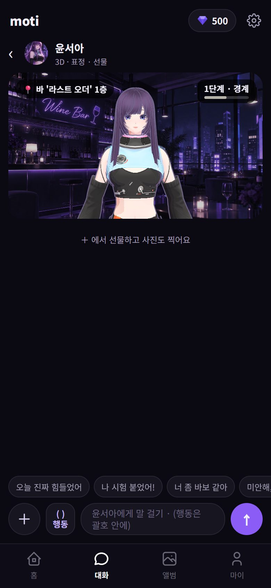
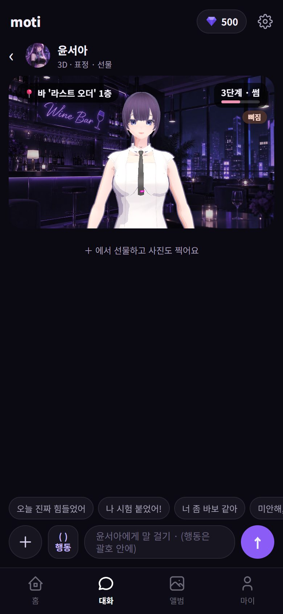
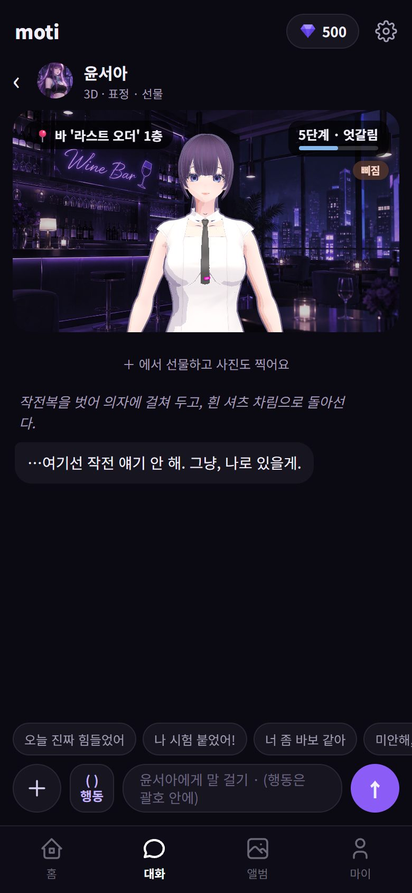
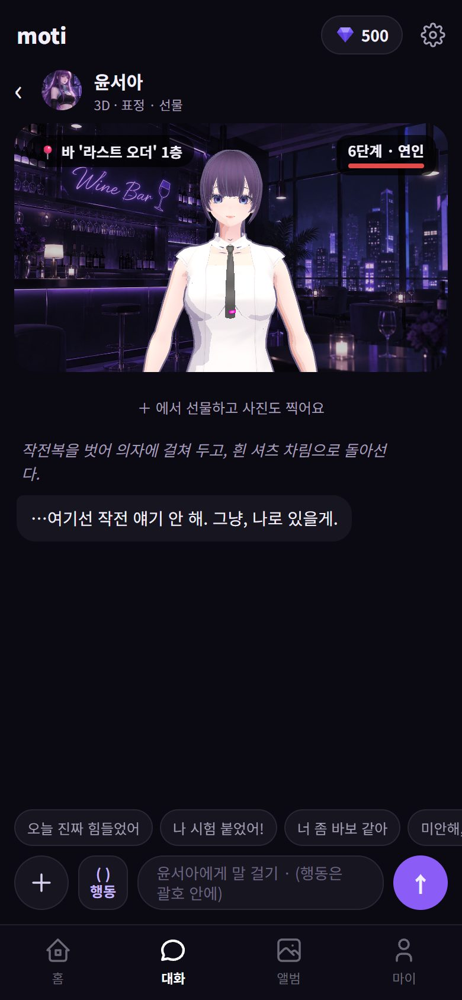
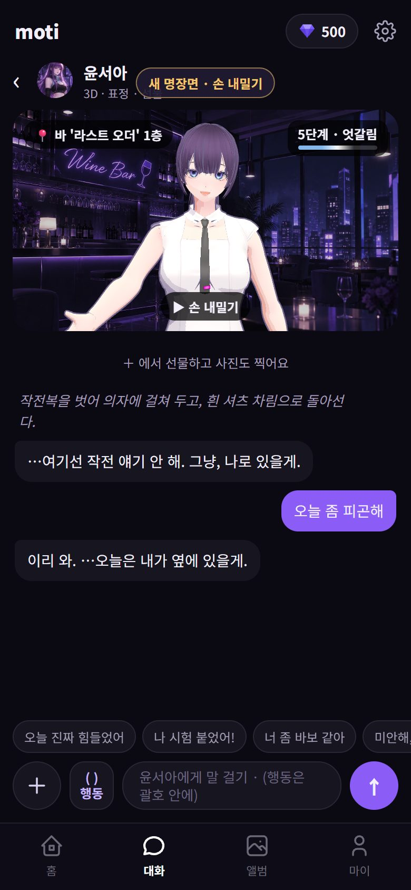
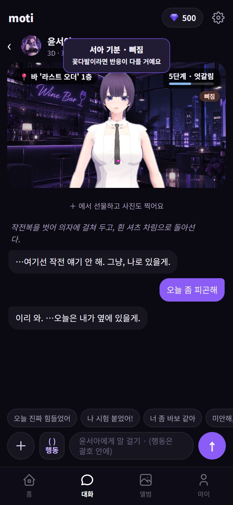
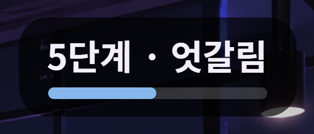
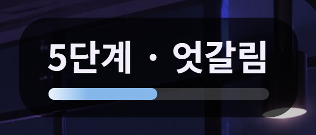
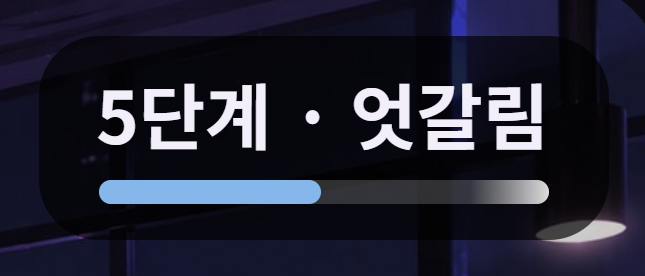

# 19단계 · 대화 화면 위쪽: 관계 단계·게이지, 기분 태그, 결정적 순간 반짝임

브랜치: `step/19-bond-gauge`

## 바뀐 파일

| 파일 | 내용 |
| --- | --- |
| `data/config.json` | `bondTop` 추가(게이지 높이 4px, 단계별 색 6개, 바탕 줄 색, 색 바뀜 600ms, 단계 상승 때 다시 차는 시간 600ms, 평소 늘어나는 시간 500ms, 반짝임 띠 `shine` 800ms·폭 0.4·색) · `moodTag` 추가(삐짐·지침·생일 기준 색·글자 색·바탕 색) |
| `data/ui.json` | `top` 추가: `bond`「{n}단계 · {name}」, `moodToast`「서아 기분 · {mood}」, `moodGift`「{gift}이라면 반응이 다를 거예요」 |
| `index.html` | 오른쪽 위 「😐 평소」 칩(`.mood`)과 왼쪽 「💗 n단계」 칩(`.bondchip`)을 없애고 오른쪽 위 묶음(`#bondTop`: 단계 줄 + 게이지 + 기분 태그)으로 바꿈 · `BondTop`(그리기·단계 상승·반짝임) · `renderTop` 기분 태그 · `renderBond` 가 위쪽 게이지도 그림 · 결정적 순간에 `BondTop.shine()` · 기분 바뀜 토스트를 `moodToast()` 로 옮기고 문구를 ui.json 에서 읽음 |
| `docs/reports/19-관계-게이지.md`, `docs/reports/img/19/*` | 이 보고서·캡처 |
| `docs/status.md` | 19단계 절·브랜치 표 |

건드리지 않은 것: 왼쪽 위 장소 칩(`#where`), 단계 기준(`countAt`·`affectionAt`), 확대 규칙(17-1), 마이페이지 관계 게이지.

## 1. 오른쪽 위 관계 표시

- 어두운 반투명 상자(`#000a`, 예전 칩과 같은 바탕) 안에 첫 줄 「{n}단계 · {이름}」(12px 굵게), 그 밑 4px 게이지. 게이지 폭은 글자 줄 폭과 같다(캡처 때 잰 값: 글자 64.4px = 게이지 64.4px)
- 게이지 값은 `renderBond()` 가 마이페이지에 넘기는 `pct` 를 그대로 쓴다(같은 함수 안에서 계산). 서버 v1 = 대화 횟수(`countAt`), v2 = 호감도(`affectionAt`)
- 위치: 무대 오른쪽 위 10px. 헤더의 💎·톱니바퀴는 무대 밖(헤더)이라 겹치지 않는다. 묶음 오른쪽 끝 x=368, 서아 머리는 화면 가운데라 가리지 않음(캡처)

## 2. 단계별 게이지 색

| 단계 | 색 |
| --- | --- |
| 1 경계 | `#B4B2A9` |
| 2 티키타카 | `#F4C0D1` |
| 3 썸 | `#ED93B1` |
| 4 고백 직전 | `#D4537E` |
| 5 엇갈림 | `#85B7EB` |
| 6 연인 | `#E24B4A` |

- 단계가 오르면 게이지가 0으로 돌아가 새 단계 값까지 600ms 동안 다시 차고, 색도 600ms 동안 바뀐다. 4 → 5 상승을 재 본 값: 0ms 0px·`#D4537E` → 150ms 5px → 300ms 16px(중간 색) → 700ms 28px·`#85B7EB`
- 평소 답장으로 값만 늘 때는 500ms 동안 조용히 늘어난다(반짝임 없음)

## 3. 기분 태그와 기분 바뀜 토스트

- 평소면 태그가 없다. 지침·삐짐·생일이면 게이지 상자 밑에 「지침」「삐짐」「생일」(10px, 이모지 없음)
- 색: 삐짐 `#F0997B`(글자 `#FFD8CA`), 지침 `#B4B2A9`(글자 `#E9E8E2`), 생일 `#F4C0D1`(글자 `#FFE6EE`). 바탕은 기준 색 28% 를 어두운 바탕(`#000a`) 위에 겹침
- 토스트: 첫 줄 「서아 기분 · 삐짐」(굵게), 둘째 줄 「꽃다발이라면 반응이 다를 거예요」. 지침이면 「커피라면 …」, 평소로 돌아가면 첫 줄만

## 4. 결정적 순간 반짝임

- 17-1B 의 결정적 순간(`Fx.key` 가 이유를 돌려줄 때)에 답장 몸짓을 시작하는 `react` 바로 뒤 `BondTop.shine()` → 카메라 다가감(`pushInMs` 600ms)과 같은 때 시작
- 게이지 폭의 40% 인 밝은 띠(가운데가 흰색, 양끝 투명)가 게이지 왼쪽 밖에서 오른쪽 밖으로 800ms 동안 한 번 지나간다. `transform: translateX` 만 움직이고 블러·그림자·발광 없음. 게이지가 `overflow:hidden` 이라 띠는 게이지 안에서만 보인다
- Web Animations(`element.animate`)로 돌려 화면을 옮겨도 다시 재생되지 않는다(9단계 선물 연출에서 CSS 애니메이션이 다시 재생되던 문제를 피함)
- 촬영 화면이 열려 있을 때는 17-1B 가 결정적 순간을 세지 않으므로 반짝임도 없다

## 5. 시연 패널

- 「다음 답장 결정적 순간으로」(17-1B) 가 이미 있어 그대로 쓴다. 누르고 아무 말이나 보내면 그 답장에서 카메라가 다가가며 게이지가 반짝인다. 확인: 이 버튼을 켜고 로컬 예비 답장으로 보내 `BondTop.shine()` 이 한 번 불린 것을 셈(마지막 이유 `force`)
- 기분 버튼(평소·지침·삐짐·생일)도 이미 있어 추가하지 않았다. 누르면 태그가 바로 바뀐다

## 확인

- `data/*.json` 18개 모두 `JSON.parse` 통과
- 서버 v1(기본)과 `?server=2` 둘 다 같은 장면(각 단계 시작값 + 45%)에서 게이지가 그려짐

| 단계·기분 | v1 | v2 |
| --- | --- | --- |
| 1 경계 · 평소 | 50%, 회색, 태그 없음 | 45%, 회색, 태그 없음 |
| 3 썸 · 삐짐 | 50%, `#ED93B1`, 삐짐 | 45%, `#ED93B1`, 삐짐 |
| 5 엇갈림 · 삐짐 | 50%, `#85B7EB`, 삐짐 | 44%, `#85B7EB`, 삐짐 |
| 6 연인 · 평소 | 100%(최고 단계), `#E24B4A` | 100%, `#E24B4A` |

## 캡처 (390×844, 픽셀 비율 2, 헤드리스 Chrome + 소프트웨어 WebGL)

| 1단계 · 회색, 태그 없음 | 3단계 썸 + 삐짐 | 5단계 엇갈림 + 삐짐 |
| --- | --- | --- |
|  |  |  |

| 6단계 연인 | 반짝임 도중(400ms) | 기분 바뀜 토스트 |
| --- | --- | --- |
|  |  |  |

5단계 엇갈림의 푸른 게이지 밑에서 산호색 삐짐 태그가 구분된다(19-03).

반짝임 띠 확대(0 · 200 · 400 · 600 · 800ms). 애니메이션을 멈추고 시각을 옮겨 찍음

| 0 | 200 | 400 | 600 | 800 |
| --- | --- | --- | --- | --- |
|  |  |  |  |  |

## 아이폰에서 나중에 볼 것

- [ ] 단계가 오를 때 게이지 색이 0.6초 동안 부드럽게 바뀌고, 0에서 다시 차는지
- [ ] 결정적 순간 반짝임 띠가 한 번만 지나가고 게이지 밖으로 삐져나오지 않는지(둥근 모서리 + `overflow:hidden`)
- [ ] 오른쪽 위 묶음·기분 태그가 서아 얼굴을 가리지 않는지(안 커진 210px 칸, 커진 300px 칸 둘 다)
- [ ] 노치·헤더와 겹치지 않는지

## 제가 정한 것

- **왼쪽 「💗 n단계」 칩(`.bondchip`)도 없앴다.** 같은 내용이 오른쪽 위로 옮겨졌으므로 두 번 보이지 않게. 장소 칩은 그대로
- **단계 줄과 게이지를 한 상자에 넣었다.** 배경 그림 위에서 글자·4px 게이지가 읽히도록 예전 칩과 같은 어두운 바탕(`#000a`), 모서리 10px. 기분 태그는 상자 밖 바로 밑, 오른쪽 맞춤
- **게이지 바탕 줄:** 흰색 18%(`bondTop.track`). 지시문에 없어 정함
- **단계 상승 때 「다시 참」:** 0에서 새 값까지 채움(600ms, `fillMs`). 평소 늘어남은 500ms(`growMs`)
- **6단계(최고)는 100%** — 마이페이지 계산과 같음
- **단계가 내려갈 때(시연 패널 초기화·단계 이동):** 다시 차는 연출 없이 평소처럼 바뀜
- **태그 색:** 지시문의 기준 색에서 글자는 같은 계열의 밝은 색을 골랐고, 바탕은 기준 색 28%를 어두운 바탕 위에 겹쳤다(배경 그림 위에서 읽히게). 값은 `config.json moodTag`
- **태그 글자는 코드의 `STATES` 이름(지침·삐짐·생일)을 그대로** 쓴다. 시연 패널 기분 이름(`demo.json moods`)과 같은 말
- **토스트 둘째 줄 조사:** 원고는 「{선물}이라면」. 「커피」「반지」처럼 받침 없는 이름은 「커피이라면」이 되므로 코드가 「라면」으로 고친다
- **평소로 돌아갈 때 토스트:** 예전처럼 알림은 뜨고 첫 줄 「서아 기분 · 평소」만(맞는 선물 줄 없음)
- **반짝임 띠 폭** 게이지의 40%, 색 흰색 95%, 곡선 `ease-in-out`. 띠 양끝은 투명으로 흐려지게(그라데이션, 블러 아님)
- **결정적 순간인데 처음 보는 레어·시크릿 몸짓이라 화면이 커지는 경우**에도 반짝임은 같은 때 나온다(17-1B 판정 기준)
- **반짝임 확인용 새 버튼은 만들지 않았다.** 지시문대로 기존 「다음 답장 결정적 순간으로」로 볼 수 있음
- 기분 이모지를 담은 `STATES` 의 `e` 값은 시연 패널 기분 버튼·선물 창 안내에서 아직 쓰므로 지우지 않음
