# [2] v2 대화 기능을 새 앱(index.html)에 다시 만들기

브랜치: `step/2-v2-newapp` (main에는 아직 병합하지 않음)

| 커밋 | 내용 |
| --- | --- |
| `[2-A]` | 서버 응답 두 형식 처리, 매 답장 몸짓, 표정 대응표 분리 |
| `[2-B]` | 관계 6단계·판정·해금·인트로·장소 |

## 바뀐 파일

| 파일 | 단계 | 내용 |
| --- | --- | --- |
| `.gitignore` | A | 새로 만듦: `.env.local`, `.env`, `node_modules/`, `.DS_Store`, `*.vroid`, `*.fbx` |
| `motion.js` | A | v2의 서아 전용 몸짓 c01~c05, 대기 몸짓 m25 추가 (v2 파일과 똑같음. 기존 m01~m23은 그대로) |
| `index.html` | A·B | 서버 연결, 매 답장 몸짓, 표정, 관계 6단계, 판정, 해금 연출, 앨범 두 칸, 인트로, 장소 5곳 |
| `data/config.json` | A | `serverVersion`(기본 1), `apiUrl` |
| `data/emotion_face.json` | A | 감정 → 표정 대응표 (기존 8개 + 새 5개) |
| `data/motions.json` | A | 몸짓 30개 이름·감정, 감정 → 고를 몸짓 감정, 표정 → 감정 |
| `data/seoa_story.json` | B | 단계 이름, 단계 상승 메시지, 호감도·대화 횟수 기준, 장소 5곳, 해금 지도, 앨범 힌트(빈칸) |
| `data/seoa_intro.json` | B | 서버 OPENING 10문단 그대로 + 몸짓 재생 문단 |
| `docs/status.md` | B | 이번 단계 반영, 바 1·2층 "이미지 필요" |
| `docs/reports/2-대화v2-새앱.md`, `docs/reports/img/2/*.jpg` | A·B | 이 보고서와 캡처 |

## 캡처 (390px)

| 화면 | 파일 |
| --- | --- |
| [2-A] v2 형식 답장: 지문(행동)은 말풍선 밖, 대사는 말풍선 | 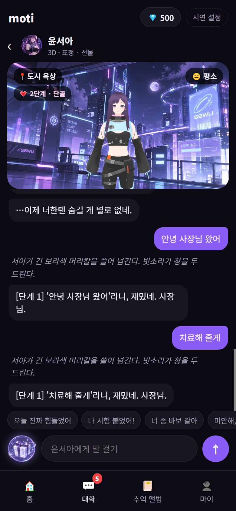 |
| 인트로 (대화방 안, 문단이 하나씩. 손 내밀기 재생 중) | 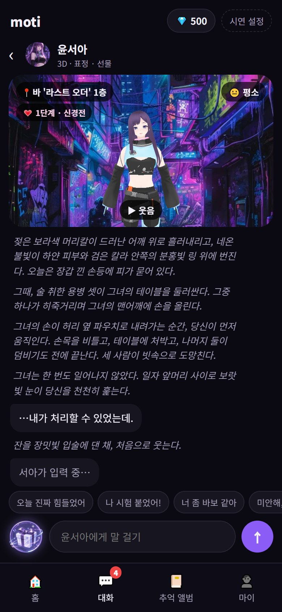 |
| 대화 중 몸짓 (매 답장) | 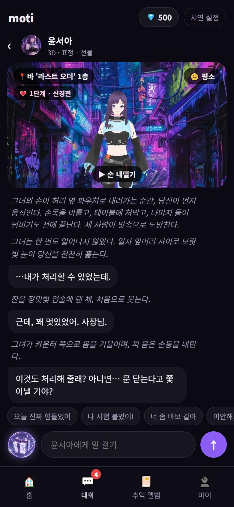 |
| 해금 순간 (전신 구도 + 해금 문구 토스트 + "관계가 변했어요 · 단골") | 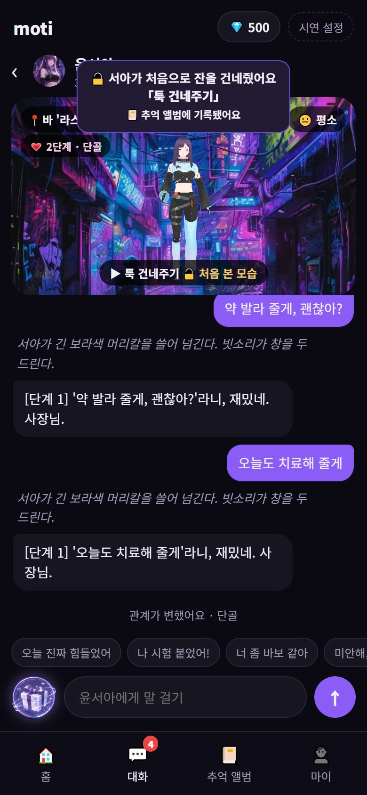 |
| 장소 전환 (바 옥상) + 3단계 끌림 해금 | 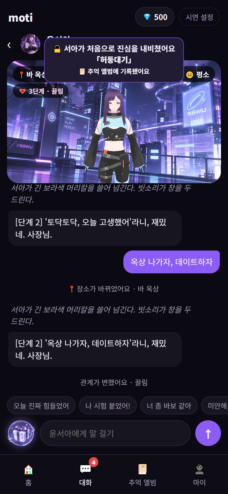 |
| 앨범 「처음 본 모습」 (누르면 그 몸짓 다시 재생, 안 열린 칸은 실루엣) | 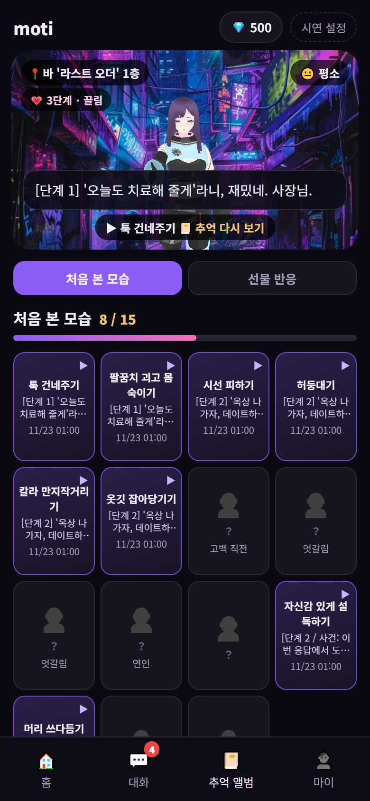 |
| 앨범 「선물 반응」 (기존 16칸 그대로) | 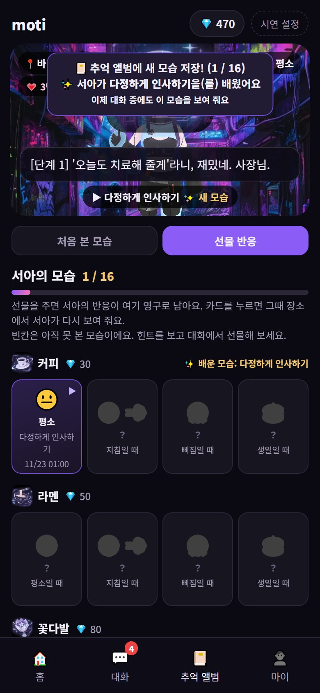 |
| 서버 없음 (예시 대사 + 대화 횟수로 2단계) | 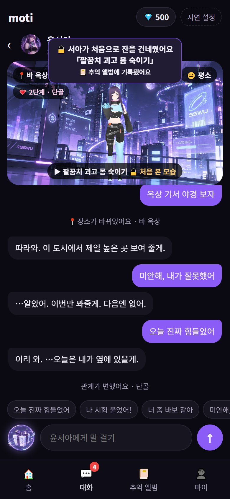 |

캡처는 헤드리스 Chrome을 390×844(배율 2)로 맞춰 찍었다. 서아의 대사가 `[단계 1] '…'라니, 재밌네. 사장님.`인 것은 서버의 **가짜 모델(LLM_PROVIDER=fake)** 응답이라서다.

## [2-A] 한 일

1. `.gitignore` 추가.
2. 새 앱은 `motion.js`를 쓴다 → v2의 `motion.js`를 그대로 가져와 c01~c05, m25를 넣었다. 이름·감정은 `data/motions.json`.
3. `data/config.json`의 `serverVersion`(기본 1). 주소 뒤 `?server=2`로 덮어쓴다. 서버 주소도 `apiUrl` + `?api=`로 바꿀 수 있다.
4. 서버 응답 두 형식 모두 처리 (`readReply`).
   - 예전 형식(`reply`): 예전처럼 `*지문*`을 쪼개 그림.
   - v2 형식(`action`, `dialogue`, `motion_id`, `emotion`, `location`): `action` → 지문(`.mnarr`), `dialogue` → 말풍선.
   - serverVersion 2면 요청도 v2 형식: 최근 16턴 `history`(`*행동* 대사`), `state`, `motion_list`(해금된 몸짓, 직전 몸짓 제외).
   - 서버 v1이라도 응답이 v2 형식이면 v2로 그린다 (서버가 먼저 배포돼도 깨지지 않게).
5. 매 답장 몸짓 (`pickMotion`): `motion_id` → 감정에 맞는 해금된 몸짓 → 없으면 대기 몸짓(m25) 유지. 직전 몸짓은 다시 안 고른다. 답장을 기다리는 동안 m25(고개 갸웃하며 듣기).
6. 감정→표정 `data/emotion_face.json`. 새 감정 5개: 평온=기본(무표정), 도발=fun 0.4, 진심=sorrow 0.3, 질투=angry 0.35, 당황=surprised 0.5+joy 0.2. **값은 지시문 그대로** 두었다. 5개 표정을 하나씩 띄워 모델에서 따로 비교해 보지는 않았다(대화 중 도발 표정만 화면으로 봄) → 아이폰 확인 때 같이 보기를 권한다.
7. 확인
   - serverVersion 1, 배포 서버: 첫 요청은 Render가 깨어나는 데 25초를 넘겨 예시 대사로 답함(예전과 같은 25초 제한). 두 번째 요청부터 서버 `reply`로 답하고 몸짓 재생 확인.
   - 서버 없음(`?api=http://127.0.0.1:9`): v1·v2 모두 예시 대사 + 몸짓으로 이어짐, 콘솔 오류 없음.

## [2-B] 한 일

1. `data/seoa_story.json`: 단계 이름 6개, 장소 5곳, 해금 지도(단계·플래그·사건, 문구 포함), 서아에게 안 맞는 몸짓(m14·m16·m22)을 서버 `yoon_seoa_prompt.md`에서 그대로 옮김.
2. 관계 6단계 (`신경전·단골·끌림·고백 직전·엇갈림·연인`)
   - serverVersion 2: 답장을 보여 준 뒤 `/judge`를 뒤에서 호출(`runJudge`), 돌아온 `state` 저장. 판정 중에 보낸 메시지는 화면에 먼저 보이고, 서버 전송은 판정이 끝난 뒤. (시험: 판정을 3초 늦춰도 두 번째 `/chat`이 판정 끝난 뒤 시작됨을 확인)
   - 6턴마다 `need_summary`와 최근 24개 대화를 같이 보냄.
   - serverVersion 1·서버 없음: 대화 횟수 0·4·9·15·22·30에서 한 단계씩 오름.
3. 해금: 단계 상승·판정 플래그·사건(ROOFTOP)에 따라 지도대로 열림. 처음 열린 몸짓만 → 카메라가 전신 구도로 물러났다가 그 몸짓 재생 → 해금 문구 토스트 → 그때 서아 대사와 함께 `S.firsts`에 기록. 단계가 오르면 "관계가 변했어요 · 단골" 시스템 메시지.
4. 추억 앨범 두 칸: 「처음 본 모습」(15칸, 날짜·그때 대사, 누르면 다시 재생, 안 열린 칸은 실루엣 + 단계 이름 또는 힌트) / 「선물 반응」(기존 16칸 그대로).
   - **힌트 문구는 원고 필요**: `data/seoa_story.json`의 `hints`가 모두 빈칸.
5. 인트로: 서아 방에 처음 들어갈 때만 OPENING 10문단을 1.7초 간격으로 메시지로 보여 주고, 0번째 문단 m07(팔짱) → 「웃는다」 m01 → 「내민다」 m11. 다시 들어오면 안 나옴.
6. 장소 5곳 적용. 서버가 `location`을 보내면 배경 전환 + "📍 장소가 바뀌었어요 · 바 옥상". 바 1층은 `bg_seoa_alley.jpg`, 2층은 `bg_seoa_roof.jpg`로 임시 대체.
7. 확인 (서버 v2 브랜치 + `LLM_PROVIDER=fake`, `?server=2&api=http://localhost:8000`)
   - 매 답장 몸짓 ✔, 1→2→3단계 상승 ✔, 단계 해금(m09·c03, m05·m06·c01·c04) ✔, 플래그 해금(tease m19, comfort m08, protect m21) ✔, 사건 해금(ROOFTOP m23, `pending_event`를 직접 넣어 시험) ✔, 앨범 기록·다시 재생 ✔, 장소 전환(바 옥상) ✔
   - serverVersion 1(배포 서버)·서버 없음 ✔

## 제가 정한 것

1. **서버 주소도 config에 넣었다** (`apiUrl`). v2에 있던 `?api=`로 덮어쓰기도 살렸다.
2. **몸짓 이름·감정은 `data/motions.json`** 으로 뺐다. 선물·Claude 미리보기가 쓰는 기존 `BASE`·`SIGN`은 손대지 않고, 없는 이름만 JSON에서 채운다.
3. `motion_id`가 없을 때 감정에 맞는 몸짓을 고르려고 **감정 → 몸짓 감정 표**(`emotionMotion`)를 만들었다. 예: 질투 → 냉담·분노, 당황 → 수줍음·놀람, 평온 → 위로. 감정 글자가 없는 답장(Claude 미리보기·예시 대사)은 표정 이름으로 감정을 대신한다(`faceEmotion`).
4. "평온: 기본 표정"은 **무표정(neutral)** 으로 정했다. 평소 상태로 돌아갈 때 쓰는 표정과 같게.
5. **?server=2 일 때는 Claude 미리보기를 건너뛴다.** 서버 v2 흐름(판정·해금)을 시험하는 모드라서.
6. 대기 몸짓(m25)은 3D 아래 몸짓 이름 표시(▶)를 띄우지 않는다. 매번 뜨면 어수선해서.
7. 서버 v2 모드라도 **서버가 답을 못 하면(예시 대사로 답하면) 대화 횟수로** 단계를 올린다. 서버 없이 시연이 되게.
8. 대화 횟수 기준 **0·4·9·15·22·30** (기존 0·4·10·18·30을 6단계로). 한 번에 한 단계씩만 오른다.
9. 해금 순간 "전신 구도"는 **그 순간에만 카메라를 뒤로 물렸다가 원래 값으로 돌아가는 방식**으로 했다. 평소 카메라 값(세로 `0,1.25,2.9`, 가로 `0,1.26,2.3` 등)은 그대로.
10. 한 번에 몸짓이 여러 개 열리면(예: 3단계 4개) **하나씩 차례로** 재생하고 토스트도 하나씩 띄운다. 대화방 밖에서 열리면 기록만 하고 연출은 생략.
11. 1단계(처음부터) 몸짓은 "처음 본 순간"이 없으므로 앨범 칸에서 뺐다 → 「처음 본 모습」은 **15칸**.
12. 안 열린 칸에는 힌트가 빈칸이라 **단계 이름**(예: 고백 직전)만 보인다. 플래그·사건 칸은 이름이 영어라 `？`만.
13. 앨범에서 「처음 본 모습」을 누르면 그때 장소로 배경을 바꾼다(선물 반응 다시 보기와 같은 방식). 이때 대화의 현재 장소도 같이 바뀐다.
14. 관계 단계가 오를 때 예전에 나오던 코드 속 대사(「…이제 너한텐 숨길 게 별로 없네.」)와 m12 재생은 **없앴다.** 그 자리를 시스템 메시지 + 해금 연출이 대신한다.
15. 인트로 중에는 "서아가 입력 중…"이 보이고 보내기가 막힌다(인트로가 끝나면 풀림). 인트로 원고가 있으면 예전 한 줄 인트로는 서아 방에 넣지 않는다. 메시지 목록의 서아 미리보기는 OPENING 첫 문단.
16. 예전 저장값(장소 2곳)은 자동으로 옮긴다: 네온 거리 → 네온 골목, 도시 옥상 → 바 옥상. 홈 특별 에피소드 장소 번호도 같은 그림이 나오게 바꿨다(홈 화면 모양은 그대로). 이미 대화하던 사람은 인트로를 건너뛴다.
17. 새로 쓰는 사람의 첫 장소는 서버 기본값과 같은 **바 '라스트 오더' 1층**(임시 그림 `bg_seoa_alley.jpg`).
18. 마이 화면의 관계 게이지: v2는 호감도, v1·서버 없음은 대화 횟수 기준. 화면 모양은 그대로.
19. `data/*.json`을 `fetch`로 읽기 때문에 **파일을 더블클릭(file://)으로 열면 안 되고** 로컬 서버로 열어야 한다 (아래 방법).

## 아이폰 사파리 확인 항목

시각 효과를 바꿨으므로 아이폰 사파리에서 따로 확인해야 한다 (이번에는 아이폰이 없어 확인 못 함).

- 해금 순간 카메라가 전신으로 물러났다 돌아오는 움직임 (WebGL)
- 새 표정 5개(도발·진심·질투·당황·평온)가 실제 모델에서 자연스러운지
- 앨범 칸의 대사 두 줄 말줄임(`-webkit-line-clamp`)

## 서버 배포 때 할 일 (serverVersion 을 2로)

1. 서버 저장소 `feat/motion-chat-v2`를 배포한다 (Render). 배포 뒤 `https://seoa-backand.onrender.com/openapi.json`에 `/judge`가 보이면 된다.
2. 앱에서 `data/config.json`의 `"serverVersion": 1` → `"serverVersion": 2`로 바꿔 커밋한다.
3. 배포 전에 먼저 확인하려면 주소 뒤에 `?server=2`를 붙인다 (예: `https://bii0411.github.io/Moti/?server=2`).
4. 참고: 앱은 두 응답 형식을 모두 읽으므로, serverVersion 1인 채로 서버가 먼저 바뀌어도 대화는 이어진다(판정·해금만 대화 횟수로).

## 노트북에서 직접 확인하는 방법

PowerShell에서 (앱 폴더):

```powershell
cd C:\Users\KDJ\Documents\Moti
git checkout step/2-v2-newapp
py -m http.server 5500
```

브라우저 주소:

| 확인할 것 | 주소 |
| --- | --- |
| 지금 배포 서버(v1) | `http://localhost:5500/` |
| 서버 없음 | `http://localhost:5500/?api=http://127.0.0.1:9` |
| 서버 v2 (로컬 가짜 모델) | `http://localhost:5500/?server=2&api=http://localhost:8000` |

서버 v2를 로컬에서 켜기 (다른 PowerShell 창, 서버 저장소 폴더에서):

```powershell
git clone -b feat/motion-chat-v2 https://github.com/ddododo-lang/seoa-backand.git
cd seoa-backand
py -m venv .venv
.venv\Scripts\python -m pip install fastapi uvicorn python-dotenv
Set-Content .env "LLM_PROVIDER=fake"
.venv\Scripts\python -m uvicorn server:app --port 8000
```

확인할 화면 순서 (처음 상태로 보려면 시연 설정 → 「처음부터 다시」):

1. 대화 탭 → 윤서아 → **인트로**: 문단이 하나씩 나오고 팔짱 → 웃음 → 손 내밀기.
2. 아무 말이나 보내기 → 답장마다 **몸짓**(3D 아래 ▶ 이름). 서버 v2면 지문이 말풍선 밖에 따로 나옴.
3. 가짜 모델 기준: 「상처 치료해 줄게」 같은 말(치료·약·괜찮아)을 3번 → **관계가 변했어요 · 단골** + 전신 구도로 툭 건네주기 → 팔꿈치 괴고 몸 숙이기, 토스트.
4. 「옥상 나가자, 데이트하자」 → **배경이 바 옥상으로**, 호감도가 차 있으면 3단계 끌림.
5. 추억 앨범 → **처음 본 모습** 칸을 눌러 다시 재생 → **선물 반응** 칸은 예전 그대로.
6. 서버 v1·서버 없음 주소로도 3~4번 대화해 깨지지 않는지 (서버 없음은 4번째 대화에서 단골).

---

## [2-1] 앨범 다시 보기 장소 복원, 서버 깨우기, 앨범 힌트

커밋: `[2-1] 앨범 다시 보기 장소 복원, 서버 깨우기, 앨범 힌트` (같은 브랜치 `step/2-v2-newapp`, main 병합 안 함)

### 바뀐 파일

| 파일 | 내용 |
| --- | --- |
| `index.html` | 다시 보기 동안만 그때 장소 보여 주기(`showScene`·`sceneForReplay`), 서버 깨우기(`wakeServer`), 첫 답장 기다림 시간·표시, 잠긴 칸 힌트 표시 |
| `data/config.json` | `wakePath`(`/openapi.json`), `firstReplyWaitMs`(45000), `waitText`(「서아가 바에 들어오는 중…」) |
| `data/seoa_story.json` | `hints` 15개를 원고 그대로 |
| `docs/status.md`, 이 보고서, `docs/reports/img/2/2-1-*.jpg` | |
| `docs/drafts/2-1-앨범힌트.md` | 받은 원고 (저장소에 같이 넣음) |

### 한 일

1. **다시 보기 장소 복원:** 「처음 본 모습」 칸을 누르면 그때 장소 배경을 몸짓·자막이 끝날 때까지만 보여 주고, 끝나면 대화의 원래 장소로 되돌린다. 대화의 현재 장소 값(`S.scene`, 서버로 보내는 `location`)은 바꾸지 않는다.
   - 확인: 대화 장소 바 옥상 → 1층에서 열린 「툭 건네주기」 다시 보기 → 도중 배경 1층 / 끝난 뒤 바 옥상. 그동안 장소 값은 계속 `4, 바 옥상`.
2. **서버 깨우기:** 앱을 열 때 `apiUrl + /openapi.json`에 GET을 한 번 보낸다(응답은 기다리지 않음).
   - 서버가 깨어난 게 확인되기 전(깨우기 요청이나 다른 요청이 한 번도 돌아오지 않았을 때)의 답장은 **최대 45초** 기다리고, 그동안 입력 중 표시 자리에 「서아가 바에 들어오는 중…」을 보여 준다.
   - 깨어난 뒤에는 예전처럼 「서아가 입력 중…」, 기다리는 시간도 예전대로(v1 25초, v2 45초).
   - 45초를 넘기면 예전처럼 예시 대사로 넘어간다. 확인: 연결만 받고 답하지 않는 시험 서버로 45.3초 뒤 예시 대사.
3. **앨범 힌트:** 원고 15개를 그대로 넣었다. 잠긴 칸에는 실루엣 아래 힌트가 보이고, 눌러도 토스트로 한 번 더 보인다. **넣기 어려운 문장은 없었다.** 15개 모두 칸 안에 4줄 이내로 들어간다.

### 캡처 (390px)

| 화면 | 파일 |
| --- | --- |
| 잠긴 칸 힌트 | 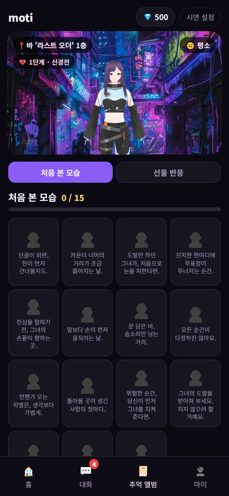 |
| 다시 보기 전 (대화 장소: 바 옥상) | 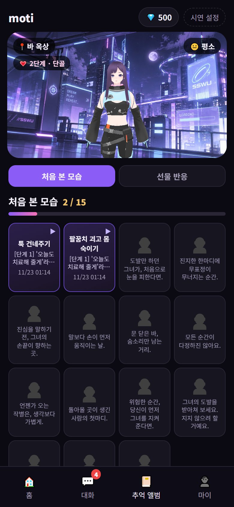 |
| 다시 보기 중 (그때 장소: 1층) | 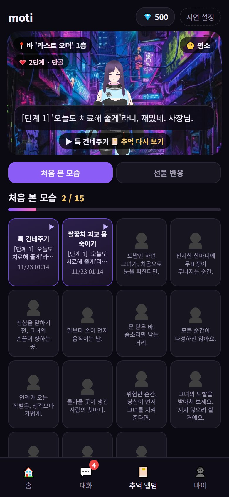 |
| 다시 보기 후 (바 옥상으로 돌아옴) |  |
| 첫 답장 기다림 표시 | 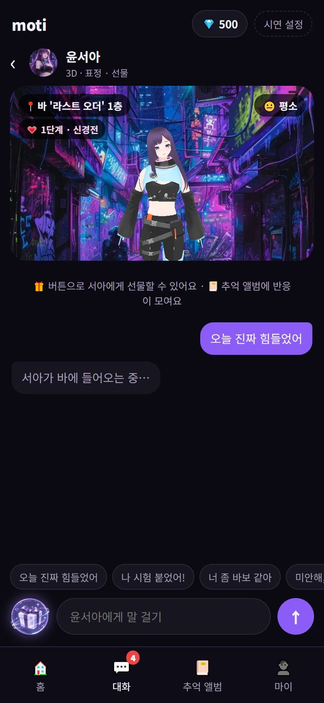 |

### 깨지지 않는지

| 주소 | 결과 |
| --- | --- |
| 서버 없음 `?api=http://127.0.0.1:9` | 바로 예시 대사 + 몸짓 |
| `?server=2&api=http://127.0.0.1:9` | 바로 예시 대사 + 몸짓 |
| `?server=2&api=http://localhost:8000` (가짜 모델) | 서버 답장 + 몸짓 + 판정 |

### 제가 정한 것

1. 깨우기 요청은 `/openapi.json`으로 정했다. 지금 배포 서버와 v2 서버 둘 다 있는 가벼운 GET이다. 응답 내용은 읽지 않는다(`no-cors`).
2. "첫 답장"은 **서버가 깨어난 게 확인되기 전의 답장**으로 정했다. 깨우기 요청이 먼저 돌아오면 첫 답장도 보통 표시(「서아가 입력 중…」)로 나온다. 둘 다 아직이면 몇 번째 답장이든 45초.
3. 기다림 표시는 서아 답장을 서버에 물을 때만 쓴다. 다른 캐릭터, 인트로, 판정 대기 때는 예전 표시.
4. 잠긴 칸은 힌트가 있으면 `？`와 단계 이름을 빼고 힌트만 보인다(칸이 좁아서). 힌트가 빈 칸만 예전처럼 `？` + 단계 이름.
5. 다시 보기 장소는 몸짓과 자막 중 **늦게 끝나는 쪽 + 0.3초** 뒤에 되돌린다. 다시 보기 도중 대화에서 장소가 바뀌면 되돌리기 예약은 취소된다.
6. 위 「[2-B] 제가 정한 것」 13번(다시 보기 때 대화 장소도 바뀜)은 이번에 고쳐서 더 이상 맞지 않는다.
7. `docs/drafts/2-1-앨범힌트.md`가 커밋되지 않은 채 있어서, 원고 원본으로 같이 커밋했다.

### 노트북과 같은 와이파이의 아이폰에서 확인하기

1. 노트북 IP 확인 (PowerShell). 와이파이 어댑터의 `IPv4 주소`(예: `192.168.0.12`)를 본다.

```powershell
ipconfig
```

2. 로컬 서버를 외부(같은 와이파이)에서 들어올 수 있게 열기 (앱 폴더에서):

```powershell
py -m http.server 5500 --bind 0.0.0.0
```

   - 처음 실행할 때 Windows 방화벽 창이 뜨면 **개인 네트워크**에 허용을 누른다.
   - 방화벽 창이 안 떴는데 아이폰에서 안 열리면, 관리자 PowerShell에서 아래로 5500 포트를 연다 (확인이 끝나면 지워도 된다).

```powershell
New-NetFirewallRule -DisplayName "moti 5500" -Direction Inbound -Protocol TCP -LocalPort 5500 -Action Allow -Profile Private
```

3. 아이폰 사파리 주소창에 넣을 주소 (`192.168.0.12` 자리에 1번에서 본 IP):

| 확인할 것 | 주소 |
| --- | --- |
| 지금 배포 서버(v1) | `http://192.168.0.12:5500/` |
| 서버 없음 | `http://192.168.0.12:5500/?api=http://127.0.0.1:9` |
| 서버 v2 (노트북의 가짜 모델) | `http://192.168.0.12:5500/?server=2&api=http://192.168.0.12:8000` |

   - 서버 v2를 아이폰에서 보려면 노트북의 서버도 밖으로 열어야 한다: `.venv\Scripts\python -m uvicorn server:app --host 0.0.0.0 --port 8000` (포트 8000도 1번처럼 방화벽 허용).
   - 아이폰에서 확인할 것: 해금 순간 카메라 움직임, 새 표정 5개, 앨범 말줄임·힌트 줄바꿈, 첫 답장 기다림 표시.
