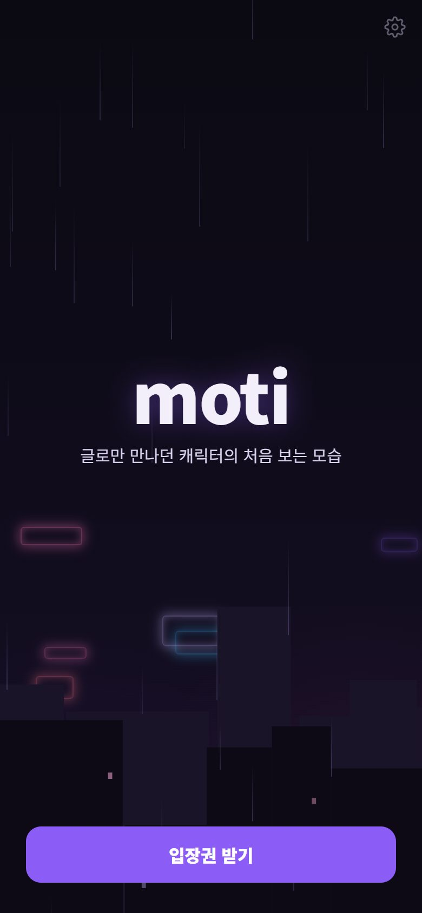
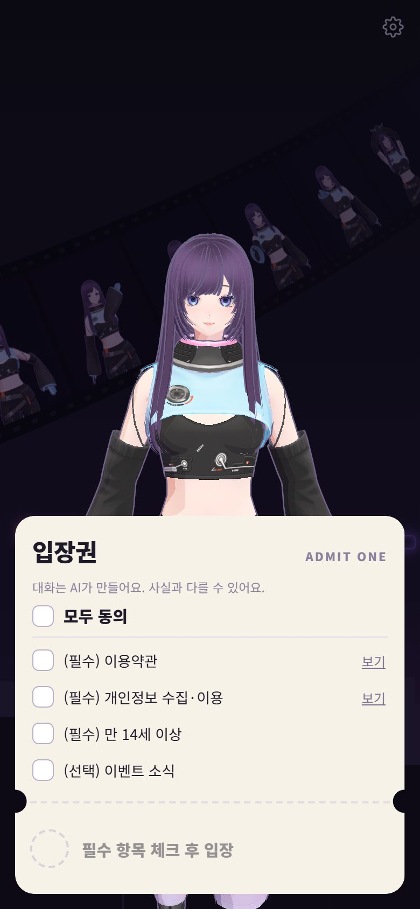
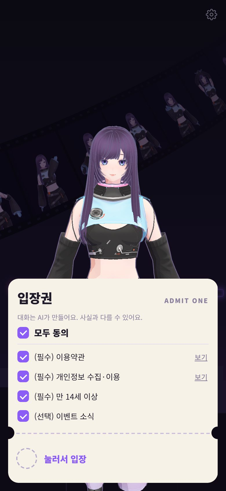
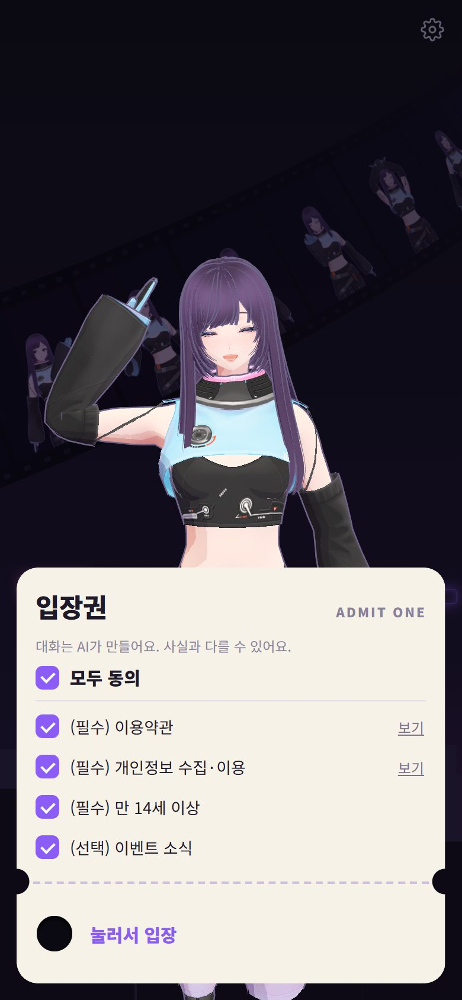
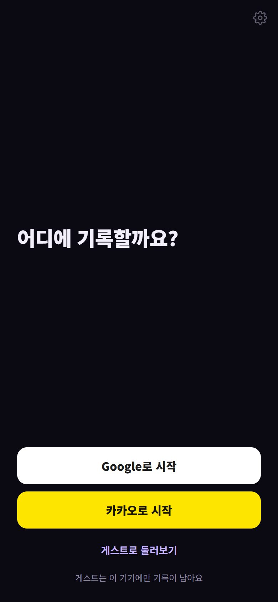
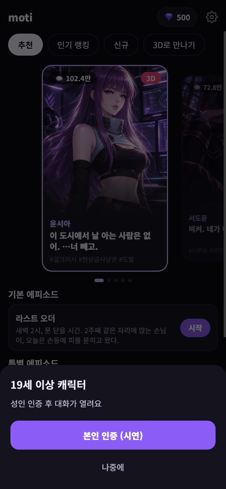
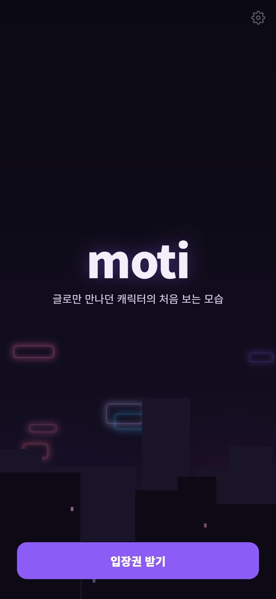
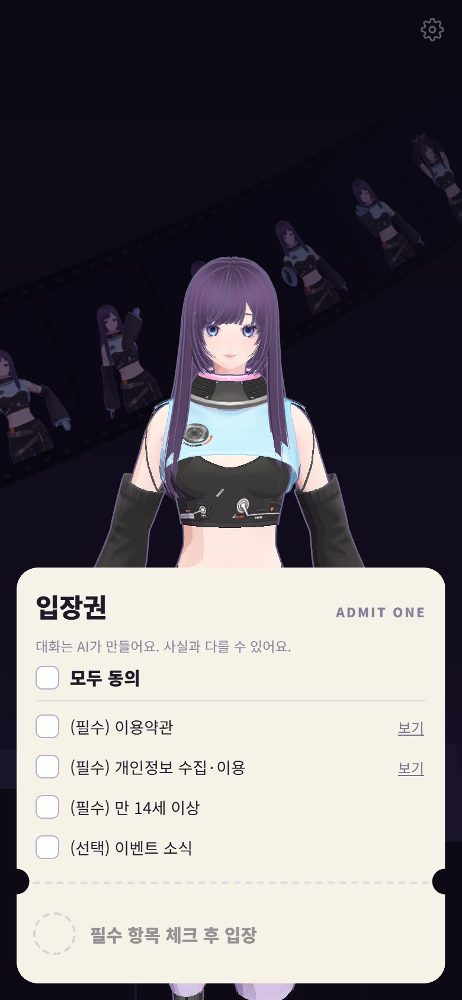

# 20단계 · 시작 화면 문구 줄이기와 정리

브랜치: `step/20-intro-clean`

## 바뀐 파일

| 파일 | 내용 |
| --- | --- |
| `data/onboarding.json` | 문구 25곳을 지시문 표대로 바꿈(「없앰」 4곳 `ticket.guide`·`ticket.punchSub`·`ticket.welcome`·`login.desc` 는 빈 문자열) · `trim` 추가(화면별 비·네온·단색 배경, AI 안내 상자 켜고 끄기, 「어서 와요」 켜고 끄기) · `film.thin.show: false` · `film.big.brightness` 0.62 → 0.43 |
| `onboarding.js` | 빈 문구 줄 숨김(`hidden`) · 화면이 바뀔 때 `trim.scenery` 대로 배경 클래스(`norain`·`noneon`·`solid`) · AI 안내 상자/한 줄 전환 · 펀치 순간 「어서 와요」는 `trim.welcome` 이 켜져 있고 문구가 있을 때만 · 네온 사각형을 `.obneons` 로 묶음 |
| `onboarding.css` | `.norain`·`.noneon`·`.solid` (0.35초 서서히) · `.ob [hidden]` 자리 없앰 · `.obai` 를 회색 한 줄로, 예전 보라 상자는 `.obai.box` |
| `film.js` | `thin.show` 가 false 면 얇은 띠를 만들지 않음(빈 필름 그림도 안 만듦) |
| `data/ui.json` | 장식 이모지 뺌: `notify.format` 💬, `gift.logTag` 🎁, `outfit.firstPrivateTag` 👕, `thread.sub` 📖 |
| `index.html` | 메시지 목록 미리보기 앞 🎁·🖼 뺌(「나: 」는 그대로) |
| `docs/drafts/7-온보딩-문구.md` | 원고를 바뀐 문구로 |
| `docs/reports/20-시작화면-정리.md`, `docs/reports/img/20/*` | 이 보고서·캡처 |
| `docs/status.md` | 20단계 절·브랜치 표 |

건드리지 않은 것: 화면 순서, 3D 서아, 펀치 연출(구멍·흔들림), 손 흔들기, 큰 필름 띠 흐름, 펀치 순간 밝아지는 연출, 약관 본문 임시 문구.

## 1. 문구

지시문 표 그대로 넣음. 화면 확인(캡처 때 잰 값):

- 입장권: 위 안내(`obGuide`)·펀치 보조 글씨(`obPunchS`) 숨김 확인, 작은 글씨 「ADMIT ONE」
- 로그인: 설명(`obLDesc`) 숨김, 제목 한 줄 「어디에 기록할까요?」
- 19+ 시트: 「19세 이상 캐릭터」 / 「성인 인증 후 대화가 열려요」 / 「본인 인증 (시연)」 / 「나중에」

## 2. 덜어내기 (`data/onboarding.json` `trim`)

```json
"trim": {
  "scenery": {
    "first":  { "rain": true,  "neon": true,  "solid": false },
    "ticket": { "rain": false, "neon": true,  "solid": false },
    "login":  { "rain": false, "neon": false, "solid": true }
  },
  "solidColor": "#0b0a12",
  "aiBox": false,
  "welcome": false
}
```

- **비:** 입장권·로그인에서 끔(빗줄기 층 opacity 0). 첫 화면은 그대로
- **로그인 배경:** 네온 사각형 끔 + 하늘빛·건물까지 `#0b0a12` 단색으로 덮음
- **필름 띠:** 얇은 띠 없음(`film.thin.show: false`, 캡처 때 `Film.info().bands = 1`). 큰 띠 밝기 0.62 → 0.43(30% 낮춤)
- **AI 안내:** 보라 상자에서 「모두 동의」 위 11.5px 회색(`#8a7f9c`) 한 줄로. 390px 에서 한 줄(높이 16.7px)
- **「어서 와요」:** 글자·상자 모두 안 뜸(캡처 때 `obWelcome` 에 `on` 없음, opacity 0). 서아 손 흔들기·필름 밝아짐은 그대로

## 3. 18 보고서 「고치지 않은 이모지」 8곳

| 곳 | 처리 | 이유 |
| --- | --- | --- |
| `ui.json notify.format` 💬 | 뺌 | 문장 앞 장식 |
| `ui.json gift.logTag` 🎁 | 뺌 | 문장 앞 장식 |
| `ui.json outfit.firstPrivateTag` 👕 | 뺌 | 문장 앞 장식(지시문 목록엔 없지만 같은 종류라 뺌) |
| `ui.json thread.sub` 📖 | 뺌 | 문장 앞 장식 |
| 메시지 목록 미리보기 🎁·🖼 | 뺌 | 문장 앞 장식 |
| 홈 카드 `💬 {n}만` | 남김 | 숫자 옆 아이콘(대화 수라는 뜻을 말 대신 알려 줌). 금액 옆 💎 와 같은 역할 |
| 명장면 칸 🎁/💬/✨/👤 | 남김 | 문장이 아니라 칸 안 그림(어디서 모았는지·곧 열림·잠김을 그림으로 표시) |
| 포토부스 몸짓 칩 🔒 | 남김 | 잠금 상태 아이콘. 빼면 못 모은 몸짓인지 글자만으로 알기 어려움 |

## 캡처 (390px)

| 첫 화면 | 입장권(체크 전) | 입장권(모두 체크) |
| --- | --- | --- |
|  |  |  |

| 펀치 순간(글자 없이 손 흔들기) | 로그인 | 19+ 인증 시트 |
| --- | --- | --- |
|  |  |  |

캡처: 헤드리스 Chrome(390×844, 픽셀 비율 2, SwiftShader), 새 프로필로 처음 실행부터 실제 버튼을 눌러 진행. 펀치 순간은 누르고 0.9초 뒤.

## 확인

- `data/*.json` 18개 모두 `JSON.parse` 통과
- `node --check onboarding.js film.js` 통과

## 제가 정한 것

- **「없앰」 처리:** 문구를 빈 문자열로 두고, 화면에서 빈 줄은 `hidden` 으로 자리를 없앰(로고 밑 소개·입장권 작은 글씨·AI 안내·로그인 제목·설명·아래 작은 글씨도 같은 규칙). 「어서 와요」는 문구가 비었고 `trim.welcome` 도 꺼서 두 겹으로 안 뜸
- **비:** 지시문이 「입장권·로그인」만 말해서 첫 화면 비는 그대로 둠(`trim.scenery.first.rain`)
- **입장권 네온:** 지시문이 로그인 네온만 말해서 입장권 화면 네온은 그대로 둠(카드 옆으로 조금 보임). 끄려면 `trim.scenery.ticket.neon: false`
- **로그인 「어두운 단색」:** 네온뿐 아니라 하늘빛 그라데이션·건물 실루엣까지 덮는 것으로 봄. 색은 지금 배경 맨 위 색과 같은 `#0b0a12`. 단색은 층을 위에 덮는 방식이라 화면이 바뀔 때 0.35초 서서히 바뀜
- **큰 띠 밝기 30%:** 0.62 × 0.7 = 0.434 → 0.43
- **얇은 띠 끄는 값:** `film.thin.show` (설정은 지우지 않고 남겨서 다시 켤 수 있음)
- **AI 안내 글자:** 11.5px, 카드 안 다른 회색 글씨(`ADMIT ONE`·「보기」)와 같은 `#8a7f9c`
- **👕 처음 보는 옷:** 18 보고서 목록에는 있었지만 지시문 예시엔 없었음. 문장 앞 장식이라 같이 뺌
- **미리보기 🎁·🖼:** 뺀 뒤엔 선물·사진 줄도 글자만 보임(선물 줄은 「선물 이름 · 등급」, 사진 줄은 함께 온 말)
- **이미 저장된 대화:** 예전 문구로 저장된 기록(예: 「🎁 커피 · 일반」)은 기기에 남은 그대로. 새로 생기는 줄부터 바뀜

## 아이폰에서 나중에 볼 것

- 필름 띠 밝기(0.43): 아이폰 화면에서 서아가 앞으로 나와 보이는지, 띠가 너무 어둡지 않은지
- 입장권 3D 배경(안개·큰 띠 한 줄만 남은 모습)과 비가 사라지는 전환
- 로그인 단색 배경으로 넘어가는 0.35초 전환(덮는 층의 opacity)

## 20-1 · 첫 화면 비와 입장권 네온 사각형 끄기

지시 의도가 시작 화면 전체를 덜어내는 것이어서, 위 「제가 정한 것」에서 남겨 두었던 두 가지도 끔.

| 파일 | 내용 |
| --- | --- |
| `data/onboarding.json` | `trim.scenery.first.rain` true → false, `trim.scenery.ticket.neon` true → false |
| `docs/reports/img/20/20-1-*` | 캡처 두 장 |

코드는 바꾸지 않음(20단계에서 만든 `trim` 값만 바꿈). 캡처 때 잰 값: 첫 화면 빗줄기 층 opacity 0, 입장권 네온 층 opacity 0.

| 첫 화면 | 입장권(체크 전) |
| --- | --- |
|  |  |

### 제가 정한 것 (20-1)

- **첫 화면 네온 사각형·건물은 그대로:** 지시문이 첫 화면은 비만 말해서 남김. 끄려면 `trim.scenery.first.neon: false`
- **브랜치:** 지시문에 브랜치 이름이 없어 20단계 브랜치 `step/20-intro-clean` 에 이어서 커밋
