# 21단계 · 단계 하트, 선 아이콘 통일, 시작 화면 필름 띠 손보기

브랜치: `step/21-heart-icons` · 커밋 `[21-A] 단계 하트와 선 아이콘 통일`, `[21-B] 시작 화면 필름 띠 손보기`

## 바뀐 파일

| 파일 | 내용 |
| --- | --- |
| `icons.js` (새 파일) | 선 아이콘 한 묶음 `Icon`. `svg(이름)`: 자물쇠·반짝임·말풍선·선물(선 굵기 1.8, 둥근 끝, 채우지 않음, 색 = 글자 색) · `gem()`: 마이 페이지 다이아(12단계 것을 옮김) · `heart(n)`: 선 하트 안 숫자, 5는 금 간 선 · `fill(html)`: 문구 속 `{gem}` 자리를 다이아 그림으로 |
| `index.html` | `icons.js` 불러옴 · 장소 칩 「📍 」 뺌 · 오른쪽 위 단계 줄을 [하트 n] + 이름으로, 하트 색 = 게이지 색(`bondColor`), 같은 `colorMs` 로 바뀜 · 마이 페이지 「Lv.n」 → 같은 하트 · 선물 창 가격 💎 → 다이아 · 선물 창 기분 안내와 시연 패널 기분 버튼의 기분 이모지 뺌 · 앨범 칸 🎁/💬/✨/👤 → 선 아이콘 · 홈 카드 💬 → 선 말풍선 · 홈 특별 에피소드 가격·시연 패널 「500 충전」 다이아 · `GEM` 은 `Icon.gem` 을 가리킴 |
| `booth.js` | 잠긴 포즈 🔒 → 앨범과 같은 자물쇠 선 아이콘 |
| `photos.js` | 「칸 늘리기」 가격(사진 시트 아래 줄, 칸이 찼을 때 창) 다이아 |
| `data/ui.json` | `top.bond` 「{n}단계 · {name}」 → 「{name}」, `top.bondAria` 「{n}단계」 추가 · `my.lv` 「Lv.{n}」 → 「{n}단계」(하트의 접근성 이름) · `home.btnPrice`·`photoFull.optGrow`·`photo.growPrice` 의 💎 → `{gem}` · 설명 키 갱신 |
| `data/demo.json` | `dia`·`diaToast` 의 💎 → `{gem}` |
| `film.js` | `big.from`·`to` 가 있으면 곧은 띠(`LineCurve3`). 없으면 예전 곡선(`points`) |
| `data/onboarding.json` | `film.big` 을 곧은 가로 띠로 · `film.tint` · `_film` 설명 |
| `docs/reports/21-하트-아이콘-필름띠.md`, `docs/reports/img/21/*` | 이 보고서·캡처 |
| `docs/status.md` | 21단계 절·브랜치 표 |

건드리지 않은 것: 단계 기준(`countAt`·`affectionAt`), 확대 규칙, 게이지 색 값(`config.bondTop.colors`), 선물 그림(`icons/gift_*.png`), 헤더 다이아 칩(원래 그림), 코드 주석과 `_` 로 시작하는 설명 키 안의 이모지.

## 1. 장소 칩

「📍 바 '라스트 오더' 1층」 → 「바 '라스트 오더' 1층」. 처음 HTML 의 기본 글자와 `showScene` 둘 다.

## 2. 단계 하트

- 오른쪽 위 줄: [선 하트 20px 안에 숫자] + 단계 이름(12px 굵게). 그 밑 게이지는 그대로(줄 전체 폭)
- 하트: 선 굵기 1.8, 둥근 끝, 채우지 않음. 숫자 9.5px 굵게, 하트 가운데(하트 몸통이 위쪽이 넓어서 숫자를 1px 내림)
- 색: 하트 선과 숫자가 바깥 칸 `color` 하나를 같이 씀 → `config.bondTop.colors[n]` (게이지와 같은 값). 단계가 오르면 `color` 를 `colorMs`(600ms) 동안 바꿈. 게이지 색 바뀜과 같은 때 시작
- 5단계 엇갈림: 숫자 대신 하트 위 오목한 곳에서 아래로 내려오는 지그재그 금
- 마이 페이지 관계 카드의 「Lv.n」 배지도 같은 하트(24px)로, 색도 그 단계 게이지 색
- 하트에는 접근성 이름 「n단계」(`top.bondAria`, `my.lv`)

| 1단계 | 4단계 | 4 → 5 상승 300ms | 5단계(금 간 하트) | 6단계 |
| --- | --- | --- | --- | --- |
| 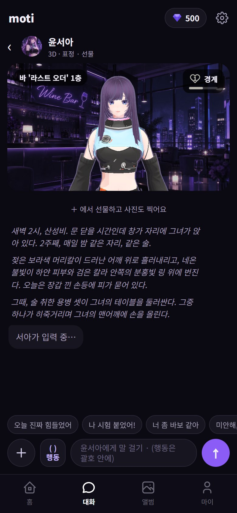 |  | 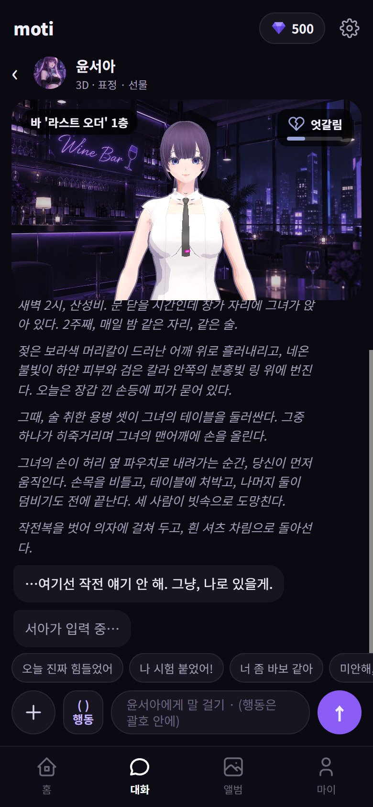 | 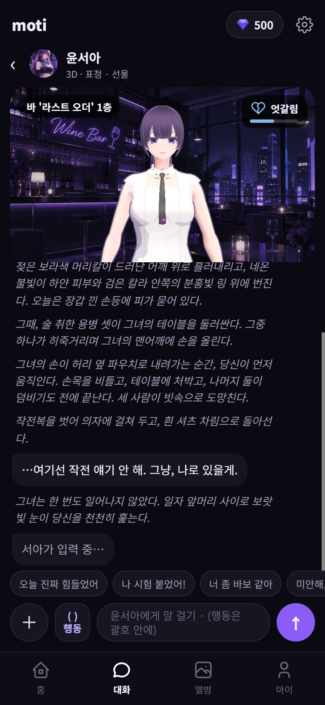 | 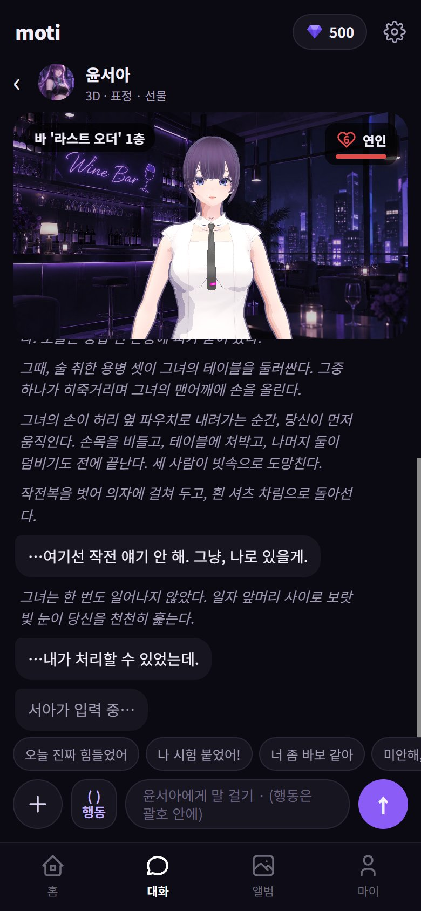 |

## 3. 이모지 → 선 아이콘

| 곳 | 전 | 후 |
| --- | --- | --- |
| 오른쪽 위 단계 줄 | 「n단계 · 이름」 | 하트 숫자 + 이름 |
| 마이 페이지 관계 카드 | Lv.n | 하트 숫자 |
| 장소 칩 | 📍 | 없음 |
| 선물 창 가격 | 💎 | 다이아 |
| 홈 특별 에피소드 가격(`home.btnPrice`) | 💎 | 다이아 |
| 사진 시트 「칸 늘리기」 가격(`photo.growPrice`) | 💎 | 다이아 |
| 사진 칸이 찼을 때 창(`photoFull.optGrow`) | 💎 | 다이아 |
| 시연 패널 「500 충전」 버튼·알림(`demo.json dia`·`diaToast`) | 💎 | 다이아 |
| 앨범 모은 칸 | 🎁 / 💬 | 선 선물 상자 / 선 말풍선 |
| 앨범 수집 대기 칸 | ✨ | 선 반짝임 |
| 앨범 잠긴 칸 | 👤 | 선 자물쇠 |
| 홈 카드 대화 수 | 💬 | 선 말풍선 |
| 포토부스 잠긴 포즈 | 🔒 | 선 자물쇠(앨범과 같은 것) |
| 선물 창 기분 안내(「지금 서아 😐 평소」) | 😐·😮‍💨·😤·🎂 | 뺌(글자만) |
| 시연 패널 기분 버튼 | 😐·😮‍💨·😤·🎂 | 뺌(글자만) |

| 선물 창 가격 | 앨범 칸 | 홈 카드 |
| --- | --- | --- |
| 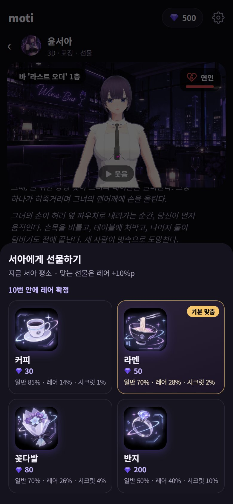 | 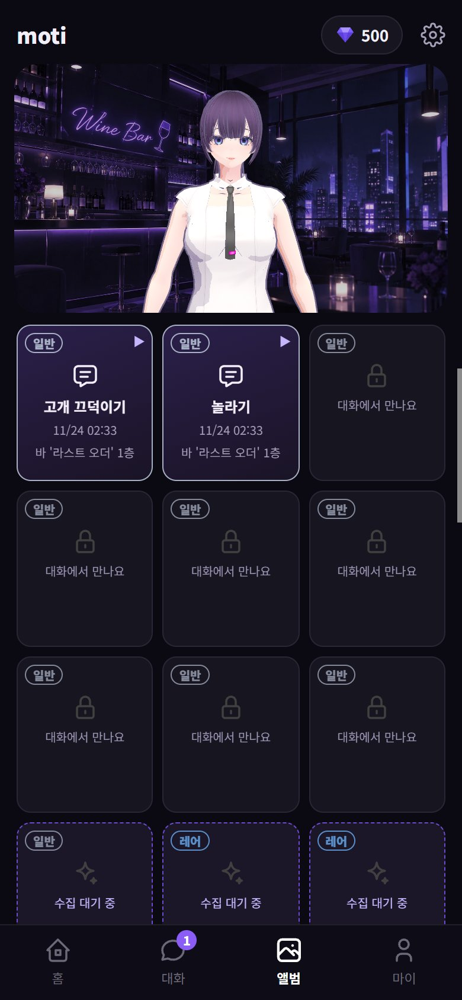 | 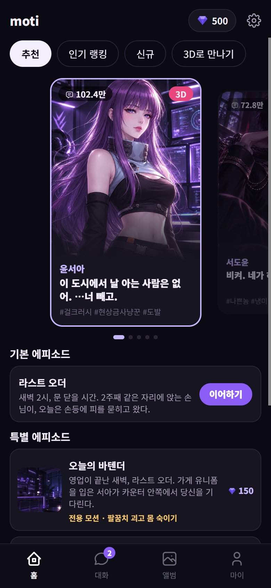 |

| 홈 특별 에피소드 가격 | 마이 페이지 하트 | 사진 시트 칸 늘리기 | 포토부스 잠긴 포즈 |
| --- | --- | --- | --- |
| 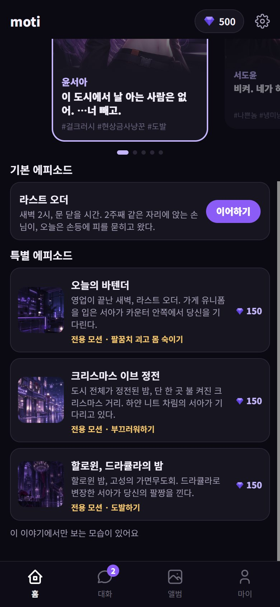 | 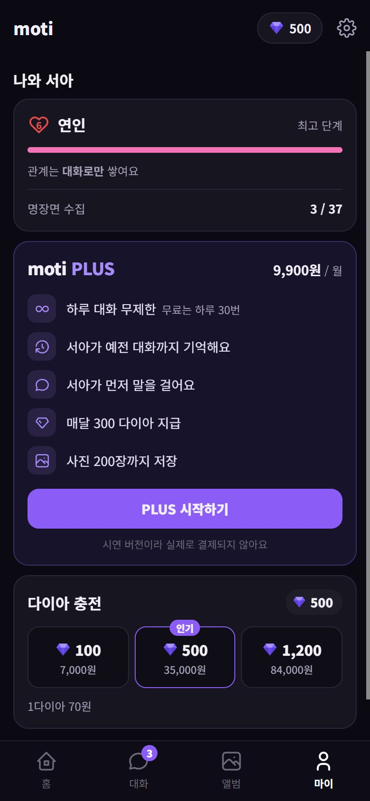 | 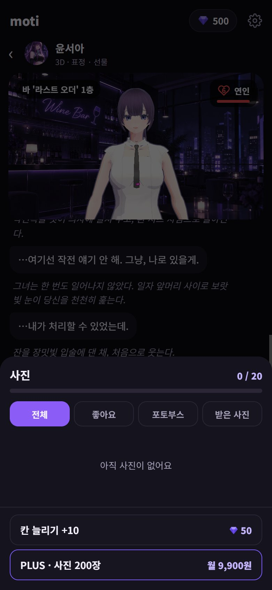 | 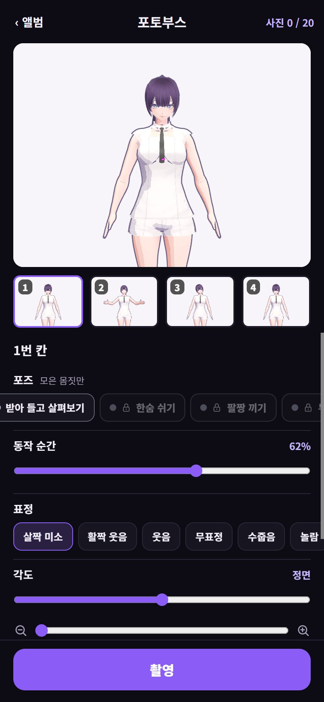 |

## 4. 시작 화면 필름 띠

| | 20단계 | 21단계 |
| --- | --- | --- |
| 모양 | 오른쪽 위로 기운 곡선(점 6개) | 곧은 가로 띠 `from [-2.4, 1.18, -0.9]` → `to [2.4, 1.18, -0.9]` |
| 폭(사진 높이) | 0.5m | 0.75m (1.5배) |
| 밝기 | 0.43 | 0.85 |
| 불투명도 | 0.82 | 0.9 |
| 보라 색조 `tint` | `#9b80d6` | `#ab96dc` (흰색 쪽으로 조금) |
| 속도 | 0.07 m/초 | 0.035 m/초 (절반) |
| 위아래 구멍 줄 | 있음 | 있음(사진 그림 그대로) |

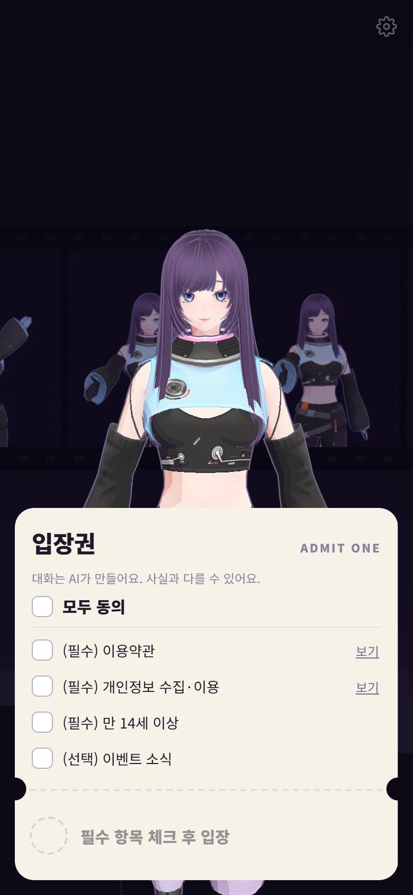 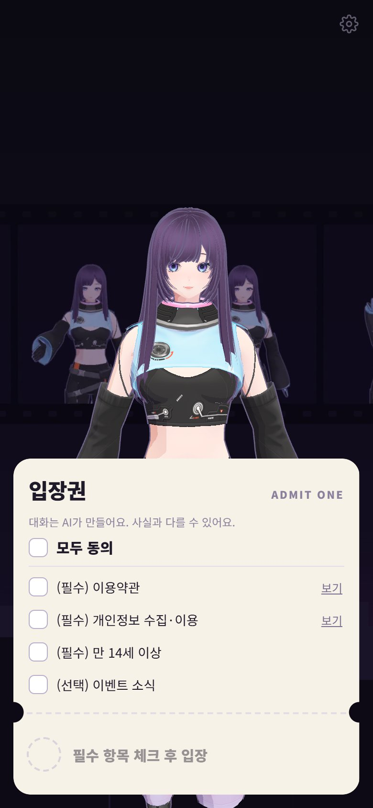

(왼쪽 입장권이 뜬 뒤 4초, 오른쪽 그 3초 뒤 — 칸이 천천히 흐름)

## 확인

- `data/*.json` 18개 모두 `JSON.parse` 통과
- `node --check icons.js film.js photos.js booth.js` 통과
- 캡처: 헤드리스 Chrome(390×844, 픽셀 비율 2, SwiftShader). 단계는 `story().stage` 와 대화 횟수를 그 단계 시작값 + 45% 로 넣고 `renderBond()`. 입장권은 새 프로필로 첫 화면에서 버튼을 눌러 진행

## 아이폰에서 나중에 볼 것

- 단계가 오를 때 하트 선·숫자 색이 게이지와 함께 0.6초 동안 바뀌는지(`color` 전환이 SVG `currentColor` 선까지 따라가는지)
- 선 아이콘(하트·자물쇠·반짝임·말풍선·선물 상자)이 레티나 화면에서 흐리지 않고 선명한지, 하트 안 숫자가 가운데인지
- 필름 띠 밝기(0.85)가 아이폰 화면에서 너무 밝거나 어둡지 않은지, 흐르는 속도(0.035)가 너무 느리지 않은지

## 제가 정한 것

- **아이콘 모음 자리:** 새 파일 `icons.js`(전역 `Icon`). `motion.js` 보다 먼저 불러서 어느 화면에서나 씀. 마이 페이지 다이아(`GEM`)도 여기로 옮기고 `GEM` 은 이름만 남김
- **💎 자리 표시:** 문구 안 `{gem}`. 코드가 `esc` 뒤에 `Icon.fill` 로 그림을 넣음(문구는 그대로 데이터에)
- **가격의 다이아:** 지시대로 마이 페이지 다이아를 그대로 씀. 이 다이아는 선 아이콘이 아니라 색을 채운 그림(12단계 것)이라 선 굵기 규칙에서 뺐다. 크기는 글자에 맞춰 12~14px
- **하트 크기:** 대화 화면 20px(숫자 9.5px), 마이 페이지 24px(숫자 10px)
- **금 간 선:** 하트 위 오목한 곳(12, 7)에서 아래 끝 가까이(12, 18.5)까지 네 번 꺾이는 선. 하트와 같은 색·굵기
- **마이 페이지 「Lv.n」:** 「n단계」 표시와 같은 것이라 보고 하트로 바꿈. 분홍 바탕 상자는 없앰. 색은 그 단계 게이지 색(마이 페이지 진행 막대 색 `#f472b6` 은 그대로)
- **하트 접근성 이름:** 화면에는 숫자만 보이므로 `role="img"` + 「n단계」. `my.lv` 를 이 용도로 바꿈
- **「n단계」를 하트로 바꾸지 않은 곳:** 서아 단계 사진 이름(「3단계 사진」 `seoaPhoto.stageLabel`·`slot`)과 시연 패널의 단계 버튼은 표시가 아니라 이름·조작 문구라 글자 그대로 둠
- **앨범 모은 칸의 🎁·💬:** 지시 목록엔 없었지만 같은 칸 그림이라 같이 바꿈(선 선물 상자 / 선 말풍선). 선물 그림 png 와는 다른 작은 선 아이콘
- **기분 이모지(😐 등):** 선물 창 기분 안내와 시연 패널 기분 버튼에만 보였음. 19단계 기분 태그처럼 글자만 남기고 뺌(선 아이콘을 따로 그리지 않음). `STATES` 의 `e` 값은 남아 있지만 화면에 안 씀
- **그대로 둔 기호:** 닫기 「✕」(`ui.json close`)는 이모지가 아니라 글자 기호라 둠. `v1.html`(이전 버전, `app.js`)의 이모지는 이번 범위 밖이라 둠. 카메라·사진 화면의 선 아이콘(`photos.js SVG`)과 마이 페이지 혜택 아이콘(`MYI`)은 이미 같은 규칙의 선 아이콘이라 옮기지 않음
- **선 아이콘 모양:** 자물쇠·말풍선·선물 상자는 Tabler Icons(MIT) 모양을 줄여 옮김(12단계와 같은 출처), 반짝임·하트·금은 직접 그림
- **필름 띠 높이:** 서아 키 1.72m 기준 가슴은 1.2~1.3m 이지만, 띠가 서아보다 0.9m 뒤에 있어 화면에서는 조금 위로 보인다. 1.28 은 목·얼굴 뒤, 1.08 은 아래 구멍 줄이 입장권 카드에 가려서, 1.18 로 정함(화면에서 서아 가슴 뒤, 위아래 구멍 줄 둘 다 보임)
- **필름 띠 길이·깊이:** 좌우 ±2.4m(390px 화면 밖까지), 깊이 −0.9m(20단계 곡선 시작점 −0.6 ~ −0.96 과 비슷, 안개에 덜 묻힘)
- **불투명도:** 지시엔 없었지만 0.82 → 0.9 로 같이 올림(밝기만 올리면 바탕이 비쳐 사진이 흐려 보여서)
- **보라 색조:** `#9b80d6` → `#ab96dc` (흰색 쪽으로 약 15%)
- **필름 사진 파일:** 다시 찍지 않음. 띠 폭을 키워 칸이 1.5배로 보임(사진 해상도 244×300 칸, 2배 크기 화면에서 조금 부드러움 — 더 또렷하게 하려면 `film.cell` 을 키워 `tools/filmshot.mjs` 로 다시 만들면 됨)
- **미리보기 서버:** `.claude/launch.json` 에 `moti-21`(8821) 추가(저장소에 올라가지 않는 파일)
