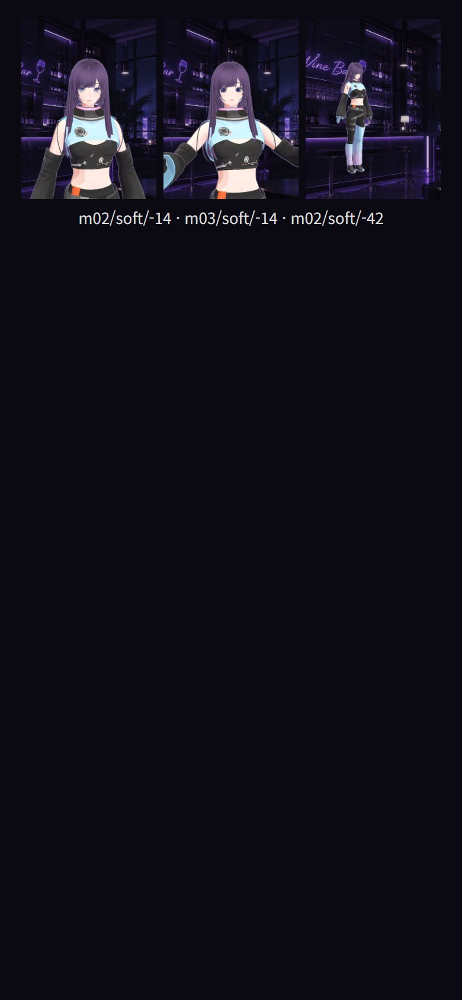
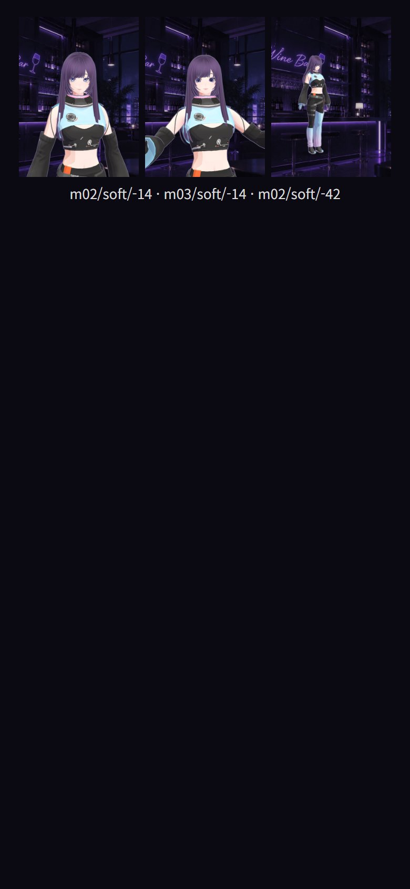
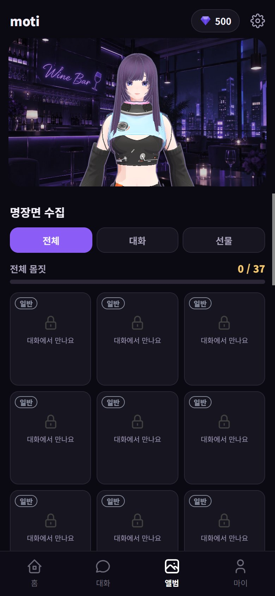
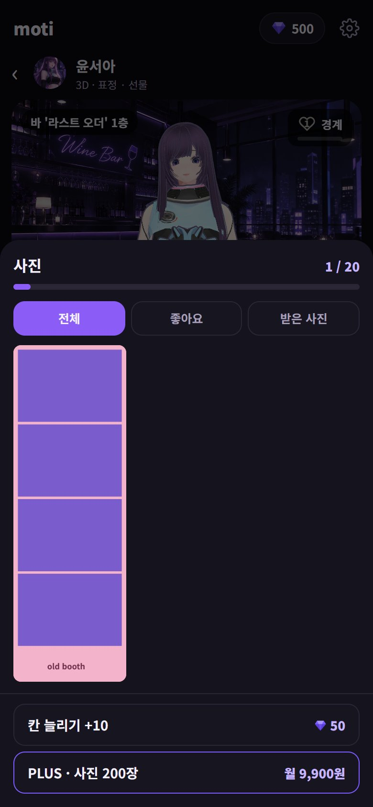
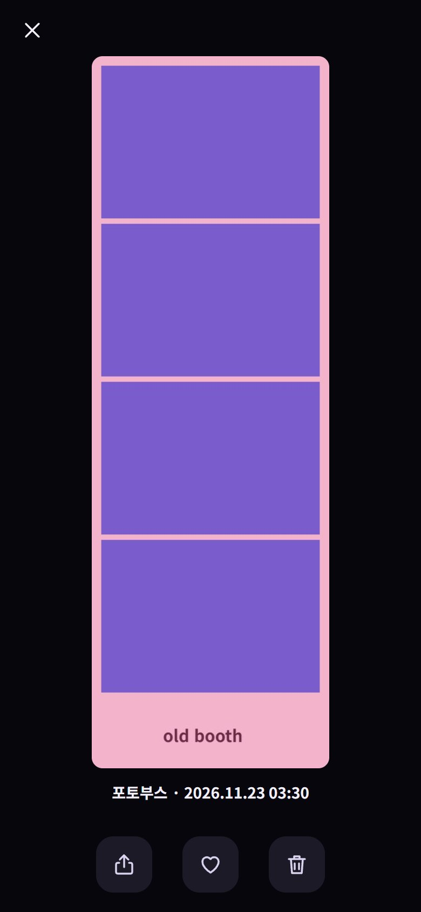
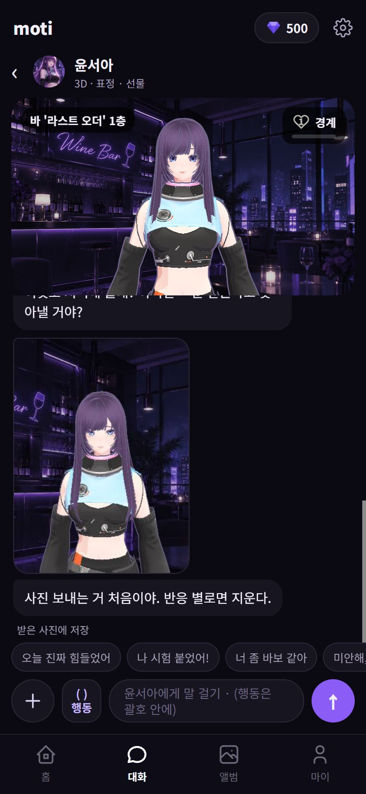

# 22단계 포토부스 지우기 (서아가 보내는 사진은 유지)

브랜치 `step/22-booth-remove` · 커밋 [22-A] 서아 사진 구도 값 옮기기, [22-B] 포토부스 지우기

포토부스는 22단계에서 뺌. 대화 화면 안의 몰입 장치에 집중하기 위해.

## 바뀐 파일

| 파일 | 내용 |
| --- | --- |
| `data/seoa_photo.json` | [22-A] `moment.byId` 새로 둠(포토부스 `booth.json moments.byId` 값을 그대로 옮김: m02 62, m03 40, m15 65, g03 62, 나머지 50). 설명 줄에서 포토부스 언급 정리 |
| `seoaphoto.js` | [22-A] 몸짓 순간을 `DATA.booth` 대신 `DATA.seoaPhoto.moment.byId` 에서 읽음. [22-B] `Booth.isOpen()` 기다림 조건과 주석 정리 |
| `booth.js`·`booth.css`·`data/booth.json` | [22-B] 삭제 |
| `index.html` | [22-B] `booth.css`·`booth.js` 불러오기, `data/booth.json` 읽기·`DATA.booth`, 앨범 「포토부스」 버튼과 그 스타일(`.colhd`·`.boothbtn`), `Booth.close/refresh/isOpen` 호출 삭제 |
| `photos.js` | [22-B] 사진 시트 묶음에서 「포토부스」 뺌(전체·좋아요·받은 사진). 예전 포토부스 사진 보이기(세로 긴 칸, 정보 줄, 공유)는 그대로 |
| `data/ui.json` | [22-B] `booth` 묶음 전체, `photo.seg.booth`, `photo.empty.booth` 삭제. `photo.infoBooth` 는 남김 |
| `icons.js` | [22-B] 주석의 `booth.js` 언급만 고침 |
| `docs/plan.md`·`docs/status.md` | 「포토부스는 22단계에서 뺌. 대화 화면 안의 몰입 장치에 집중하기 위해」 |
| `docs/reports/22-포토부스-지우기.md`, `docs/reports/img/22/*` | 이 보고서·캡처 |

건드리지 않은 것: 카메라(`Cam`), 사진 저장소(`Photos`), 서아가 보내는 사진의 동작·구도 계산, 셔터 소리.

## 확인

- **data JSON:** `data/*.json` 17개 모두 `JSON.parse` 통과
- **콘솔 오류 없음**(헤드리스 Chrome, 390×844, 경고 `morphNormals`·`favicon` 404 는 전부터 있던 것):
  앨범 열기 → 사진 시트 열기 → 예전 포토부스 사진 크게 보기·공유 이미지 만들기·삭제(확인 창으로) → 시연 패널 「서아 사진 지금 받기」(받은 사진 1장) → 카메라 촬영(사진 1장 늘어남) → 시연 패널 전체 초기화
- 남은 `Booth`·`DATA.booth`·`#boothBtn`·booth 스타일시트 없음(페이지에서 확인)
- 시연 패널에 포토부스 버튼 없음(`data-a` 에 booth 없음)

### 서아 사진 옮기기 전·후 비교 (같은 몸짓)

난수를 0으로 고정해 같은 순서로 세 장: 셀카 m02(순간 62) · 셀카 m03(순간 40) · 풍경 m02. 후 쪽은 `DATA.booth={}` 로 비워 놓고 만들어 포토부스 값에 기대지 않음을 확인.

| 전 | 후 |
| --- | --- |
|  |  |

구도·포즈 같음. 파일 바이트는 수백 바이트씩 다른데, 같은 코드로 두 번 만들어도 그만큼 달라서(숨쉬기 등 시간에 따른 움직임) 코드 차이가 아님. 원본 크기 사진: `img/22/22-01*-before.jpg`, `img/22/22-02*-after.jpg`

### 390px 캡처

| 앨범 위쪽(포토부스 버튼 없음) | 사진 시트 묶음 버튼 | 예전 포토부스 사진 크게 보기 | 서아 사진 받기 |
| --- | --- | --- | --- |
|  |  |  |  |

- 아이폰 사파리: 시각 효과(블러·그림자·애니메이션·3D)는 바꾸지 않아 별도 확인 항목 없음

## 제가 정한 것

- **3D 잠금(`Stage.lock`)·배경(`Stage.bg`)·그림판 빌리기(`Stage.borrow`):** 서아 사진은 이것들을 쓰지 않고(구도 계산 `setCam` 은 12단계부터 `seoaphoto.js` 안에 따로 있었음) 옮길 것이 없었음. 모두 `index.html` 의 `Stage` 에 있는 함수라 지우지 않고 둠. `Stage.lock`·`Stage.bg` 는 지금 부르는 곳이 없음
- **옮긴 값은 몸짓 순간(`moments`)만.** `booth.json` 의 나머지(네 칸 크기·프레임·카운트다운·배경색·표정 목록)는 서아 사진이 쓰지 않아 함께 지움
- **시연 패널 「명장면 모두 열기」는 남김.** 11단계에 포토부스 포즈 시연용으로 넣었지만 앨범 시연에도 쓰여서 버튼은 두고 `Booth.refresh()` 호출과 「포토부스」 주석만 뺌
- **예전 포토부스 사진:** 「전체」·「좋아요」 묶음에서 그대로 세로로 긴 칸(프레임 색 바탕)으로 보이고, 크게 보기 정보 줄은 `photo.infoBooth`, 공유는 예전처럼 표시를 덧붙이지 않음. 캡처는 시험용 포토부스 사진(종류 booth)을 넣어 찍음
- **저장값 `S.places`**(포토부스 장소 배경용으로 11단계에 생김)는 저장값이라 그대로 둠(아무 곳에서도 쓰지 않음)
- **`docs/CREDITS.md`:** 포토부스 관련 줄이 없어 고치지 않음(셔터 소리는 카메라 것이라 남김)
- 앨범 제목 줄은 버튼이 빠져서 11단계 전처럼 제목만(`h2.colh`)
- 11단계 보고서·status 의 11단계 절은 기록이라 그대로 둠
