# [23] 홈 화면 구조 바꾸기 (캐릭터가 많아져도 찾기 쉽게)

- 브랜치: `step/23-home-layout` (시작 전 main 최신으로 받음)
- 커밋: `[23] 홈 화면 구조 바꾸기`
- 원고: 새 문구는 지시문에 적힌 것 그대로. 원고 파일(`docs/drafts/`)은 없음
- 건드리지 않은 것: `data/motions.json`, `motion.js`, `motions/`, 캐릭터·에피소드 문구, 「3D」 등 배지 값, 대화방·19+ 인증·가격·이어하기 규칙

## 바뀐 파일

| 파일 | 내용 |
| --- | --- |
| `index.html` HTML | 헤더 로고 오른쪽(알림 줄과 💎 사이)에 검색 칸 버튼 `#hSearch`. 홈 탭에서만 보임(`.app.inhome`) |
| `index.html` 홈 JS | 홈을 다시 씀. 위에서 아래로 검색 입력창(누르면 열림) → 이어서 대화 → 특별 에피소드 줄 → 캐릭터 찾기(태그 칩 + 정렬 버튼 + 2열 카드). 카드 → 캐릭터 화면(`renderChar`), 뒤로 가기 → 홈. 예전 카드 가로 넘기기(`Car`)·점 표시·정렬 칩 4개 지움. 에피소드 목록(`renderEps`)·`startStory`·`enterRoom`·`adultSheet` 는 그대로 씀 |
| `index.html` `openRoom` | 대화방에 들어간 때를 `S.roomAt[캐릭터]` 에 기록(「이어서 대화」 최근 순) |
| `index.html` `setTab` | 다른 탭에서 홈으로 오면 홈 첫 화면(캐릭터 화면을 열어 둔 채 대화방에 갔다 와도 홈 첫 화면) |
| `index.html` CSS | 예전 홈 카드·가로 넘기기·정렬 칩 CSS(`.hcar`·`.hcard`·`.hdots`·`.ccard`·`.srow`·`.pillchip`·`.hc`·`.hcards`) 지우고 새 홈 CSS(`.hsearch`·`.hq`·`.hsec`·`.hrow`·`.hcont`·`.spc`·`.hsort`·`.hchips`·`.hgrid`·`.hcc`·`.chd`·`.chero`) |
| `icons.js` | 선 아이콘 4개 추가: `search`(돋보기), `sort`(위아래 화살표), `back`(왼쪽 꺾쇠), `close`(검색 닫기 ×) |
| `data/episodes.json` | 「오늘의 바텐더」(s4)에 `"new": true`, `_설명`에 new 설명 |
| `data/ui.json` `home` | 추가: `search`·`searchEmpty`·`continue`·`specialRow`·`find`·`all`·`tagChips`(사이버펑크·혐관·첫사랑·티키타카·연습생)·`newTag`·`sortLabel`·`back`·`close`. `sorts` 를 `rec 추천`·`hot 인기`·`new 신규` 셋으로(「인기 랭킹」 → 「인기」, 「3D로 만나기」 지움). `_home` 설명 갱신 |
| `docs/reports/img/23/*.jpg` | 캡처 |

## 캡처 (390×844)

| 처음 연 홈(이어서 대화 없음) | 서아와 대화한 뒤 홈 | 검색 「혐관」 | 검색 결과 없음 |
| --- | --- | --- | --- |
| 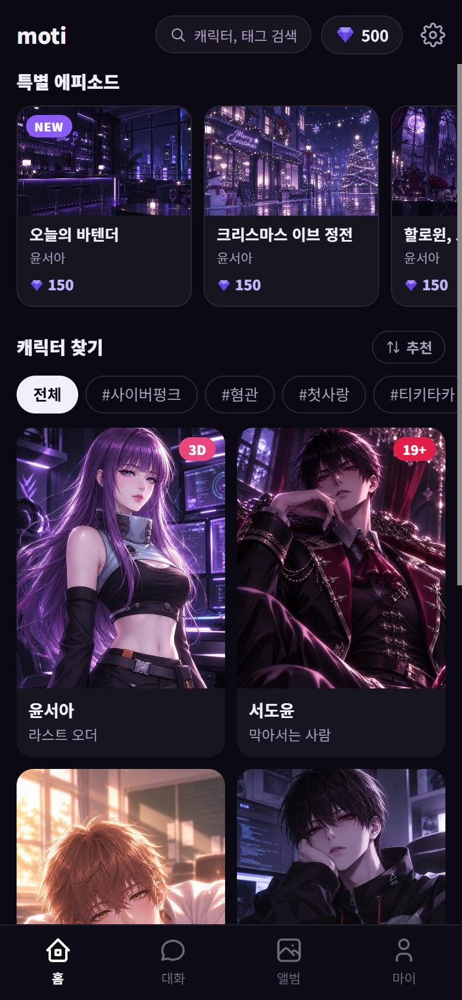 | 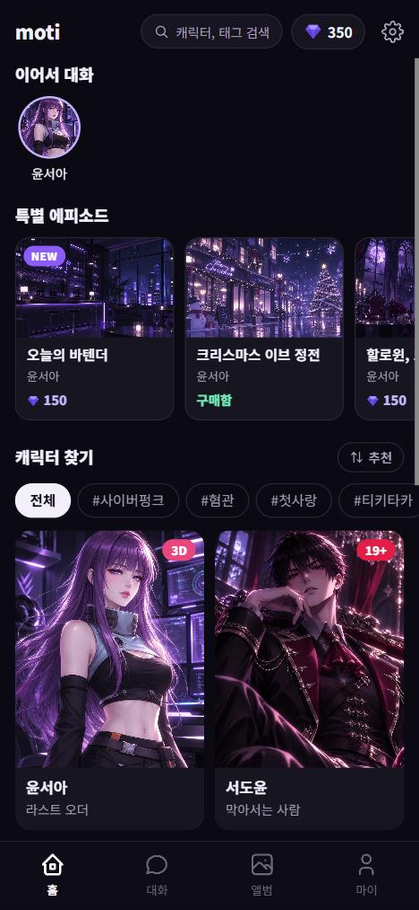 | 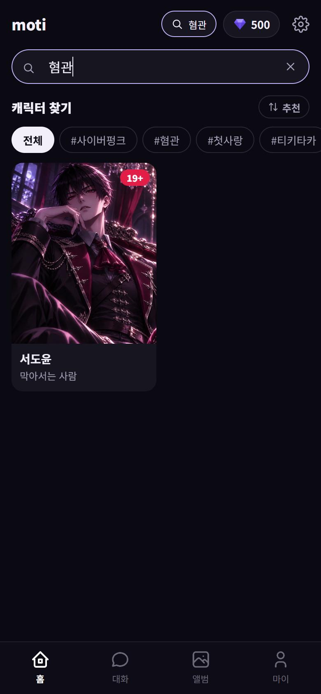 | 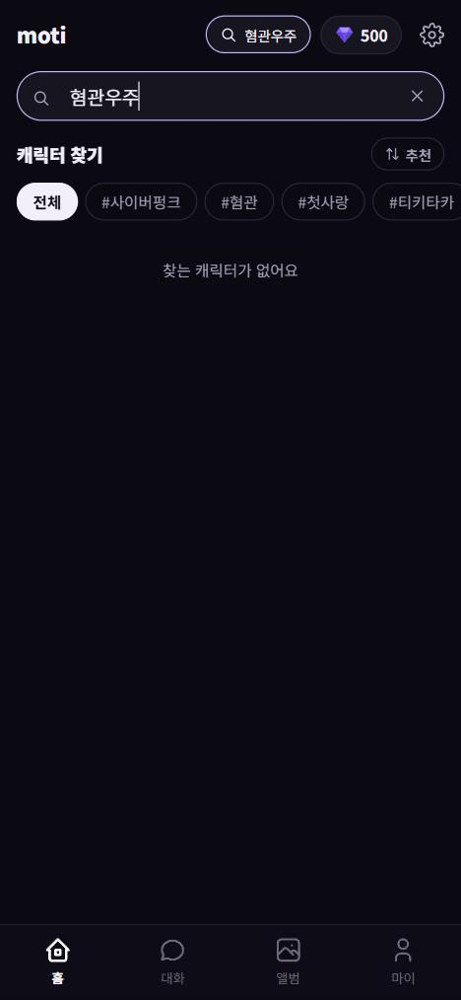 |

| 태그 칩 「사이버펑크」 | 서아 캐릭터 화면 | 서아 캐릭터 화면(아래로 내림) | 도윤 캐릭터 화면(19+) |
| --- | --- | --- | --- |
| 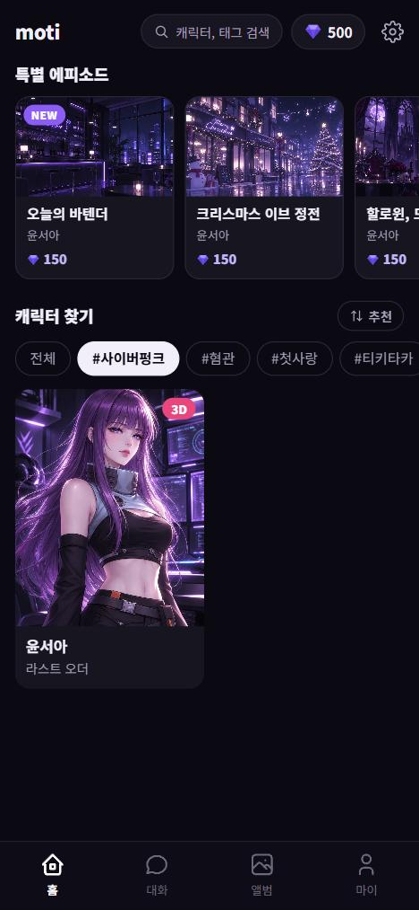 | 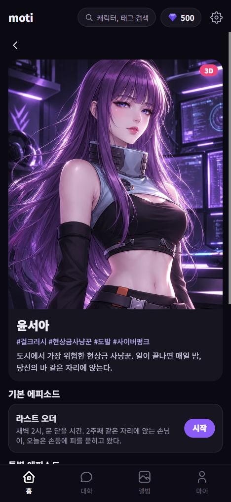 | 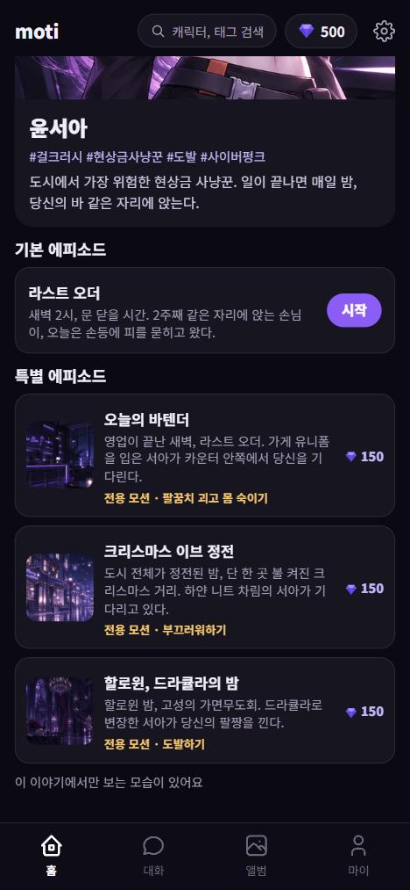 | 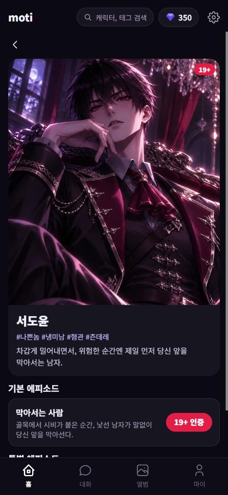 |

| 도윤 「19+ 인증」 → 인증 시트 | 특별 에피소드 NEW 카드(서아·도윤과 대화 뒤) | 특별 에피소드 시작 직후 |
| --- | --- | --- |
| 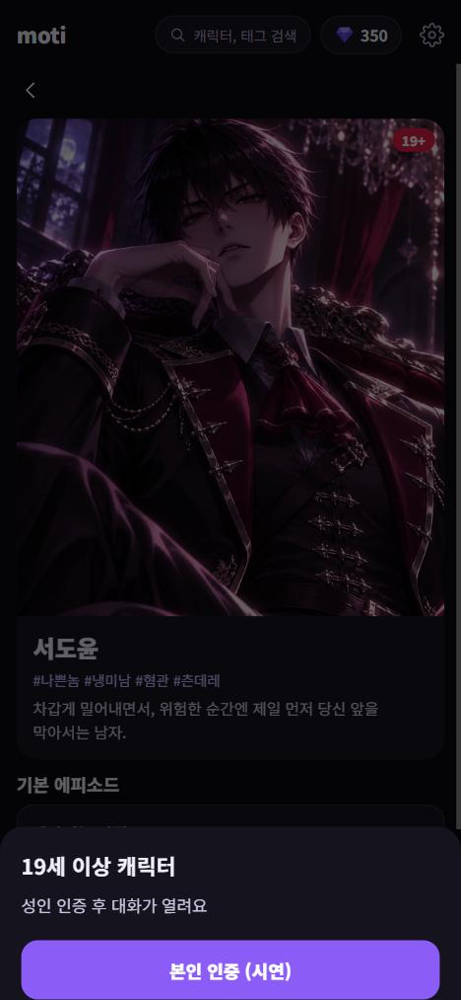 | 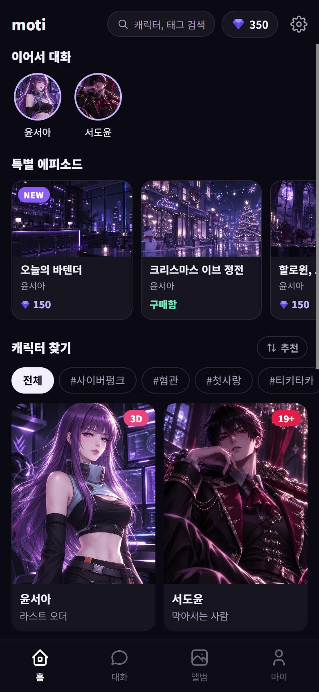 | 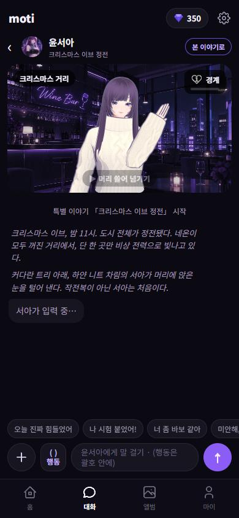 |

## 확인한 것 (로컬 서버, 390×844, 저장값 초기화 → 온보딩 끝낸 상태)

- `data/*.json` 17개 모두 읽힘(파이썬 `json.load`), 콘솔 오류 없음, 페이지 가로 넘침 없음(scrollWidth 390)
- 처음 연 홈: 「이어서 대화」 없음, 특별 에피소드 줄 맨 앞 「오늘의 바텐더」 + NEW
- 검색: 「혐관」 → 서도윤 하나. 「혐관우주」 → 「찾는 캐릭터가 없어요」. × → 입력창 닫히고 전체 목록. 한글 입력(조합 중)도 바로 걸러짐
- 태그 칩 「사이버펑크」 → 윤서아 하나
- 정렬 버튼: 추천 → 인기(서아·도윤·지후·하람·이준) → 신규(하람 먼저) → 추천(서아·도윤·지후·이준·하람)
- 서아 카드 → 캐릭터 화면(사진·이름·태그·한 줄 소개, 기본 에피소드 「시작」, 특별 에피소드 3개·가격·전용 모션·안내 문구). 뒤로 가기 → 홈, 내려 두었던 스크롤 위치(300px) 그대로
- 특별 에피소드 시작: 「크리스마스 이브 정전」 → 💎 500 → 350, 서아 대화방·특별 이야기 시작·오프닝 문단. 홈에 돌아오면 그 카드가 「구매함」, 「이어서 대화」에 서아
- 이어서 대화 서아 → 서아 대화방(보던 이야기 그대로)
- 서아 기본 에피소드 「이어하기」 → 서아 대화방, 본 이야기(main)로
- 도윤: 캐릭터 화면 19+ 표시, 기본 「19+ 인증」, 특별 「곧 공개돼요」 → 「19+ 인증」 → 인증 시트 → 「본인 인증 (시연)」 → 서도윤 대화방. 홈 「이어서 대화」가 도윤 → 서아 순(최근 순)

## 아이폰에서 나중에 볼 것

새로 넣은 블러·그림자·애니메이션은 없음. 예전 카드 넘기기(scroll-snap, 크기·투명도 전환)는 없어짐. 대신 아래를 봐 주세요.

- [ ] 헤더 검색 칸을 누르면 입력창이 열리고 키보드가 바로 올라오는지(사파리는 탭 직후 focus 만 키보드를 띄움). 입력창 16px 라 화면이 확대되지 않는지
- [ ] 한글을 칠 때 글자가 끊기거나 두 번 들어가지 않는지(조합 중에 목록이 다시 그려짐)
- [ ] 「이어서 대화」·특별 에피소드 줄·태그 칩 줄을 옆으로 밀 때 페이지 전체가 밀리지 않는지, 줄 위에서 세로로 쓸면 페이지가 내려가는지
- [ ] 캐릭터 화면 큰 사진 높이(`min(52dvh, 420px)`)가 주소창이 접히고 펴질 때 튀지 않는지
- [ ] 헤더에 다른 캐릭터 알림이 뜰 때 검색 칸이 줄어들어 알림과 겹치지 않는지

## 제가 정한 것

- **검색 칸 자리:** 로고는 이미 앱 헤더에 있어서 헤더 안 로고 오른쪽(💎 왼쪽)에 검색 칸을 넣고 홈 탭에서만 보이게 함. 누르면 홈 맨 위에 입력창이 열림. 검색어가 있으면 헤더 칸에 검색어가 보임
- **검색 범위:** 이름·태그·한 줄 소개. 「한 줄 소개」는 캐릭터 화면에 쓰는 `desc` 로 봄(hook 대사는 검색에 넣지 않음). 띄어쓰기·#·대소문자는 무시
- **검색 중 화면:** 검색어가 있으면 「이어서 대화」·특별 에피소드 줄을 숨기고 「캐릭터 찾기」만. 태그 칩과 검색은 같이 걸림(둘 다 맞는 캐릭터만)
- **정렬 「신규」:** 예전 8-2 는 「NEW 만 거르기」였는데, 지시문이 「순서가 바뀜」이라 NEW 를 앞으로 보내는 정렬로 바꿈(나머지는 목록 순서). 「3D로 만나기」는 없앰
- **정렬 이름:** 「인기 랭킹」 → 「인기」(지시문 「추천·인기·신규」). 버튼에는 지금 정렬 이름이 보이고 누를 때마다 다음 것으로
- **캐릭터 카드 표시:** 「19+」 자리에 예전 카드 위 표시 규칙(`badgeOf`) 그대로 → 서아는 「3D」, 하람은 「NEW」도 보임. 대화 수·hook 은 카드에서 뺌
- **이어서 대화 순서:** 마지막으로 대화방에 들어간 때와 마지막 메시지 때 중 늦은 쪽. 기록이 없던 예전 저장값은 마지막 메시지 때로
- **이어서 대화를 누르면:** 그 캐릭터 대화방으로 바로(서아는 보던 이야기 줄기 그대로. 기본 에피소드 버튼은 예전처럼 본 이야기로)
- **특별 에피소드 카드 가격 칸:** 캐릭터 화면과 같은 표시(💎 가격·무료·구매함, 19+ 인증 전이면 「19+ 인증」)
- **NEW 카드 순서:** new 인 것끼리는 데이터 순서, 그 뒤 나머지도 데이터 순서
- **캐릭터 화면 들어가고 나오기:** 홈 안에서 화면만 바꿈(주소·브라우저 뒤로 가기와는 연결하지 않음). 뒤로 가기 → 홈 스크롤 위치 그대로. 대화방에 갔다가 하단 「홈」 탭으로 오면 홈 첫 화면
- **읽기용 이름(화면에 안 보이는 문구):** 검색 닫기 「검색 닫기」, 뒤로 가기 「홈으로」, 정렬 버튼 「정렬」. 모두 `data/ui.json home`
- **사진 비율:** 2열 카드 4:5, 캐릭터 화면 큰 사진은 화면 높이 52%(최대 420px)
- **남겨 둔 것:** `onboarding.css` 의 `.ccard .pl.age` 는 이제 쓰는 곳이 없지만 다른 파일이라 지우지 않음. `v1.html`(`app.js`·`style.css`)의 홈은 그대로
