# [24] ＋ 기능판·선물·카메라·사진 다듬기

- 브랜치: `step/24-plus-polish` (main 최신 `ef8550c` 에서 만듦)
- 선물 확률·천장·가격, 사진 칸 수·가격, 결제 흐름 동작은 바꾸지 않음. 보이는 위치와 문구만 바꿈
- `data/motions.json`, `motion.js`, `motions/` 는 건드리지 않음

## 바뀐 파일

| 파일 | 내용 |
| --- | --- |
| `index.html` | ＋ 기능판 선물 칸 보라색 채움 없앰(`.fni.gift`), 선물 시트 안내·표시 문구, 카드 확률 줄 지우고 시트 아래 「확률 보기」 + 확률 표 창(`giftOdds`), 작은 창 자리 `#mini`, `closeSheets` 가 작은 창도 닫음 |
| `photos.js` | **카메라:** 위아래 각도(pitch) 추가, 구도 계산을 원근으로 풂(무릎 아래가 틀에 안 들어옴), 틀 양옆 여백, 찍은 직후 날아가는 사진, 값 읽는 곳을 `data/config.json camera.photo` 로. **사진 시트:** 아래 줄 지우고 + 버튼 → 결제 방식 작은 창, 빈 상태는 빈 칸. **작은 창 `Mini`** (사진·선물 같이 씀) |
| `photos.css` | 카메라 틀 모서리, 날아가는 사진(`.camfly`), 사진 시트 + 버튼·빈 칸, 작은 창(`.mini`), 확률 표(`.otab`). 예전 `.pfoot`·`.prow`·`.pempty` 지움 |
| `icons.js` | 선 아이콘 `plus` 추가 |
| `seoaphoto.js` | 발밑 그림자 값을 `data/config.json camera.photo.shadow` 에서 읽음(한 줄) |
| `data/config.json` | `camera.photo` 새로(예전 `data/photos.json camera` 를 옮기고 위아래 각도·처음 구도·틀 여백·날아가기 값 더함) |
| `data/photos.json` | `camera` 묶음 빼고 설명에 옮긴 곳 적음 |
| `data/ui.json` | `gift.moodNote`·`match` 문구, `gift.odds` 지우고 `oddsOpen`·`oddsTitle`·`oddsGift`·`pct`·`oddsMatch`·`oddsNote`·`oddsAriaClose`, `photo.add`·`buyTitle` |
| `docs/reports/img/24/*.jpg` | 캡처 |
| `docs/status.md` | 24단계 절, 남은 일 |

## 캡처 (390×844)

| ＋ 기능판 | 선물 시트(서아 기분 지침) | 확률 보기 창 |
| --- | --- | --- |
| 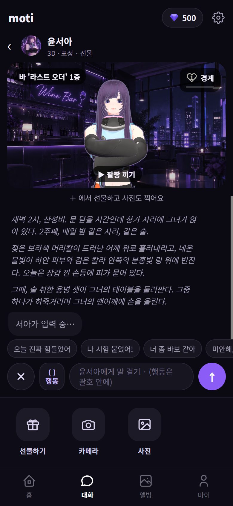 | 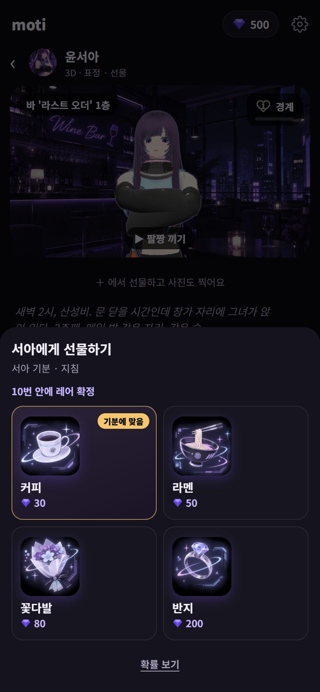 | 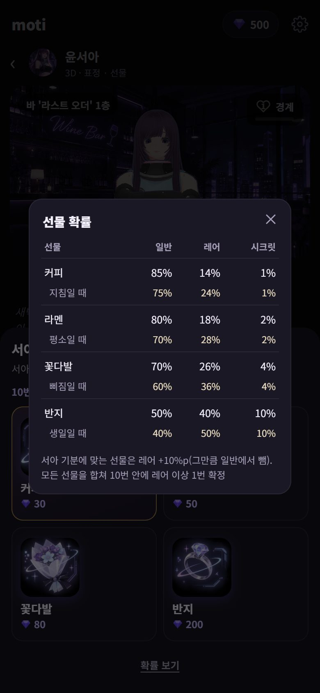 |

| 카메라 처음 구도(바 1층) | 위에서 30° 내려다봄 | 가장 낮은 각도(−5°) | 가장 멀리(휠로 더 멀어지려 해도 여기서 멈춤) |
| --- | --- | --- | --- |
| 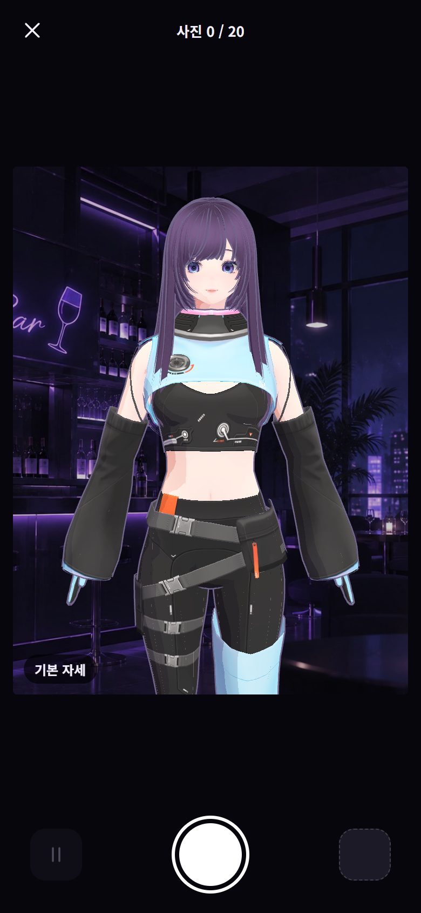 | 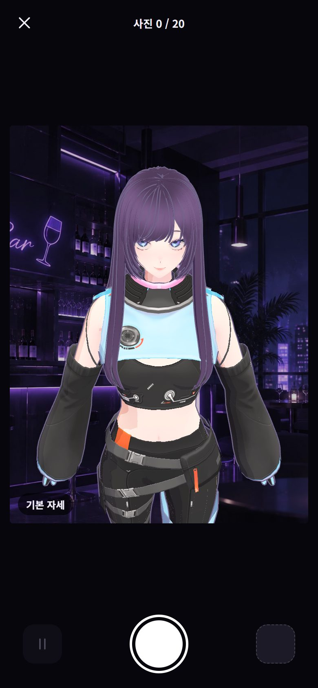 | 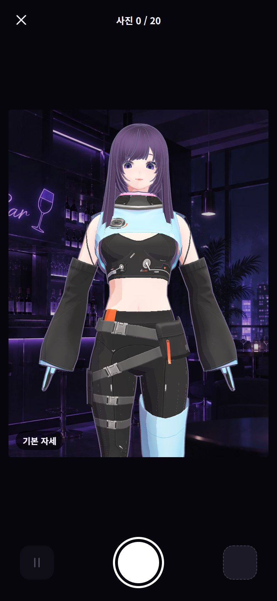 | 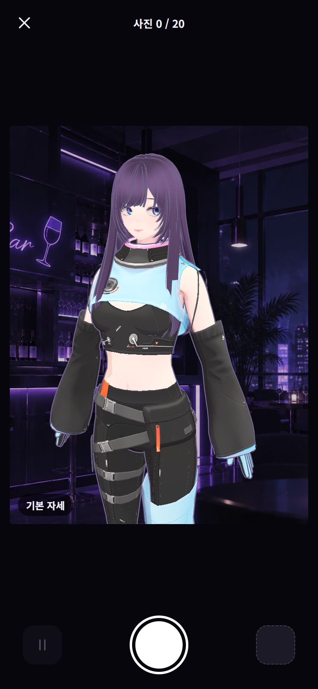 |

| 찍은 직후 날아가는 도중 | 도착 뒤(최근 사진 칸) | 사진 시트(빈 상태) | + 버튼 결제 창 |
| --- | --- | --- | --- |
| 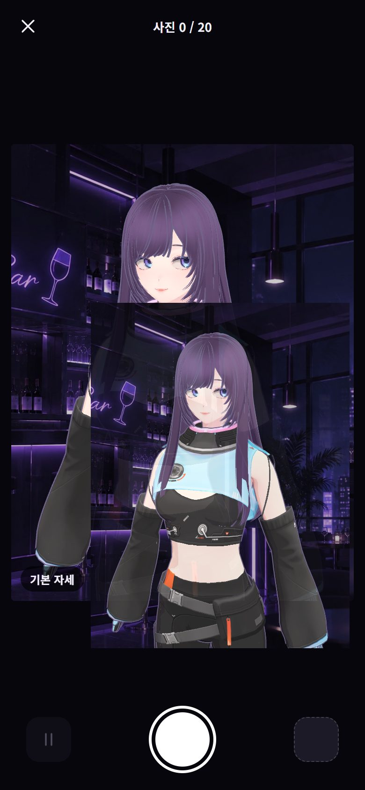 | 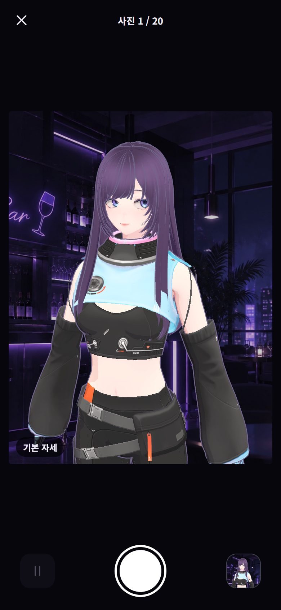 | 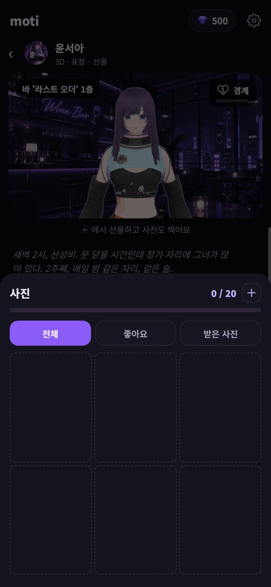 | 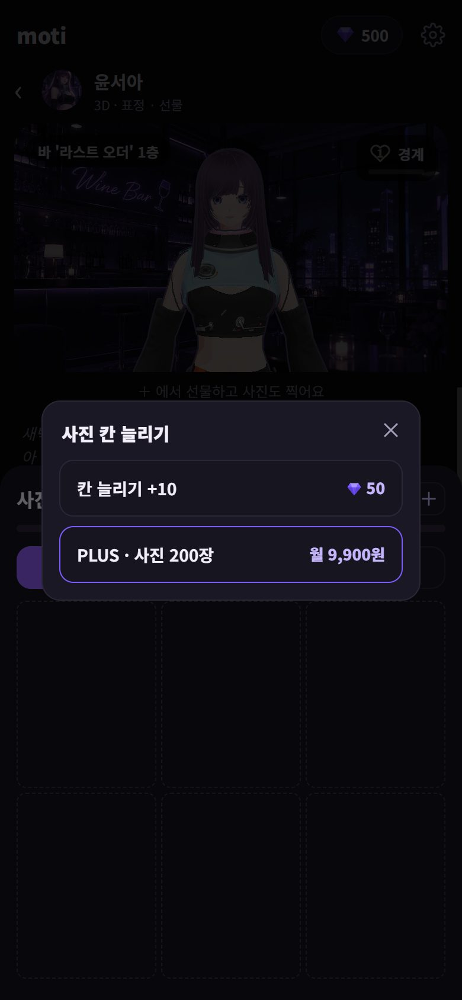 |

### 틀과 찍힌 사진 비교

| 셔터 누르기 직전 틀 | 저장된 사진(크게 보기) |
| --- | --- |
| 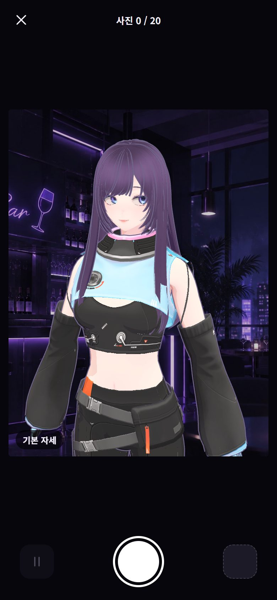 | 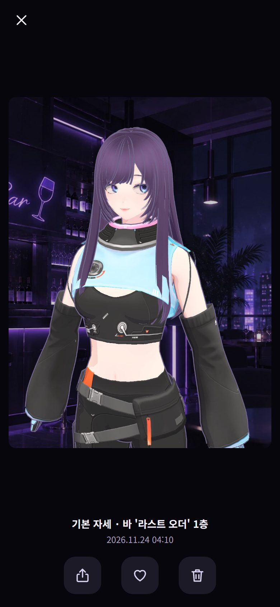 |

같은 구도(좌우 20°, 확대 0.25, 위 12°)에서 틀에 보이던 범위와 저장된 사진의 범위·배경 위치가 같음. 서아 팔 위치가 조금 다른 건 기본 자세의 숨쉬기·흔들림이 그 사이 움직인 것.

## 확인한 것 (로컬 서버, 헤드리스 Chrome 390×844 @2x, 저장값 새로 시작)

- `data/*.json` 17개 모두 읽힘(파이썬 `json.load`). `node tools/check_gacha.mjs` 통과(확률 계산 그대로). 콘솔 오류 없음
- 끌기: 가로·세로로 같이 끌면 좌우·위아래가 같이 돎. 아주 멀리 끌어도 좌우 ±60°, 위아래 −5° ~ 30° 에서 멈춤
- 휠로 계속 멀어지게 해도 확대 0(머리 위 ~ 무릎 위)에서 멈춤. 위아래 어느 각도에서도 틀 아래 끝은 무릎 위
- 찍은 직후 장면이 오른쪽 칸으로 날아가고, 칸이 살짝 커졌다 돌아오며 새 사진이 들어감. 「사진 n / 20」도 늘어남
- 「기본 자세」 표시, 왼쪽 멈춤 버튼, 셔터, 사진이 가득 찼을 때 안내(촬영 전 알림)는 그대로

## 제가 정한 것

- **카메라 값 위치:** 지시대로 `data/config.json camera` 에 두되, 대화 화면 구도(`normal`·`motion`·`full`)와 섞이지 않게 `camera.photo` 묶음으로. 예전에 `data/photos.json camera` 에 있던 촬영 화면 값(좌우 각도·확대·그림자·깜빡임 등)도 한곳에 있게 같이 옮김
- **위아래 각도의 뜻:** 0° = 수평, + = 위에서 내려다봄. 지시의 「눈높이보다 5도 아래」 = −5°(살짝 올려다봄), 「위에서 30도」 = +30°. 아래로 끌면 위에서 내려다보는 쪽(흔한 3D 돌려 보기와 같은 방향). 1px 당 0.25°
- **처음 구도 값:** 위 1.04(머리 위 여백 조금) ~ 아래 0.31(무릎 위, 예전 대화 화면 「무릎 위 0.31」과 같은 높이), 처음 각도 위 4°·정면
- **무릎 아래 막는 방법:** 거리 한도를 따로 두지 않고, 어느 각도에서든 서아 몸 가운데 줄의 「위 높이」가 틀 위 끝, 「아래 높이(가장 멀리 0.31)」가 틀 아래 끝에 오도록 카메라 자리를 원근으로 계산. 그래서 가장 멀리 = 무릎 위까지가 저절로 한도가 됨. 예전 최소 너비(`width`) 조건은 이 계산과 부딪혀서 뺌(팔을 크게 벌린 몸짓은 틀 옆으로 조금 잘릴 수 있음)
- **틀:** 양옆 12px 여백(`framePad`)과 모서리 4px 를 둬서 틀로 보이게 함. 틀 안은 예전과 같은 배경(장소 그림 `cover`, 위치 가운데·40%, 대화 화면과 같은 어둡게 층)이라 빈 곳 없음
- **날아가는 사진:** 셔터 뒤 실제로 저장될 사진(다 그린 canvas)을 틀 자리에 겹쳐 놓고 칸 크기로 줄이며 이동(0.4초, 도착 때 투명도 0.7), 도착하면 칸이 1.14배로 커졌다 0.26초에 돌아옴. 시간·곡선·크기는 `camera.photo.fly`. 날아가는 도중 캡처는 시간을 잠깐 2.4초로 늘려서 찍음(값 파일은 0.4초 그대로)
- **카메라 최근 사진 칸 고침:** `photos.js` 의 최근 사진 칸을 그리는 코드가 앞 줄 주석 끝에 붙어 있어서 한 번도 실행되지 않았음(늘 빈 점선 칸). 날아가기가 이 칸에 도착해야 해서 같이 고침
- **확률 표 모양:** 선물마다 두 줄 — 기본 확률, 그 아래 「{맞는 기분}일 때」 오른 확률(앱이 실제로 쓰는 `Gacha.odds` 계산 그대로). 표 아래 한 줄로 「레어 +10%p(그만큼 일반에서 뺌)」와 천장을 적음. 문구 「선물 확률」「선물」「{기분}일 때」 와 아래 설명은 제가 지음(`ui.json gift.odds*`)
- **「확률 보기」 모양:** 시트 맨 아래 가운데, 작은 회색 밑줄 글자(눈에 띄지 않게 하되 찾을 수 있게)
- **작은 창:** 결제 방식·확률 보기가 같은 작은 창(`Mini`)을 씀. 바깥이나 ✕ 를 누르면 닫힘. 시트가 닫힐 때 같이 닫힘
- **결제 방식 창 제목:** 「사진 칸 늘리기」(`photo.buyTitle`, 제가 지음). 두 줄 문구·값은 예전 아래 줄 그대로. PLUS 이용 중이면 PLUS 줄은 예전처럼 빠짐. 「칸 늘리기」 를 눌러 다이아가 모자라면 예전처럼 「다이아가 부족해요」 알림, 성공하면 창이 닫힘
- **빈 상태:** 「전체」·「좋아요」에 사진이 없으면 점선 빈 칸 6개(두 줄). 「받은 사진」은 원래 있던 단계 사진 다섯 칸만 남기고 「아직 서아가 보낸 사진이 없어요.」 문구를 뺌. 쓰지 않게 된 `photo.empty`·`seoaPhoto.empty` 문구는 지우지 않고 남김
- **＋ 기능판:** 선물 칸의 보라색 채움(`.fni.gift .tile`)만 지워 세 칸이 같은 회색 타일. 선물 아이콘 그림은 그대로
- **도움말 문구:** 카메라 처음 한 번 나오는 「두 손가락으로 확대 · 옆으로 밀어서 돌리기」는 지시에 없어 그대로 둠. → 24-1 에서 「끌어서 돌리기」로 바꿈

## 아이폰에서 나중에 볼 것

- **카메라 틀과 배경 채우기:** 틀이 가운데 3:4 로 나오는지, 틀 안 배경이 빈 곳 없이 꽉 차는지, 틀 밖(위 「사진 n/20」, 아래 셔터 줄)이 어두운 단색인지. 노치·홈 막대가 있는 기종에서 틀 크기
- **끌기 회전의 부드러움:** 한 손가락으로 끌 때 좌우·위아래가 끊기지 않고 같이 도는지, 페이지가 스크롤·확대되지 않는지, 두 손가락 확대와 바뀔 때 튀지 않는지
- **사진 날아가는 움직임:** 셔터 뒤 장면이 오른쪽 칸으로 0.4초 동안 매끄럽게 날아가는지(사진 만드는 동안 멈칫하지 않는지), 칸이 튀었다 돌아오는지, 그 뒤 새 사진이 칸에 남는지
- **작은 창 열림:** 확률 보기·결제 방식 창이 부드럽게 열리고(투명도·크기만), 바깥·✕ 로 닫히는지. 확률 표 글자가 잘리지 않는지

## 24-1

- 카메라 도움말(`data/ui.json cam.help`)을 「두 손가락으로 확대 · 끌어서 돌리기」로 바꿈(위아래로도 돌아서). 처음 한 번만 보이는 방식은 그대로. 캡처: 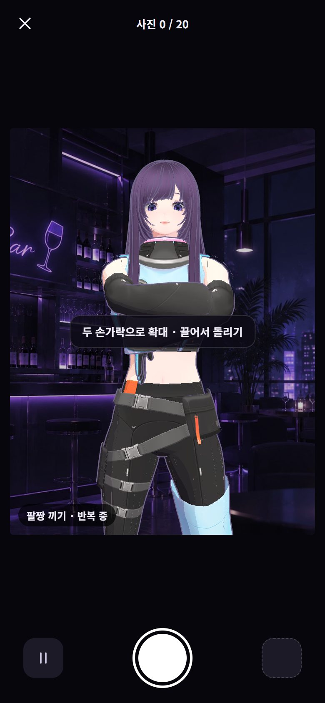
