# 25 · 새 XSTAGE 몸짓 6개 대화에 붙이기, 팔짱·경계 자세 확인

브랜치 `step/25-xstage-wire` · 커밋 `[25-A] 새 몸짓 6개 붙이기`, `[25-B] 팔짱 확인, 경계 자세 구도, 넘어가는 순간`

## 바뀐 파일

| 파일 | 내용 |
| --- | --- |
| `data/seoa_story.json` | unlock: 1단계에 x01·x11·x02, 3단계에 x15, 4단계에 x09, 판정 protect 에 x16(m21 뒤). lead 그대로. hints 에 x15·x09·x16 (지시문 문장 그대로) |
| `data/motion_keywords.json` | x01·x11·x02·x15·x09·x16 키워드, 겹침 정리(아래), 같은 자리에서 맞을 때 규칙을 `_설명`에 적음 |
| `data/collection.json` | `node tools/build_collection.mjs` 로 다시 만듦: 37칸 → **43칸**(대화 31 + 선물 12). x01·x11·x02 일반, x15·x09·x16 레어 |
| `data/motions.json` | 재생 구간: m07 3.5~10 → 5~17.3 중 9~14.5 건너뜀, m05 2~9 → 1.6~9.3, x09 끝까지 → 5.5초, x15 3번 되풀이. 새 항목 `skip`·`repeat`·`fadeIn`·`fadeOut` 설명 |
| `data/config.json` | `camera.follow`(x16 머리 따라가기 0.85, 0.35초), `stage.motionBlendMs` 350, `stage.xsFadeIn` 0.8 · `xsFadeOut` 1.0 |
| `index.html` | ① 새 몸짓 시작 때 지금 자세에서 섞기(`motionBlendMs`) ② XSTAGE `skip`·`repeat`·처음/끝 섞는 시간 설정값 ③ 카메라 머리 따라가기(`camera.follow`) ④ 예전 저장값: protect 를 이미 연 사람도 x16 이 열리게(판정·사건 묶음 중 하나라도 열렸으면 묶음 전체) |
| `docs/reports/img/25/` | 캡처 46장 |

## 1. 새 몸짓 6개

| 몸짓 | 열리는 곳 | 등급 | 키워드 |
| --- | --- | --- | --- |
| x01 짜증 내기 | 1단계 | 일반 | 짜증, 귀찮, 혀를 찬 (not: 귀찮지 않) |
| x11 손 들어 막기 | 1단계 | 일반 | 손을 들어, 막는다, 막아선 (not: 손을 들어 인사) |
| x02 허리 숙이기 | 1단계 | 일반 | 몸을 숙, 허리를 숙, 카운터 너머 |
| x15 수줍게 걷기 | 3단계 | 레어 | 쭈뼛, 머뭇, 발끝 |
| x09 붙잡기 | 4단계 | 레어 | 붙잡, 손목을 잡 |
| x16 몸 낮춰 경계하기 | 판정 protect (m21 과 함께, 연출은 m21) | 레어 | 경계, 자세를 낮 (not: 경계를 풀·경계가 풀·경계심이 풀·경계를 늦·경계가 누그러) |

### 겹친 단어

| 단어 | 겹친 몸짓 | 정리 |
| --- | --- | --- |
| 손을 들어 | m13 「손을 들어 인사」 ⊃ x11 「손을 들어」 | x11 에 not 「손을 들어 인사」, m13 이 목록에서 앞 |
| 몸을 숙 | c03 「몸을 숙」 = x02 「몸을 숙」 | c03 이 목록에서 앞 → c03 이 열린 2단계부터는 c03, 1단계에서는 x02 |
| 돌아서 | m10 「돌아서」 vs x09 힌트 같은 문장 「돌아서려는 당신을 … 붙잡는다」 | m10 에 not 「돌아서려는 당신」「돌아서는 당신」「돌아선 당신」(서아가 아니라 당신이 돌아섬) |
| 막아선 | 기존 몸짓과 겹치지 않음 (m12 「다가선」과 다른 말) | — |
| 손목을 잡 / 붙잡 | c04 「잡아당」(「손목을 잡아당긴다」) | 지문에서 먼저 나온 x09 「손목을 잡」이 걸림 |
| 카운터 너머 | c03 「카운터에 기대」와 다른 말 | — |

### 키워드 시험 (`pickMotion` 과 같은 규칙, 모두 열린 상태 / 표시한 줄만 1단계)

| 지문 | 기대 | 결과 | 걸린 단어 | |
|---|---|---|---|---|
| *귀찮다는 듯 혀를 찬다.* | x01 | x01 | 귀찮 | ○ |
| *짜증 섞인 눈으로 노려본다.* | x01 | x01 | 짜증 | ○ |
| *혀를 찬다.* | x01 | x01 | 혀를 찬 | ○ |
| *손을 들어 당신의 말을 막는다.* | x11 | x11 | 손을 들어 | ○ |
| *문 앞을 막아선다.* | x11 | x11 | 막아선 | ○ |
| *손을 들어 인사한다.* | m13 | m13 | 손을 들어 인사 | ○ |
| *허리를 숙여 바닥의 잔을 줍는다.* | x02 | x02 | 허리를 숙 | ○ |
| *카운터 너머로 손을 뻗는다.* | x02 | x02 | 카운터 너머 | ○ |
| *몸을 숙여 당신을 들여다본다.* | c03 | c03 | 몸을 숙 | ○ |
| *몸을 숙여 당신을 들여다본다.* (1단계만 열림) | x02 | x02 | 몸을 숙 | ○ |
| *발끝으로 바닥을 쭈뼛 긁는다.* | x15 | x15 | 발끝 | ○ |
| *머뭇거리며 한 걸음 다가온다.* | x15 | x15 | 머뭇 | ○ |
| *돌아서려는 당신의 소매를 붙잡는다.* | x09 | x09 | 붙잡 | ○ (정리 전엔 m10) |
| *손목을 잡아당긴다.* | x09 | x09 | 손목을 잡 | ○ |
| *자세를 낮추고 문 쪽을 경계한다.* | x16 | x16 | 자세를 낮 | ○ |
| *경계하듯 눈을 가늘게 뜬다.* | x16 | x16 | 경계 | ○ |
| *경계를 풀고 웃는다.* | m01 | m01 | 웃 | ○ |
| *팔짱을 끼고 벽에 기댄다.* | m07 | m07 | 팔짱 | ○ |
| *귀찮지 않다는 듯 웃는다.* | m01 | m01 | 웃 | ○ |

## 2. 앨범 잠긴 칸 힌트

x15·x09·x16 세 문장을 그대로 넣음. 1단계 3개는 잠긴 칸이 되면 기본 문구(「대화에서 만나요」)가 나옴(처음부터 열려 있어 대화에서 한 번 나오면 바로 기록됨).

| x15 | x16 |
| --- | --- |
| 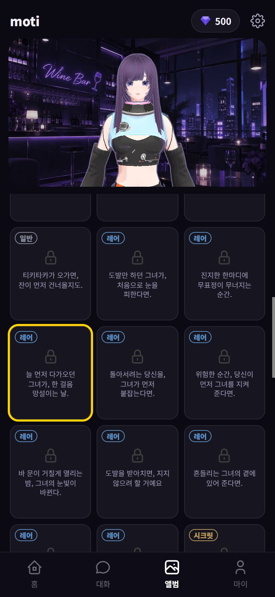 | 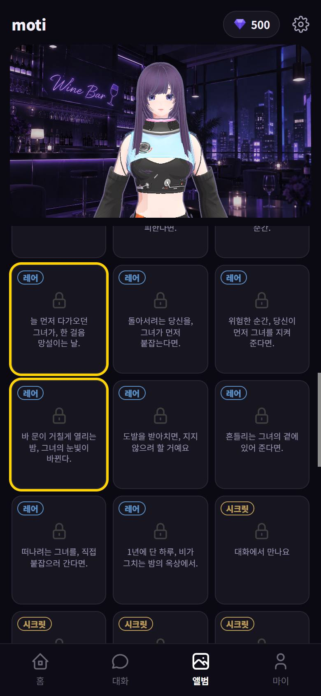 |

## 3. 팔짱 끼기(m07) 확인

원본 모션 전체(0~20.8초, 0.5초 간격): 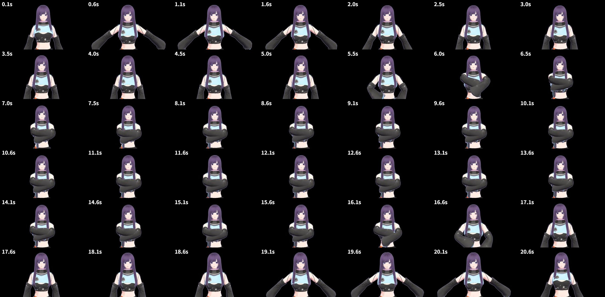

**원인: 재생 구간.** 원본은 0~5.3초 팔을 내린 채 서 있다가 5.3~6.3초에 팔짱을 끼고, 16초쯤 풂. 예전 구간 3.5~10초는
- 처음 약 2초는 팔을 내린 그대로(팔짱이 안 보임),
- 2~2.5초에 두 손이 앞·위로 올라오며 팔짱을 끼는데 이게 「손 내미는」 것처럼 보이고(기획자가 본 m11 로 추정),
- 9.3초부터 끝 섞기(0.7초)로 팔짱 낀 팔을 기본 자세로 바로 당겨 와서 한 프레임에 36° 넘게 휙 돌았음.

다른 쪽은 문제없었음:
- 다른 자동 몸짓이 끼어드는지: 답장 뒤 몸짓을 바꾸는 곳은 다음 답장·해금 연출·인트로 문단뿐(`Stage.play` 전부 확인). 살아 있게(`alive.js`)는 숨·시선·머리카락만 더하고 팔은 안 건드림
- 남자 모션이라 팔이 몸을 뚫는지: 0.5초 간격 그림에서 팔이 몸 앞에 제대로 겹치고, 손은 가슴보다 13~15cm 앞(뚫지 않음)

**처리:** 구간을 5~17.3초로 바꾸고 9~14.5초(팔짱 낀 채 거의 멈춘 구간)를 건너뜀 → 재생 6.8초: 0.6초부터 팔짱을 끼기 시작해 1.2초쯤 완성, 약 4초 유지, 끝에 원본대로 팔을 풂. 건너뛴 두 순간의 손 위치 차이 1.5cm 이하라 이음매가 안 보임.

390px 대화방, 0.5초 간격(몸짓 시작 = 0초):

| 0.0 | 0.5 | 1.0 | 1.5 | 2.0 | 3.0 | 4.0 | 5.0 | 6.0 | 7.0 |
| --- | --- | --- | --- | --- | --- | --- | --- | --- | --- |
| 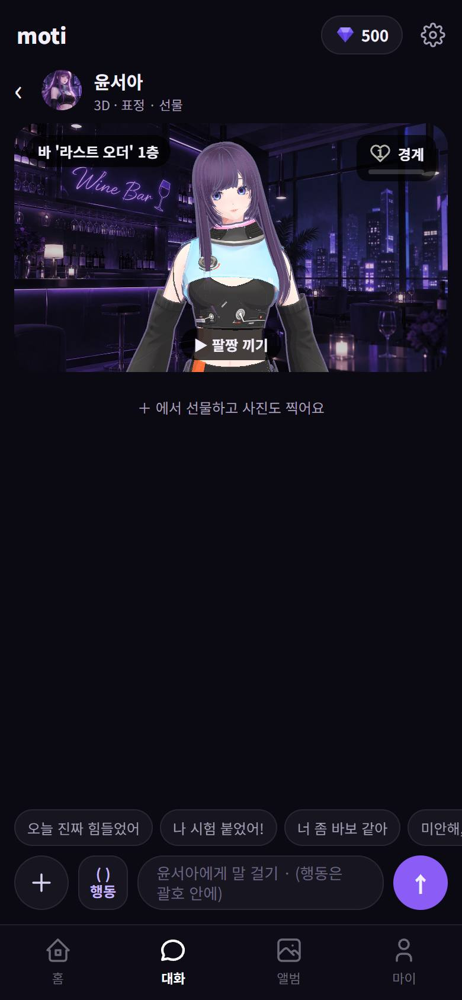 | 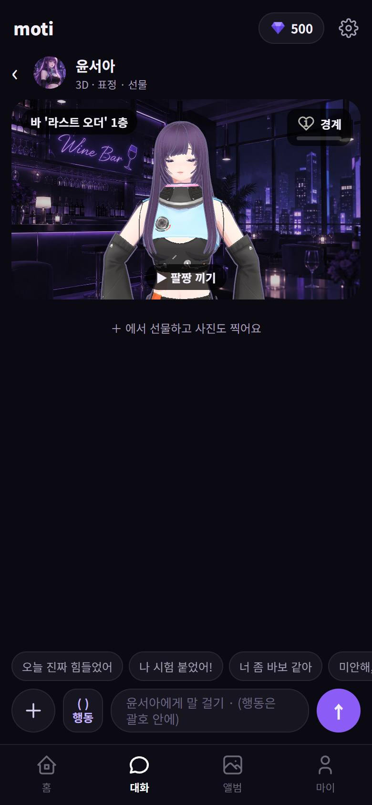 | 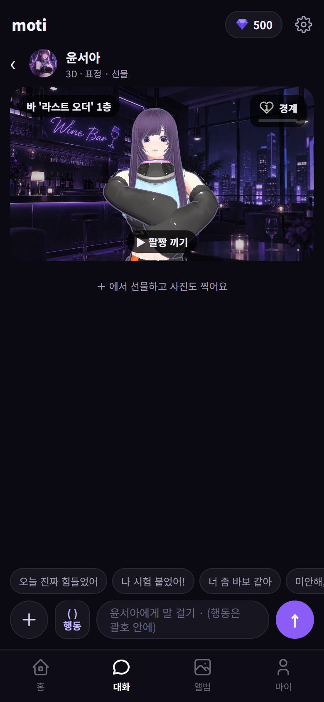 |  | 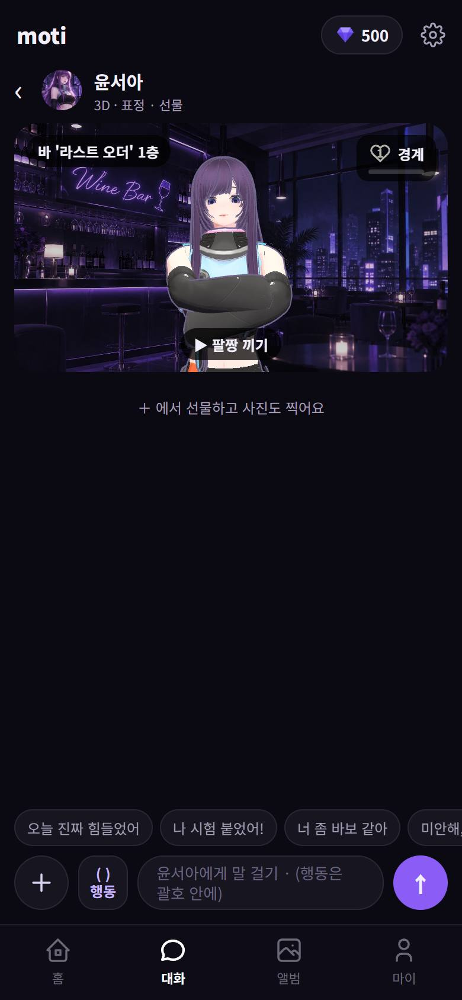 |  | 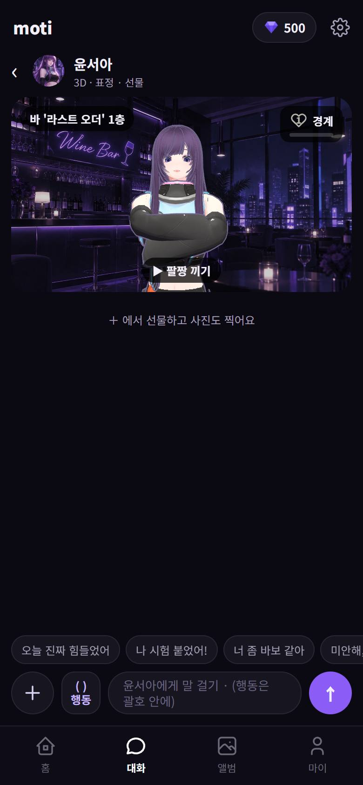 | 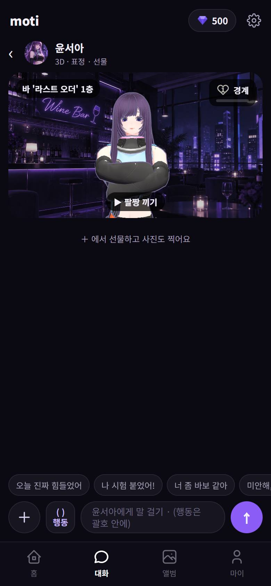 | 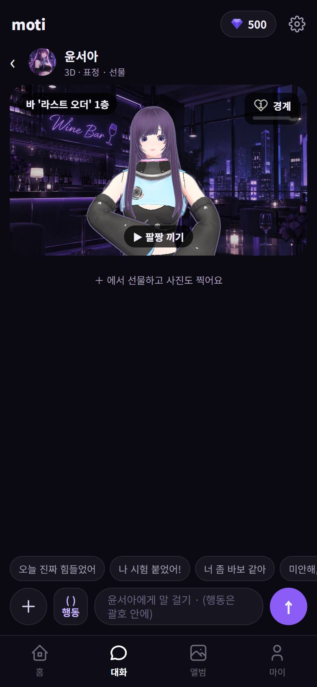 |  |

(0.5초 간격 16장 전부 `img/25/390_m07_*.jpg`)

## 4. 몸 낮춰 경계하기(x16) 구도

x16 은 머리가 1.32m → 0.89m 까지 내려가 평소 구도에서는 화면 아래로 사라졌음. 재생하는 동안만 카메라가 머리가 내려간 만큼 × 0.85 따라 내려가고, 끝나면 같은 부드러움(0.35초)으로 돌아옴. 위로는 따라가지 않음. 값은 `data/config.json camera.follow`. 다른 몸짓 구도는 그대로.

카메라 이동량: 0초 0 → 1초 −0.29m → 2초 −0.34m → 3초 −0.34m → 4.6초(끝) −0.11m → 5.6초 0

| 따라감 끔(비교) 2초 | 켬 0초 | 켬 2초 | 켬 3초 | 켬 끝+1초 |
| --- | --- | --- | --- | --- |
| 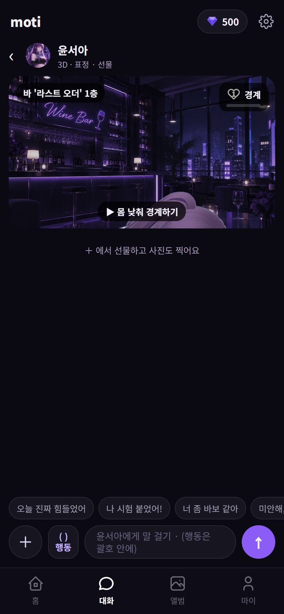 | 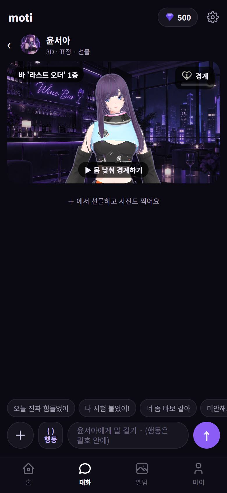 | 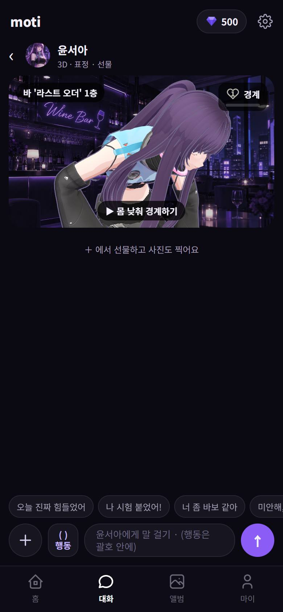 | 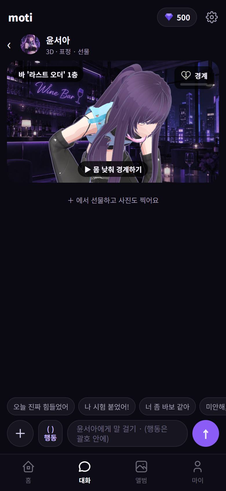 | 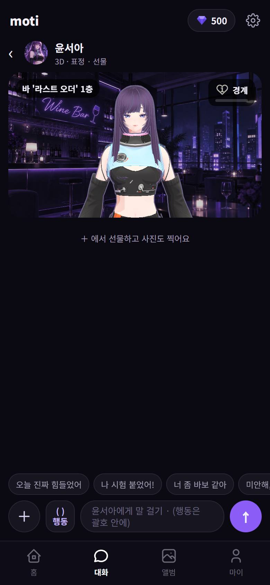 |

## 5. 시연 패널

`?debug=1` 시연 패널 몸짓 목록 32개 안에 새 6개가 있고, 단계 해금 없이 눌러서 모두 재생됨(x01·x11·x02·x15·x09·x16 재생 확인). 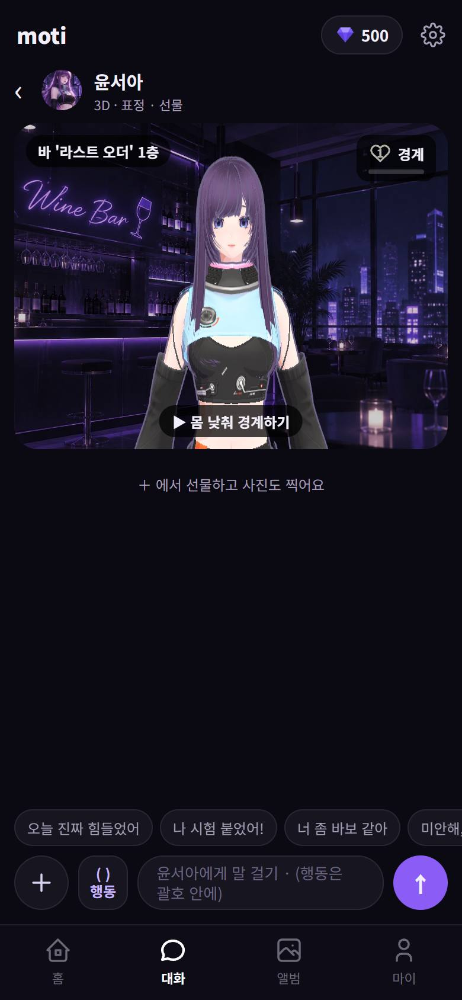

## 넘어가는 순간 (대기 → 몸짓 → 대기)

방법: 헤드리스 Chrome 390px, 시계를 직접 넘겨(1/30초씩) 고개 갸웃(m25) 1초 → 몸짓 → 끝난 뒤 1.2초. 뼈 20개의 회전이 **한 프레임에 가장 크게 바뀐 각도**를 잼. 참고로 몸짓 안쪽(처음·끝 1초 뺀 구간)의 95% 값이 그 모션 자체의 빠르기.

| 몸짓 | 시작 고치기 전 | 시작 고친 뒤 | 끝 고치기 전 | 끝 고친 뒤 | 모션 자체(95%) |
| --- | --- | --- | --- | --- | --- |
| x01 | 11.7° 머리 툭 | 9.2° | 7.8° | 5.4° | 13.7° |
| x11 | 11.6° 머리 툭 | 3.9° | 5.7° | 4.0° | 8.7° |
| x02 | 16.4° | 14.6° | 10.6° | 7.4° | 5.5° |
| x15 | 19.5° | 17.0° | 14.1° | 10.1° | 9.4° |
| x09 | 20.1° | 17.8° | 14.7° | 10.3° | 1.5° |
| x16 | 15.8° | 13.5° | 11.2° | 7.9° | 11.9° |
| m07 | 11.6° 머리 툭 | 10.2° | **36.2°** | 9.8° | 7.6° |
| m19 | 15.7° | 14.0° | 15.5° | 14.0° | 19.6° |
| m09 | 11.5° 머리 툭 | 7.4° | 5.9° | 4.5° | 6.8° |
| m03 | 11.7° 머리 툭 | 7.6° | 6.8° | 4.7° | 2.3° |
| m04 | 11.5° 머리 툭 | 8.1° | 7.7° | 7.2° | 9.0° |
| m05 | 19.9° | 6.4° | 17.5° | 9.5° | 5.1° |

튀던 것과 처리
- **모든 몸짓 시작 첫 프레임에 머리가 11~12° 툭**: 고개 갸웃(m25) 중에 새 몸짓이 시작되면 갸웃한 고개가 한 프레임에 바로 펴졌음. → 새 몸짓을 시작할 때 지금 자세에서 0.35초 섞으며 넘어감(`stage.motionBlendMs`, XSTAGE·손으로 만든 몸짓 모두). 앞 몸짓 중간에 다음 몸짓이 와도 같이 부드러워짐
- **m07 끝 36°**: 위 3절(구간 변경). 「고치기 전」 m07 숫자는 중간에 시험한 5~11.5초 구간에서 잰 값(예전 3.5~10초도 팔짱 낀 채 끝나서 같은 문제)
- **팔이 크게 움직이는 몸짓의 처음·끝**: XSTAGE 처음/끝 섞는 시간 0.5/0.7초 → 0.8/1.0초(`stage.xsFadeIn`·`xsFadeOut`)
- **m05 처음·끝 20°**: 손을 목에 올린 채로 시작·끝나던 구간 → 손 올리기·내리기를 포함한 1.6~9.3초
- 남은 x09·x15 시작 17~18° 는 원본 모션 자체가 0.1~0.4초에 손을 빠르게 뻗거나 모으는 동작(여러 프레임에 걸친 매끄러운 곡선, 한 프레임 툭이 아님). 다른 모션의 보통 빠르기(m19 최대 28°, x01 최대 18°) 안이라 그대로 둠

0.1초 간격 연속 캡처(윗줄 = 대기 −0.1초 ~ 시작 1.0초, 아랫줄 = 끝 0.7초 전 ~ 끝난 뒤 0.6초 대기):

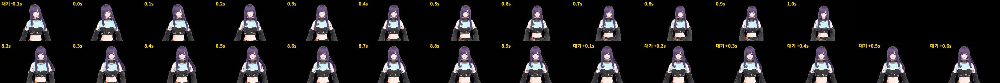
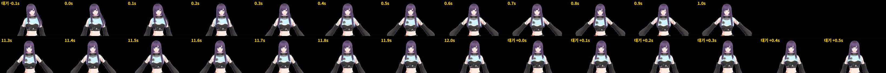
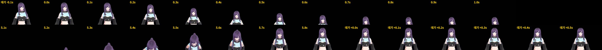
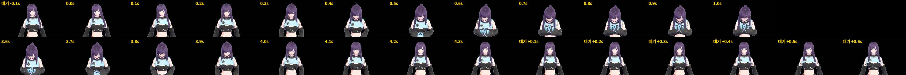
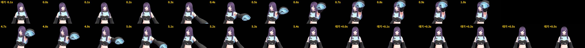
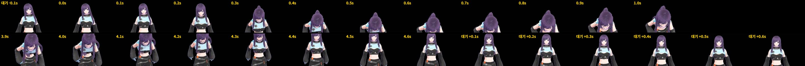
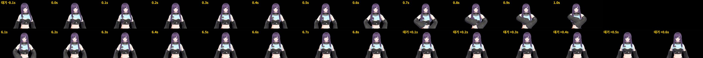
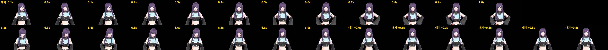
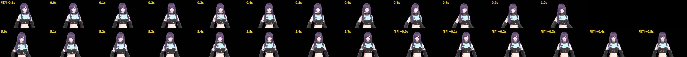
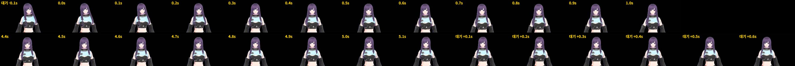
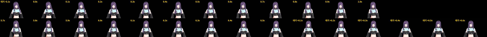
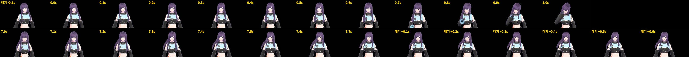

## 390px 캡처: 새 몸짓 6개

| x01 짜증 내기 | x11 손 들어 막기 | x02 허리 숙이기 | x15 수줍게 걷기 | x09 붙잡기 | x16 몸 낮춰 경계하기 |
| --- | --- | --- | --- | --- | --- |
| 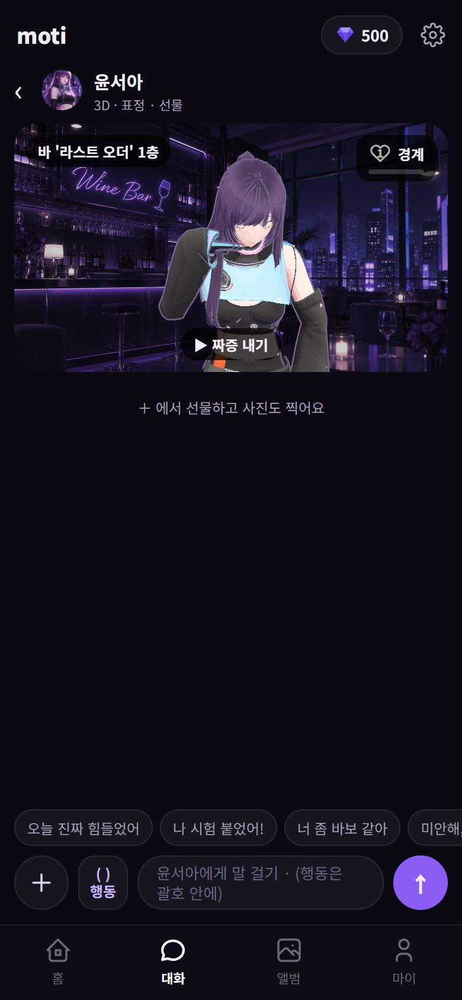 | 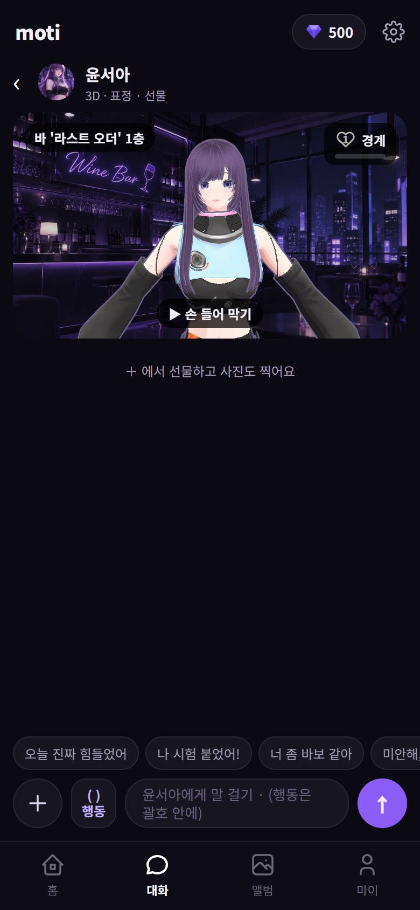 | 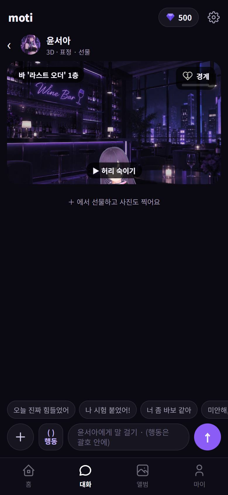 | 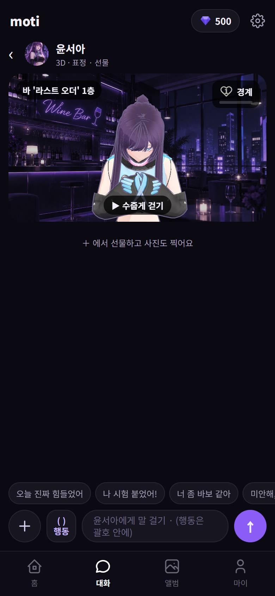 | 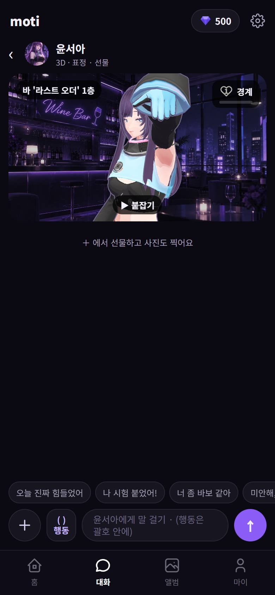 | 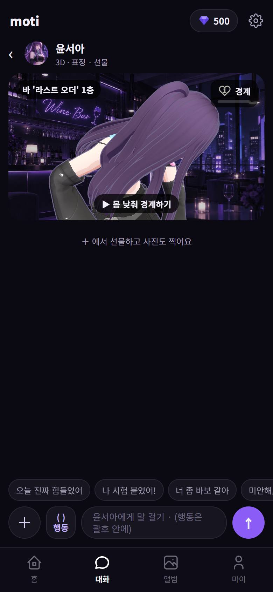 |

## 확인

- data JSON 17개 모두 읽힘(`json.load`)
- `build_collection`: 대화 31 + 선물 12 = 43칸 (전 37칸, +6)
- 키워드 시험 19개 모두 맞음(위 표)
- 시연 패널에서 새 6개 바로 재생됨

## 제가 정한 것

- **x02 허리 숙이기도 x16 처럼 화면 아래로 사라짐**(머리 1.32m → 0.70m, 1초 무렵부터 머리 꼭대기만 보이다 2.5초쯤 완전히 안 보임, [원본](img/25/raw_x02.jpg)·[390 캡처](img/25/390_x02.jpg)). 지시문이 「다른 몸짓의 구도는 바꾸지 않는다」라 그대로 둠. 고치려면 `data/config.json camera.follow.motions` 에 `"x02": 0.85` 한 줄이면 됨(코드 그대로)
- 「몸을 숙」은 c03 과 x02 둘 다에 넣고 c03 을 앞에 둠: 1단계에선 x02, c03 이 열리는 2단계부터는 c03
- m10 「돌아서」에 not(당신이 돌아서는 경우) 추가 — 지시문 표에는 없지만 x09 시험 문장이 m10 으로 가서
- x01 「귀찮지 않」, x16 「경계를 풀」 등 not 은 m01 「웃지 않」 같은 기존 방식으로 몇 개만 넣음
- x16 은 protect 묶음에서 m21 뒤에 둬서 해금 연출은 m21 그대로, x16 은 조용히 열림. 예전 저장값에서 protect 를 이미 연 사람(m21 이 열린 사람)도 x16 이 같이 열리게 함
- 카메라 따라가는 몫 0.85(머리가 내려간 만큼 다 따라가면 무대 배경이 많이 올라가 보여서 조금 덜). 부드러움 0.35초
- 섞는 시간: 몸짓 시작 0.35초, XSTAGE 처음 0.8초·끝 1.0초. 모든 XSTAGE 몸짓에 같이 적용(m24 포함). 몸짓마다 따로 쓰고 싶으면 `data/motions.json xstage` 에 `fadeIn`·`fadeOut`
- m07 은 원본의 팔짱 푸는 동작까지 쓰고 가운데 멈춘 부분만 건너뜀(`skip` 새로 만듦). 재생 길이 6.5 → 6.8초
- x09 원본은 0.4초에 손을 뻗은 뒤 9초까지 거의 멈춰 있어 5.5초에서 끊음
- x15 원본은 1.44초 한 바퀴라 섞기만 하다 끝나서 3번 되풀이(`repeat` 새로 만듦, 이음매 튐 없음: 안쪽 최대 11°)
- 몸짓 이름·감정 태그는 팀원이 정한 그대로 둠(x02 「지침」, x16 「긴장」 등)
- 미리보기 서버(앱 미리보기 창)가 다른 대화들 몫으로 다 차서 못 열었음. 대신 캡처 스크립트가 잠깐 파일을 띄워 헤드리스 Chrome 으로 찍고 닫음(저장소 밖 임시 폴더, 저장소에 안 넣음)

## 아이폰에서 나중에 볼 것

- **카메라 따라감(x16):** 사파리에서 카메라가 부드럽게 내려갔다 돌아오는지, 3D 확대(화면 커짐)와 같이 일어날 때 끊기지 않는지
- **넘어가는 순간 섞기:** 몸짓이 바뀔 때 매끄러운지(매 프레임 뼈 회전값을 한 번 더 복사하는 정도라 부담은 작을 것으로 봄)
- **모션 파일 미리 받기:** 지금 불러오는 XSTAGE 13개 합계 약 2.0MB(따로 둔 4개 제외). 3D 준비 뒤 하나씩 차례로 받음 — 받는 동안 대화·3D 가 버벅이지 않는지, 데이터 받는 동안 처음 몸짓이 늦게 시작되는지(아직이면 받는 대로 처음부터 재생)
- x09 붙잡기는 손이 화면 앞으로 크게 다가오는 모션이라 작은 화면에서 얼굴이 가려 보이는지
