# 26 · 컬렉션 이름과 소개

브랜치 `step/26-collection` · 커밋 `[26] 컬렉션 이름과 소개`

카드를 얻는 규칙(단계·플래그·키워드·선물 등급·천장)과 칸 수(43), 칸 모양은 그대로.

## 바뀐 파일

| 파일 | 내용 |
| --- | --- |
| `data/ui.json` | 이름 바꿈(아래 표), 새 문구 `album.intro`(소개 창), `album.infoAria`((!) 버튼 이름), `album.firstSeen`(새 무빙 카드 작은 알림, seoa_story.json 에서 옮겨 옴) |
| `data/seoa_story.json` | `firstSeenText` 를 지우고 ui.json 으로 옮겼다는 `_` 설명만 남김. `_soonText`·`_hints` 설명 속 이름 |
| `data/demo.json` | 시연 패널 문구 3곳(아래 표) |
| `data/demo_scenes.json` | 시연 6장 이름 「앨범」 → 「컬렉션」 |
| `icons.js` | 선 아이콘 `info`(동그라미 안 !) 추가 |
| `index.html` | 하단 탭 기본 글자, 컬렉션 제목 옆 (!) 버튼, 소개 창 `colIntro()`(처음 한 번 자동 + 버튼), 컬렉션 탭의 3D 무대·자막 칸 없앰, 얻은 칸 누르기를 작은 창으로(아래 3절), 새 무빙 카드 알림이 `UI("album.firstSeen")` 을 읽음, 시연 「컬렉션만」 초기화 때 소개 창도 다시 뜨게 |
| `docs/reports/img/26/` | 캡처 |

## 1. 이름 바꾼 곳

| 파일 · 키 | 예전 | 지금 | 화면 |
| --- | --- | --- | --- |
| `ui.json nav.album` · `index.html #navAlbum` 기본 글자 | 앨범 | 컬렉션 | 하단 탭 |
| `ui.json album.title` | 명장면 수집 | 무빙 카드 | 컬렉션 탭 제목 |
| `ui.json album.unlockTag` | 새 명장면 | 새 무빙 카드 | 해금 연출 때 3D 위 몸짓 이름 옆 |
| `ui.json album.unlockSaved` | 명장면 +1 | 무빙 카드 +1 | 해금 토스트 셋째 줄, 선물·레어 카드 셋째 줄 「무빙 카드 +1 · n / 43」 |
| `ui.json album.firstSeen` (예전 `seoa_story.json firstSeenText`) | 새 명장면 · {name} | 새 무빙 카드 · {name} | 일반 등급 새 몸짓 작은 알림 |
| `ui.json my.collection` | 명장면 수집 {n} / {total} | 무빙 카드 {n} / {total} | (지금 코드에서 쓰지 않는 키, 같이 바꿈) |
| `ui.json my.collectionLabel` | 명장면 수집 | 무빙 카드 | 마이 페이지 줄 이름 |
| `demo.json colOpenAll` | 명장면 모두 열기 | 무빙 카드 모두 열기 | 시연 패널 |
| `demo.json resets.album` | 앨범만 | 컬렉션만 | 시연 패널 초기화 버튼 |
| `demo.json motionSeen` | 앨범 | 컬렉션 | 시연 패널 몸짓 목록(수집한 몸짓 표시) |
| `demo_scenes.json` 6장 `name` | 앨범 | 컬렉션 | 시연 장 제목 「6장 · 컬렉션」 |

`gifts.json`·`collection.json` 에는 화면에 보이는 「명장면」「앨범」이 없었다(`collection.json` 은 `_설명` 키뿐이라 그대로). 코드 주석·`_` 설명 키는 그대로 둠(seoa_story.json 의 `_` 설명 2곳만 손봄). 바꾼 뒤 `data/`·`*.js`·`*.html` 에서 주석·`_` 키를 빼고 「명장면」「앨범」 글자를 찾으면 0건.

## 2. 소개 창

- 컬렉션 탭에 처음 들어갈 때 한 번 자동으로 뜸. 뜬 순간 저장값 `S.colIntro` 를 켬(확인을 누르지 않고 닫아도 다시 뜨지 않음)
- 제목 「무빙 카드」 옆 (!) 동그라미 버튼(`Icon.svg("info")`)을 누르면 같은 창
- 창은 24단계 작은 창(`Mini`, 선물 확률 보기와 같은 것)을 그대로 씀. 확인·✕·바깥 누르면 닫힘
- 문구는 지시문 그대로 `ui.json album.intro`

## 3. 무대 없는 컬렉션

- 컬렉션 탭의 3D 무대 자리(`#stageSlotAlbum`)와 다시 보기 자막 칸(`#rcap`)을 없앰. 칸 목록이 헤더 아래 화면 전체를 씀. 3D 무대는 서아 대화방에서만 보임
- 얻은 칸을 누르면(26-1 카드 확대 전까지 임시): **재생 없이 작은 창**에 몸짓 이름(제목) · 등급 · 얻은 날 · 장소 · 그때 대사
- 잠긴 칸을 누르면 힌트 토스트(예전 그대로)

## 캡처 (390×844)

| 하단 탭 | 처음 들어갈 때 소개 창 | (!)로 다시 연 창 |
| --- | --- | --- |
|  | 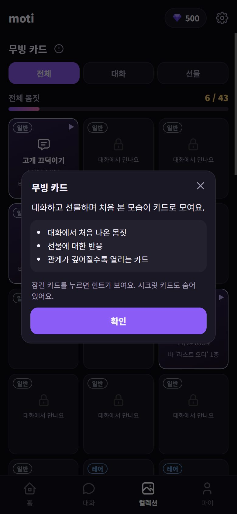 |  |

| 무대 없는 컬렉션 | 아래로 내린 컬렉션 | 얻은 칸 누르기(임시 창) | 잠긴 칸 힌트 |
| --- | --- | --- | --- |
| 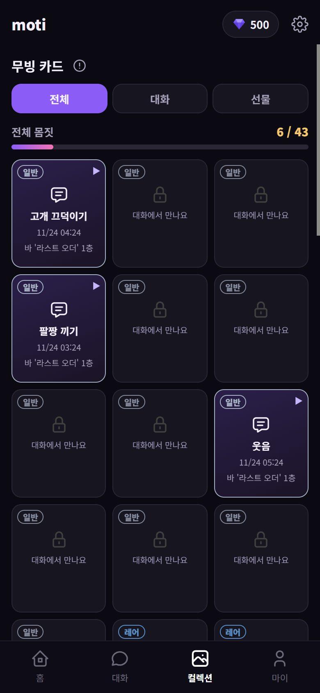 | 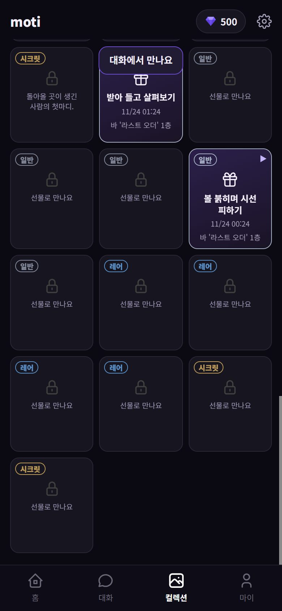 | 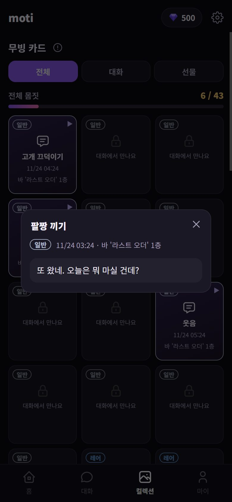 | 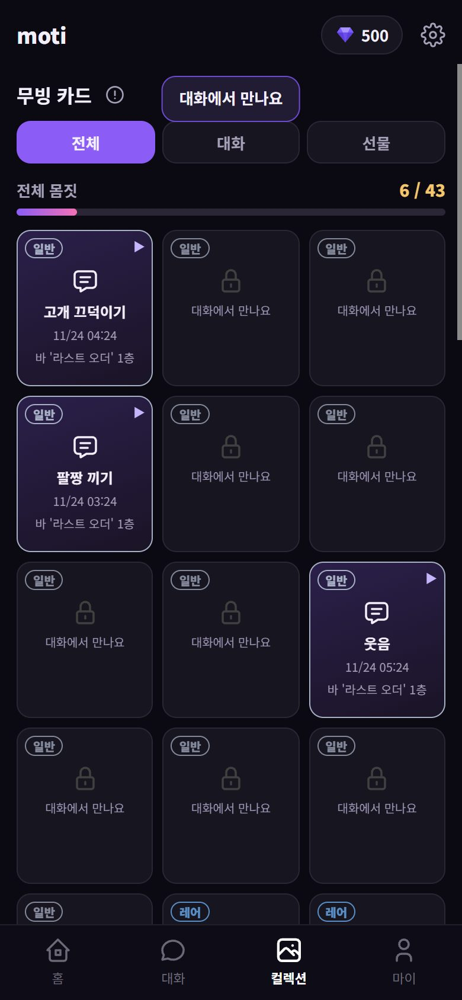 |

| 새 무빙 카드 알림(일반) | 선물 카드 셋째 줄(레어) |
| --- | --- |
|  | 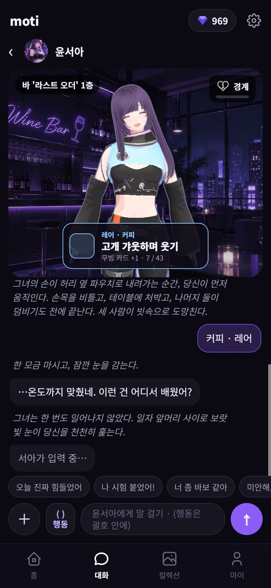 |

## 확인

- `data/*.json` 17개 모두 `JSON.parse` 통과, `collection.json items` 43칸
- 헤드리스 Chrome(390×844, 픽셀 비율 2)에서: 처음 들어가면 창이 뜨고 `S.colIntro=1`, 다른 탭 갔다 다시 오면 안 뜸, (!)로 다시 열림, 컬렉션에서 `#stage` 는 `display:none`
- 선물 결과 카드 글: 새 레어 「레어 · 커피 / 고개 갸웃하며 웃기 / 무빙 카드 +1 · 7 / 43」, 이미 모은 것 「… / 이미 모은 모습」, 일반 새 몸짓 알림 「새 무빙 카드 · 놀라기」
- 스크립트 오류 없음

## 아이폰 사파리에서 볼 것

- 새 시각 효과는 없음. 소개 창·임시 창은 24단계 작은 창과 같은 것(투명도·크기 전환만, 블러 없음)
- 컬렉션 탭에서 3D 무대가 빠졌으니 컬렉션 → 대화방으로 돌아올 때 무대가 제자리에서 다시 그려지는지

## 제가 정한 것

- **칸 누를 때 임시 동작:** 대화방으로 옮겨 재생하는 대신 **재생 없이 이름·대사 작은 창**을 골랐다. 컬렉션을 넘겨 보다 누를 때마다 탭이 바뀌면 다시 찾아오기 번거롭고, 26-1 카드 확대와 모양이 가까워서. 얻은 칸 오른쪽 위 ▶ 표시는 칸 모양을 이번에 바꾸지 않기로 해서 그대로 둠
- **firstSeenText 옮김:** 「바뀐 문구는 모두 ui.json」에 따라 `seoa_story.json firstSeenText` 를 `ui.json album.firstSeen` 으로 옮김. 보이는 시간 `firstSeenMs` 는 숫자라 seoa_story.json 에 그대로
- **시연 패널 문구는 demo.json 에 둠:** 시연 패널은 자기 문구 파일(`demo.json`)만 읽으므로 그 안에서 바꿈. 앱 사용자 화면 문구만 ui.json
- **소개 창 「본 적 있음」 기준:** 창이 뜬 순간에 저장(확인을 눌러야만이 아님). 시연 패널 「컬렉션만」 초기화와 전체 초기화 때는 다시 뜸
- **목록 모양:** 세 줄은 점 목록(•)으로, 옅은 바탕 칸 안에. 아래 줄은 작은 회색 글씨, 확인은 보라 버튼 전체 폭
- **(!) 아이콘:** Tabler `alert-circle` 모양(동그라미 + 세로선 + 점)을 선 굵기 1.8로
- **안 쓰는 키:** `ui.json my.collection` 은 코드에서 안 쓰지만 문구라서 같이 바꿈

---

# 26-1 · 무빙 카드

브랜치 `step/26-1-moving-card` · 커밋 `[26-1A] 카드에 처음 본 순간 담기` → `[26-1B] 카드 모양과 확대`

카드를 얻는 규칙과 카드 수(43)는 그대로. 사진 저장 칸(20장)에는 카드 그림을 넣지 않고 따로 저장한다.

## 바뀐 파일

| 파일 | 내용 |
| --- | --- |
| `cards.js` (새 파일) | `Cards`: 카드 그림 저장소(IndexedDB `moti_cards`, 사진 저장소와 따로) · 그림 만들기 예약(몸짓 재생이 끝난 뒤) · 예전 저장값 채우기 · 카드 칸 모양 · 카드 확대(3D 반복 재생) · 공유 그림 |
| `cards.css` (새 파일) | 카드 칸 3열 2:3, 테두리·등급 표시, 못 본 카드·잠긴 카드 뒷면, 카드 확대 화면 |
| `index.html` | `seenNow()`: 기록할 때 의상·장소·이야기 줄기·캐릭터·관계 단계를 같이 저장(대화 처음·해금 연출·선물·시연 「모두 열기」). 기록 뒤 `Cards.capture`. 컬렉션 칸을 `Cards.grid` 로, 캐릭터 칩 줄, 칸 누르기 = `Cards.open`(26 임시 작은 창 `replayCol` 과 그 CSS 삭제). 초기화·시연 장면 이동 때 카드 그림도 지움. 탭 이동·시연 취소 때 확대 닫기 |
| `index.html` `Stage` | `still()` 에 `o.model`(다른 의상 모델을 잠깐 올려 그리고 되돌림), `Stage.model(k)`(의상 모델 불러오기만), `outfitNow()`·`outfitLoaded(k)`·`xs(id)`. XSTAGE 맞춤값을 모델(의상)마다 따로 보관 |
| `seoaphoto.js` | `make(spec)` 재사용용 옵션: `mid`(몸짓 고정)·`face`·`K`(구도)·`image`(크기)·`outfit`·`card`(큰 그림 한 장만) |
| `data/collection.json` | `card`(그림 크기·구도·기본 의상/장소·대기 시간·확대 시간·색·공유 글자 비율) |
| `data/ui.json` | `album.card`(못 본 카드 글, 뒷면 글, 불러오기, 아래 줄 「{stage} · {date}」, 이전/공유/다음, 공유 표시, 저장 알림 등) |
| `docs/reports/img/26-1/` | 캡처 |

## 1. 처음 본 순간 담기 (26-1A)

- 기록 `S.col[id]` 에 `char`(서아), `outfit`(그때 `Outfit.want()`), `scene`, `thread`(`main` 또는 에피소드 id), `stage`(관계 단계)를 더함
- 같은 때 `Cards.capture(id)` → 대화 무대가 한가할 때(몸짓 재생·해금 연출 대기·촬영·서아 사진 보내기가 끝난 뒤, 기록 후 최소 1.5초) `SeoaPhoto.make` 로 600×900 jpeg 한 장. 저장 열쇠 「캐릭터 id:칸 id」. 이미 있으면 만들지 않음(처음 것만)
- 선물 칸(g01~g12)은 임시 재생 설정 `play`(몸짓·표정·속도)로 그림
- 의상이 지금 무대 의상과 다르면 그 의상 모델을 불러와 같은 작업 안에서 잠깐 올려 그리고 되돌림(대화 화면에는 안 보임)
- 예전 저장값: 컬렉션 탭을 열 때(`Cards.fill`) 의상 기록이 없는 카드에 `outfit: ops`, 장소가 없으면 `0`(바 1층)을 적고(`old: 1` 표시) 하나씩 만듦

## 2. 카드 모양 (26-1B)

- 3열, 가로2:세로3, 바깥 2px 밝은 테두리 + 둥근 모서리(12px / 안 10px)
- 모은 카드: 카드 그림 + 아래 어두운 띠 위 이름 + 왼쪽 위 등급. 일반 밝은 회색, 레어 분홍(`#ff7eb6`), 시크릿은 무지개빛 테두리(선형 그라데이션 색만, 그림 효과 없음)
- 열렸지만 못 본 카드: 흐린 사람 실루엣 + 「대화에서 만나요」/「선물로 만나요」
- 잠긴 카드: 뒷면(어두운 바탕, 안쪽 얇은 선, 자물쇠 선 아이콘, 작은 moti). 누르면 예전처럼 힌트
- 캐릭터 칩 줄: 카드가 있는 캐릭터만, 하나뿐이면 숨김(지금은 숨김)

## 3. 카드 확대 (26-1B)

- 칸 자리에서 가운데로 0.3초(`transform` 만, 끝은 `cubic-bezier(.2,.8,.2,1)`). 닫을 때는 0.24초에 칸 자리로 돌아가며 흐려짐(칸이 화면 밖이면 아래로 작아지며)
- 카드 안: 그때 장소 그림 + 대화 무대와 같은 어둡게 층 + 빌려 온 3D 그림판. 그때 의상으로 바꾸고 그 몸짓을 반복(`Stage.camLoop`), 표정 고정(`Stage.lock`). 준비되면 카드 그림을 걷어 3D 가 보임
- 의상 모델을 아직 안 불러왔으면 카드 그림 위 「불러오는 중」(깜빡임) → 불러오면 재생
- 아래: 이름, 처음 봤을 때 대사(있으면 두 줄까지), 「경계 · 2026.11.24」(단계 기록이 없는 예전 카드는 날짜만)
- 이전 / 공유 / 다음(모은 카드 중 지금 묶음 순서, 옆으로 밀어도 넘어감). 바깥 누르기·아래로 70px 밀기·✕ = 닫기. 닫으면 3D 그림판은 대화 무대로, 의상·장소 빛은 지금 상황대로(`Outfit.sync`)
- 공유: 카드 그림 + 테두리(시크릿 무지개) + 왼쪽 위 등급 + 아래 이름 + 오른쪽 아래 「moti」를 jpeg 로. 카드를 열 때 미리 만들어 둠(아이폰은 누른 순간 공유 창). 공유 창이 없는 브라우저는 파일로 저장 + 알림

## 캡처 (390×844, 픽셀 비율 2)

| 카드 목록(위) | 레어·시크릿·못 본·잠긴 섞임 | 카드 확대 재생 중(레어) |
| --- | --- | --- |
| 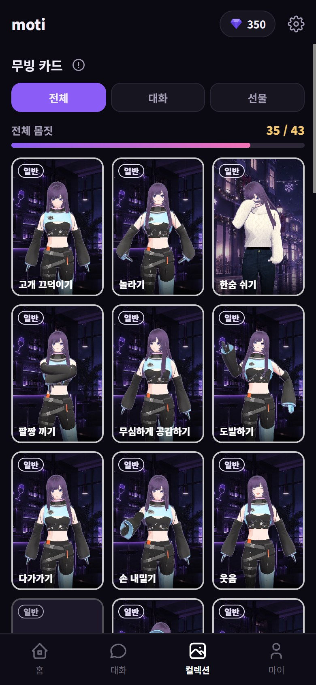 | 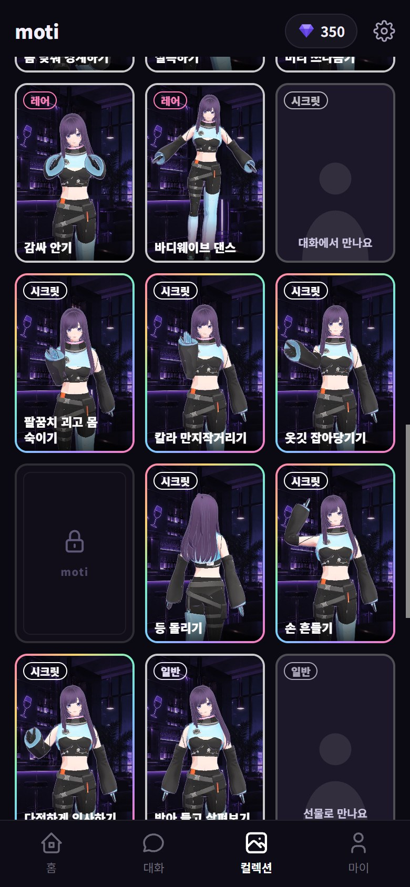 | 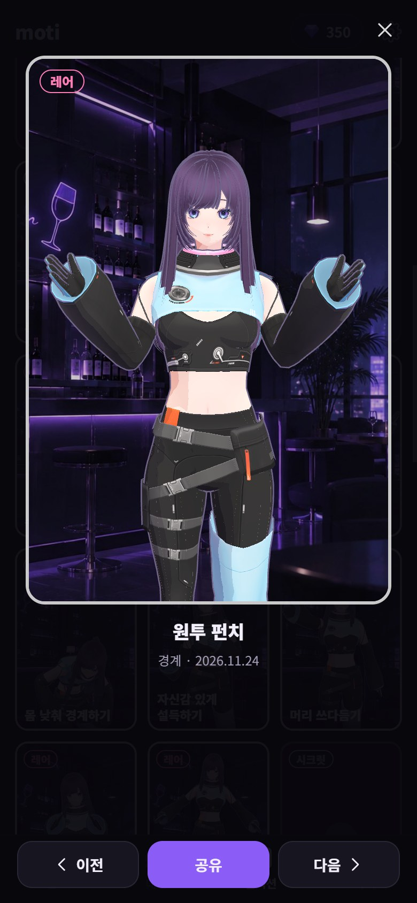 |

| 크리스마스 의상 카드 확대 | 시크릿 카드 확대 | 닫은 뒤 대화방(무대 원래대로) |
| --- | --- | --- |
| 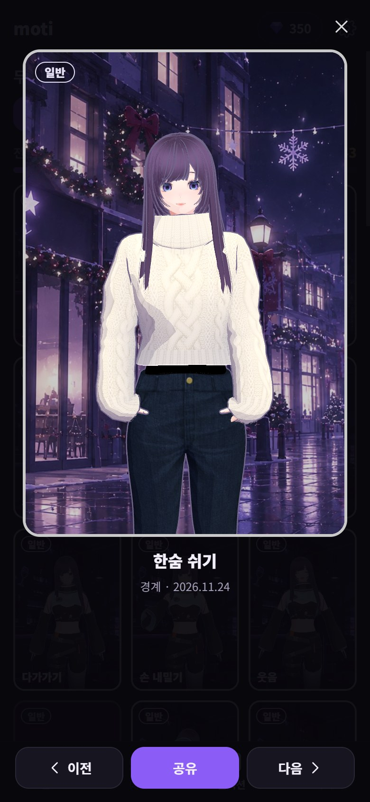 | 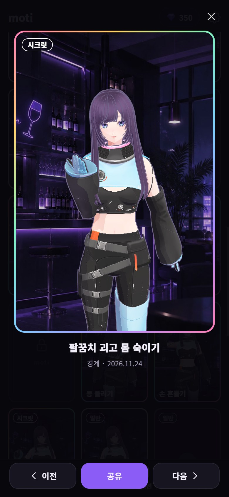 | 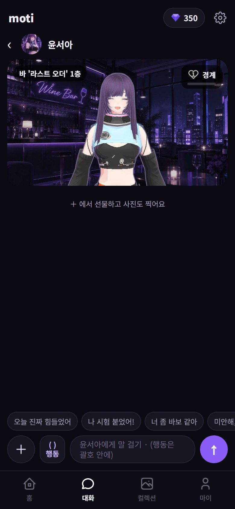 |

| 공유 그림(일반·크리스마스) | 공유 그림(시크릿) | 예전 저장값으로 채운 카드(네온 골목) |
| --- | --- | --- |
| 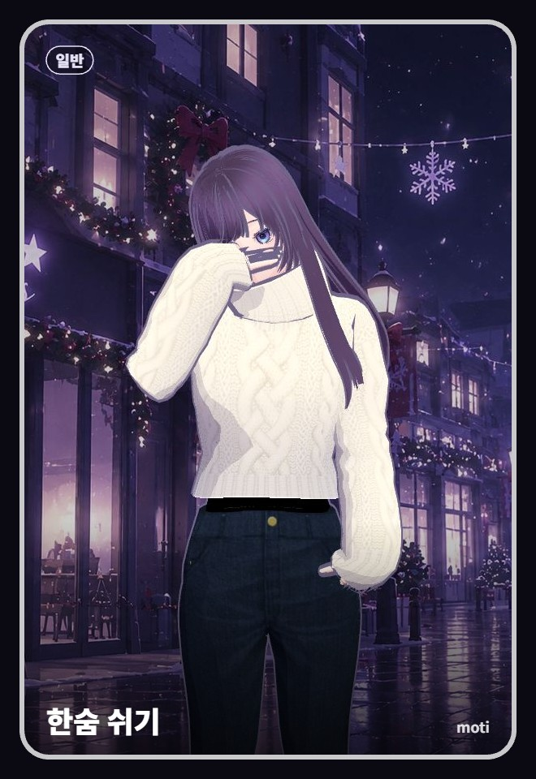 | 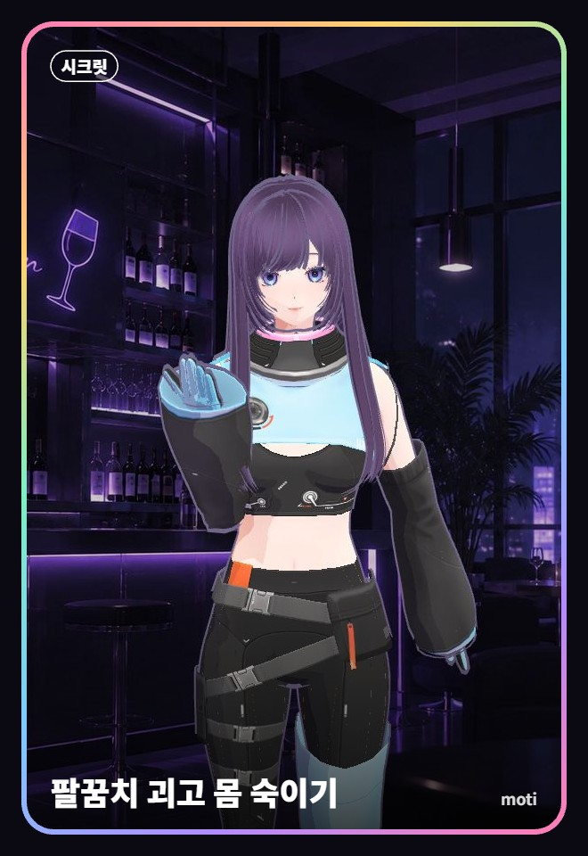 | 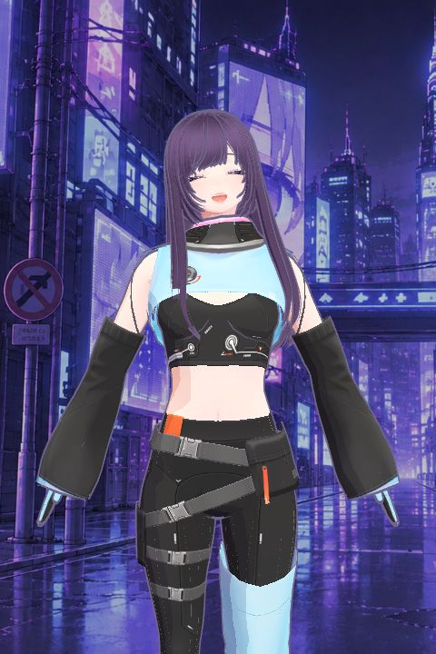 |

## 확인 (헤드리스 Chrome 390×844)

- `data/*.json` 17개 모두 `JSON.parse` 통과, `collection.json items` 43, 컬렉션 칸 43(시연 「모두 열기」 뒤 일부를 지워 모은 35 / 못 본 5 / 잠긴 3)
- 같은 몸짓 유지: m03 을 본 이야기(작전복)에서 처음 본 뒤 크리스마스 에피소드에서 다시 재생 → 기록·카드 그림 모두 `outfit: ops` 그대로
- 크리스마스 에피소드(`startStory('s2')`)에서 처음 본 m04 → 기록 `outfit: xmas, scene: 6(크리스마스 거리), thread: s2`, 카드 그림도 니트·크리스마스 거리(캡처)
- 예전 저장값: 의상 없는 기록 2개(m01 장소 2, m02 장소 없음)로 열기 → 컬렉션을 열자 `ops`/2, `ops`/0 으로 채워지고 그림 2장 생김
- 카드 그림 크기: 평균 67KB(600×900), 한 장 그리기 80~310ms(헤드리스 소프트웨어 그리기 기준), 35장 채우는 데 약 21초(하나씩, 사이 0.4초)
- 확대: 재생 중 `Stage.recentMotion` = 그 몸짓 반복, 바깥 누르기·아래로 밀기로 닫힘, 다음 버튼으로 넘어감, 아직 안 불러온 의상(드라큘라로 바꾼 기록)에서 「불러오는 중」 표시 → 불러온 뒤 사라짐. 닫은 뒤 대화방 의상 `ops`, 그림판이 대화 무대로 돌아감
- 스크립트 오류 없음

## 아이폰에서 나중에 볼 것

- **카드 확대 움직임:** 칸 → 가운데 `transform`(이동+크기) 0.3초, 닫기 0.24초. 확대 중 아래로 끌 때 카드가 손가락을 따라오는지, 스크롤로 새지 않는지(`touch-action:none` + `touchmove` 막음)
- **카드 안 3D 재생:** 빌린 그림판이 카드 크기에 맞게 다시 잡히는지, 카드 안 장소 어둡게 층(`mix-blend-mode:saturation`, 촬영 화면과 같은 방식)이 맞는지, 닫은 뒤 대화 무대가 제자리에 다시 그려지는지
- **카드 그림 만들 때 버벅임:** 몸짓이 끝난 뒤 600×900 한 장을 그림(같은 작업 안에서 그림판 크기를 바꿔 한 번 그리고 되돌림). 처음 컬렉션을 열 때 예전 카드가 많으면 0.4초 간격으로 여러 장 — 넘겨 보는 중 멈칫하는지
- **의상 모델 불러오기:** 다른 의상(크리스마스·드라큘라·바텐더) 카드를 처음 열 때 모델 다운로드 시간과 「불러오는 중」 표시. 의상 모델이 메모리에 여러 개 남음(한 번 불러온 의상은 다시 씀)
- 공유 창: 카드를 열 때 미리 만든 파일로 바로 열리는지

## 제가 정한 것

- **카드 그림 크기:** 600×900(긴 변 900), jpeg 품질 0.8부터 최대 90KB. 지시의 「수십 KB」 안에서 공유 그림이 너무 작지 않게. 값은 `collection.json card.image`
- **카드 구도:** 머리 위 여백 ~ 무릎 위(키 비율 top 1.08, bottom 0.36), 머리 쪽으로 살짝 가운데(center 0.3). 바디웨이브 댄스(m23)만 전신. 확대 재생도 같은 구도
- **멈춘 순간과 표정:** 서아 사진(12)과 같은 `seoa_photo.json moment`(대부분 50%). 표정은 입장권 필름(`onboarding.json film.shots`)에 있으면 그것, 없으면 `soft`. 선물 카드는 `play.f`
- **기록 시점의 의상:** 그 순간 `Outfit.want()`(무대가 그 의상을 아직 불러오는 중이어도 원래 보여야 할 의상)
- **「열렸지만 못 본」 기준:** 대화 카드는 지금 열린 몸짓(1단계 기본 몸짓 포함 — 26까지는 1단계를 잠긴 칸으로 뒀지만 「대화에서 만나요」가 맞아서), 선물 카드는 언제든 선물로 만날 수 있으니 모두 「선물로 만나요」. 못 본 카드도 누르면 힌트
- **카드 위 이름 자리:** 「아래 이름」을 카드 안 아래 어두운 띠 위에 둠(칸 높이가 모두 같게). 못 본·잠긴 카드에는 이름 없음
- **시크릿 표시:** 테두리만 무지개, 등급 글자는 흰색. 일반은 밝은 회색(예전 등급 색 대신 카드 모양 전용 색 `card.look`)
- **확대 화면 자리:** 위 52px(✕) · 카드(화면에 맞는 가장 큰 2:3, 390 폭에서 342×513) · 글 · 아래 버튼 줄. 옆으로 밀기로도 이전/다음
- **3D 뒤 어둡게:** 확대 화면의 장소 그림 어둡게는 대화 무대 `#bgdim` 과 같은 층을 복사(촬영 화면과 같은 방식). 지시에 없어 `card.view` 에 따로 값 두지 않음
- **공유 그림:** 카드 그림 크기 그대로(테두리 포함 660×960), 바탕 앱 배경색. 시크릿은 무지개 테두리
- **카드 그림 다시 만들기 없음:** 그림이 처음 만들어진 뒤에는 의상이 바뀌어도 그대로. 시연 패널 「컬렉션만」·전체 초기화·시연 장면 이동(지우는 칸)에서는 그림도 지움
- **확대 중 바깥 일:** 확대 중엔 `Stage.lock` 으로 바깥 몸짓·표정을 막고, 탭을 옮기거나 시연 취소 때 닫음
- **확인 방법:** 다른 대화가 미리보기 서버 칸을 다 써서, 같은 폴더를 띄운 로컬 서버(8765)에 헤드리스 Chrome 을 붙여 확인·캡처

---

# 26-2 · 의상 모델 메모리 정리, 카드 그림 나눠 만들기

브랜치 `step/26-2-outfit-memory` · 커밋 `[26-2] 의상 모델 메모리 정리와 카드 그림 나눠 만들기`

## 바뀐 파일

| 파일 | 내용 |
| --- | --- |
| `index.html` `Stage` | 다 불러온 의상 모델 목록(`models`), 내려놓기 `prune()`(geometry·material·texture·skeleton `dispose`, `built` 캐시·불러옴 표시에서 뺌), `keep(k)` 마지막으로 연 카드 의상, `use(k,±1)` 그리는 동안 붙잡기, `memory()` 확인용. 의상을 무대에 올릴 때마다 `prune()`. XSTAGE 맞춤값 보관을 `WeakMap` 으로(내려놓은 모델이 남지 않게) |
| `seoaphoto.js` | `make()` 가 다른 의상 모델로 그릴 때 `Stage.use` 로 붙잡고, 끝나면 놓음(쓰지 않으면 바로 내려놓음) |
| `cards.js` | 카드를 열 때 `Stage.keep(그 의상)`. 그림 만들기 차례: 화면이 쉬는 틈(`requestIdleCallback`)에 한 장씩, 대화방에서는 몸짓이 끝나고 1.2초 지난 뒤에만, 컬렉션을 보는 중이면 화면에 보이는 카드부터 |
| `data/collection.json` | `card.quietMs`(1200)·`idleTimeoutMs`(3000)·`idleMinMs`(8) |

## 1. 의상 모델은 최대 2개

- 남기는 것: 지금 대화방 의상(`Outfit.want()`) + 마지막으로 연 카드 의상 + (그 순간 무대에 올라 있거나 올리는 중인 의상, 카드 그림을 그리는 중인 의상)
- 내려놓는 때: 의상을 무대에 올린 직후(카드를 열어 그 의상으로 바꿀 때, 카드를 닫고 대화방 의상으로 돌아올 때), 카드 그림 한 장을 다 그린 뒤
- 대화방 의상은 내려놓지 않음. 다시 필요한 의상은 다시 불러옴(두 번째는 브라우저 캐시). 그동안 카드 그림 + 「불러오는 중」(26-1 그대로)

## 2. 확인: 다섯 의상 카드를 차례로 열고 닫기 (헤드리스 Chrome 390×844)

카드 5장(작전복 ops · 흰 옷 private · 크리스마스 xmas · 드라큘라 dracula · 바텐더 bar)을 만든 뒤 하나씩 열고 닫음. 모델 = 메모리에 남은 의상 모델, geo·tex = `renderer.info.memory`, heap = `performance.memory.usedJSHeapSize`

| 순서 | 남은 모델 | 수 | geometries | textures | heap(MB) |
| --- | --- | --- | --- | --- | --- |
| 카드 그림 5장 만든 뒤 | ops | 1 | 21 | 45 | 41 |
| ops 카드 열림 | ops | 1 | 21 | 45 | 36 |
| ops 카드 닫음 | ops | 1 | 21 | 45 | 39 |
| private 카드 열림 | ops + private | 2 | 35 | 77 | 36 |
| private 카드 닫음 | ops + private | 2 | 35 | 77 | 38 |
| xmas 카드 열림 | ops + xmas | 2 | 34 | 75 | 40 |
| xmas 카드 닫음 | ops + xmas | 2 | 34 | 75 | 48 |
| dracula 카드 열림 | ops + dracula | 2 | 40 | 87 | 47 |
| dracula 카드 닫음 | ops + dracula | 2 | 40 | 87 | 46 |
| bar 카드 열림 | ops + bar | 2 | 37 | 81 | 46 |
| bar 카드 닫음 | ops + bar | 2 | 37 | 81 | 44 |
| dracula 다시 열고 닫음 | ops + dracula | 2 | 40 | 87 | 55 |

- 남은 모델은 늘 2개 이하. geometries·textures 는 의상이 바뀔 때마다 앞 의상 몫이 빠져 쌓이지 않음(private 35/77 → xmas 34/75)
- heap 은 36~55MB 사이에서 오르내림(가비지 정리 시점에 따라 흔들림, 계속 오르지 않음)
- 카드 그림 5장을 만드는 동안에도(의상 4개를 하나씩 불러와 그리고 내려놓음) 끝난 뒤 남은 모델은 ops 하나
- 내려놓은 드라큘라 카드를 다시 열면 「불러오는 중」이 뜨고 다시 불러와 재생(로컬에서는 바로 끝남)

## 3. 카드 그림 나눠 만들기

- 한 번에 몰아서 만들지 않음: 한 장 만든 뒤 0.4초 쉬고, 다음 장은 브라우저가 한가한 틈(`requestIdleCallback`, 남은 틈이 8ms 이상)에. 틈이 늘 짧은 기기(3D 가 매 프레임 그려지는 대화방)는 3초 기다린 뒤 만듦. 사파리처럼 `requestIdleCallback` 이 없으면 `setTimeout`
- 대화방에서는 몸짓 재생 중·끝난 지 1.2초 안·답장 기다리는 중·해금 연출·촬영·서아 사진 보내는 중에는 만들지 않음
- 컬렉션을 보는 중이면 지금 화면에 보이는 카드부터

확인

- 「모두 열기」 중 대화방 몸짓(7개를 60초 동안 번갈아 재생): 몸짓 재생 중에 카드 그림을 그린 프레임 **0**. 몸짓 재생 중 가장 긴 프레임 간격 61ms(「모두 열기」 전 같은 재생 15초 동안 206ms, 처음 몸짓 시작 때), 95% 간격은 둘 다 49ms(헤드리스 소프트웨어 그리기 기준). 그동안 만든 카드 2장 — 몸짓이 거의 쉬지 않는 시험이라, 나머지는 대화가 쉴 때·컬렉션을 열 때 이어서 만듦
- 컬렉션을 맨 아래로 내린 채 43장 채우기: 처음 만든 3장(m15·g01·g02)이 모두 그때 화면에 보이던 카드

## 아이폰에서 나중에 볼 것 (26-2 추가)

- **메모리:** 의상 카드 여러 개를 열고 닫아도 사파리가 페이지를 다시 불러오지 않는지(메모리 부족으로 탭이 새로 고쳐지는 일). 남는 의상 모델은 2개
- 내려놓은 의상 카드를 다시 열 때 다시 불러오는 시간과 「불러오는 중」
- 컬렉션을 넘겨 보는 중 카드 그림이 한 장씩 생길 때 멈칫하는지(아이폰 사파리는 `requestIdleCallback` 이 없어 `setTimeout` 으로 감)

## 제가 정한 것

- **「쓰는 중」 모델도 남김:** 대화방 의상 + 마지막 카드 의상 외에, 그 순간 무대에 올라 있는 모델과 카드 그림을 그리는 중인 모델은 내려놓지 않음(그리는 중에 지워지지 않게). 두 경우 모두 곧 위 둘 중 하나가 되거나 놓이므로 끝나면 2개 이하
- **내려놓는 때:** 의상을 무대에 올린 직후와 카드 그림 한 장을 그린 뒤. 카드를 닫을 때 대화방 의상이 이미 무대에 있으면(카드 의상 = 대화방 의상) 내려놓을 것이 없음
- **쉬는 틈 기준:** 남은 틈 8ms 이상, 대화방은 몸짓이 끝나고 1.2초, 3초 넘게 틈이 안 나면 그냥 만듦. 값은 `collection.json card`
- **시크릿 표시 등 26-1 모양은 그대로**, 이번에는 화면 모양이 바뀌지 않아 새 캡처는 넣지 않음
