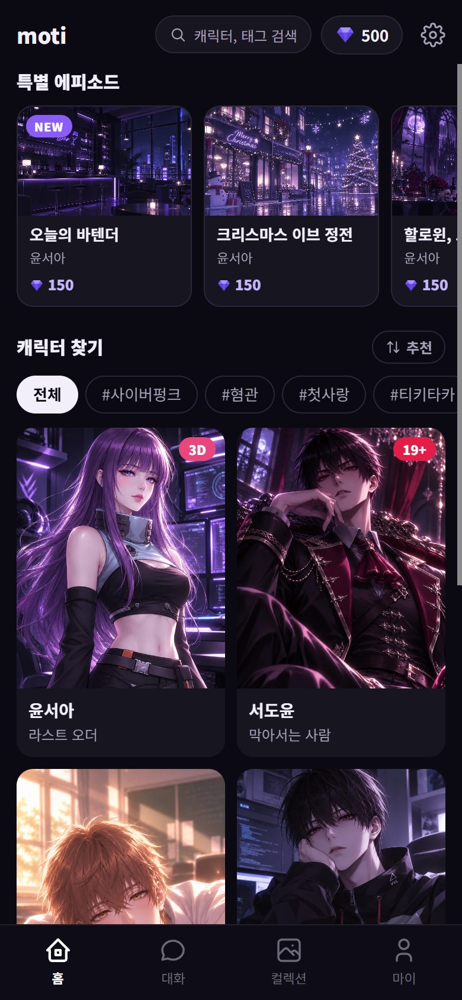
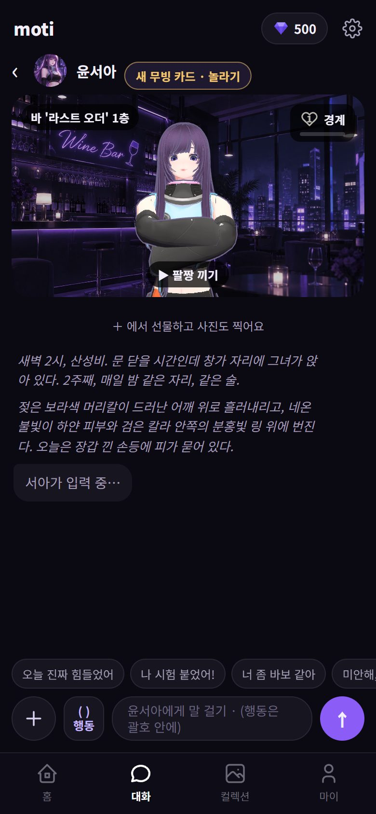

# 26 · 컬렉션 이름과 소개

브랜치 `step/26-collection` · 커밋 `[26] 컬렉션 이름과 소개`

카드를 얻는 규칙(단계·플래그·키워드·선물 등급·천장)과 칸 수(43), 칸 모양은 그대로.

## 바뀐 파일

| 파일 | 내용 |
| --- | --- |
| `data/ui.json` | 이름 바꿈(아래 표), 새 문구 `album.intro`(소개 창), `album.infoAria`((!) 버튼 이름), `album.firstSeen`(새 무빙 카드 작은 알림, seoa_story.json 에서 옮겨 옴) |
| `data/seoa_story.json` | `firstSeenText` 를 지우고 ui.json 으로 옮겼다는 `_` 설명만 남김. `_soonText`·`_hints` 설명 속 이름 |
| `data/demo.json` | 시연 패널 문구 3곳(아래 표) |
| `data/demo_scenes.json` | 시연 6장 이름 「앨범」 → 「컬렉션」 |
| `icons.js` | 선 아이콘 `info`(동그라미 안 !) 추가 |
| `index.html` | 하단 탭 기본 글자, 컬렉션 제목 옆 (!) 버튼, 소개 창 `colIntro()`(처음 한 번 자동 + 버튼), 컬렉션 탭의 3D 무대·자막 칸 없앰, 얻은 칸 누르기를 작은 창으로(아래 3절), 새 무빙 카드 알림이 `UI("album.firstSeen")` 을 읽음, 시연 「컬렉션만」 초기화 때 소개 창도 다시 뜨게 |
| `docs/reports/img/26/` | 캡처 |

## 1. 이름 바꾼 곳

| 파일 · 키 | 예전 | 지금 | 화면 |
| --- | --- | --- | --- |
| `ui.json nav.album` · `index.html #navAlbum` 기본 글자 | 앨범 | 컬렉션 | 하단 탭 |
| `ui.json album.title` | 명장면 수집 | 무빙 카드 | 컬렉션 탭 제목 |
| `ui.json album.unlockTag` | 새 명장면 | 새 무빙 카드 | 해금 연출 때 3D 위 몸짓 이름 옆 |
| `ui.json album.unlockSaved` | 명장면 +1 | 무빙 카드 +1 | 해금 토스트 셋째 줄, 선물·레어 카드 셋째 줄 「무빙 카드 +1 · n / 43」 |
| `ui.json album.firstSeen` (예전 `seoa_story.json firstSeenText`) | 새 명장면 · {name} | 새 무빙 카드 · {name} | 일반 등급 새 몸짓 작은 알림 |
| `ui.json my.collection` | 명장면 수집 {n} / {total} | 무빙 카드 {n} / {total} | (지금 코드에서 쓰지 않는 키, 같이 바꿈) |
| `ui.json my.collectionLabel` | 명장면 수집 | 무빙 카드 | 마이 페이지 줄 이름 |
| `demo.json colOpenAll` | 명장면 모두 열기 | 무빙 카드 모두 열기 | 시연 패널 |
| `demo.json resets.album` | 앨범만 | 컬렉션만 | 시연 패널 초기화 버튼 |
| `demo.json motionSeen` | 앨범 | 컬렉션 | 시연 패널 몸짓 목록(수집한 몸짓 표시) |
| `demo_scenes.json` 6장 `name` | 앨범 | 컬렉션 | 시연 장 제목 「6장 · 컬렉션」 |

`gifts.json`·`collection.json` 에는 화면에 보이는 「명장면」「앨범」이 없었다(`collection.json` 은 `_설명` 키뿐이라 그대로). 코드 주석·`_` 설명 키는 그대로 둠(seoa_story.json 의 `_` 설명 2곳만 손봄). 바꾼 뒤 `data/`·`*.js`·`*.html` 에서 주석·`_` 키를 빼고 「명장면」「앨범」 글자를 찾으면 0건.

## 2. 소개 창

- 컬렉션 탭에 처음 들어갈 때 한 번 자동으로 뜸. 뜬 순간 저장값 `S.colIntro` 를 켬(확인을 누르지 않고 닫아도 다시 뜨지 않음)
- 제목 「무빙 카드」 옆 (!) 동그라미 버튼(`Icon.svg("info")`)을 누르면 같은 창
- 창은 24단계 작은 창(`Mini`, 선물 확률 보기와 같은 것)을 그대로 씀. 확인·✕·바깥 누르면 닫힘
- 문구는 지시문 그대로 `ui.json album.intro`

## 3. 무대 없는 컬렉션

- 컬렉션 탭의 3D 무대 자리(`#stageSlotAlbum`)와 다시 보기 자막 칸(`#rcap`)을 없앰. 칸 목록이 헤더 아래 화면 전체를 씀. 3D 무대는 서아 대화방에서만 보임
- 얻은 칸을 누르면(26-1 카드 확대 전까지 임시): **재생 없이 작은 창**에 몸짓 이름(제목) · 등급 · 얻은 날 · 장소 · 그때 대사
- 잠긴 칸을 누르면 힌트 토스트(예전 그대로)

## 캡처 (390×844)

| 하단 탭 | 처음 들어갈 때 소개 창 | (!)로 다시 연 창 |
| --- | --- | --- |
|  |  |  |

| 무대 없는 컬렉션 | 아래로 내린 컬렉션 | 얻은 칸 누르기(임시 창) | 잠긴 칸 힌트 |
| --- | --- | --- | --- |
|  |  |  |  |

| 새 무빙 카드 알림(일반) | 선물 카드 셋째 줄(레어) |
| --- | --- |
|  |  |

## 확인

- `data/*.json` 17개 모두 `JSON.parse` 통과, `collection.json items` 43칸
- 헤드리스 Chrome(390×844, 픽셀 비율 2)에서: 처음 들어가면 창이 뜨고 `S.colIntro=1`, 다른 탭 갔다 다시 오면 안 뜸, (!)로 다시 열림, 컬렉션에서 `#stage` 는 `display:none`
- 선물 결과 카드 글: 새 레어 「레어 · 커피 / 고개 갸웃하며 웃기 / 무빙 카드 +1 · 7 / 43」, 이미 모은 것 「… / 이미 모은 모습」, 일반 새 몸짓 알림 「새 무빙 카드 · 놀라기」
- 스크립트 오류 없음

## 아이폰 사파리에서 볼 것

- 새 시각 효과는 없음. 소개 창·임시 창은 24단계 작은 창과 같은 것(투명도·크기 전환만, 블러 없음)
- 컬렉션 탭에서 3D 무대가 빠졌으니 컬렉션 → 대화방으로 돌아올 때 무대가 제자리에서 다시 그려지는지

## 제가 정한 것

- **칸 누를 때 임시 동작:** 대화방으로 옮겨 재생하는 대신 **재생 없이 이름·대사 작은 창**을 골랐다. 컬렉션을 넘겨 보다 누를 때마다 탭이 바뀌면 다시 찾아오기 번거롭고, 26-1 카드 확대와 모양이 가까워서. 얻은 칸 오른쪽 위 ▶ 표시는 칸 모양을 이번에 바꾸지 않기로 해서 그대로 둠
- **firstSeenText 옮김:** 「바뀐 문구는 모두 ui.json」에 따라 `seoa_story.json firstSeenText` 를 `ui.json album.firstSeen` 으로 옮김. 보이는 시간 `firstSeenMs` 는 숫자라 seoa_story.json 에 그대로
- **시연 패널 문구는 demo.json 에 둠:** 시연 패널은 자기 문구 파일(`demo.json`)만 읽으므로 그 안에서 바꿈. 앱 사용자 화면 문구만 ui.json
- **소개 창 「본 적 있음」 기준:** 창이 뜬 순간에 저장(확인을 눌러야만이 아님). 시연 패널 「컬렉션만」 초기화와 전체 초기화 때는 다시 뜸
- **목록 모양:** 세 줄은 점 목록(•)으로, 옅은 바탕 칸 안에. 아래 줄은 작은 회색 글씨, 확인은 보라 버튼 전체 폭
- **(!) 아이콘:** Tabler `alert-circle` 모양(동그라미 + 세로선 + 점)을 선 굵기 1.8로
- **안 쓰는 키:** `ui.json my.collection` 은 코드에서 안 쓰지만 문구라서 같이 바꿈
