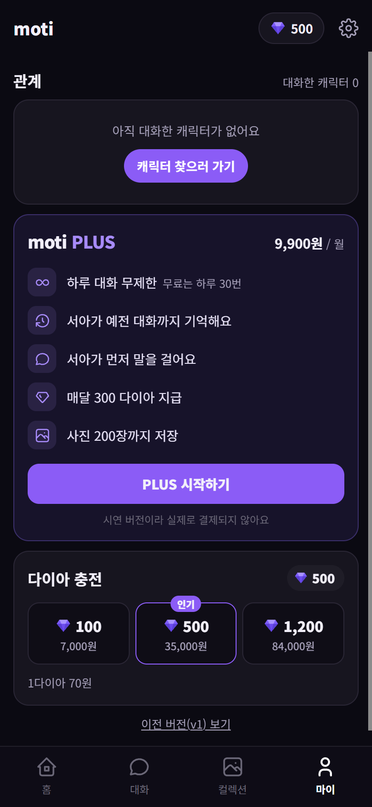
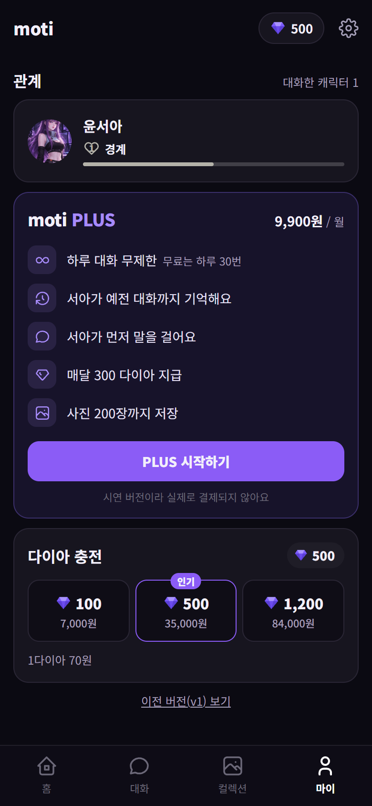
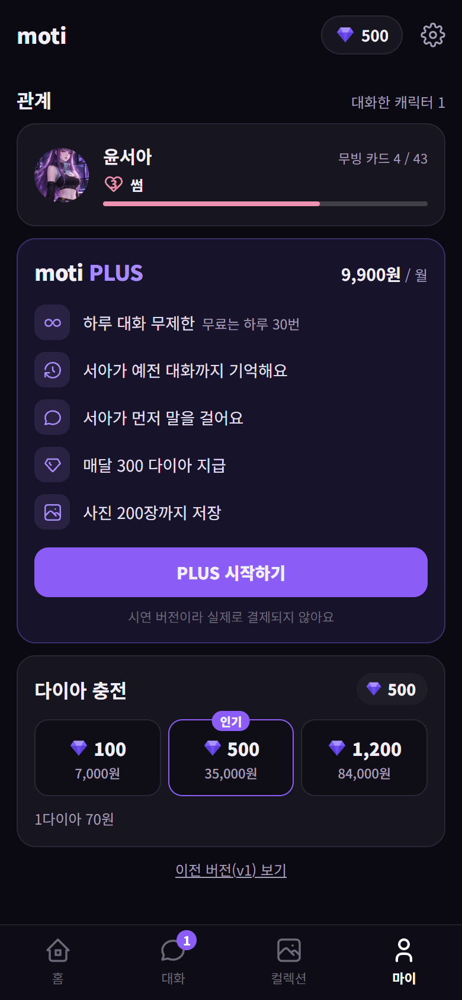
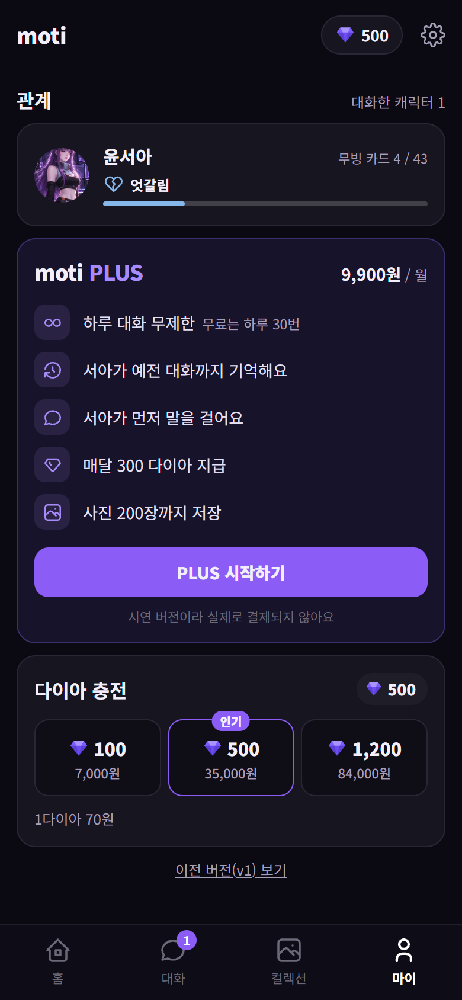
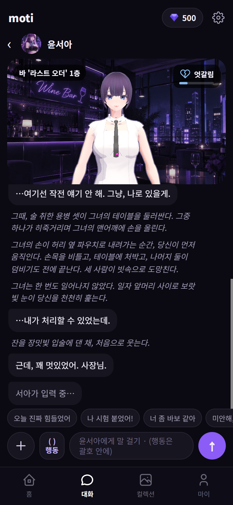
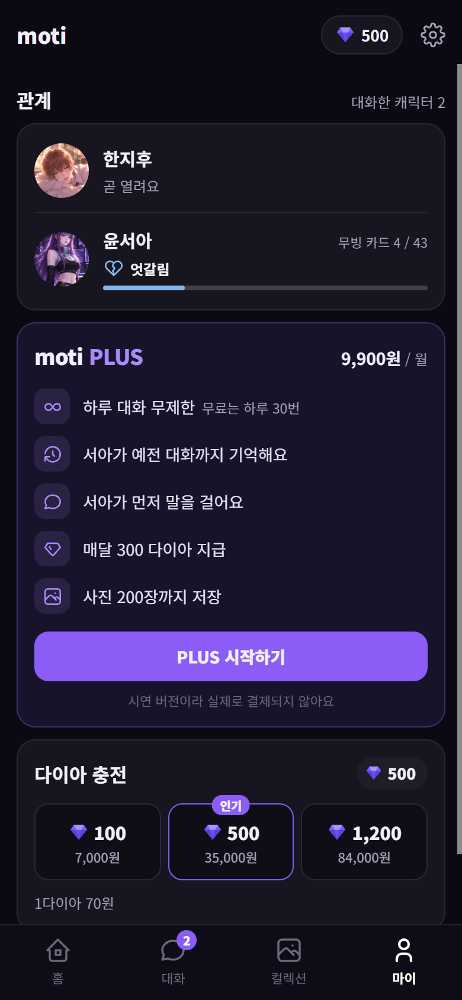
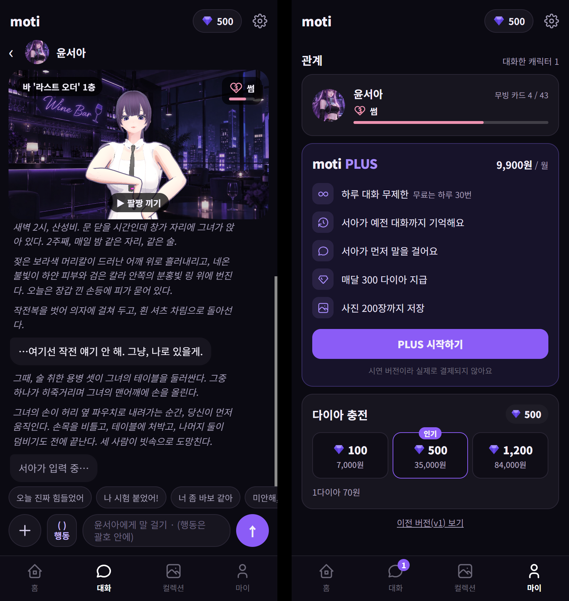

# 28단계 · 마이 메뉴 「관계」를 캐릭터별 목록으로

브랜치 `step/28-my-relations` · 커밋 `[28] 마이 메뉴 관계를 캐릭터별 목록으로`

## 한 일
- 마이 맨 위 「나와 서아」 카드 → **「관계」 묶음.** 제목 오른쪽에 작게 「대화한 캐릭터 {n}」
- 대화방에 들어간 적 있는 캐릭터(`S.rooms`)마다 한 줄, **최근 대화 순**(대화 목록과 같은 기준: 마지막 메시지 시각)
- 한 줄 = 동그란 사진 / 이름 / 하트 숫자 아이콘 + 단계 이름 / 얇은 게이지 / 오른쪽 위 「무빙 카드 {n} / {total}」. 줄을 누르면 그 캐릭터 대화방(`enterRoom`, 19+ 인증 전이면 인증 시트부터)
- 하트·게이지는 대화 화면 위쪽과 **같은 계산·같은 색**: 단계 % 계산을 `bondNow()` 하나로 모아 대화 화면(`renderBond`)과 마이 줄이 같이 씀. 색은 `config.bondTop.colors`(경계 = 회색), 게이지 높이·바탕색도 `bondTop.gaugeH`·`track`, 게이지 모양은 대화 화면 `.bgauge` 그대로. 5단계 엇갈림은 `Icon.heart` 의 금 간 하트
- 관계 기능이 없는 캐릭터는 사진·이름·「곧 열려요」만
- 무빙 카드 수는 캐릭터별(26-1 의 `S.col[id].char` 기준). 카드가 없으면 그 줄은 숨김
- 뺀 것: 「관계는 대화로만 쌓여요」, 「다음 단계 · {name}」, 「최고 단계」, 카드 아래 「무빙 카드」 줄(오른쪽 위로 옮김). `data/ui.json` 에서도 지움(`next`·`max`·`bondNote1`·`bondNoteB`·`bondNote2`·`collectionLabel`)
- 관계 단계가 오르는 기준(`countAt`·`affectionAt`)과 계산식은 그대로

## 바뀐 파일
| 파일 | 내용 |
| --- | --- |
| `index.html` | `relHTML()`·`bondNow()`·`cardCount()`·`roomsRecent()`, `renderMy()` 위쪽 교체, `renderBond()` 가 `bondNow()` 사용, 관계 줄 CSS(예전 `.mbh`·`.mybond` 지움) |
| `data/ui.json` | `my.relTitle`·`relCount`·`relEmpty`·`relGoHome`·`relSoon`·`relAria` 추가, 위 6개 문구 지움, `_my` 설명 갱신 |
| `data/characters.json` | 서아에 `"bond": true`, 설명 한 줄 |
| `docs/reports/img/28/` | 캡처 |

## 확인
- `data/*.json` 모두 읽힘(파이썬 `json.load`)
- 줄 누르기: 서아 줄 → 대화 탭·서아 방, 지후 줄 → 지후 방 (헤드리스 Chrome 에서 클릭 후 `curTab`·`S.room`·방 이름 확인)
- 같은 단계에서 숫자 비교(5단계, 게이지 25%): 대화 화면 위쪽 `엇갈림 / rgb(133,183,235) / 25%` = 마이 줄 `엇갈림 / rgb(133,183,235) / 25%`. 3단계도 둘 다 66.67%
- 서아 대화 1단계·3단계·5단계는 시연용으로 `story().stage` 와 대화 횟수(`S.bond`)를 직접 넣어 찍음

## 캡처 (390×844, 픽셀 비율 2)
| 처음(대화 전, 목록 빔) | 서아 1단계 | 서아 3단계(카드 4장) |
| --- | --- | --- |
|  |  |  |

| 서아 5단계(금 간 하트) | 대화 화면 5단계 | 서아 + 지후(두 줄) |
| --- | --- | --- |
|  |  |  |

같은 단계(3 · 썸)에서 대화 화면 위쪽과 마이 줄 나란히:

## 제가 정한 것
- **관계 기능이 있는 캐릭터 표시:** `data/characters.json` 에 `bond: true` (지금은 서아만). 3D 표시(`badge`)와 묶지 않고 따로 둠 — 지후처럼 3D 모델이 먼저 생겨도 관계 기능은 따로 켤 수 있게
- **목록이 비었을 때:** 묶음 안에 「아직 대화한 캐릭터가 없어요」 + 「캐릭터 찾으러 가기」(홈으로). 대화 탭 빈 목록과 같은 흐름. 제목 오른쪽은 「대화한 캐릭터 0」
- **단계 이름 글자색:** 대화 화면 위쪽처럼 흰 글자, 색은 하트·게이지에만
- **하트 크기:** 대화 화면 20px, 마이 줄 18px(이름 아래 줄이라 조금 작게)
- **게이지 움직임:** 마이 줄은 열 때 그 값으로 바로 그림(대화 화면의 차오르는 움직임·반짝임은 넣지 않음)
- **「무빙 카드 {n} / {total}」 의 total:** 컬렉션 화면의 캐릭터 칩과 같은 기준 — 그 캐릭터가 모은 카드 + (서아만) 아직 못 모은 칸. 지금 칸은 모두 서아 것이라 서아 total = 43, 다른 캐릭터는 모은 수만큼
- **서아 줄을 누르면:** 이야기 줄기(본 이야기/에피소드)를 바꾸지 않고 마지막에 있던 줄기로 들어감(대화 목록에서 누를 때와 같음)
- **줄 하나 = 버튼 하나:** 줄 전체를 누를 수 있고, 화면 읽기용 이름 「{name} 대화방으로」

## 아이폰 사파리 확인 항목
- 새 시각 효과는 없음(블러·그림자·애니메이션 추가 없음). 동그란 사진(`border-radius:50%` + `background-size:cover`)과 게이지 둥근 끝이 잘리지 않는지만 보면 됨
