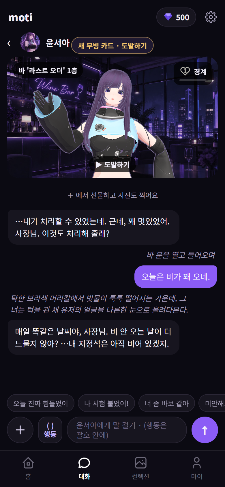
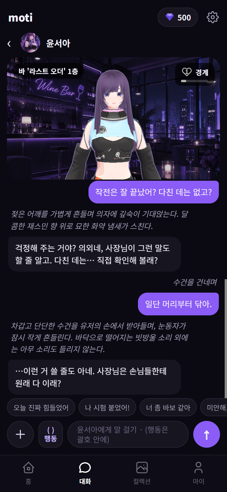
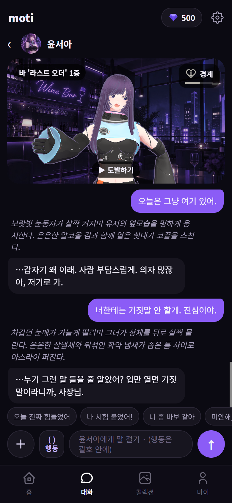
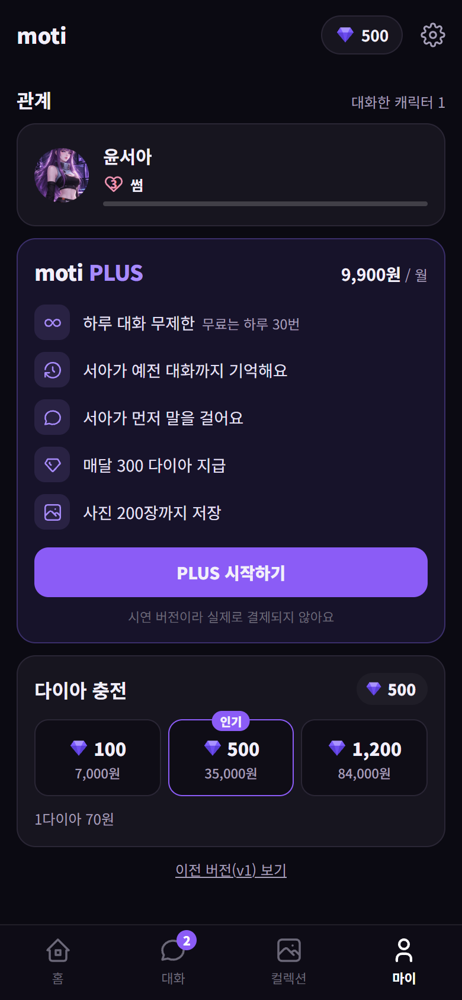
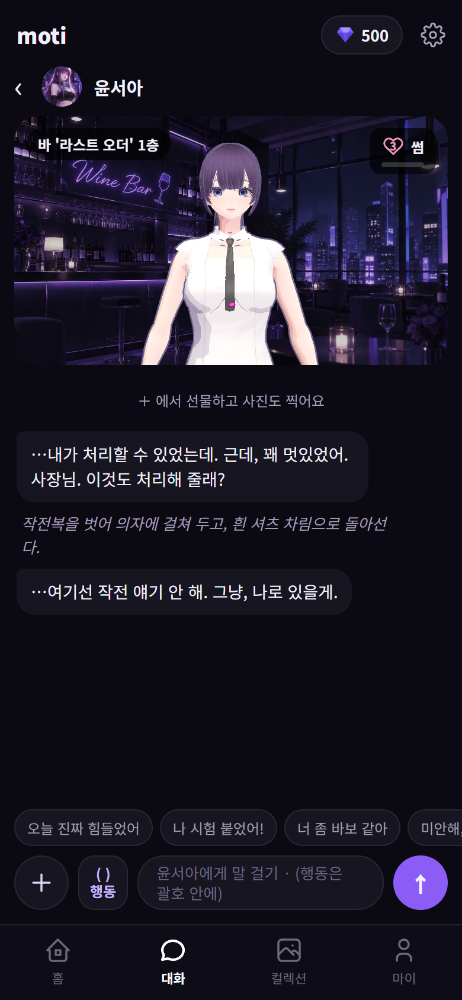
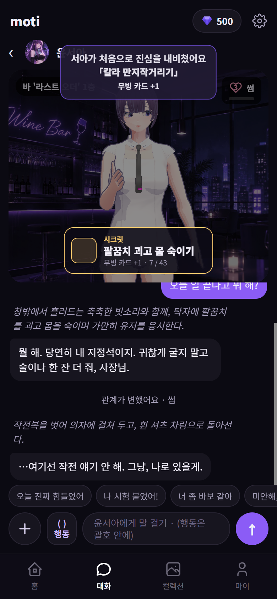

# 29단계 · 판정 3턴에 한 번 + 서버 v2 켜기

브랜치 `step/29-v2-on` · 커밋 `[29-A] 판정 3턴에 한 번`, `[29-B] 서버 v2 켜기`

## 한 일

### 29-A 판정 3턴에 한 번
- 서버 v2 답장이 오면 그 턴(내 말·서아 답)을 저장값 `S.judgeBuf` 에 쌓고, `judgeEvery`(3) 개가 되면 `/judge` 를 한 번 부른다(`queueJudge()` → `runJudge()`).
- 판정 때 쌓인 턴들을 `last_user`·`last_reply` 에 **순서대로 줄바꿈으로 이어 붙여** 넘긴다. 서버 코드는 그대로.
- 서버 입력 한도(`last_user` 1000자, `last_reply` 2000자)를 넘으면 오래된 앞부분을 자른다(`judgeMaxChars`). 지금 답장 길이(300~440자 × 3)는 한도 안.
- 요약(`need_summary`)은 판정 `summaryEveryJudges`(2) 번에 한 번 = 약 6턴. 판정 횟수는 저장값 `S.judgeN`.
- 대화방을 나가거나 앱을 닫아도 `S.judgeBuf` 가 남아, 다음 대화 첫 판정 때 같이 넘어간다.
- 시연 예약 턴: 예약 실행(단계 상승·사건 해금)은 그대로 그 턴에. 판정이 그 턴에 없으면 고정할 단계를 `S.judgeKeep` 에 두었다가 그 묶음 판정 때 예전처럼 단계 고정 + 판정 플래그 해금 연출 건너뜀.
- 사건 답장 턴의 해금(`unlock.event`)은 예전처럼 그 사건 답장 바로 뒤.
- 장면 바로가기·서아 초기화·대화 초기화·관계 초기화 때 쌓인 턴도 비운다.

### 29-B 서버 v2 켜기
- `data/config.json` `serverVersion` 1 → **2**. 주소 뒤 `?server=1` 로 예전 방식(대화 횟수, 판정 없음)으로 되돌리는 것은 그대로.
- 저장값 옮기기(`moveToV2()`): v2 로 처음 열 때 저장된 단계가 n 이면 호감도를 `affectionAt[n-1]` 로(이미 더 높으면 그대로). 한 번만 하고 `S.v2moved` 에 표시. 전체 초기화 필요 없음.
- 서버 대체 응답 「…」: 예전에는 「…」가 그대로 서아 대사로 보였다. 이제 `serverFiller` 에 든 글자만 오면 실패로 보고 예비 대사 흐름(예시 대사 키워드 → `fallbackReply` 「다시 말해 봐」)으로 넘어간다. 이 턴은 판정 묶음에 넣지 않는다.

## 바뀐 파일
| 파일 | 내용 |
| --- | --- |
| `index.html` | `queueJudge()`·`runJudge()` 묶음 판정, `JLOG`·`CALLS`(확인용 기록), `moveToV2()`, `isFiller()`·`readReply()`·`askServer()` 「…」 처리, 초기화·장면 이동 때 묶음 비움 |
| `data/config.json` | `serverVersion: 2`, `judgeEvery`·`summaryEveryJudges`·`judgeMaxChars`·`serverFiller` 와 설명 |
| `docs/reports/img/29/` | 캡처 |
| `docs/status.md` | 29단계 절, 서버 배포 상태 갱신 |

## 확인

- `data/*.json` 17개 모두 읽힘(`JSON.parse`). `index.html` 스크립트 문법 검사(`node --check`) 통과.
- 실제 서버(Render, `seoa-backand.onrender.com`)로 헤드리스 Chrome, 390×844. 1단계 새 저장값에서 시작, 턴 사이 12초 쉼.

### 9턴 표
| 턴 | 응답(ms) | 「…」 | 몸짓 | 몸짓 출처 | /judge | 판정 뒤 호감도 | 플래그 | 단계 |
| --- | --- | --- | --- | --- | --- | --- | --- | --- |
| 1 | 1,770 | 아니오 | m20 | 서버 | — | 0 | | 1 |
| 2 | 1,624 | 아니오 | c02 | 서버 | — | 0 | | 1 |
| 3 | 1,478 | 아니오 | m17 | 서버 | **부름**(3턴, 9.0초) | 0 → **4** | care | 1 |
| 4 | 1,336 | 아니오 | m01 | 서버 | — | 4 | | 1 |
| 5 | 1,722 | 아니오 | m20 | 서버 | — | 4 | | 1 |
| 6 | 1,603 | 아니오 | c02 | 서버 | **부름**(3턴, 요약 포함, 9.1초) | 4 → **7** | care | 1 |
| 7 | 1,586 | 아니오 | m17 | 서버 | — | 7 | | 1 |
| 8 | 1,515 | 아니오 | m03 | 서버 | — | 7 | | 1 |
| 9 | 1,517 | 아니오 | m20 | 서버 | **부름**(3턴, 1.2초) | 7 → **11** | sincere | 1 |

- `/judge` 는 **3·6·9턴에만** 불림. 요약은 6턴째 판정에만.
- 9턴 동안 앱이 보낸 요청: `/chat` 9 + `/judge` 3 = **12번**(예전 매 턴 판정이면 18번). 서버 한 요청 = Google 한 번으로 셈(서버 안의 재시도·예비 모델 넘김은 앱에서 안 보임, 응답이 모두 1.3~1.8초라 재시도는 없었던 것으로 봄).
- 1단계 호감도 상한이 30이라 9턴에 단계는 그대로(2단계는 호감도 20 + care/protect).

### 그 밖
| 항목 | 결과 |
| --- | --- |
| 판정 못 한 턴 이어 넘기기 | 2턴 보낸 뒤 쌓인 턴 2 → 페이지 새로 열어도 2 → 1턴 더 보내자 판정 1번(3턴 묶음, 요약 포함), 묶음 비워짐 |
| 저장값 옮기기 | 대화 횟수로 3단계(`bond` 10, 호감도 없음) 저장값 → v2 로 열기: **3단계 · 썸 · 호감도 40 · 게이지 색 `#ED93B1`(3단계 색 그대로)** · `v2moved` true |
| `?server=1` | 서버 모드 1, `/chat` 1번·`/judge` 0번, 대화 횟수 3 → 4 로 2단계 상승(예전 방식), 저장값 옮기기 안 함 |
| 시연 단계 바로가기(③ 썸) v2 | 2단계로 들어가 예약 `{stage:3}` → 첫 답장 뒤 3단계. 그 턴은 묶음 1턴째라 고정 단계 3 을 `judgeKeep` 에 두고 판정 때 적용 |
| 「…」·실패 (가짜 응답으로) | 「…」 → `fallbackReply` 「다시 말해 봐」, 몸짓 없음 · 502 → 한 번 더 보내고(`/chat` 2번) 같은 예비 대사 · 「…」 + 「미안」 → 예시 대사(m05). 세 경우 모두 판정 묶음에 안 들어감 |

## 캡처 (390×844, 픽셀 비율 2)
| v2 대화 중(서버가 고른 몸짓 m20 도발하기) | 판정 뒤 게이지(3턴, 호감도 4) | 9턴 뒤 |
| --- | --- | --- |
|  |  |  |

| 저장값 옮긴 뒤 마이 관계 줄(3 · 썸) | 옮긴 뒤 대화 화면 | 시연 ③ 썸 v2 |
| --- | --- | --- |
|  |  |  |

시각 효과는 바꾸지 않아 아이폰 사파리 별도 확인 항목은 없음.

## 제가 정한 것
- **판정이 실패하면** 쌓인 턴을 지우지 않고 남겨, 다음 턴에 다시 판정한다(그때는 최근 3턴만, 가장 오래된 턴은 버림). 실패가 이어지면 그동안은 매 턴 판정을 시도한다.
- **요약 주기**는 대화 횟수(`S.bond % 6`)가 아니라 판정 횟수(`S.judgeN`, 2번째·4번째…)로 셈. 이어 넘긴 판정도 한 번으로 침.
- **시연 예약 턴**은 바로 판정하지 않고 묶음에 넣음(판정 수를 줄이는 게 목적이라). 고정 단계는 `S.judgeKeep` 로 묶음 판정까지 가져감.
- **「…」 판단**: 대사(별표 뺀 것)가 정확히 `…`·`...`·`……` 일 때만(`serverFiller`). 「…알았어」처럼 말줄임으로 시작하는 정상 대사는 그대로.
- **저장값 옮기기**는 호감도를 내리지 않음(이미 높으면 그대로). 시연 패널에서 v1 → v2 로 바꾼 경우도 다음 메시지 때 한 번 옮김. 옮긴 직후 게이지는 그 단계 시작점(0%)이라, v1 에서 단계 안 진행률이 있었으면 막대 길이는 줄어 보인다(단계·색은 같음).
- **확인용 기록** `CALLS`(경로별 요청 수)·`JLOG`(판정마다 묶음 크기·호감도·시간)를 남김. 화면에는 안 보임.
- `post()` 의 `/judge` 기다리는 시간(45초)은 그대로.

## 서버 팀원에게 전달할 것 (서버는 바꾸지 않음)
- 서버 `_tick_events` 는 `/judge` 한 번을 한 턴으로 센다. 판정이 3턴에 한 번이 되어 **사건 발동(조용한 턴 수)이 약 3배 늦어지고**, 이어 붙인 `last_user` 가 길어져 「짧은 메시지 연속」 조건도 거의 안 걸린다.
- 판정 한 번의 호감 변화가 ±10 으로 묶여 있어, 판정이 줄어든 만큼 단계 상승도 느려질 수 있다(이번 9턴: +11).
- 판정이 9초 걸린 적이 있다(3·6턴). 다음 메시지는 판정이 끝나야 보내지므로, 판정 바로 뒤 곧장 보내면 그만큼 기다린다.
