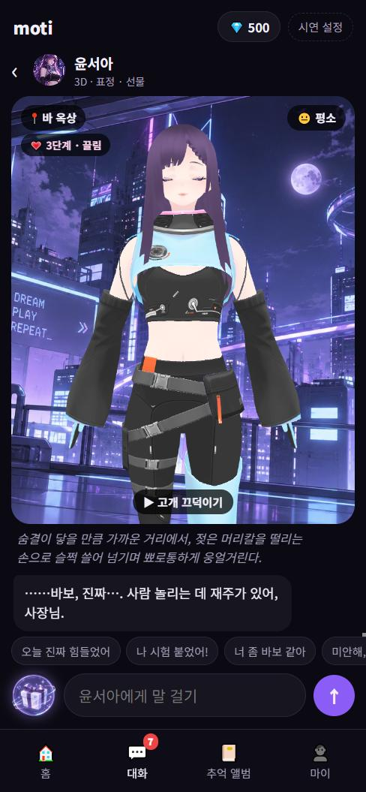
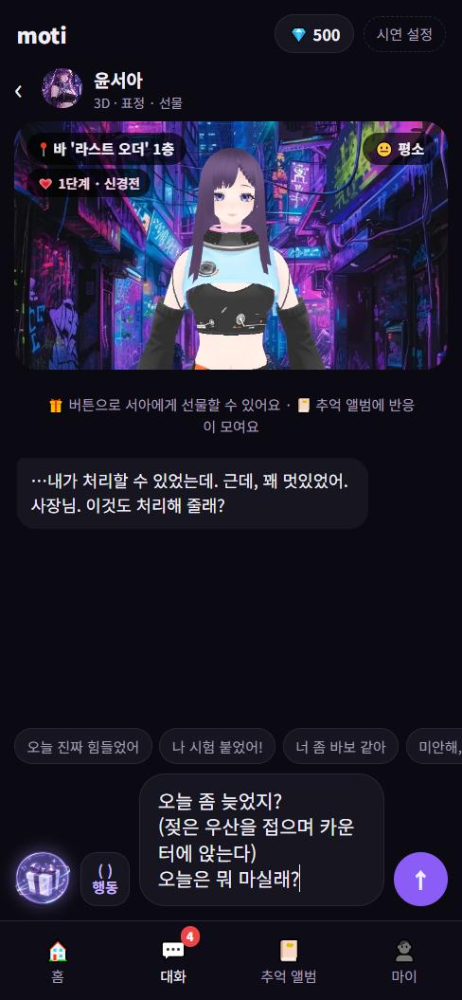
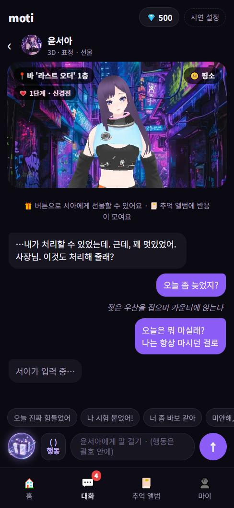

# [3] 몸짓 맥락 맞추기, 3D 확대 높이, 입력 방식, 상황 묘사, 답장 속도 조사

브랜치: `step/3-chat-input` (main에는 아직 병합하지 않음)

| 커밋 | 내용 |
| --- | --- |
| `[3-A]` | 지문 단어로 몸짓 고르기, 최근 3회 반복 방지, 3D 확대 비율 0.54 |
| `[3-B]` | 여러 줄 입력·버튼 전송, 괄호 상황 묘사, 답장 속도 측정 |
| `[3-C]` | 서버 저장소 권한이 **READ** → 서버는 고치지 않음. 아래 「서버 팀원에게 전달할 것」에 적음 |

## 바뀐 파일

| 파일 | 단계 | 내용 |
| --- | --- | --- |
| `data/motion_keywords.json` | A·B | 새로 만듦. 몸짓별 행동 단어 표, 제외할 말(`not`), 반복 방지 횟수(`recentLimit` 3) |
| `data/motions.json` | A | 감정 → 몸짓 표(`emotionMotion`) 삭제. 감정으로 몸짓을 고르지 않음 |
| `data/config.json` | A·B | `stage.bigRatio` 0.64 → **0.54**, 입력창 안내 문구 `inputPlaceholder` 추가 |
| `index.html` | A·B | 몸짓 고르기 순서, 반복 방지, 여러 줄 입력창, 행동 버튼, 내 메시지 괄호 지문, 답장 속도 측정 |
| `docs/reports/3-몸짓맥락-입력.md`, `docs/reports/img/3/*.jpg` | | 이 보고서와 캡처 |
| `docs/status.md` | | 3단계 반영 |

## 캡처 (390px)

| 화면 | 파일 |
| --- | --- |
| [3-A] 몸짓 재생 중 3D 확대 0.54 (화면 높이 844px 중 456px). 무릎 위 구도(머리~무릎 바로 위)가 그대로 들어옴 |  |
| [3-B] 여러 줄 입력(4줄까지 커짐) + 왼쪽 「( ) 행동」 버튼. 둘째 줄이 행동 버튼으로 넣은 괄호 |  |
| [3-B] 보낸 직후: 괄호 안은 말풍선 밖 기울임체 지문(오른쪽 정렬, 괄호 기호 없음), 나머지는 말풍선. 「서아가 입력 중…」이 바로 보임 |  |

캡처는 앱 안 브라우저를 390×844로 맞춰 찍었다(이미지 배율 1.25).

## [3-A] 한 일

1. **몸짓 고르기 순서** (`pickMotion`)
   1. 서버가 준 몸짓(v2 `motion_id`, 예전 서버의 `motions` 이름, Claude 미리보기의 `motion`) — 해금됐고 최근 3번 안에 안 나온 것만
   2. 없으면 답장의 **지문**(v2 `action` + 예전 형식의 `*…*` 부분)에서 `data/motion_keywords.json`의 단어를 찾음. 여러 개면 지문에서 **먼저 나온 것**. 해금 안 된 것·최근 3번 안에 나온 것은 건너뜀
   3. 그래도 없으면 몸짓 없이 대기 동작(m25)을 유지
   - 감정만 보고 아무 몸짓이나 고르던 방식(`emotionMotion`)은 없앴다. 감정은 표정에만 쓴다.
2. 단어 표 `data/motion_keywords.json` — 지시문의 시작값을 넣은 뒤 아래 10턴 확인에서 맥락이 어긋난 것을 고쳤다 (「고친 단어」).
3. **반복 방지:** 최근 3번 안에 재생한 몸짓(대기 몸짓 제외, 해금 연출·선물 반응 포함)은 고르지 않는다. 서버 v2에 보내는 `motion_list`에서도 같은 3개를 뺀다.
4. **3D 확대 비율** `stage.bigRatio` 0.64 → 0.54. 390×844에서 3D 칸이 456px(0.54)이 되고 무릎 위 구도가 잘리지 않고 들어옴(캡처). 카메라 구도 값은 그대로.

### 10턴 확인 (serverVersion 1, 배포 서버, 2026-11-23)

예전 서버는 `motions: []`, `emotion: null`로 답하고, 지문을 `*…*` 안에 길게 쓴다 → 모든 턴이 지문 단어로 골라짐.
「처음 표」는 지시문 시작값 그대로 대화했을 때, 「고친 뒤」는 같은 지문을 고친 단어 표로 다시 골랐을 때(같은 해금 상태·최근 3회 기록으로 재생).

| 턴 | 보낸 말 | 지문에서 몸짓과 관련된 부분 (요약) | 단계 | 처음 표 | 고친 뒤 | 판단 |
| --- | --- | --- | --- | --- | --- | --- |
| 1 | 안녕, 오늘도 왔네? | 잔 테두리를 훑음 · 은회색 **칼라가** 빛남 · 어깨를 으쓱하며 몸을 바짝 앞으로 **숙인다** | 1 | 없음 | 없음 | 숙이기(c03)·칼라(c01)는 아직 잠김 → 대기 ✔ |
| 2 | 오늘 일이 너무 힘들었어 | 잔 테두리를 톡톡 · **칼라를** 톡톡 만지작 | 1 | 없음 | 없음 | c01 잠김 → 대기 ✔ |
| 3 | 너 좀 바보 같아 | 눈매가 커짐 · 슬쩍 **시선을 피**하며 칼라 단추를 누름 · **머리칼을 쓸어 넘기며** | 1 | c02 머리 쓸어 넘기기 | c02 | ✔ (시선 피하기 m05는 잠김) |
| 4 | 미안해, 내가 잘못했어 | 시선을 피하려던 고개가 멈춤 · **당황** · 칼라를 움켜쥠 · 머리칼을 **거칠게 쓸어 넘긴다** | 2 | 없음 | 없음 | c02는 최근 3회 → 대기 ✔ |
| 5 | 한 잔 만들어 줄까? | 칼라를 만지던 손이 내려옴 · 시선을 피하며 **코웃음** · 턱을 괸다 | 2 | **m01 웃음** ✘ | m20 도발하기 | 「코웃음」 속 「웃」에 걸림 → 고침 |
| 6 | 옥상 가서 야경 보자 | 시선을 피하며 칼라 단추 · 소매 끝을 **잡아당긴다** | 2 | 없음 | 없음 | m05·c04 잠김 → 대기 ✔ |
| 7 | 너한테 비밀 하나 말해 줄게 | 파우치 스트랩을 건드림 · 의자에 **기대어** 있던 몸을 앞으로 기울임 | 2 | 없음 | 없음 | c03 최근 3회 → 대기 ✔ (「기대」는 고침, 아래) |
| 8 | 가까이 와 봐 | 칼라를 쓸어내리며 **턱을 치켜든다** · 몸을 바짝 기울임 | 2 | m20 도발하기 | 없음 | 고친 뒤엔 5턴에 m20이 나와 최근 3회 → 대기 |
| 9 | 춤 한번 춰 봐 | 바짝 **다가갔던** 상체가 멈춤 · 허리 **춤**의 스트랩 · **코웃음** · 머리칼을 **귀 뒤로 넘긴다** | 3 | **m12 다가가기** ✘ | c02 머리 쓸어 넘기기 | 「다가갔던(멈춤)」에 걸림, 「허리춤」이 춤에 걸릴 뻔함 → 고침 |
| 10 | 좋아해 | 시선 둘 곳을 모름 · **칼라를** 움켜쥠 · 머리칼을 떨리는 손으로 **쓸어 넘기며** | 3 | 없음 | c02 | 처음 표는 「머리칼을 쓸」이 안 맞아 놓침 → 고침 |

[3-B] 속도 측정 때 7턴을 더 보내며 본 것:
- 「칼라를 손끝으로 **무심하게** 쓸어내리며 슬며시 웃는다」 → m17 무심하게 공감하기 ✘ (부사 「무심하게」에 걸림) → 고침. 고친 뒤엔 m01 웃음.
- 「긴 생머리를 한쪽으로 **쓸어넘기며**」(띄어쓰기 없음) → c02가 안 걸림 → 「쓸어넘」 추가.
- 「**도발적인** 눈빛으로 올려다본다」 → m20 ✔, 「몸을 바짝 숙여 … 거리까지 **다가온다**」 → m12 ✔, 「잔을 집어 들며 나른하게 **웃는다**」 → m01 ✔.

### 고친 단어 (`data/motion_keywords.json`)

| 몸짓 | 시작값 | 고친 값 | 이유 |
| --- | --- | --- | --- |
| m01 웃음 | 웃, 미소, 피식 | + 입꼬리, **제외(`not`)**: 코웃음, 비웃, 웃음기 없, 웃지 않 | 「코웃음」「비웃」이 웃음으로 잡힘 |
| m12 다가가기 | 다가, 가까이, 거리를 좁 | 다가가, 다가간, 다가온, 다가와, 다가선, 다가앉, 가까이, 거리를 좁 | 「다가갔던 상체가 멈춘다」처럼 지난 동작·멈춤에도 걸림 |
| m17 무심하게 공감하기 | 무심하게, 대충 고개 | 무심하게 고개, 무심하게 끄덕, 대충 고개 | 「무심하게 쓸어내리며」처럼 다른 동작의 꾸밈말에 걸림 |
| m20 도발하기 | 도발, 턱을 치켜, 비웃 | + 코웃음 | 코웃음은 웃음보다 도발에 가까움 |
| m23 바디웨이브 댄스 | 춤, 몸을 흔들 | 춤을 추, 춤을 춘, 춤사위, 몸을 흔들 | 「허리춤」에 걸림 |
| c01 칼라 만지작거리기 | 칼라, 목을 만지 | 칼라를, 칼라의 단추, 목을 만지 | 「칼라가 차갑게 빛난다」 같은 옷 묘사에 걸림 (서버 지문에 칼라 묘사가 매우 자주 나옴) |
| c02 머리 쓸어 넘기기 | 머리를 넘, 머리칼을 쓸 | + 쓸어 넘, 쓸어넘, 귀 뒤로 넘 | 「머리칼을 거칠게/떨리는 손으로 쓸어 넘기며」를 놓침 |
| c03 팔꿈치 괴고 몸 숙이기 | 팔꿈치, 몸을 숙, 기대 | 팔꿈치, 몸을 숙, 몸을 바짝, 앞으로 숙, 상체를 숙, 턱을 괴, 턱을 괸, 카운터에 기대, 테이블에 기대 | 「기대」가 「기대된다(바람)」「의자에 기대어(뒤로)」에 걸림, 「몸을 바짝 앞으로 숙인다」를 놓침 |

## [3-B] 한 일

1. **여러 줄 입력창** (`<textarea>`)
   - 엔터는 줄바꿈만(PC 포함). 전송은 화살표 버튼으로만.
   - 줄이 늘면 4줄(112px)까지 커지고, 그 이상은 입력창 안에서 스크롤. 보내면 한 줄 높이로 돌아감.
   - 입력 글자 16px 유지(아이폰 자동 확대 방지).
2. **상황 묘사 ( )**
   - 선물 버튼 옆 「( ) 행동」 버튼: 누르면 커서 자리에 `()`를 넣고 커서를 괄호 안에 둔다. 글자를 골라 둔 채 누르면 그 글자를 괄호로 감싼다. 누를 때 입력창이 포커스를 잃지 않게 해서(키보드 유지) 바로 이어서 쓸 수 있다.
   - 보낸 메시지: 괄호 안은 말풍선 밖 기울임체 지문(서아 쪽 지문과 같은 모양, 오른쪽 정렬), 나머지는 말풍선. 괄호 기호는 안 보인다. 전각 괄호 `（ ）`도 같게.
   - 서버에는 원문 그대로(괄호 포함) 보낸다. 대화 기록(history)도 원문.
   - 안내 문구 「윤서아에게 말 걸기 · (행동은 괄호 안에)」 → `data/config.json` `inputPlaceholder` (`{name}` 자리에 캐릭터 이름).
3. **답장 속도** — 아래 표. 앱 쪽 고친 것: 직전 판정을 기다리는 동안에도 대기 몸짓이 바로 나오게 순서를 바꿈(서버 v2에서만 해당).
4. 「서아가 입력 중…」과 대기 몸짓(m25)은 보내자마자(5~9ms) 나온다 — 확인함.

### 답장 속도 측정 (serverVersion 1, 배포 서버가 깨어 있는 상태, 2026-11-23)

구간: **준비** = 보내기 버튼 ~ 서버 요청 시작, **서버** = 요청 시작 ~ 응답(JSON) 받음, **표시** = 응답 ~ 메시지·몸짓이 화면에 들어감, **그려짐** = 그 다음 화면 갱신까지. 단위 ms.

| # | 보낸 말 | 준비 | 서버 | 표시 | 그려짐 | 전체 | 입력 중 표시 |
| --- | --- | --- | --- | --- | --- | --- | --- |
| 1 | 오늘 좀 늦었지? (여러 줄 + 괄호) | 8 | 6,760 | 28* | — | 6,795 | 6 |
| 2 | (잔을 닦으며) 오늘 손님이 없네 | 8 | 2,352 | 8 | 14 | 2,381 | 5 |
| 3 | 뭐 마실래? | 7 | 6,910 | 12 | 16 | 6,945 | 5 |
| 4 | (창밖을 보며) 비가 그칠 생각을 안 하네 | 9 | 3,111 | 13 | 17 | 3,150 | 7 |
| 5 | 작전은 잘 끝났어? | 12 | 2,421 | 7 | 3 | 2,443 | 9 |
| 6 | (조용히 잔을 내려놓는다) | 13 | 2,869 | 9 | 19 | 2,909 | 9 |
| 7 | 내일도 올 거지? | 13 | 7,259 | 8 | 3 | 7,283 | 9 |
| **평균** | | **10** | **4,526** | **9** (2~7) | **12** | **4,844** | **7** |

\* 1번은 측정 방식을 나누기 전이라 표시+그려짐을 합친 값.

- 전체 시간의 **99.7%가 서버 응답 시간**이다. 앱 준비·표시는 합쳐 30ms 안팎.
- 답장 길이는 매번 280~330자로 비슷한데 서버 시간은 **약 2.4~3.1초 / 약 6.8~7.3초 두 무리**로 나뉜다.
- 10턴 확인(3-A) 때도 서버 시간은 2.9~14.9초.

앱 쪽에서 살펴본 대기 지점:

| 지점 | 결과 |
| --- | --- |
| Claude 미리보기 확인(`getSample`) | 첫 번째만 확인하고 기억함. 배포 사이트에서는 즉시 끝남(측정 준비 시간 7~13ms에 포함) |
| 직전 판정 대기(`judgeP`, 서버 v2만) | 판정이 바꾼 단계·사건을 이번 요청에 넣으려면 필요해서 **남겼다.** 대신 대기 몸짓·입력 중 표시를 판정 대기보다 먼저 띄움. v1에서는 0ms |
| 고정 지연(setTimeout) | 답장 표시 경로에는 없음. 해금 연출(1.4초 뒤)·선물 반응(0.7초 뒤)은 답장이 보인 뒤라 속도와 무관 |
| 순차 요청 | 답장 하나에 서버 요청 1번(`/chat`). v2 판정(`/judge`)은 답장을 보여 준 뒤 뒤에서 |
| 서버 깨우기 | 깨어난 게 확인되기 전 첫 답장만 최대 45초까지 기다림(제한 시간일 뿐 지연 아님) |

측정 코드는 남겨 두었다: 보낼 때마다 브라우저 콘솔에 `[답장 속도 ms]`가 찍히고, 콘솔에서 `PERF`로 모아 볼 수 있다.

## 서버 팀원에게 전달할 것

### 1. 괄호 규칙 ([3-C] 결과)

`gh repo view ddododo-lang/seoa-backand --json viewerPermission` → **`READ`**. 서버 저장소는 고치지 않았다.
`yoon_seoa_prompt.md`의 「# 절대 규칙」 12번 다음에 아래 줄을 넣어 주세요 (`feat/motion-chat-v2`에서 새 브랜치 → PR):

```
13. 유저 메시지에서 괄호 ( ) 안의 내용은 유저의 행동·표정 묘사다. 대사처럼 받아치지 말고, 그 행동에 반응한다.
```

앱은 3-B부터 유저 메시지를 괄호 포함 원문 그대로 보낸다 (예: `오늘 좀 늦었지?\n(젖은 우산을 접으며 카운터에 앉는다)`).

### 2. 답장 속도

- 측정: 배포 서버 `/chat`(예전 API) 7번 평균 **4.5초**(2.4~7.3초), 3-A 10턴에서는 최대 14.9초. 앱 쪽 시간은 합쳐 30ms 안팎이라 체감 대기는 거의 모두 서버.
- 원인 추정 (서버 코드를 보지 않고 응답만 보고 추정):
  1. **답장과 판정을 한 요청 안에서 차례로 하는 것으로 보인다.** 지금 배포된 `/chat` 응답에 `judge: {affection_delta, flags, reason …}`, `changes`, `affection`이 같이 온다. 판정을 LLM으로 한 번 더 부르고 끝나야 응답을 보내면 그만큼 길어진다. → 답장을 먼저 보내고 판정은 뒤에서(v2의 `/judge` 분리처럼) 하면 줄어든다.
  2. **시간이 두 무리(약 2.5초 / 약 7초)로 나뉜다.** 답장 길이는 비슷하므로, 일부 요청에서 LLM을 한 번 더 부르는 경우(형식 검사 실패 후 다시 생성, 재시도, 판정 추가 호출 등)가 있는지 서버 로그로 확인을 권한다.
  3. 답장이 매번 280~330자, 지문이 3~4문단으로 길다. 출력 토큰 수가 응답 시간에 비례하므로 지문을 1~2문장으로 줄이면 빨라지고, 앱의 몸짓 고르기도 정확해진다(지문이 길면 옷·조명 묘사가 섞여 엉뚱한 단어가 걸림).
  4. Render 무료 인스턴스가 잠들어 있으면 첫 요청이 25초 넘게 걸린다(2단계에서 확인, 앱은 깨우기 요청으로 대응 중).
- 몸짓 관련 부탁: 예전 서버는 `motions: []`, `emotion: null`을 보낸다. v2에서 `motion_id`를 주면 앱은 그것을 먼저 쓴다(해금된 것만).

## 제가 정한 것

1. **예전 서버의 `motions`(몸짓 이름)와 Claude 미리보기의 `motion`도 「서버가 준 몸짓」(①)으로 본다.** 지시문의 ①은 `motion_id`지만, 둘 다 답장을 만든 쪽이 고른 몸짓이라 같은 자리에 두었다. 예시 대사(서버 없음)는 대사마다 정해 둔 몸짓을 그대로 쓴다. (지금 배포 서버는 `motions`를 빈 칸으로 보내므로 실제로는 모두 지문 단어로 골라짐.)
2. **지시문 시작값 단어 표를 고쳤다** (위 「고친 단어」). 「단어가 지문에 들어 있으면 맞음」 방식이라 짧은 단어가 엉뚱한 곳에 걸려서, 단어를 길게 하거나 `not`(제외할 말)을 새로 만들었다. `not`은 m01에만 씀.
3. 지문이 아닌 **대사(말풍선) 안의 단어는 보지 않는다.** v2 `dialogue`, 예전 형식의 따옴표 안이 대사.
4. **반복 방지의 「최근 3번」에 해금 연출·선물 반응·인트로 몸짓도 넣었다.** 화면에 나온 몸짓 기준이 사용자가 느끼는 반복과 같아서. 대기 몸짓(m25)은 빼고, 몸짓을 고르지 못한 턴(대기 유지)은 횟수에 안 들어간다.
5. 최근 3번 안의 몸짓이 지문에서 가장 먼저 나와도 **건너뛰고 다음으로 먼저 나온 단어**를 고른다.
6. 반복 방지 횟수도 데이터로 뺐다 (`data/motion_keywords.json` `recentLimit`).
7. `data/motions.json`의 **감정 → 몸짓 표(`emotionMotion`)를 지웠다.** 더 쓰지 않는다. 표정 → 감정(`faceEmotion`)은 메시지 감정 기록에 계속 쓴다.
8. 10턴 「고친 뒤」 열은 **서버에 다시 보내지 않고** 같은 지문으로 다시 골랐다. 서버 답장은 매번 달라서, 같은 지문으로 비교해야 단어 표만의 차이가 보이기 때문.
9. 안내 문구가 390px에서 한 줄에 안 들어가 **두 줄로 보이게** 했다: 빈 칸일 때만 안내 글자를 13px로 줄이고 위아래 여백을 줄여 입력창 높이(46px) 안에 넣음. 입력 글자는 16px 그대로라 아이폰 확대에는 영향 없음.
10. 입력창 모서리를 둥근 알약 모양(999px)에서 **22px**로 바꿨다. 여러 줄일 때 알약 모양이면 글자가 모서리에 잘려서. 한 줄일 때 모양은 거의 같다.
11. 「행동」 버튼은 **「( )」 위 「행동」 두 줄 글자 버튼**(높이 46px)으로 했다. 글자를 골라 둔 채 누르면 괄호로 감싼다.
12. **화살표 버튼을 누르면 입력창 포커스가 풀린다(휴대폰 키보드가 내려감).** 예전처럼 두어야 답장 몸짓 때 3D 확대가 보인다(입력창에 포커스가 있으면 확대하지 않는 2-2 규칙). 행동 버튼만 포커스를 유지한다.
13. 내 메시지 안의 줄바꿈은 **한 말풍선 안에서 줄바꿈**으로 보인다(서아 쪽처럼 줄마다 말풍선을 나누지 않음). 괄호를 닫지 않으면 괄호 그대로 말풍선에 보인다.
14. 괄호 지문 표시는 **모든 캐릭터 방**에 적용했다. 안내 문구도 `{name}`으로 모든 방에 같게. 메시지 목록 미리보기에서는 괄호 기호를 빼고 보여 준다.
15. 판정 대기(서버 v2)는 **줄이지 않았다.** 판정이 끝나야 바뀐 단계·사건이 다음 요청에 들어가기 때문. 대신 대기 몸짓을 판정 대기 전에 띄우게 순서만 바꿈.
16. 속도 측정 코드를 앱에 **남겨 두었다** (콘솔 `[답장 속도 ms]`, `PERF`). 화면에는 아무것도 안 보인다.
17. 로컬 확인용 `.claude/launch.json`(로컬 서버 `py -m http.server 5500`)은 **커밋하지 않았다.**

## 아이폰 사파리 확인 항목

시각 효과(3D 확대 비율)와 입력 방식을 바꿨으므로 아이폰 사파리에서 따로 확인해야 한다 (이번에도 아이폰이 없어 확인 못 함).

- [3-A] 3D 확대 0.54: 몸짓 재생 중 무릎 위 구도가 잘리지 않는지, 확대 애니메이션이 매끄러운지
- [3-B] **엔터 줄바꿈**: 키보드의 엔터(「줄바꿈」 키)가 전송이 아니라 줄바꿈인지
- [3-B] **입력창 커짐**: 줄이 늘면 4줄까지 커지고 그 이상은 안에서 스크롤되는지, 보낸 뒤 한 줄로 돌아오는지, 키보드가 올라온 상태에서 입력창이 가려지지 않는지
- [3-B] **행동 버튼 커서 위치**: 누르면 키보드가 내려가지 않고 커서가 괄호 안에 있는지 (사파리는 `pointerdown` 기본 동작 막기·`setRangeText` 동작을 꼭 확인)
- [3-B] 입력창을 눌러도 화면이 확대되지 않는지(16px), 두 줄 안내 문구가 잘리지 않는지
- [3-B] 내 메시지의 괄호 지문(기울임체, 오른쪽 정렬)

## 노트북에서 직접 확인하는 방법

```powershell
cd C:\Users\KDJ\Documents\Moti
git checkout step/3-chat-input
py -m http.server 5500
```

브라우저에서 `http://localhost:5500/` → 대화 → 윤서아.

1. 입력창에 쓰고 **엔터** → 줄만 바뀌고 안 보내짐. 4줄 넘게 쓰면 입력창 안에서 스크롤.
2. **「( ) 행동」** 버튼 → `()`가 들어가고 커서가 괄호 안. 행동을 쓰고 화살표 버튼으로 보내기.
3. 내 메시지: 괄호 안은 기울임체 지문, 나머지는 말풍선.
4. 서아 답장의 지문에 「웃는다」「코웃음」「머리칼을 쓸어 넘기며」 같은 말이 있으면 그 몸짓(3D 아래 ▶ 이름), 맞는 말이 없으면 몸짓 없이 대기.
5. F12 콘솔에서 `[답장 속도 ms]` 확인.
