# 30단계 · 360도 배경

브랜치 `step/30-pano` · 커밋 `[30] 360도 배경`

## 한 일

- **그림 옮기기:** 다운로드 폴더의 `pano_seoa_bar.webp`(바 1층)·`pano_seoa_street.webp`(네온 골목)를 맨 위 폴더로 복사해 커밋. 이름은 지시문 그대로였음(숫자 붙은 것 없음). 둘 다 4096×2048.
- **장소 데이터:** `data/seoa_story.json` locations 에 `pano`(그림 파일)·`panoYaw`(돌리는 각도, 도)·`panoBright`(밝기 곱). 바 1층·네온 골목에만 넣음. 설명은 `_locations`.
- **360도 구:** pano 가 있는 장소에서는 3D 장면 안에 서아를 둘러싼 큰 구를 두고 안쪽에 그림을 입힘(`index.html` Stage 의 「360도 배경(30)」 부분).
  - 구 중심 높이 = 그림 수평선 = 카메라 눈높이(`data/config.json` `pano.height` 1.43m). 평소 구도의 카메라 높이(서아 키 1.72m 기준)에 맞춘 값.
  - 서아 발: 구 아래쪽(중심보다 `height` 넘게 아래)을 바닥 y=0 평면으로 눌러 놓아, 그림의 바닥이 서아가 선 바닥과 같은 높이에 깔림. 카메라를 돌리거나 내려다봐도 발이 바닥에서 뜨거나 파묻히지 않음.
  - 반지름 `pano.radius` 12m (카메라가 보는 거리 20m 안).
  - 조명·안개 영향 없음(빛을 받지 않는 재질). 3D 뒤 배경 어둡게 층(`data/look.json background`, 밝기 .8·채도 .9)과 같은 정도로 구 안에서 어둡게 → 평평한 배경 장소와 밝기가 비슷. 그 위에 장소별 `panoBright`(지금 1, 바 1층도 어둡지 않아 그대로).
  - `panoYaw` 0 = 그림 가로 가운데가 서아 바로 뒤. 바 1층은 카운터·술병 선반, 네온 골목은 멀리 이어지는 골목이 그림 가운데라 둘 다 0.
- **끌어서 돌리기:** 촬영 화면(`photos.js`)은 3D 장면의 카메라가 서아 주위를 도는 방식이라, 배경이 장면 안의 구가 되면서 끌어서 돌리면 배경도 같이 돎(공간 안에서 도는 것처럼).
- **장소 전환:** 평평한 배경 그림(CSS)은 지금처럼 0.6초 전환으로 바뀌고, 구는 같은 시간(`pano.fadeMs` 600ms) 동안 투명도가 바뀜. 평평 → 360도: 구가 0.6초 동안 나타남, 360도 → 평평: 구가 0.6초 동안 사라지며 아래의 평평한 그림이 보임, 360도 → 360도: 앞 구가 사라지며 새 구가 나타남.
- **사진·카드 그림:** 서아 사진(`seoaphoto.js`)·내가 찍은 사진(`photos.js` Shot)·무빙 카드 그림(`cards.js` → `SeoaPhoto.make`)은 그 장소에 360도가 있으면 평평한 그림 대신 구를 같이 찍음(그 장소 구를 그 순간만 켰다가 되돌림). 카드 확대 화면의 3D 재생도 그 카드 장소의 360도.
- **정리:** `index.html` 의 `clientStageUp()`(29-1 `stageUpRule` 임시 규칙)와 호출을 지움.

## 바뀐 파일

| 파일 | 내용 |
| --- | --- |
| `pano_seoa_bar.webp`, `pano_seoa_street.webp` | 360도 배경 그림(새 파일) |
| `index.html` | Stage 에 360도 구(불러오기·만들기·전환·사진용 잠깐 켜기), `borrow`/`release` 에서 빌린 칸의 360도, `showScene` 에서 구 전환, `clientStageUp` 삭제 |
| `photos.js` | 촬영 화면이 그 장소 360도로, `Shot.take` 360도 배경 |
| `seoaphoto.js` | 서아 사진·카드 그림 360도 배경 |
| `cards.js` | 카드 확대 화면 3D 재생 때 그 카드 장소의 360도 |
| `data/seoa_story.json` | `pano`·`panoYaw`·`panoBright` 와 설명 |
| `data/config.json` | `pano` {height, radius, fadeMs} 와 설명 |
| `docs/CREDITS.md` | 두 그림 출처 |
| `docs/status.md` | 30단계 절, 남은 일 |

## 캡처 (390px)

| | |
| --- | --- |
| 바 1층 대화 화면(평소 구도) | 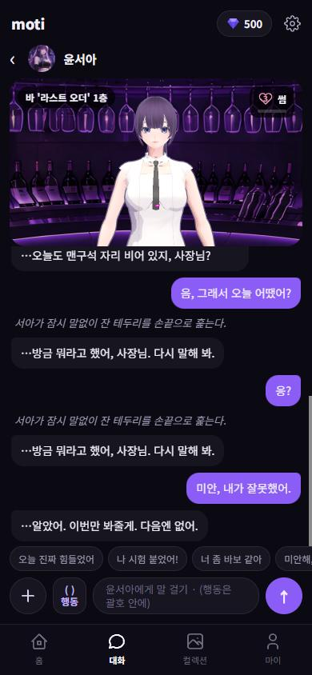 |
| 바 1층 전신(발이 바닥에 서 있는지 확인용) | 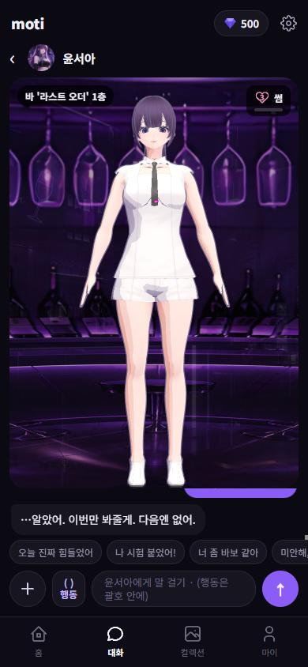 |
| 촬영 화면 왼쪽으로 돌림(−55°) | 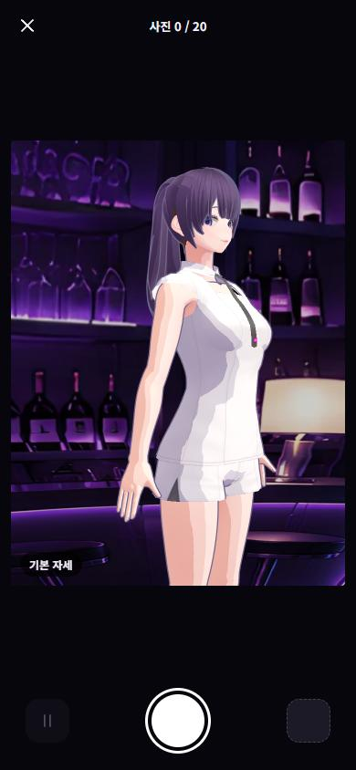 |
| 정면(0°) | 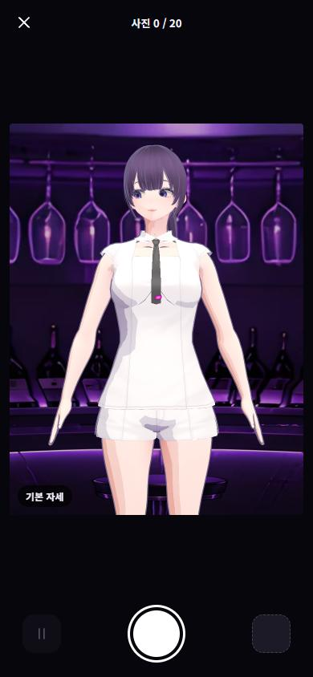 |
| 오른쪽으로 돌림(+55°) | 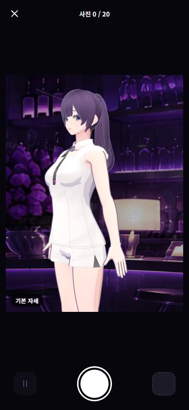 |
| 위에서 내려다봄(30°) | 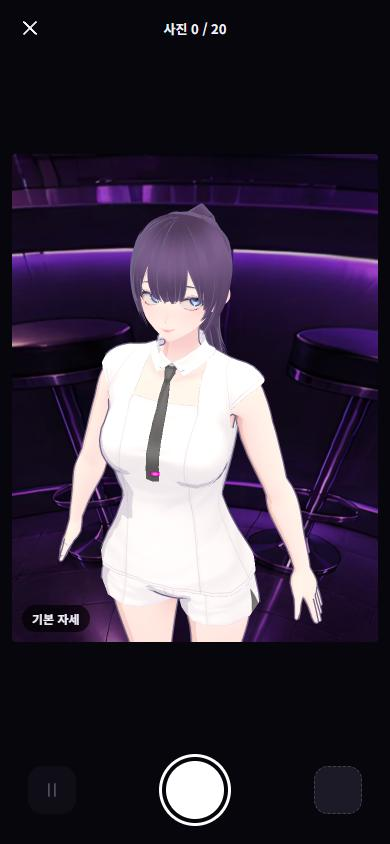 |
| 네온 골목 대화 화면 | 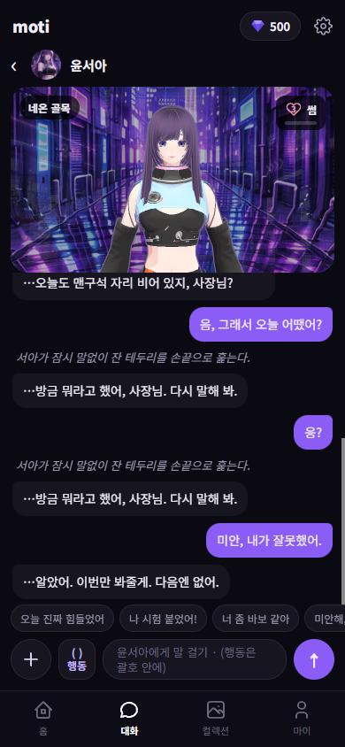 |
| 360도 없는 장소(바 옥상)로 바꿈 | 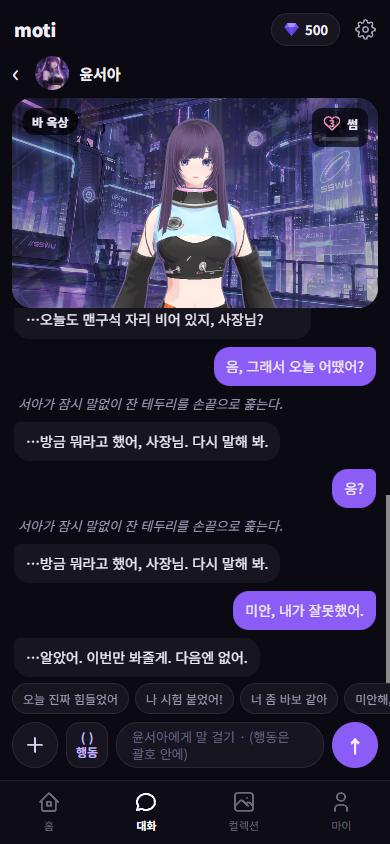 |
| 다시 바 1층(전환 중간, 구가 나타나는 중) | 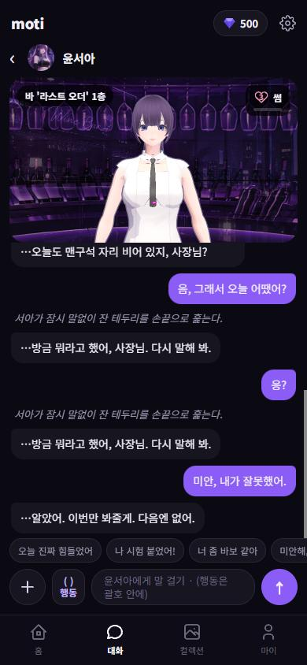 |
| 바 1층 무빙 카드 그림(m05) | 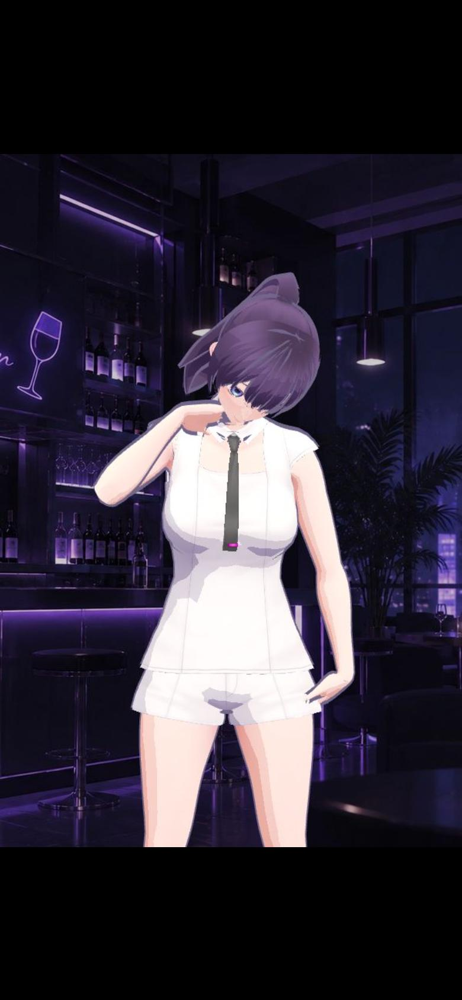 |
| 카드 확대(대화 장소는 옥상인데 카드 장소 바 1층의 360도로 재생, 첫 안내 창이 위에 뜬 상태) | 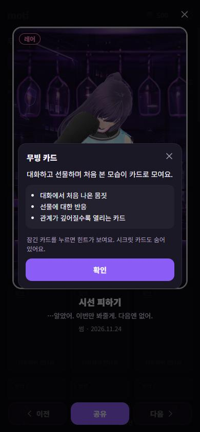 |
| 확인용: 구를 180° 돌려 그림 양 끝 이음매를 서아 뒤에 둠 | 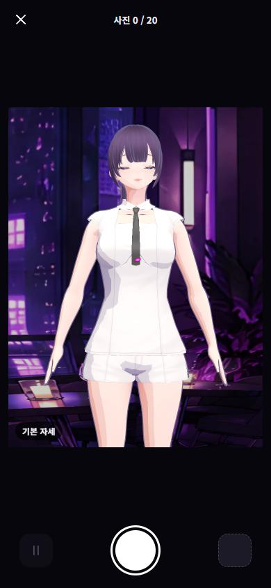 |

## 확인

- 서아 발: 전신·내려다본 각도에서 발이 바닥 그림 위에 섬(뜨거나 파묻히지 않음).
- 수평선: 구 중심이 카메라 눈높이라 화면 수평과 맞음. 기울어짐 없음.
- 이음매: 그림 양 끝이 만나는 곳(서아 앞, 카메라 뒤)을 일부러 서아 뒤로 돌려 봄 → 이음매 보이지 않음.
- 카드 확대를 닫으면 대화 장소(옥상)로 돌아가 360도가 꺼짐.
- 콘솔 오류 없음.

## 제가 정한 것

- **구 모양:** 그냥 구가 아니라 아래쪽을 바닥 평면으로 누른 구(three.js 의 「땅에 붙인 스카이박스」 방식)를 직접 만듦. 그냥 구면 카메라를 돌릴 때 바닥 그림이 서아 발 밑에서 미끄러져 보여서. 대신 바닥에 서 있는 키 큰 물건(바 의자 등)은 내려다볼 때 바닥 쪽으로 늘어나 보임(캡처 「위에서 내려다봄」의 의자).
- **값:** `pano.height` 1.43m(평소 구도 카메라 눈높이), `radius` 12m. 높이를 올리면 그림 속 공간이 작아 보이고(서아가 커 보임) 내리면 반대. 지금 바 1층은 매달린 잔이 서아 머리보다 조금 크게 보이는 정도.
- **전환:** 평평한 배경 그림은 360도 장소에서도 지우지 않고 구 아래에 그대로 둠 → 그림을 불러오는 동안·실패해도 평평한 그림이 보이고, 전환도 그 위에서 구가 0.6초 동안 나타나고 사라지는 것으로 지금 효과와 같게 함.
- **배경 어둡게:** 지금 평평한 배경에 겹치는 어둡게 층(밝기 .8·채도 .9)이 구에는 닿지 않아(3D 그림판이 그 층 위) 같은 값을 구 재질 안에서 곱함. 바 1층이 어둡지 않아 `panoBright` 는 1 그대로.
- **`panoYaw` 방향:** + 가 위에서 볼 때 시계 반대 방향. 두 장소 모두 0.
- **빌려 쓰는 칸:** 온보딩 입장권 3D·필름 사진(개발용)은 3D 그림판을 빌릴 때 360도를 끔(안개·단색 배경 연출 그대로). 촬영 화면은 대화 장소, 카드 확대는 그 카드 장소의 360도.
- **이미 만든 카드 그림:** 이 단계 전에 만들어 저장된 무빙 카드 그림(평평한 배경)은 그대로 둠. 새로 만드는 카드부터 360도 배경.
- **끄기:** 주소 뒤 `?pano=off` 면 360도 없이 예전처럼(비교·문제 생길 때용).
- **그림 압축:** 받은 webp 그대로 씀(바 0.5MB, 골목 1.2MB). 크기를 줄이지 않음.

## 아이폰에서 나중에 볼 것

- 360도 그림 불러오기 시간: 바 0.5MB·골목 1.2MB webp. 불러오는 동안은 평평한 그림이 보이다가 구가 나타나는지.
- 메모리: 그림 한 장 4096×2048 → GPU 에 약 32MB(밉맵까지 약 43MB). 두 장소를 오가면 두 장 다 남아 있음(지금은 내려놓지 않음). 의상 모델 2개와 같이 있을 때 사파리가 탭을 다시 불러오는지.
- 아이폰 최대 그림 크기(4096)에 딱 맞음 — 깨지거나 검게 나오지 않는지.
- 촬영 화면에서 끌어서 돌릴 때 끊김.
- 장소 전환 때 구가 나타나고 사라지는 0.6초가 끊기지 않는지.

## 30-1 360도 그림 메모리 정리

브랜치 `step/30-1-pano-memory` · 커밋 `[30-1] 360도 그림 메모리 정리`

### 한 일
- 360도 그림은 **지금 보이는 장소 것 하나만** 메모리에 둔다. 다른 장소로 옮기면 떠난 장소의 구가 0.6초 동안 사라진 뒤 구·재질·텍스처를 내려놓음(`dispose`). 다시 오면 다시 불러오고, 그동안은 평평한 배경 그림.
- 무빙 카드 확대에서 다른 장소 카드를 열면 그 장소 그림을 잠깐 불러오고(대화방 장소 것과 함께 2장), 카드를 닫으면 대화방 장소 것만 남기고 내려놓음.
- 서아 사진·내가 찍은 사진·카드 그림을 다른 장소로 만들 때도 그 장소 그림은 그리는 동안만 붙잡아 두고, 다 그리면 내려놓음.

### 확인 (`R.info.memory.textures`)
3D 텍스처 수는 장소마다 서아 의상 모델이 바뀌어(바 1층·옥상·골목 의상이 다름) 같이 오르내린다. 그래서 같은 순서를 `?pano=off`(360도 없이)로도 재서 뺀 값 = 360도 텍스처 수.

| 순서 | 텍스처 수 | 360도 없이 | 차이(360도 텍스처) | 남은 360도 그림 |
| --- | --- | --- | --- | --- |
| 시작(옥상) | 44 | 44 | 0 | 0 |
| 바 1층 | 33 | 32 | 1 | 1 (바 1층) |
| 네온 골목 | 45 | 44 | 1 | 1 (네온 골목) |
| 옥상 | 44 | 44 | 0 | 0 |
| 바 1층 | 33 | 32 | 1 | 1 (바 1층) |

장소를 바꾼 직후 0.6초 전환 동안만 두 장(떠나는 것 + 오는 것)이 함께 있고, 전환이 끝나면 1장.

| 카드 | 남은 360도 그림 |
| --- | --- |
| 네온 골목 대화 중 | 1 (네온 골목) |
| 바 1층 카드 확대 | 2 (바 1층 + 네온 골목) |
| 카드 닫음 | 1 (네온 골목) — 텍스처 79 → 78 |
| 네온 골목에서 바 1층 카드 그림 만들기: 그리는 순간 / 다 만든 뒤 | 2 / 1 |

### 제가 정한 것
- 떠나는 장소 그림은 전환(0.6초)이 끝나 완전히 사라진 뒤 내려놓음(전환 효과를 지키려고). 그래서 전환 동안은 최대 2장.
- 카드 확대 중에는 카드 장소 + 대화방 장소 2장을 둠(닫으면 바로 대화방 장소로 돌아가야 해서).
- 구 모양(바닥 누른 구)은 장소끼리 같이 써서 내려놓지 않음(그림이 아니라 크기가 작음).
- 확인은 브라우저 창이 숨겨진 상태라 화면 그리기를 대신 돌리는 임시 사본 페이지로 재고 지움(저장소에 넣지 않음).
