# 32 · 확대 뒤 비율 고치기 · 서아 사진을 진짜 셀카로 · 대사 다듬기

브랜치 `step/32-selfie-lines` · 커밋 `[32-A] 확대 뒤 비율 고치기`, `[32-B] 서아 사진을 진짜 셀카로`, `[32-C] 사진 대사를 상황에 맞추기`

## 바뀐 파일

| 파일 | 내용 |
| --- | --- |
| `index.html` | (A) `Stage.borrow` 가 카메라 aspect·fov·그림판 크기(픽셀 비율 포함)를 저장, `Stage.release` 가 되돌린 뒤 `fit()` 으로 지금 대화 무대 크기에 다시 맞춤. 확대 중이면 끝날 때 한 번 더. 매 프레임 크기 검사에 「카메라 비율이 어긋남」·「켜진 시야 자르기」도 넣음(빌려 쓰지 않을 때만). `View.moving()`(확대가 끝날 때까지 남은 ms), 확대가 끝나면 `Stage.fit()`. (B) `Stage.reach`(팔 뻗기)·`Stage.tiltHead`(머리 기울이기)·`Stage.eyeY`(눈 높이) |
| `seoaphoto.js` | (A) 사진 그리기 때 **꺼진** 시야 자르기를 되살리지 않음(버그 원인), 확대가 진행 중이면 끝날 때까지 미룸. (B) 셀카 종류 뽑기·셀카 카메라·팔 끝 자리, 사진 종류 비중(`shotWeight`). (C) 「지금 장소」, 오랜만 사진을 그 시각 자리에 끼워 넣기(`insertMsg`)·받은 시각 뽑기(`awayAt`)·시각 표시(`timeLabel`), 서버 한 줄 둘(같이 있을 때 / 오랜만), 360도 그림이 없는 장소를 찍을 때 지금 장소의 구 숨김 |
| `photos.css` | (C) `.phrow`·`.phtime` (말풍선 옆 받은 시각) |
| `data/seoa_photo.json` | (B) `shotWeight`(셀카 1·풍경 0), `kinds.selfie` 에 `fov`·`pitch`·`roll`·`headTilt`·`arm`·`mids`·`types`(3종). (C) `here`, 단계 사진 5장(지금 장소·셀카·새 이름·새 대사), 대화 중 가끔 18줄, 오랜만 6줄, `away.night`·`edgeMin`·`delayMs` 300, `serverLine` 새 문장, `serverLineAway`(예전 문장) |
| `data/gifts.json` | (C) 선물 반응 16줄(원고 4절) |
| `data/episodes.json` | (C) 특별 에피소드 3개 오프닝 대사 문단과 `line`(원고 5절) |
| `data/config.json` | (C) `fallbackReply.line`(원고 6절), 설명 고침 |
| `data/ui.json` | (C) `seoaPhoto.time`·`am`·`pm`·`yesterday`·`date` (받은 시각 문구) |
| `docs/drafts/32-대사-다듬기.md` | 다운로드 폴더에서 복사(그대로) |
| `docs/drafts/12-…`, `9-…`, `16-…` | 같은 대사로 고침. 12 에는 단계 사진 「지금 장소」·오랜만 사진 끼워 넣기·서버 한 줄 둘을 적음 |
| `docs/reports/img/32/` | 캡처 21장 |

## A · 확대 뒤 서아가 눌리는 문제

**원인:** `seoaphoto.js` 가 사진을 그린 뒤 카메라를 되돌릴 때 `cam.view` 가 **있기만 하면** `setViewOffset` 을 다시 불렀다. three.js 는 `clearViewOffset()` 뒤에도 `cam.view` 객체를 남겨 두고 `enabled` 만 끈다. 그래서 온보딩(입장권 3D, 시야를 아래로 늘리려고 `setViewOffset` 을 씀)을 한 번 거친 뒤에는, 서아 사진을 그릴 때마다 온보딩 때의 시야 자르기가 다시 켜지고 `cam.aspect` 도 그때 값(예: 0.52)이 됐다. 대화 무대 그림판 크기는 그대로라 매 프레임 크기 검사(픽셀 크기만 비교)가 이를 고치지 못해 그대로 남음 → 서아가 옆으로 늘어나거나 눌려 보임. 단계 사진은 대표 몸짓 확대 직후에 오므로 「확대 뒤」에 나타나는 것처럼 보였음. 컬렉션 카드·촬영 화면은 빌린 동안 시야 자르기를 끄므로, 카드를 열었다 닫으면 잠깐 나았다가 다음 사진에서 다시 생김.

**고친 것:**
1. 사진 그리기: 켜져 있던 시야 자르기만 되돌림.
2. `Stage.borrow` / `release`: 빌릴 때 값 저장 → 되돌림 → 지금 무대 크기로 `fit()`(시야 자르기 끔, 비율 다시 계산). 확대가 진행 중이면 끝날 때 한 번 더.
3. 매 프레임: 빌려 쓰지 않을 때 카메라 비율이 그림판과 다르거나 시야 자르기가 켜져 있으면 바로 맞춤(다른 곳에서 또 어긋나도 한 프레임 안에 돌아옴).
4. 서아 사진 그리기는 확대가 커지거나 줄어드는 동안 미룸.

**확인(헤드리스 Chrome 390px, 숫자는 카메라 비율 / 그림판 비율):**

| 경우 | 결과 | 캡처 |
| --- | --- | --- |
| 고치기 전(main): 온보딩이 남긴 시야 → 서아 사진 | 0.523 / 1.743, 시야 자르기 켜짐 — **늘어남** | 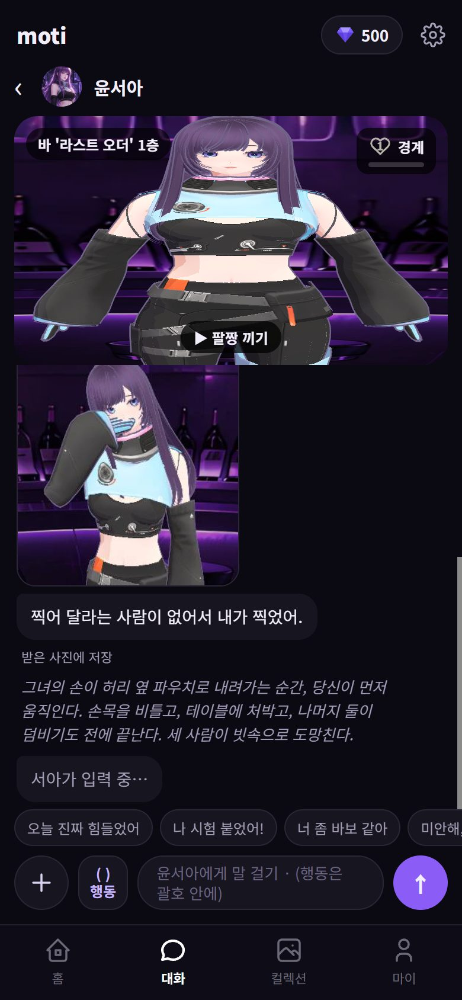 |
| 고친 뒤: 같은 상황 | 1.743 / 1.743 | 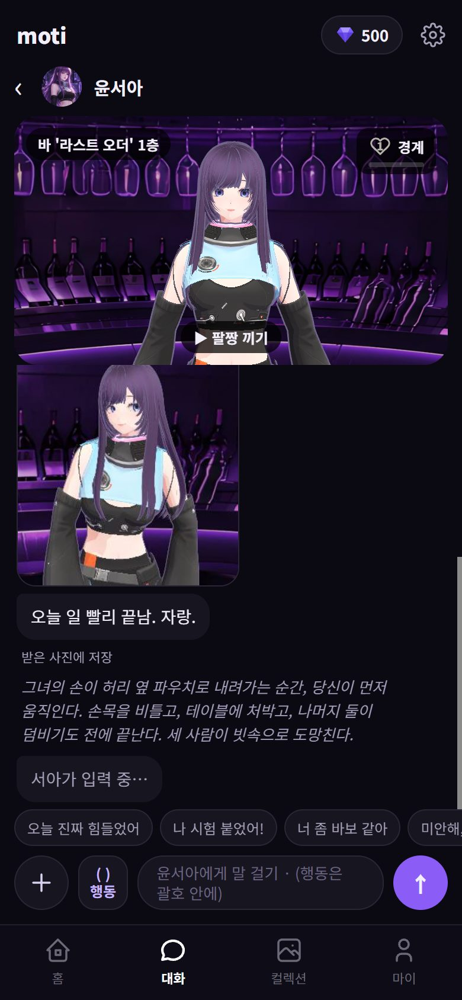 |
| 확대 직후 서아 사진(확대 중) | 1.22 / 1.22 | 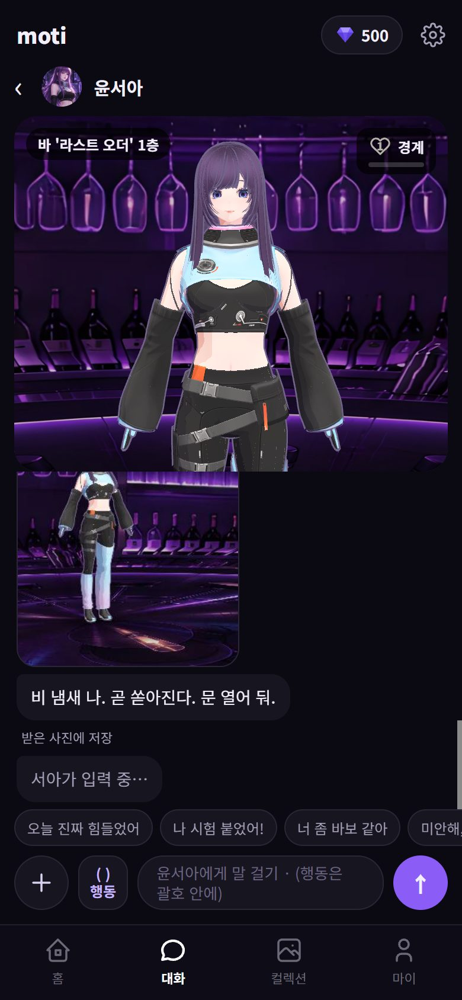 |
| 위 경우 확대가 끝난 뒤 | 1.743 / 1.743 | 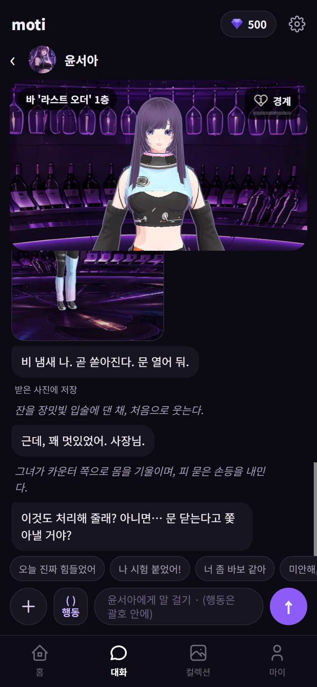 |
| 확대 → 컬렉션 카드 크게 보기 | 0.663 / 0.663 (카드 칸) | 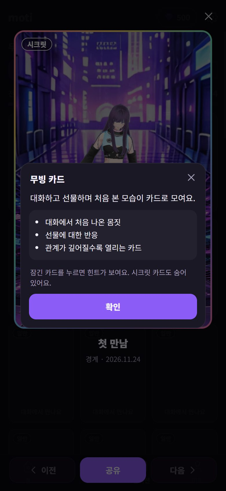 |
| → 닫고 대화로 | 1.743 / 1.743 | 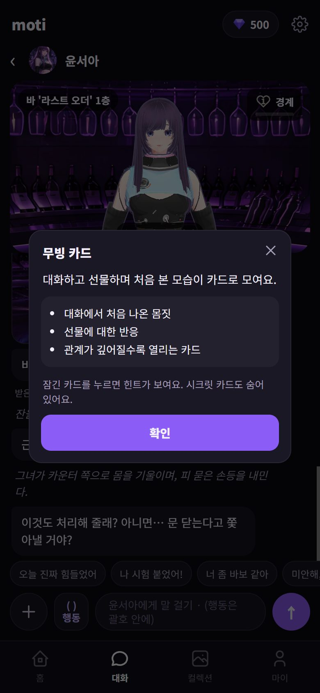 |
| 「첫 만남 다시 보기」 끝까지 | 1.743 / 1.743 | 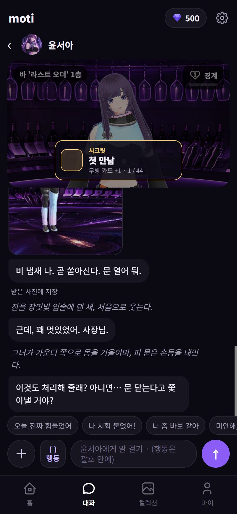 |
| 「첫 만남 다시 보기」 2.2초에 건너뛰기 | 1.743 / 1.743 | 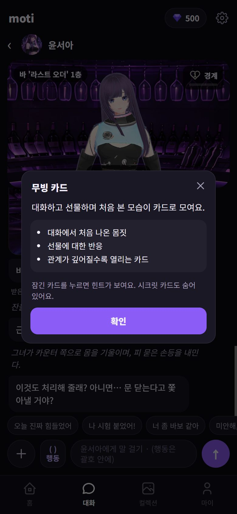 |
| 연출 직후 확대 + 서아 사진 겹침 | 1.22 / 1.22 | 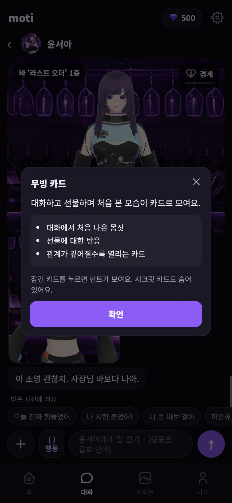 |
| 화면 회전(844×390) | 1.972 / 1.972 | 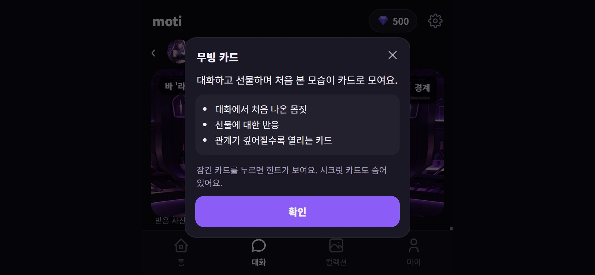 |
| 다시 세로(390×844) + 확대 | 1.22 / 1.22 | 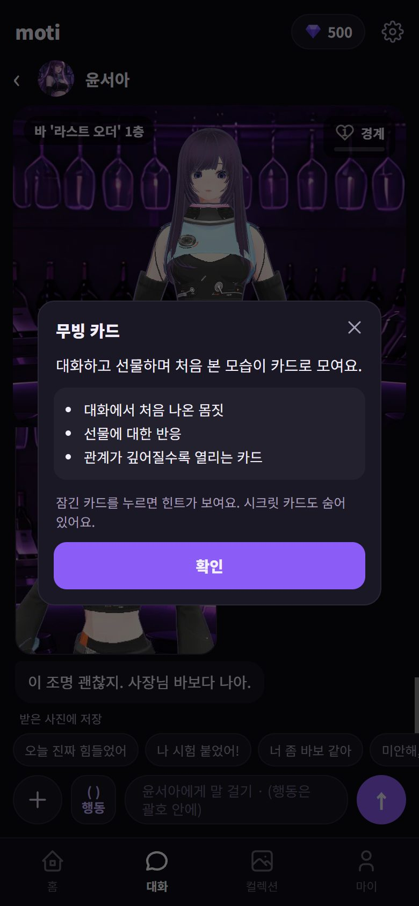 |

앱 미리보기 창에서도 매 프레임 감시(빌려 쓰지 않을 때 카메라 비율 ≠ 그림판 비율이면 기록)를 켜고 위 순서를 다시 돌려 어긋난 프레임 0.

## B · 서아가 보내는 사진을 모두 진짜 셀카로

- **풍경 비중 0:** `shotWeight: {selfie: 1, landscape: 0}`. 원고의 `shot` 이 풍경이어도 비중이 0 이면 셀카로. 풍경 구도(`kinds.landscape`)는 지우지 않음
- **셀카 구도(`kinds.selfie`):**
  - 넓은 렌즈 `fov` 60°(대화 무대는 30°). 폰 렌즈처럼 가깝게 찍혀야 팔이 사진 밖으로 나감
  - 카메라는 **눈 높이에서** `pitch` 10~15° 위, 구도 가운데(가슴 위~머리)를 봄 → 살짝 내려다봄
  - 사진 기울기 `roll` 2~6°, 좌우 무작위
  - 한쪽 팔(`arm.side` R·L 무작위)의 위팔·아래팔을 「렌즈에서 팔 쪽·아래로 조금 비킨 점(폰을 든 손)」으로 뻗음 → 팔이 사진 아래 옆 모서리 밖으로. 어깨도 30% 그쪽으로, 팔꿈치는 살짝 굽힘
  - 시선은 렌즈(기존 `lens` 값 그대로: 목·머리·눈)
  - 가슴 위까지(`top`·`bottom`)
- **셀카 종류 3개(`types`):** 사진마다 하나, 직전 셀카와 같은 종류는 피함(저장값 `S.sp.lastSelfie`)
  - `arm` 한 팔 뻗기 — 기본
  - `close` 얼굴 가까이 — 더 가깝게(가슴 윗부분까지), 더 위에서(12~15°)
  - `lean` 살짝 옆으로 기울이기 — 머리 10~14° 기울임, 사진 3~6° 기울임, 좌우 각도 더 큼

12장 모음(사진 아래: 종류·팔·카메라 높이 pitch·기울기 roll·머리 기울기 tilt):

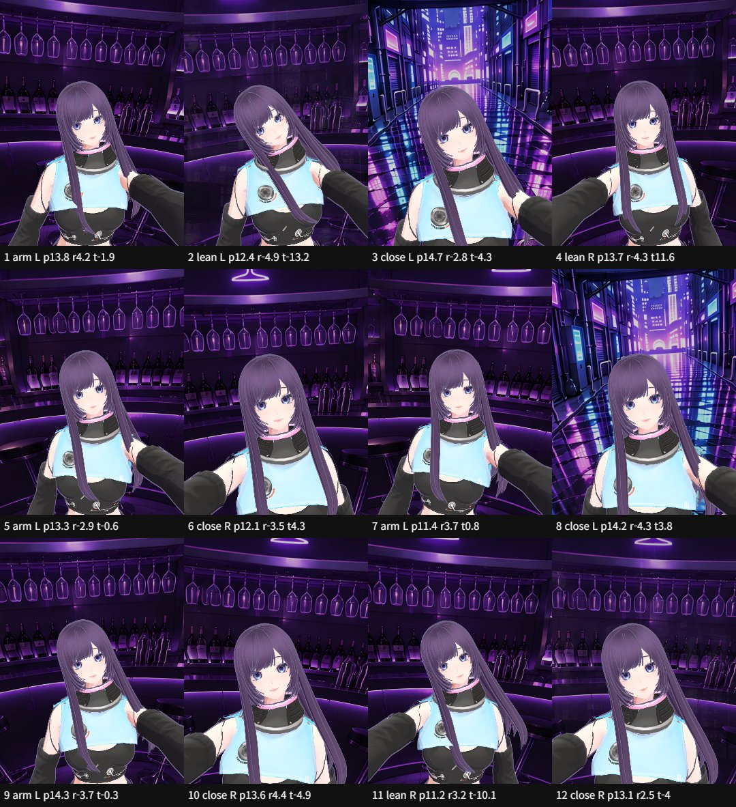

**고친 값:** 첫 모음에서 팔 끝을 렌즈 바로 옆(키의 5%)으로 두었더니 팔이 렌즈를 똑바로 향해 넓은 소매 끝이 가슴 앞에 큰 덩어리로 보였음 → 손 자리를 팔 쪽 20%·아래 12% 로 옮겨 팔이 사진 모서리 밖으로 비스듬히 나가게. 허리까지 보여서 아래 경계를 0.70 → 0.75(얼굴 가까이 0.80), 너비 0.5 → 0.4. 기울이기의 머리 기울기 8~12° 는 잘 안 보여 10~14° 로.

## C · 사진 대사를 상황에 맞추기, 대사 다듬기

원고 `docs/drafts/32-대사-다듬기.md` 1~6절을 그대로 넣음(넣지 못한 줄 없음).

- **단계 사진 5장:** `place` = 「지금 장소」(`here`) → 단계가 오른 그때 대화 장소에서 찍은 셀카. 사진 이름·대사 새것
- **대화 중 가끔:** 묶음 4개 18줄 교체(순서·개수 그대로), 지금 대화 장소
- **오랜만에 들어왔을 때:** 대사 6줄만 교체(장소·종류 원고 그대로). 대화방에 들어간 뒤 「보내는 중」 없이 사진을 만들어, **내가 없던 동안 밤 9시~새벽 2시 중 한때**를 받은 시각으로 대화 기록의 그 자리에 끼워 넣음. 말풍선 옆에 그 시각(오늘이면 「오후 11:53」, 어제면 「어제 오후 11:53」, 그 전이면 「11월 22일 …」)
- **서버에 알리는 한 줄:** 같이 있을 때 사진 `(서아가 지금 {place}에서 셀카를 찍어 보냈다. 함께 보낸 말: "{msg}")`. 오랜만 사진은 예전 문장(`serverLineAway`)
- **선물 반응 16줄, 특별 에피소드 3개 오프닝 대사 문단 + `line`, 서버 실패 예비 대사**

| 확인 | 캡처 |
| --- | --- |
| 단계 사진(3단계, 지금 장소 네온 골목) 「…저장은 해.」 · 서버 한 줄 「(서아가 지금 네온 골목에서 셀카를 찍어 보냈다…)」 | 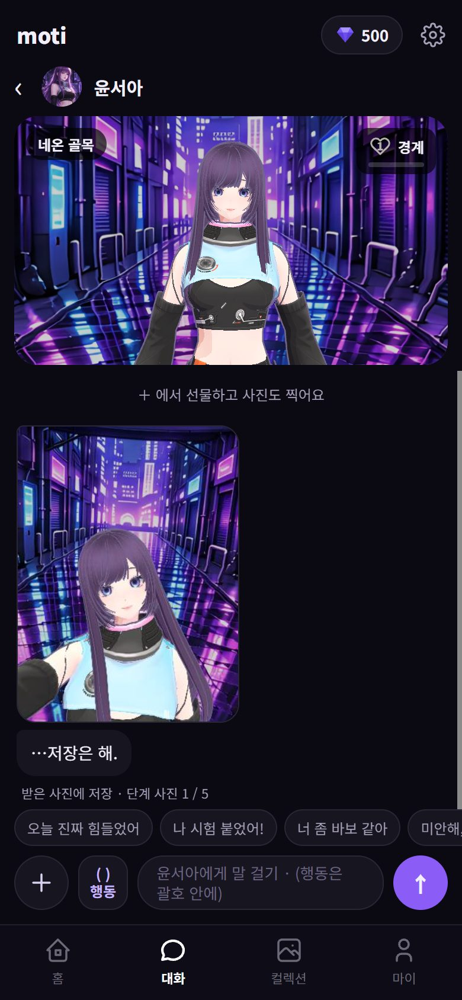 |
| 대화 중 가끔(4단계 묶음, 바 1층) 「이 각도 괜찮지?」 | 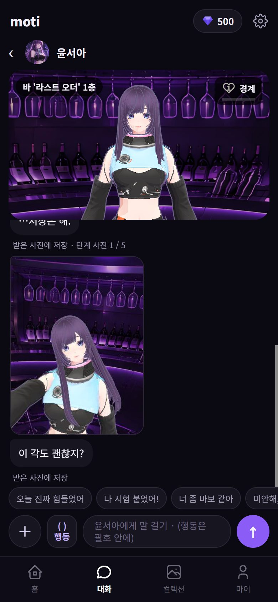 |
| 오랜만 사진: 마지막 대화 30시간 뒤 들어옴 → 「어제 오후 11:53」에 받은 「카운터에 먼지 쌓였어.」, 「보내는 중」 없음 | 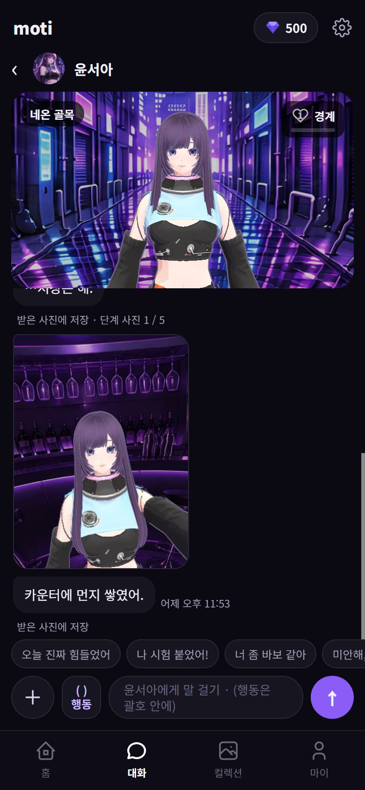 |
| 360도 그림 없는 장소(비 내리는 골목)를 바 1층에서 찍은 셀카 | 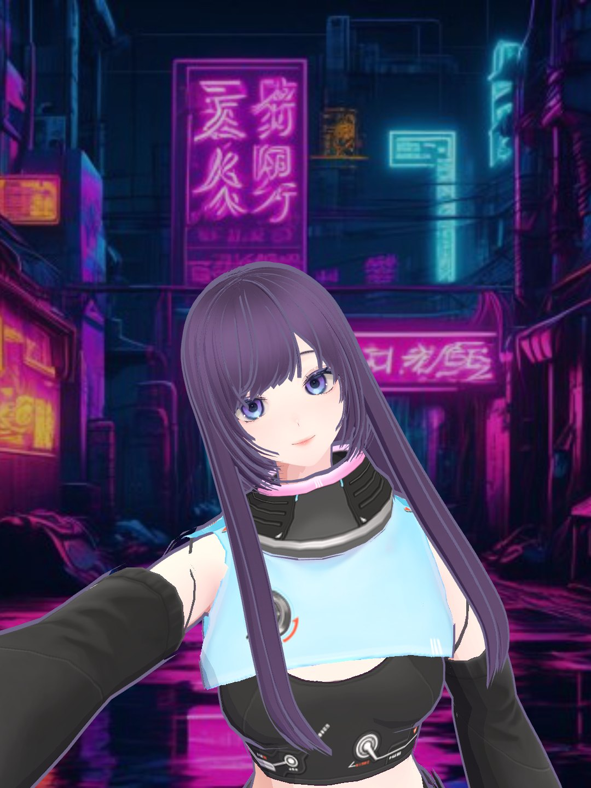 |
| 선물 커피 일반 「바에서 커피? …나쁘지 않네.」 | 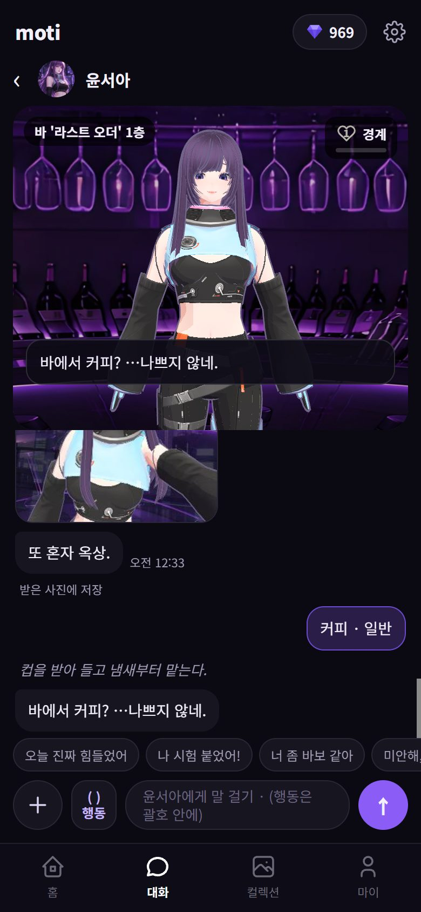 |
| 오늘의 바텐더 오프닝 | 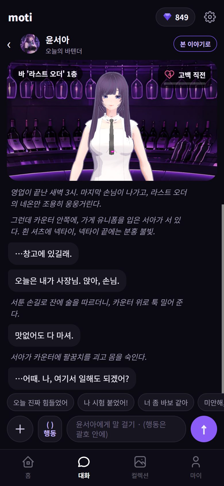 |
| 크리스마스 이브 정전 오프닝 | 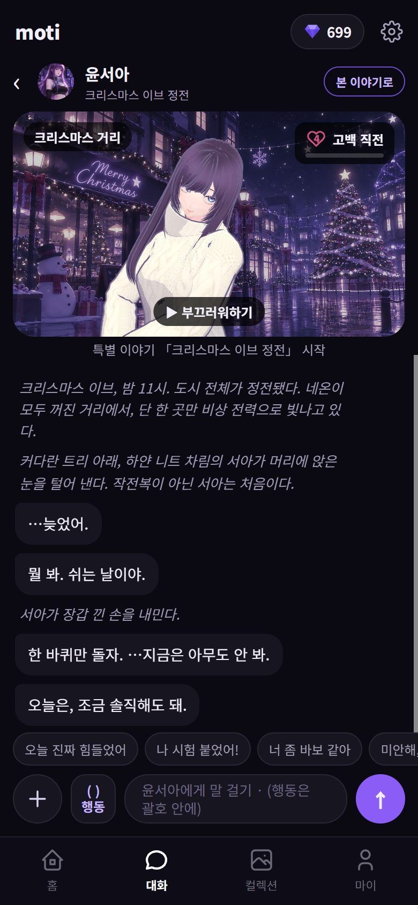 |
| 할로윈 오프닝 | 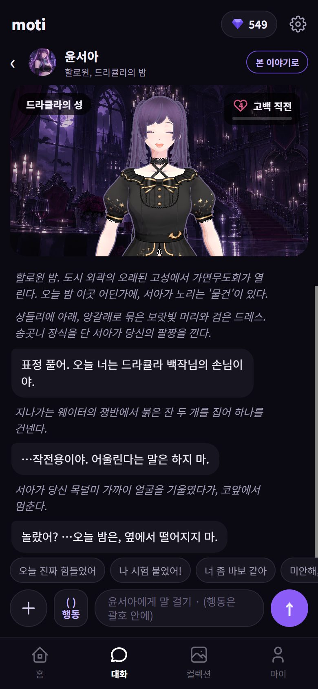 |
| 서버 실패 예비 대사(서버 끔, 키워드 없는 말) 「…다시 말해 봐.」 | 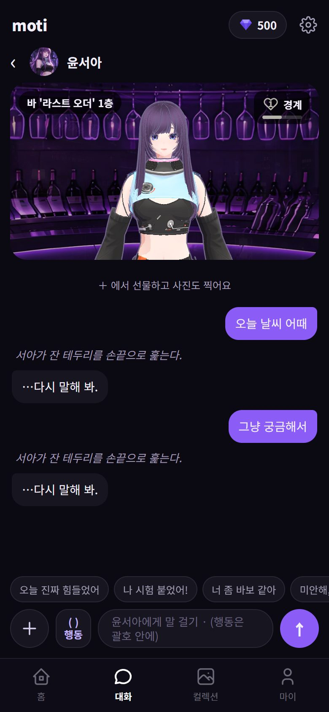 |

- 데이터 JSON 17개 모두 읽힘(앱이 `dataReady` 까지 오류 없이 뜸), 콘솔 오류 없음
- 받은 시각 뽑기: 30·60시간 전 마지막 대화 → 밤 9시~새벽 2시 안, 7시간 전(오전 9시~오후 4시) → 밤 시간이 없어 가운데

## 제가 정한 것

- **A 원인 범위:** 지시문은 borrow/release 를 의심했지만 실제 원인은 사진 그리기의 시야 자르기 되살리기. 둘 다 고침(borrow/release 저장·되돌리기는 지시대로, 매 프레임 비율 검사는 다른 곳에서 또 어긋나도 돌아오게 덧붙임)
- **release 때 시야 자르기:** 빌릴 때 저장하는 값은 aspect·fov·그림판 크기·픽셀 비율. 시야 자르기는 대화 무대가 쓰지 않으므로 저장하지 않고 늘 끔
- **사진 미루기:** 확대(View)의 크기 바뀌기만 기다림(최대 20번). 첫 만남 연출 중에는 이미 `busy` 라 사진이 오지 않음. 컬렉션 카드 그림 만들기(같은 `make`)도 같은 규칙
- **셀카 몸 자세:** 팔을 따로 뻗으므로 몸은 대기 자세(m25) 하나(`mids`). 다른 몸짓은 팔·몸이 셀카 팔과 부딪쳐서. 사진마다 다른 것은 종류·팔(좌우)·카메라 높이·기울기·표정
- **셀카 렌즈 60°:** 지시문에 없는 값. 30° 로는 가슴 위 구도에 카메라가 1m 넘게 떨어져 팔이 닿지 않음
- **「한 팔 뻗기」·「얼굴 가까이」 등 종류 이름:** 데이터의 `name` 은 확인용(화면에 안 보임)
- **오랜만 사진 시각:** 마지막 대화 뒤·지금 앞으로 10분씩 비우고, 그 사이 밤 구간들의 길이에 비례해 뽑음. 그 사이에 밤이 없으면(예: 오전 9시 → 오후 4시) 가운데 시각. 시각 문구는 `data/ui.json`
- **오랜만 사진이 보이는 때:** 대화방에 들어가 0.3초 뒤 사진을 만들기 시작해 0.3~1초 뒤 기록에 나타남(사진을 미리 만들어 둘 수 없어서). 그동안 「보내는 중」은 없음
- **오랜만 사진의 장소·종류:** 원고 3절 「장소·사진 종류는 그대로」에 따라 데이터의 `shot` 은 그대로 두고, B 의 비중 0 때문에 실제로는 셀카로 찍힘
- **오랜만 사진의 서버 한 줄:** 같이 있을 때 문장(「지금 …에서 셀카를 찍어」)이 맞지 않아 예전 문장을 `serverLineAway` 로 남김
- **특별 에피소드 `line`:** 지금은 오프닝이 없는 에피소드에서만 첫 대사로 쓰임(세 에피소드 모두 오프닝이 있어 화면에는 잘 안 나옴). 원고대로 데이터만 맞춤
- **할로윈 둘째 문단의 대사(「표정 풀어. …」):** 원고 표에 없어 그대로 둠
- **360도 그림이 없는 장소 사진(30단계부터 있던 버그):** 오랜만 사진(비 골목 등)을 360도 그림이 있는 장소에서 찍으면 지금 장소의 구가 평평한 그림을 덮어 바 1층이 찍혔음. 그릴 때 구를 모두 숨김
- **캡처 방법:** 31단계와 같이 저장소를 잠깐 띄워 헤드리스 Chrome 390px(픽셀 비율 2). 확인 스크립트는 저장소 밖 임시 폴더. 「고치기 전」은 origin/main 을 따로 띄워 찍음. 온보딩이 남긴 시야는 온보딩을 끝까지 도는 대신 같은 상태(`setViewOffset` → `clearViewOffset`)를 만들어 재현

## 아이폰에서 나중에 볼 것

- **확대 뒤 비율:** 온보딩 → 첫 만남 → 대화 → 단계 사진(확대 직후)에서 서아가 늘어나 보이지 않는지. 주소창이 접히고 펼쳐질 때, 화면 회전 뒤
- **셀카 그리기:** 렌즈 60°·팔 뻗기로 바뀌어 그리는 양은 같음. 사진을 만드는 동안 대화 무대가 멈칫하는 정도(`SeoaPhoto.perf` 의 `maxGapMs`)
- **확대 중 사진 미루기:** 확대가 끝난 뒤 사진이 오므로 「보내는 중」이 조금 더 길어 보일 수 있음
- **오랜만 사진:** 대화방에 들어간 직후 사진 말풍선이 기록 중간(그 시각 자리)에 끼어들 때 스크롤이 튀지 않는지, 받은 시각 글자가 말풍선 옆에서 줄바꿈되지 않는지(긴 대사)

## 32-1 · 부재중 사진 자리 다듬기

커밋 `[32-1] 부재중 사진 자리 다듬기`

### 바뀐 파일

| 파일 | 내용 |
| --- | --- |
| `seoaphoto.js` | 대화방에 들어가는 순간(`enter`, 대화방을 처음 그리는 같은 작업 안) 오랜만 사진을 골라 정해진 시각 자리에 말풍선·시각과 **사진 크기 자리**(`wait`)를 먼저 넣음. 사진 그림은 만들어지면 `fill` 로 그 자리에만 채움(기록을 다시 그리지 않음). 이때 사진 저장 알림(`Photos.onChange`)으로 기록을 다시 그리지 않게 막음(`quiet`). 기다리던 단계 사진이 있어도 오랜만 사진을 넣음(그보다 앞 시각) |
| `photos.css` | `.phmsg.wait`(그림을 기다리는 사진 칸: 사진 크기 그대로, 카드 바탕) |
| `docs/reports/img/32/321_*` | 캡처 5장 |

- **자리:** 기록에서 정해진 시각 순서대로 끼워 넣고(그보다 늦은 메시지가 있으면 그 위), 저장도 그 순서(`S.chats`). 같은 사진 id 는 두 번 넣지 않음
- **조용히:** 새 메시지 알림·소리·자동 스크롤 없음. 들어갈 때 이미 읽은 것으로(안 읽은 수에 안 셈). 들어갈 때 한 번 그리는 대화방(맨 아래로 스크롤)에 처음부터 함께 그려짐

### 확인(헤드리스 Chrome 390px)

**(가) 마지막 대화 뒤 하루(26시간) 지나 들어감:** 들어간 순간 말풍선 「비 와. …안 와?」와 「어제 오후 9:23」, 사진 크기 빈 칸이 이미 있음 → 1.6초 뒤 같은 칸에 사진이 채워짐.

| 들어간 직후 | 사진이 채워진 뒤 |
| --- | --- |
| 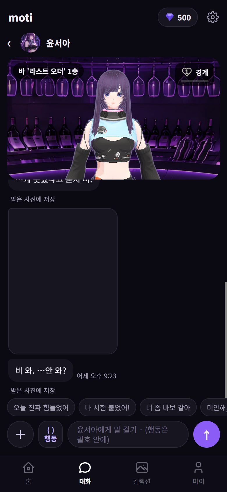 | 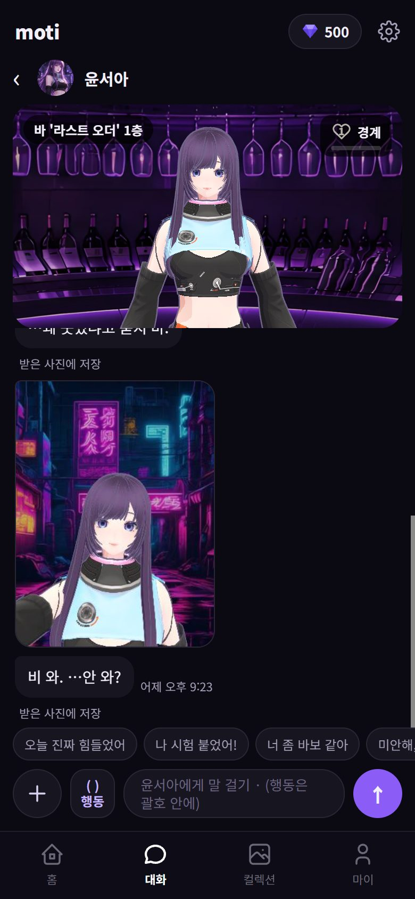 |

**(나) 그 사이 기다리던 단계 사진이 있을 때(30시간 뒤, 5단계 사진 대기):** 저장된 순서 = 대화 중 사진(전날 오전) → 오랜만 사진 「카운터에 먼지 쌓였어.」(오전 1:17) → 단계 사진 「…지우지는 마.」(들어간 뒤 지금 시각, 「보내는 중」을 거쳐 맨 끝). 오랜만 사진이 단계 사진 위에 옴.

| 맨 아래 | 오랜만 사진 쪽으로 올림 |
| --- | --- |
| 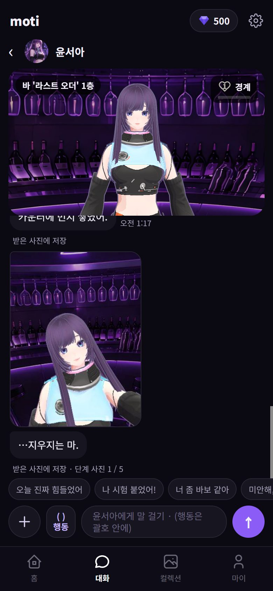 | 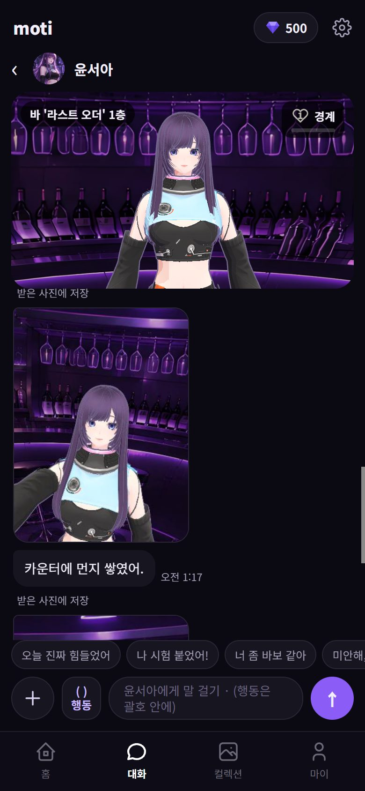 |

**(다) 들어간 직후 0~1.6초, 매 프레임 기록:** 사진 칸 위치(화면 위에서 357px)·높이(251px), 기록 스크롤 위치(333)·전체 높이(708)가 처음부터 사진이 채워진 1613ms 까지 한 번도 바뀌지 않음(27프레임, 헤드리스 소프트웨어 그리기라 프레임이 적음). 사진이 채워질 때 기록을 다시 그리지 않음.

### 제가 정한 것

- **빈 칸 모양:** 사진 크기(3:4) 카드 바탕만(불러오기 표시·애니메이션 없음). 채워질 때도 효과 없이 바로 바뀜
- **들어가자마자 고르기:** 메시지·장소·시각을 들어갈 때 정해 저장(`S.sp.pend` 에 사진 id 와 함께). 그림을 다 만들기 전에 앱을 닫으면 다음에 들어올 때 같은 칸에 채움
- **그림을 못 만들면:** 빈 칸을 거두고 말풍선·시각만 남김(12단계 「사진이 지워진 말풍선」과 같은 모양)
- **기다리던 사진과 함께:** 예전에는 기다리던 사진(단계 사진 등)이 있으면 오랜만 사진을 건너뛰었음. 이제는 오랜만 사진을 먼저 넣고(지난 시각), 기다리던 사진은 그 뒤 지금 시각으로
