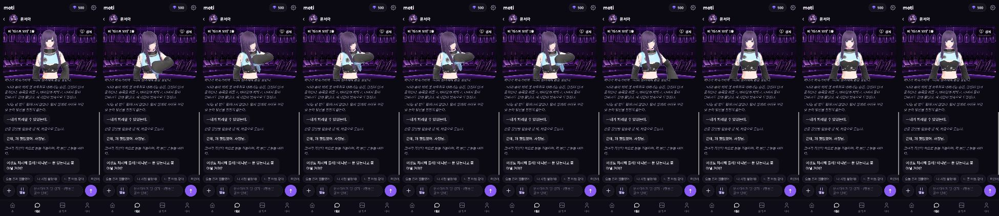
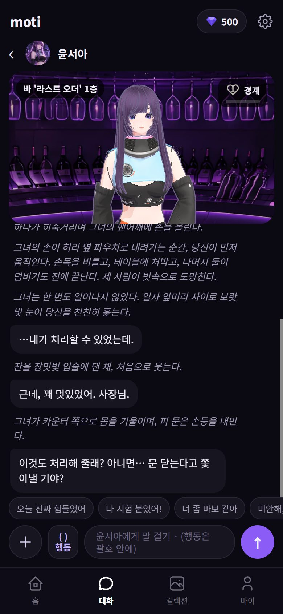
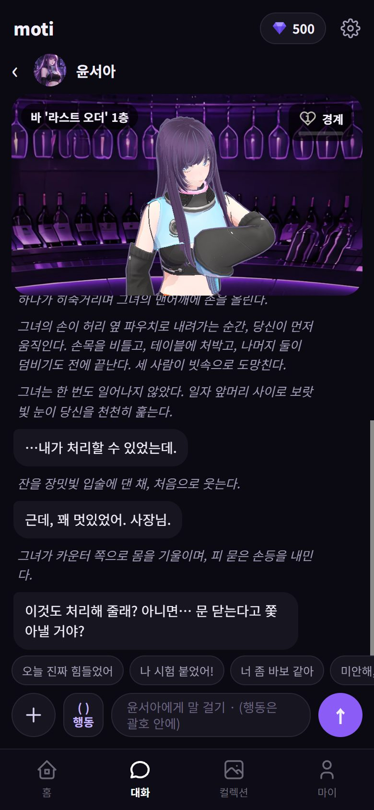
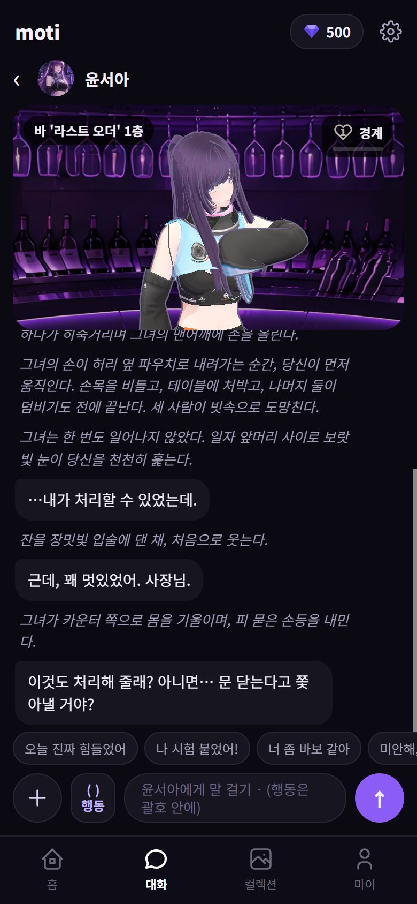
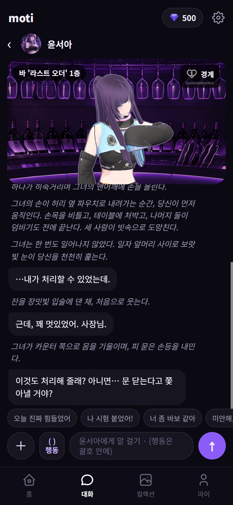
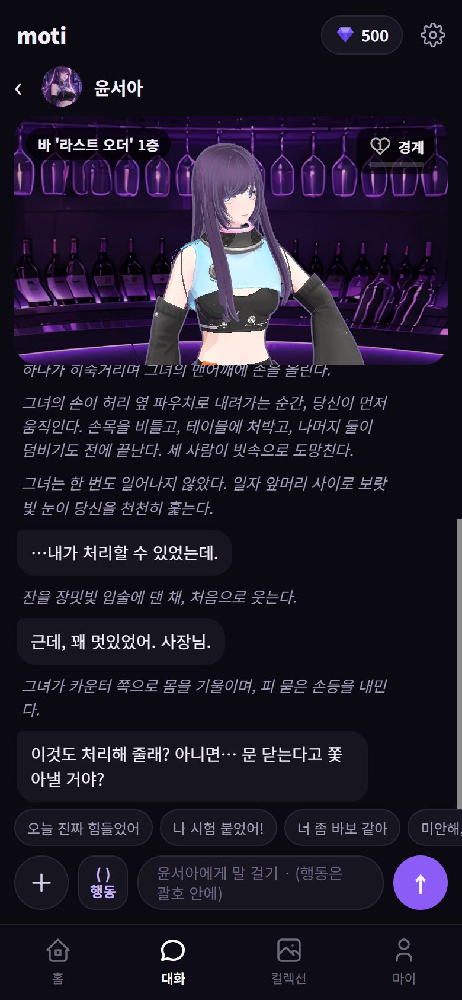
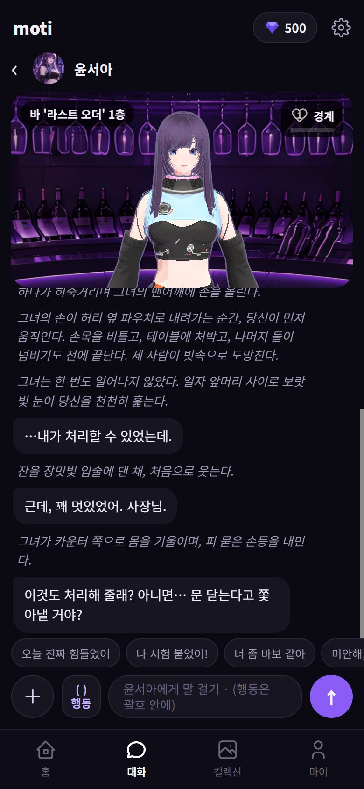
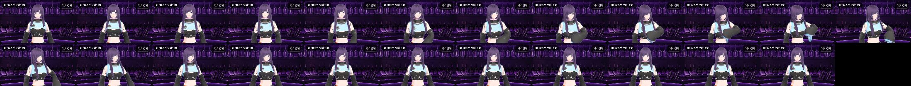
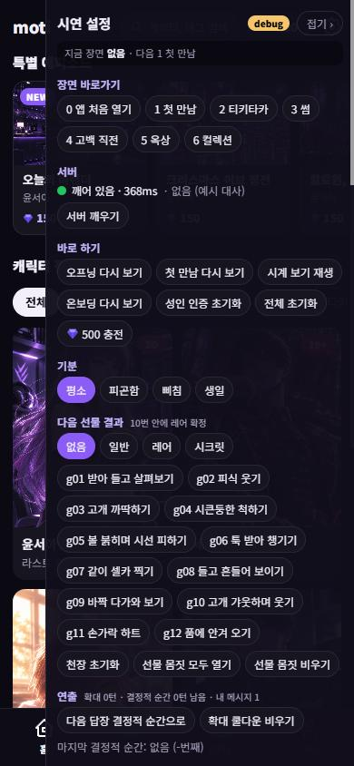
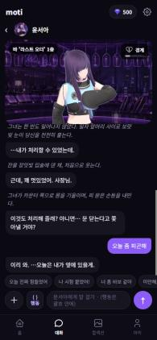

# 33 · 내가 말이 없을 때 서아가 시계 보기

브랜치 `step/33-idle-watch` · 커밋 `[33] 내가 말이 없을 때 서아가 시계 보기`

## 파일 옮기기

- 다운로드 폴더의 `standard_Waiting.fbx`(이름 그대로)를 `_src/` 로 복사. FBX 는 `.gitignore` 에 막혀 저장소에 안 들어감.

## 바뀐 파일

| 파일 | 내용 |
| --- | --- |
| `motions/xstage_checking_watch.json` | 새 모션(원본 13.44초, 뼈 20개, 30fps, 202KB). `tools/fbx2motion.mjs` 로 변환 |
| `data/motions.json` | `motions.x18` 「시계 보기」(감정 평온), `xstage.x18` = 1.75~8.4초 중 4.43~7.1초 건너뜀, `fadeIn` 0.6, `fadeOut` 0.9, `inPlace`. `_xstage` 설명에 33단계 줄 |
| `data/config.json` | `idle` 묶음(`motion` "x18", `afterSec` 25, `cooldownSec` 60, `maxPerVisit` 3, `face` "neutral") + `_idle` 설명 |
| `data/demo.json` | `idleWatch` 「시계 보기 재생」 |
| `docs/CREDITS.md` | XSTAGE 「[standard] Waiting - Checking watch」 출처 |
| `index.html` | `IdleWatch`(시간 세기·조건·재생), `send` 에서 처음부터 다시 세기, 시연 패널 「바로 하기」에 「시계 보기 재생」 버튼 |
| `docs/reports/img/33/` | 캡처 15장 |

## 1. 모션 x18 시계 보기

원본: 0~1.9초 서 있음 → 1.95~2.9초 왼손목을 들어 시계를 봄 → 4.6~6.2초 손목을 든 채 고개를 딴 데로 돌렸다 → 다시 시계 → 7.7~8.2초 손을 내림 → 11초쯤 몸을 원래 방향으로 돌림.

**재생 구간 약 4.0초(3.98초):** 1.75~4.43초(손목 들어 시계 보기) + 7.1~8.4초(다시 시계 보고 내리기). 가운데 고개를 돌리는 4.43~7.1초는 `skip` 으로 건너뜀. 이음매는 뼈 20개 중 가장 크게 다른 것이 6.6°(머리)로, 원래 모션 한 프레임 빠르기(95% 9.7°) 안.

시연 패널 재생, 390px 0.5초 간격(0.5 ~ 5.0초): 

| 0.5 | 1.0 | 1.5 | 2.0 | 2.5 | 3.0 | 3.5 | 4.0 | 4.5 |
| --- | --- | --- | --- | --- | --- | --- | --- | --- |
|  |  |  |  |  |  |  |  |  |

3D 칸만, 0.1초 간격(시작 0.1~1.0초, 이어서 끝 3.3~4.5초): 

| 잰 것(헤드리스 Chrome 390px, 시계를 1/30초씩 직접 넘김) | 값 |
| --- | --- |
| 재생 전 대기 자세 1초 | 한 프레임 최대 0.1° |
| 시작 0.6초 안 한 프레임 최대 회전 | 15.1°(왼손, 0.3초) — 0.07초부터 0.4·1.6·3.4·6·8.7·11.9·14.1·**15.1**·14·10.9… 로 오르내리는 곡선(손목을 드는 동작 자체). 한 프레임 툭이 아님 |
| 끝 앞뒤 한 프레임 최대 회전 | 14.1°(왼손, 3.7초) — 손을 내리는 동작, 3.2초부터 2.6 → 14.1 → 3.98초 1.4 → 끝난 뒤 0.1 |
| 모션 가운데(1초 ~ 끝 1초 전) | 95% 3.8°, 최대 9.0° |
| 손·아래팔·머리 화면 위치(±1 = 3D 칸 끝) | 가로 −0.41 ~ 0.52 → **손·팔이 3D 칸 옆으로 안 나감**. 세로 최고 0.26(머리). 세로 최저 −1.39 는 내린 손이 평소 구도(상반신) 아래에 있는 것으로 대기 자세(−1.26)와 같음. 든 손목은 3D 칸 안(위 0.5~3.0초 캡처) |

- 대화 몸짓 구도(확대)는 쓰지 않고 평소 구도 그대로 재생. 몸짓 이름 칩(`▶ 시계 보기`)·새 몸짓 알림·컬렉션 기록 없음(위 캡처에 글자 없음).

## 2. 언제 나오나 (`IdleWatch`, `data/config.json idle`)

0.25초마다 확인. 아래가 **모두** 맞는 동안만 시간이 쌓이고, 하나라도 깨지면 0으로.

| 조건 | 코드에서 본 것 |
| --- | --- |
| 서아 대화방이 열려 있음 | 대화 탭 · `S.room==="seoa"` |
| 3D 무대가 보임 | `#stage` 크기가 있고, 무대 그림판을 다른 칸에 빌려주지 않음(`Stage.isLent`) |
| 입력창에 글자 없음 | `#inp` 값이 비어 있음 (한 글자라도 있으면 0으로) |
| 서아 답 기다리는 중 아님 | `waiting`·`busy`(오프닝·특별 에피소드 첫 장면 포함) |
| 다른 몸짓 아님 | 몸짓 재생 중 또는 끝난 지 1.2초 안(`Stage.recentMotion`) |
| 확대 아님 | 3D 확대·카메라 다가감·크기 바뀌는 중(`View`) |
| 사진 그리기 아님 | 서아 사진 만드는 중(`SeoaPhoto.isSending`) |
| 첫 만남 연출 아님 | `FirstMeet.isOn` |
| 시트·카드 보기 아님 | 시트·작은 창·카드 확대·사진 화면·촬영·온보딩, 해금 연출 대기 |

- **페이지가 뒤에 있으면(`document.hidden`)** 시간을 0으로 돌리지 않고 **멈춤**. 돌아오면 이어서 셈.
- 쌓인 시간이 `afterSec`(25초)이 되면 한 번 재생 → 0부터 다시. 재생 뒤 `cooldownSec`(60초) 동안은 안 나옴. 대화방에 한 번 들어와 있는 동안(나갔다 다시 들어오면 새로) `maxPerVisit`(3번)까지.
- 내 메시지를 보내면(`send`) 0부터. 글자를 치는 동안도 0.
- 재생 동안 표정 `face`(neutral = 무표정), 끝나면 기분에 맞는 기본 표정으로(삐짐이면 뾰로통, 지침이면 슬픔). 끝나기 전에 내가 메시지를 보내면 되돌리기는 취소(답장 표정을 덮지 않게).
- 서버 요청·대화 턴(`Fx` 턴 0 그대로)·호감·판정 버퍼(`S.judgeBuf` 0 그대로)·몸짓 최근 목록(`recent`)에 안 들어감.

## 3. 먼저 말 걸기와 겹치지 않게

실제 코드에서 찾은 「먼저 말 걸기」:

| 이름 | 코드 | 언제 |
| --- | --- | --- |
| 다른 캐릭터가 먼저 메시지 | `index.html` `pingLater`·`ping` (`data/config.json notify`) | 앱을 연 뒤 **180초 + 0~30초 무작위마다** 반복(`minGapMs` 180000, `jitterMs` 30000). 내가 말을 건 적 있는 다른 캐릭터만, **지금 대화 중인 캐릭터·서아는 빠짐**. 헤더 로고 옆에 3초(`showMs`) 한 줄 |
| 서아가 먼저 보내는 사진 | `seoaphoto.js` (`data/seoa_photo.json`) | 시간 타이머가 아님: 관계 단계가 오를 때·대화방에 6시간 만에 들어올 때·서아 답장 10번 뒤 20% |

- 서아가 대화방에서 「시간이 지나서」 먼저 말하는 타이머는 지금 코드에 없음. 시간으로 나오는 것은 다른 캐릭터 알림(가장 빨라도 180초)뿐이고, 시계 보기는 **25초**라 그보다 먼저 나옴.
- 겹치는 순간 처리: 시계 보기를 낼 차례에 **다른 캐릭터 알림이 헤더에 떠 있으면 건너뛰고** 0부터 다시 셈(횟수·쿨다운에 안 셈). 확인: 알림을 띄운 채로 시간을 채우니 재생 없이 기록에 `skip: "notify"`.
- 서아 사진은 「사진 그리기 중」 조건으로 막힘(사진을 보내는 동안은 안 나옴). 반대로 시계 보기 중에 사진이 올 차례면 사진 쪽이 몸짓이 끝나기를 기다림(사진 쪽 기존 규칙 `!Stage.recentMotion(0)`).

## 확인

### 시연 패널 「시계 보기 재생」

| 버튼(바로 하기 줄) | 누른 뒤 1.5초 |
| --- | --- |
|  |  |

누르면 대화 화면(서아)으로 가서 0.3초 뒤 재생. 시연 재생은 횟수·쿨다운에 안 셈.

### 타이머 (가)~(마)

앱 미리보기 창(390px)에서. `afterSec` 3초·`cooldownSec` 5초로 잠깐 바꿔서(페이지 안 설정값만 바꿈, 파일은 그대로) 확인하고 25·60으로 되돌림.

| | 한 일 | 결과 |
| --- | --- | --- |
| (가) | 대화방에 들어와 가만히 있음 | 0.5초마다 0.5 → 1.0 → … → 2.99초, 3초에 x18 재생(횟수 1) ○ |
| (나) | 2.5초 쌓인 뒤 입력창에 「안」 → 6초 기다림 | 6초 동안 0초, 막는 이유 `typing`, 재생 없음. 글자를 지우면 1초 뒤 1.0초(처음부터) ○ |
| (다) | 서아 답 기다리는 중(`waiting`)으로 6초 | 6초 동안 0초, 막는 이유 `waiting`, 재생 없음. 끝나고 1초 뒤 1.0초 ○ · 실제로 메시지를 보냈을 때도 보낸 순간 0부터 다시 셈 ○ |
| (라) | 가만히 계속 | 9초 간격(재생 4초 + 몸짓 뒤 1.2초 + 3초)으로 3번 나오고, 그 뒤 17초 넘게 가만히 있어도 안 나옴 ○ |
| (마) | 5초 쌓인 뒤 다른 탭(페이지 숨김)에서 8초 | 숨김 동안 5.0초 그대로(멈춤), 돌아와 1초 뒤 5.88초(이어서) ○ |

참고로 실제 값(25·60·3)으로 처음 들어갔을 때도 그대로 둔 동안 오프닝이 끝나고 25초 뒤, 그 뒤 60초마다 3번 나오고 멈췄음(기록 46.5초 · 106.5초 · 166.5초).

### 그 밖

- 콘솔 오류 없음(새로 불러온 뒤 시연 패널 재생까지). 헤드리스 Chrome 에서 경고 `morphNormals` 는 예전부터 있던 three.js 경고
- data JSON 17개 모두 읽힘, `motions/xstage_checking_watch.json` 읽힘(403프레임)

## 제가 정한 것

- **몸짓 번호 x18**(x17 다음). 감정 「평온」: 기존 감정 중 무심하게 시간을 확인하는 몸짓에 가장 가까움. 표정 이름의 감정 대응(`faceEmotion`)에서 neutral → 평온이라 표정과도 맞음
- **표정 neutral(무표정)**: 표정 이름 중 가장 무심한 것. 다만 지금 neutral 은 입꼬리만 살짝 올린 얼굴(14-3)
- **재생 구간:** 원본에서 손목을 든 채 고개를 딴 데로 돌리는 2.7초를 건너뛰어 4초 안에 맞춤. 건너뛴 이음매는 거리가 가장 작은 두 순간(4.43초·7.1초)을 계산으로 고름. 처음 섞기는 기본 0.8초 대신 0.6초(손목을 드는 1.95초 전에 거의 끝나서 드는 동작이 약해지지 않게), 끝 섞기 0.9초. 손목 내리기가 8.2초쯤 끝나 8.4초에서 끊음
- **inPlace:** 원본이 몸을 25° 돌리며 골반이 옆으로 밀려서 켬(몸 돌림 자체는 남음). 카메라 따라감은 안 넣음
- **조건이 깨지면 0부터, 다른 탭만 멈춤:** 지시문의 「모두 맞는 채로 afterSec 동안」을 그대로 따름. 몸짓·확대·시트 등이 끝나도 0부터 다시 25초
- **「다른 몸짓 아님」은 끝난 뒤 1.2초까지 포함**(무빙 카드 그리기 쪽 `quietMs` 와 같은 값). 몸짓이 끝나자마자 바로 시계를 보지 않게
- **한 번 방문 = 서아 대화방에 들어온 뒤 나가기 전까지.** 다른 탭(브라우저)에 갔다 오는 것은 같은 방문, 홈·목록으로 나갔다 들어오면 새 방문
- **쿨다운은 실제 시간으로 셈**(다른 탭에 있던 시간 포함). 쌓이는 25초만 페이지가 앞에 있을 때 셈
- **먼저 말 걸기와 겹침:** 서아 쪽 시간 타이머가 없어서, 겹칠 수 있는 것은 헤더의 다른 캐릭터 알림뿐. 알림이 떠 있는 3초 동안 차례가 오면 건너뜀
- **내가 메시지를 보내면** 시계 보기가 재생 중이어도 기존대로 대기 몸짓(고개 갸웃)으로 넘어감(답장이 먼저)
- **시연 패널 버튼 자리:** 「바로 하기」 줄의 「첫 만남 다시 보기」 옆. 누르면 진행 중인 것(시트·연출 등)을 닫고 대화 화면으로 가는 다른 버튼들과 같은 방식
- **x18 은 시연 패널 몸짓 목록(debug)에도 나옴:** 기존 규칙이 「아직 아무 데도 안 붙은 XSTAGE 모션」을 미리보기로 보여 줘서. 「전부 열기」를 누르면 x17 처럼 열린 목록에 들어가지만, 키워드가 없어 대화에서 고를 일은 없음
- **캡처:** 0.5초 간격 그림은 25·31단계와 같은 방식(저장소를 띄워 헤드리스 Chrome 390px, 시계를 직접 넘김). 타이머 확인은 앱 미리보기 창. 미리보기 창은 탭을 바꿔도 페이지가 숨겨지지 않아서 (마)는 페이지 숨김 신호(`document.hidden`·`visibilitychange`, 코드가 읽는 것과 같은 것)를 직접 보내 확인. 확인 스크립트는 저장소 밖 임시 폴더
- `tools/fbx2motion.mjs` 는 three 가 필요해서 저장소 밖 임시 폴더에 `three@0.160.0` 을 깔고 같은 스크립트를 복사해 돌림(저장소에 `node_modules` 안 넣음)

## 아이폰에서 나중에 볼 것

- **다른 앱·탭에 갔다 올 때:** 사파리에서 홈 화면으로 나갔다 오거나 화면을 잠갔다 켤 때 시간이 멈췄다 이어지는지(`visibilitychange`). 사파리는 뒤에 있는 페이지 타이머를 멈추기도 해서 돌아온 순간 한꺼번에 세지 않는지(한 번에 최대 1초만 더하게 해 둠)
- **키보드:** 입력창을 눌러 키보드만 올리고 글자를 안 친 채로 25초가 지나면 시계 보기가 나옴(지시문대로 글자 기준). 키보드가 올라와 3D 칸이 작아진 상태에서 어색하지 않은지
- **재생:** 왼손목이 가슴 앞까지 올라오는 4초 몸짓이 끊기지 않는지, 시작·끝 섞기가 매끄러운지
- 모션 파일 202KB 가 하나 더 미리 받기 목록에 들어감(3D 준비 뒤 차례로)
