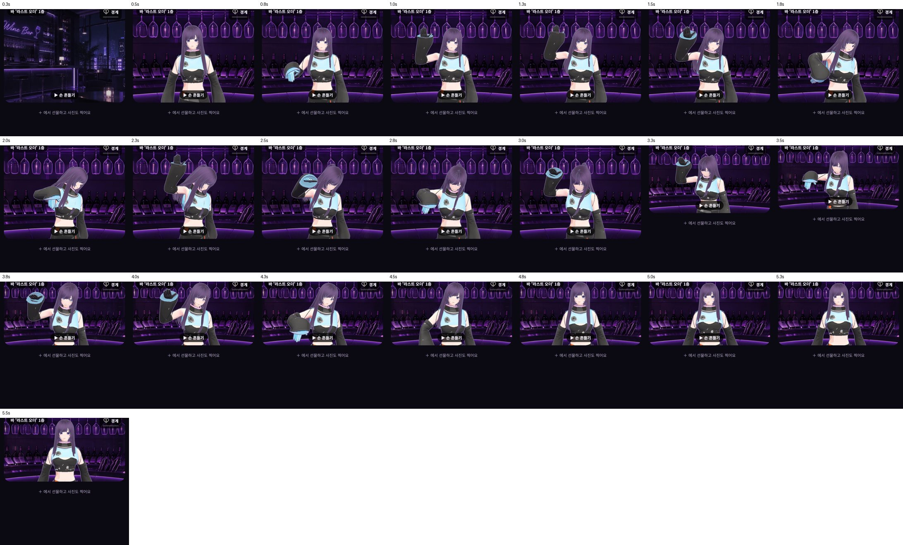
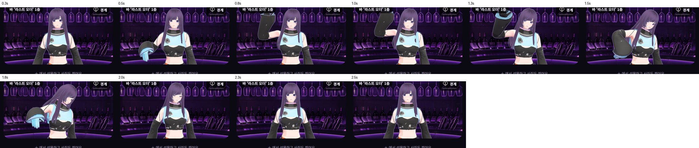
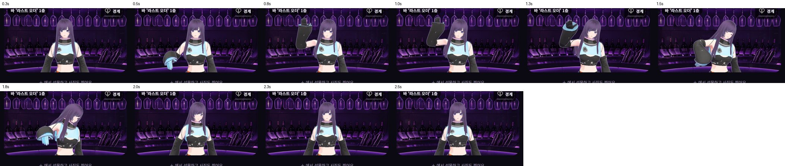
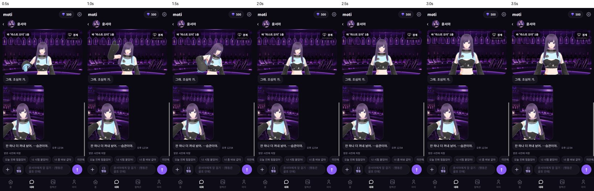
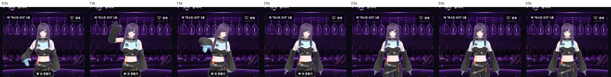
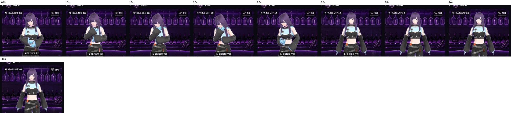
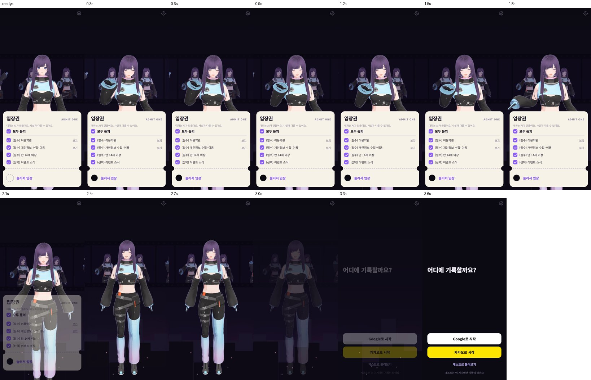
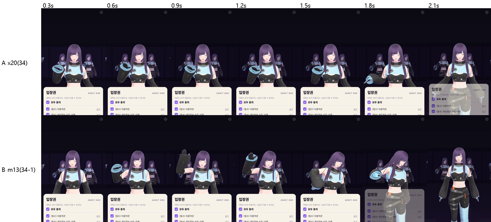
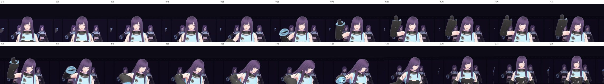
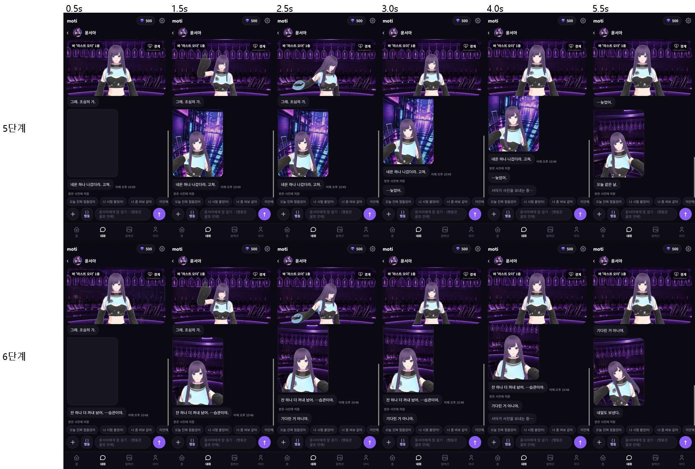

# 34 · 손 흔들며 웃기(다시 들어올 때 인사) · 입 가리고 웃기(선물 반응) · 입장권 손 인사

브랜치 `step/34-wave-shylaugh` · 커밋 `[34-A] 손 흔들며 웃기`, `[34-B] 입 가리고 웃기`, `[34-C] 입장권 손 인사`

## 파일 옮기기

- 다운로드 폴더의 `standard_Wave_and_Laugh.fbx`, `standard_Shy_Short laugh.fbx`, `standard_Wave_Hand.fbx` 를 이름 그대로 `_src/` 로 복사. FBX 는 `.gitignore` 에 막혀 저장소에 안 들어감.
- `tools/fbx2motion.mjs` 로 변환(three 는 저장소 밖 임시 폴더에 깔고 돌림, 33과 같은 방식).

| 변환 결과 | 원본 길이 | 프레임 | 뼈 | 크기 |
| --- | --- | --- | --- | --- |
| `motions/xstage_wave_and_laugh.json` | 11.74초 | 352 | 20 | 174KB |
| `motions/xstage_shy_short_laugh.json` | 8.41초 | 252 | 20 | 126KB |
| `motions/xstage_wave_hand.json` | 5.90초 | 177 | 20 | 81KB |

## 바뀐 파일

| 파일 | 내용 |
| --- | --- |
| `motions/xstage_*.json` 3개 | 새 모션(위 표). 세 파일 모두 `[34-A]` 커밋에 같이 들어감 |
| `data/motions.json` | `xstage.m13`(손 흔들기 진짜 모션), `motions.x19` 「입 가리고 웃기」(수줍음, `only: "gift"`) + `xstage.x19`(`turn` 95), `motions.x20` 「손 인사」(기쁨, `only: "onboarding"`) + `xstage.x20`. `_설명`에 `only`, `_xstage` 에 34 줄과 `turn` 설명 |
| `data/config.json` | `greet` 묶음 + `_greet` 설명, `camera.wave`·`camera.waveBig` 구도 + `_wave` 설명, `camera.byMotion.m13` = `waveBig` |
| `data/motion_keywords.json` | m13 에 `mine`(작별 인사 10개)·`mineNot`, `_설명`에 34 줄 |
| `data/collection.json` | g02 = 「입 가리고 웃기」, `play` `{m: x19, f: shy, speed: 1}`, 등급 common 그대로 |
| `data/onboarding.json` | `greet.motion` m13 → x20, `leaveMs` 1700 → 2000, `_greet` 설명 |
| `docs/drafts/9-선물-앨범-원고.md` | g02 줄 이름·재생을 같이 고침 |
| `docs/CREDITS.md` | 세 모션 출처 |
| `index.html` | `Greet`(다시 들어올 때 인사), `openRoom` 에서 부름, `send` 에서 취소, `IdleWatch` 막는 이유에 `greet`, `pickMotion` 에 내 메시지 작별 단어(⓪), `unlockedIds` 에서 `only` 몸짓 뺌, XSTAGE `turn`(세로축 돌림), 서아 초기화 때 `greet` 저장값 지움 |
| `seoaphoto.js` | `awayPending()`(부재중 사진 기다림 여부), 인사 중엔 부재중 사진이 아닌 사진을 첫 대사 자리까지 미룸 |
| `onboarding.js` | 인사 몸짓 기본값 x20, 입장권이 보일 때 인사 모션 파일을 먼저 받아 둠 |
| `docs/reports/img/34/` | 캡처 7장 |

## A · 손 흔들며 웃기 (m13)

### 재생 구간

원본: 0~3.4초 서 있다가 두 손을 앞에 모음 → 3.6~4.1초 오른손을 들어 → 4.1~4.9초 얼굴 옆에서 흔듦 → 5.0~5.4초 웃으며 몸을 숙이고 손을 가슴 앞으로 → 5.6~6.2초 손이 **얼굴을 가로지름** → 6.4~7.3초 다시 흔들기 → 7.5~7.9초 내림 → 9.3초쯤 처음 자세.

전체 구간(3.3~8.2초)을 무대에서 본 것: 

**고른 구간: 3.3~5.4초(2.1초), 처음·끝 섞기 0.5초.** 손을 들어 얼굴 옆에서 흔들고 웃으며 숙이는 데까지. 그 뒤는 손이 얼굴을 가려서 뺌. 마지막 흔들기를 이어 붙이는 이음매(`skip`)도 찾았지만 가장 작은 것이 34°(오른팔)로 원래 모션 한 프레임 빠르기(95% 21.5°)보다 커서 안 씀. 숙인 뒤 손이 가슴 앞에 내려와 있어 끝 섞기로 기본 자세에 자연스럽게 돌아감.

### 손끝이 잘리는지 → 카메라를 조금 뒤로

평소 구도(normal, 위 1.05)로 재생하면 손끝이 3D 칸 위로 잘림(1.0·1.3초):


**구간은 그대로 두고, 이 몸짓 동안만 카메라를 조금 뒤로 빼는 쪽을 고름**(흔드는 부분이 이 몸짓의 핵심이라 구간으로는 못 피함). 값은 `data/config.json camera`:

| 구도 | 위·아래·너비 | 쓰는 때 |
| --- | --- | --- |
| `wave` | 1.16 · 0.58 · 0.45 | 다시 들어올 때 인사(평소 크기 3D 칸, `greet.frame`). 0.5초 동안 옮겨 가고 몸짓이 끝나면 0.5초 동안 돌아옴 |
| `waveBig` | 1.12 · 0.40 · 0.48 | 대화 중 m13 이 나와 3D 칸이 커질 때(`byMotion`) |

처음 시험한 1.13 은 0.8초에 손끝이 칸 끝에 닿아서 1.16 으로 올림: 

### 다시 들어올 때 인사 (390px, 0.5초 간격)

6단계 · 마지막 대화 8시간 전 · 직전 인사 m15 → 이번엔 m13. 대화 기록에 부재중 사진(오후 12:54, 「잔 하나 더 꺼내 놨어.」)이 이미 그려지고 채워진 뒤 인사가 시작됨. 손끝이 3D 칸 안, 글자·이름 칩 없음.



### 대화 중(작별 인사 키워드 등) 3D 칸이 커질 때 (390px, 0.5초 간격)



### 언제 나오나 (`Greet`, `data/config.json greet`)

```json
"greet": {
  "minStage": 5, "hoursFrom": "keyMoment.reunionHours",
  "motions": { "5": ["m13"], "6": ["m13", "m15"] },
  "lineDelayMs": { "m13": 1900, "m15": 2000 },
  "face": { "m13": "joy", "m15": "soft" },
  "frame": { "m13": "wave" }, "frameMs": 500, "waitMaxMs": 10000
}
```

서아 대화방에 들어갈 때(`openRoom`) 아래가 모두 맞으면 한 번:

| 조건 | 코드에서 본 것 |
| --- | --- |
| 관계 5단계 이상 | `curStage() >= minStage` |
| 마지막 대화 뒤 6시간 이상 | 서아 방의 내 메시지·답장·선물·사진 중 가장 늦은 시각(부재중 사진은 뺌)과 **마지막 인사 시각** 중 늦은 것. 시간은 `keyMoment.reunionHours`(6) |
| 첫 만남 연출·오프닝 아님 | `S.introDone`, `busy`, `FirstMeet.isOn()` |
| 특별 에피소드 아님 | `Thread.ep()` 없음 |
| 시연 장면 아님 | `Scenes.cur()` 없음 |
| 3D 무대 준비 | 모델 준비(`Stage.readyMs`), 그림판을 안 빌려줌, 3D 칸이 보임. 안 되면 `waitMaxMs`(10초)까지 기다리고 넘기면 이번엔 안 함 |

몸짓: 그 단계 이하에서 가장 가까운 줄, 열린 몸짓만. 둘이면 직전에 쓴 것(저장값 `S.greet.last`)이 아닌 것.

### 들어올 때 지금 나오는 것(실제 코드에서 확인)과 순서

| 무엇 | 코드 | 언제 |
| --- | --- | --- |
| 부재중 사진 | `seoaphoto.js enter` | 3단계 이상·6시간 만이면 들어가는 순간 기록의 지난 시각 자리에 말풍선·사진 자리, 0.3초 뒤 그림을 만들어 채움 |
| 기다리던 사진(단계·대화 중·시연) | `seoaphoto.js check` | 대화방에 들어오면 다시 보냄(「보내는 중…」→ 사진 + 한 줄) |
| 첫 만남 연출·오프닝 | `FirstMeet`, `runIntro` | 처음 들어갈 때만 |
| 특별 에피소드 첫 장면 | `runOpening` | 에피소드 처음 시작 때만 |
| 먼저 말 걸기 | `ping` | 다른 캐릭터만(서아 아님), 180초+ 마다 헤더 한 줄 |

**다시 들어올 때 서아가 먼저 하는 대사는 지금 코드에 없음.** 그래서 인사는 몸짓만 나오고(「첫 대사가 없으면 몸짓만」), 기다리던 사진이 있으면 그 사진 한 줄을 「첫 대사」 자리로 보고 `lineDelayMs` 전에는 안 보냄.

순서: ① 대화 기록(부재중 사진 자리 포함) 그림 → ② 부재중 사진 그림이 채워지고 모션 파일·3D 가 준비될 때까지 기다림 → ③ 인사 몸짓(표정 joy/soft, 카메라 wave) → ④ `lineDelayMs` 뒤 첫 대사 자리(기다리던 사진이 있으면 이때부터, 사진은 몸짓이 끝나야 그려지므로 실제로는 몸짓 끝 바로 뒤) → ⑤ 몸짓 끝 0.2초 뒤 카메라·표정 되돌림. 시계 보기 타이머는 ①~⑤ 동안 막는 이유 `greet`, 끝난 뒤에도 기존 규칙(몸짓 끝 1.2초)으로 0부터 셈.

### 인사 확인 (가)~(바)

앱 미리보기 창(390px). 시간은 저장값의 대화 시각을 6시간 넘게 뒤로 옮겨서 확인(설정값 6시간은 그대로).

| | 한 일 | 결과 |
| --- | --- | --- |
| (가) | 4단계, 마지막 대화 7시간 전 → 들어감 | 인사 없음(`stage`) ○ |
| (나) | 5단계, 7시간 전 | m13 ○ |
| (다) | 6단계, 7시간 전 → 들어감 → 시각을 7시간 뒤로 → 다시 → 또 | m13 → m15 → m13 ○ |
| (라) | 인사 직후 홈 → 다시 대화 / 마지막 대화가 방금 | 둘 다 인사 없음(`recent`) ○ |
| (마) | 특별 에피소드 줄기에서 들어감 / 오프닝 전(첫 만남) | `episode` / `intro`, 인사 없음 ○ |
| (바) | 5단계 7시간 전, 부재중 사진과 함께 | 사진 자리 0.1초 → 사진 그림 3.15초에 채워짐 → 3.19초 m13 → 5.08초 첫 대사 자리 → 5.5초 끝 ○ |

### 작별 인사 키워드

`data/motion_keywords.json` m13 의 `mine`: 잘 자, 잘자, 갈게, 가 볼게, 가볼게, 내일 봐, 내일봐, 또 올게, 다음에 봐, 안녕. `mineNot`: 같이 갈게, 데리러 갈게, 따라 갈게, 따라갈게, 놀러 갈게, 보러 갈게.

| 보낸 말 | 단계 | 고른 몸짓 |
| --- | --- | --- |
| 잘 자(서버 몸짓 m02 를 줬다고 하고) | 5 | m13(`내 말`) ○ |
| (손을 흔들며) 내일 봐! | 5 | m13 ○ |
| 같이 갈게 | 5 | 없음 ○ |
| 잘 자 | 4 | 없음(m13 안 열림) ○ |
| 실제 보내기 「잘 자」(서버 없음 모드) | 5 | m13 재생, 3D 아래 「▶ 손 흔들기」 ○ |

## B · 입 가리고 웃기 (x19, 선물 g02)

원본 배우가 **처음부터 옆(−87°)을 보고** 찍혀 있고 끝까지 −115° 쪽으로 조금씩 돎. 그대로 넣으면 서아가 옆을 봄 → XSTAGE 항목에 `turn`(모션 전체를 세로축으로 돌리는 각도)을 새로 두고 x19 는 95°(고른 구간의 평균 방향).

원본: 0~1.3초 가슴 앞에 두 손을 모음 → 1.8~2.5초 오른손을 입으로 → 2.5초부터 끝까지 입을 가린 채 웃음(3.0~3.6초, 5.1~6.3초에 크게).

**고른 구간: 1.6~4.5초(2.9초), 처음 섞기 0.5초, 끝 섞기 0.8초.** 원본은 끝까지 입을 가린 채라 끝 섞기로 손을 내림.

선물 뽑기(시연 패널 「다음 선물 결과」 g02, 커피) — 3D 확대, 390px 0.5초 간격:



- 선물 뒤 3D 아래 이름 「▶ 입 가리고 웃기」, 컬렉션 칸 글자에 「입 가리고 웃기」 있음·「피식 웃기」 없음 ○
- 대화 몸짓 목록·서버에 보내는 목록에 안 나옴: `only` 가 있는 몸짓은 `unlockedIds()` 에서 뺌. 「전부 열기」처럼 x19·x20 을 열린 목록에 넣어도 `allowedMotions()` 에 없음 ○. 키워드 없음

## C · 입장권 손 인사 (x20)

원본: 0.1~0.5초 오른손을 얼굴 옆으로 → 0.5~1.6초 작게 흔듦 → 1.7~2.4초 내림 → 서 있기. 왼팔은 내내 내려가 있음.

**고른 구간: 0.1~2.6초(2.5초), 처음 섞기 0.3초, 끝 섞기 0.5초.** `greet.leaveMs` 1700 → **2000**: 손을 내리기 시작한 뒤 카드가 올라가며 사라지기 시작해 2.45초에 다 사라지고, 몸짓이 2.5초에 끝남.

전체 초기화(저장값 없음) → 「입장권 받기」 → 모두 동의 → 「눌러서 입장」, 390px 0.3초 간격(맨 앞은 누르기 전). 실제 시간을 1/4로 늦춰(JS 시계·타이머·CSS 전환 모두) 찍음:



| 시각 | 몸짓 | 카드 |
| --- | --- | --- |
| 0.3~1.8초 | x20 | 그대로 |
| 2.1초 | x20(손 내리는 중) | 사라지기 시작(불투명 0.95) |
| 2.4초 | x20 끝 직전 | 거의 사라짐(0.04) |
| 2.7초 | 끝 | 0, 서아 전신 |
| 3.0~3.6초 | — | 3D 어두워짐 → 로그인 |

- 흔드는 손(파란 장갑)이 소매에 가려지지 않고, 3D 칸 옆으로 안 나감 ○

## 그 밖

- 콘솔: 모든 캡처·확인에서 오류 없음(예전부터 있는 three.js `morphNormals` 경고만)
- data JSON 17개 모두 읽힘, 새 모션 3개 읽힘
- 시연 패널 몸짓 목록: m13 은 대화 칸, x19·x20 은 「아직 아무 데도 안 붙은 XSTAGE 모션」 미리보기 줄에 나와 재생 가능(33의 x18 과 같은 규칙)

## 제가 정한 것

- **m13 구간을 2.1초로 짧게:** 지시의 「2~4초」 안에서, 손이 얼굴을 가로지르는 부분을 빼려고 앞쪽 한 번의 흔들기 + 웃으며 숙이기만. 이어 붙이기는 이음매가 커서 안 씀
- **손끝 잘림은 카메라로:** 구간을 바꾸면 흔들기가 빠져서, 이 몸짓 동안만 카메라를 조금 뒤로(`wave` 1.16, `waveBig` 1.12). 인사(평소 칸)와 대화 확대(큰 칸)의 칸 비율이 달라 구도를 둘로 나눔
- **「마지막 대화」에 마지막 인사도 셈:** 대화 없이 나갔다 들어올 때마다 다시 인사하지 않게. 부재중 사진은 「내가 없던 동안」이라 마지막 대화에서 뺌
- **첫 대사:** 다시 들어올 때 서아 대사는 지금 없어서 몸짓만. 기다리던 서아 사진을 첫 대사 자리로 봄. `lineDelayMs` 는 몸짓마다(m13 1900 = 2.1초 몸짓이 거의 끝날 때, m15 2000 = 2.4초 몸짓)
- **3D 준비를 기다림:** 앱을 막 열고 바로 들어가면 3D 가 아직일 수 있어 10초(`waitMaxMs`)까지 기다리고, 넘기면 이번엔 안 함. 모션 파일을 받은 뒤에 시작(타이머가 몸짓 길이와 맞게)
- **인사 표정:** m13 joy(감정 기쁨), m15 soft. 끝나면 기분에 맞는 기본 표정(삐짐 sulky, 지침 sorrow, 그 밖 soft)
- **인사는 글자 없이:** 3D 아래 이름 칩·새 몸짓 알림·컬렉션 기록 없음(`quiet`). 그래서 인사로는 m13·m15 무빙 카드를 얻지 않음
- **작별 키워드는 내 메시지에서:** 지금 키워드는 서아 답장의 지문에서만 찾아서, 「잘 자」를 보내도 서아 지문에 손 흔들기가 없으면 안 나옴. 그래서 m13 에 `mine`(내 메시지에서 찾는 단어)을 새로 두고, 맞으면 **서버가 준 몸짓보다 먼저** 고름(작별 인사엔 손 흔들기가 확실히 나오게). 열린 몸짓·최근 3번 규칙은 그대로. 「같이 갈게」처럼 떠나는 말이 아닌 것은 `mineNot`. 「안녕」은 처음 인사로 써도 손 흔들기라 그대로 둠
- **x19·x20 을 대화에서 빼는 방법:** `data/motions.json` 에 `only`(gift·onboarding)를 두고 열린 몸짓 계산에서 뺌. x17·x18 은 33까지의 규칙대로 둠(안 바꿈)
- **g02 속도 0.8 → 1:** 0.8은 임시 재생(m01)을 느리게 하던 값이라 진짜 모션은 원래 빠르기로
- **x19 `turn` 95°:** 원본 배우의 방향이 −87°에서 −115°까지 돌아서, 고른 구간(1.6~4.5초)의 평균쯤으로. 몸이 조금 도는 것은 남김
- **입장권 인사 모션 미리 받기:** 모션 미리 받기 순서에서 x20 이 맨 뒤라, 입장권이 보일 때 따로 먼저 받음(펀치 때 받으면 몸짓이 늦게 시작해 카드 사라짐과 어긋남)
- **캡처 방법:** 인사·대화 확대·선물·입장권은 헤드리스 Chrome 390px(픽셀 비율 2)에서 JS 시계·타이머·CSS 전환을 모두 1/4로 늦춰 실제 흐름대로 찍음. 모션 구간 고르기는 시계를 1/30초씩 직접 넘겨 찍음. 확인 스크립트는 저장소 밖 임시 폴더
- 원본 FBX 셋을 `_src/` 에 이름 그대로(띄어쓰기 포함) 둠. 변환 JSON 셋은 A 커밋에 같이 들어감

## 아이폰에서 나중에 볼 것

- **인사 카메라:** 다시 들어올 때 카메라가 0.5초 동안 살짝 물러났다 돌아오는 움직임이 어색하지 않은지, 손끝이 노치·둥근 모서리에 가리지 않는지
- **인사 시작 때:** 부재중 사진 그림을 만드는 동안(32-1에서 멈칫함 확인 필요 항목) 기다렸다가 인사가 나오는데, 그 사이 기다림이 너무 길지 않은지
- **입 가리고 웃기:** 95° 돌린 모션이 확대 3D 에서 자연스러운지, 손이 얼굴에 파묻히지 않는지
- **입장권:** 손 인사와 카드 사라지기가 맞는지(아이폰에서 모션 파일 81KB 를 입장권이 보일 때 받음)
- 모션 파일 3개(합 약 380KB)가 미리 받기 목록에 들어감

---

## 34-1 · 입장권 손 인사를 「안녕」 느낌으로 · 다시 들어올 때 첫 대사

브랜치 `step/34-1-ticket-wave` · 커밋 `[34-1A] 입장권 손 인사를 안녕 느낌으로`, `[34-1B] 다시 들어올 때 첫 대사`

### A · 입장권 손 인사 → m13 으로

후보 둘을 입장권 화면 390px(픽셀 비율 2), 전체 초기화(빈 프로필) → 모두 동의 → 「눌러서 입장」으로 0.3초 간격 비교:



| 기준 | (A) x20 손 인사 | (B) m13 손 흔들며 웃기 |
| --- | --- | --- |
| 손이 얼굴 옆 높이 | ✕ 가슴~어깨 높이에서 앞으로 나옴(손을 내미는 모양) | ○ 0.7~1.2초 얼굴 옆, 손끝이 머리 위 |
| 좌우로 두 번 이상 | ✕ 손목만 조금 | △ 0.8~1.2초 바깥·안·바깥·안·바깥으로 작게 두 번(아래 0.1초 캡처) |
| 손바닥이 앞 | △ 아래·앞 | ○ 앞, 손가락이 위 |
| 얼굴을 안 가림 | ○ | ○ |
| 소매가 가슴을 크게 안 가림 | ✕ 내내 가슴 앞을 가림 | △ 흔드는 동안은 안 가림, 끝(1.4~1.8초) 웃으며 손을 내릴 때 잠깐 가림 |
| 다른 팔은 내려가 있음 | ○ | ○ |

m13 0.1초 간격(입장권, 위쪽만):



- **(B) m13 을 고름.** (A) 는 원본(5.9초)을 다시 읽어 보니 손이 가장 높을 때도 머리뼈 높이 아래(턱)이고 앞으로 나와 있어서, 어느 구간을 골라도 「얼굴 옆에서 흔들기」가 안 나옴(0.5~1.6초가 유일한 들어 올린 구간인데 34에서 이미 쓴 그 부분)
- 손끝이 입장권 3D 칸(`scene3d.frame` top 1.12) 안에 들어와서 **입장권 전용 구도는 안 둠**
- `data/onboarding.json greet` = `motion` m13, `leaveMs` 2000 → **1650**: 카드가 1650ms 에 사라지기 시작해 2100ms 에 다 사라짐 = 몸짓 끝(2.1초). 캡처로 확인(1.8초 카드 반쯤, 2.1초 다 사라지고 몸짓 끝)
- x20 은 지우지 않음(`only: onboarding` 그대로, 지금은 어디서도 안 나옴). `onboarding.js` 기본값도 m13

### B · 다시 들어올 때 첫 대사

- `data/config.json greet.lines` 에 원고 대사를 그대로(5단계 5줄, 6단계 5줄). 그 단계 이하에서 가장 가까운 줄에서 **무작위, 직전에 쓴 줄(저장값 `greet.line`)은 피함**
- 몸짓이 거의 끝날 때(`lineDelayMs`: m13 1900, m15 2000) 서아 말풍선으로 대화 기록에 들어감(`{r:"c", greet:true}`). 서버로 보내는 대화 기록(`history`)에도 서아 말로 들어감
- 서버를 따로 부르지 않음. 내 메시지 수(`S.bond`)·판정 버퍼(`S.judgeBuf`)·호감은 안 바뀜(확인: 한 줄 뒤 bond 0·judgeBuf 0 그대로, 그다음 내 메시지 때 1씩)
- 기다리던 서아 사진(부재중 사진 빼고)은 **한 줄 뒤 `photoAfterMs`(1200ms)** 까지 미룸 → 한 줄 → 사진

순서 확인(390px, 8시간 뒤 다시 들어감, 기다리던 사진 하나):



| 단계 | 0.03초 | 0.6초 | 2.5초 | 5.2초 |
| --- | --- | --- | --- | --- |
| 5 | 부재중 사진 자리 | 인사 m13 시작 | 「…늦었어.」 | 기다리던 사진(3.7초쯤 「보내는 중」) |
| 6 | 부재중 사진 자리 | 인사 m13 시작(직전 m15) | 「기다린 거 아니야.」 | 기다리던 사진 |

여러 번 다시 들어가기(같은 화면에서 시각을 8시간씩 돌림):
- 6단계 6번: 보고 싶었다는 말은 안 해 → 늦었잖아. …앉아 → 보고 싶었다는 말은 안 해 → 기다린 거 아니야 → 자리, 그대로 있어 → 왔다 (몸짓 m13·m15 번갈아, m15 도 한 줄 나옴)
- 5단계 5번: 왔어? 앉아 → 또 왔네 → …늦었어 → 왔어? 앉아 → 왔네
- 연달아 같은 줄은 한 번도 안 나옴

서버로 가는 기록(그다음 내 메시지 때 `/chat` 의 `history` 끝 넷):

```
유저: 내일 또 올게
서아: 그래. 조심히 가.
서아: (서아가 바 옥상에서 찍은 사진을 보냈다. 함께 보낸 말: "또 혼자 옥상.")   ← 부재중 사진 메모
서아: 기다린 거 아니야.                                                         ← 인사 한 줄
```

- **답장이 그 한 줄에 이어지는지는 못 봄:** 2026-11-25 배포 서버 `/chat` 이 매번 15초 뒤 「…」(서버 대체 응답)만 돌려줌. 인사 한 줄을 뺀 예전 모양 기록으로 보내도 똑같아서 이번 변경 때문은 아님(직접 요청 6번 모두 같음). 앱은 그때 예시 대사로 넘어감. 서버가 되살아나면 다시 봐야 함

### 바뀐 파일

| 파일 | 내용 |
| --- | --- |
| `data/onboarding.json` | `greet.motion` x20 → m13, `leaveMs` 2000 → 1650, `_greet` |
| `onboarding.js` | 인사 몸짓 기본값 m13 |
| `data/motions.json` | `_xstage` 에 34-1(입장권 m13, x20 남겨 둠) |
| `data/config.json` | `greet.lines`(원고 그대로), `greet.photoAfterMs` 1200, `_greet` |
| `index.html` | `Greet`: `pickLine`·`say`(한 줄 넣기), 사진 미루기를 한 줄 뒤 `photoAfterMs` 까지. `send`: 다시 만남 신호에서 인사 한 줄을 뺌. `photoNote`: 부재중 사진 메모를 인사 한 줄 앞에 |
| `seoaphoto.js` | 주석 |
| `docs/reports/img/34/34-1_*` | 캡처 3장 |

### 그 밖

- 콘솔 오류 없음(입장권, 5·6단계 다시 들어가기, 여러 번 들어가기, 보내기)
- data JSON 모두 읽힘

### 제가 정한 것

- **입장권 = (B) m13:** 기준 여섯 중 (A) 는 셋을 못 맞추고 고칠 구간이 원본에 없음. (B) 는 끝에 웃으며 손을 내릴 때 소매가 잠깐 가슴을 가리고 좌우 흔들기가 작지만, 「안녕」으로 보이는 쪽은 분명히 (B)
- **입장권 구도는 그대로:** 손끝이 안 잘려서 입장권 전용 값을 안 만듦
- **`leaveMs` 1650:** 카드가 다 사라지는 때(1650+450)를 몸짓 끝 2.1초에 맞춤. 손을 내리며 웃기 시작한 뒤(1.3초~) 카드가 올라감
- **한 줄과 사진 사이 1200ms(`photoAfterMs`):** 한 줄을 읽을 틈. 사진은 그 뒤 원래대로 「보내는 중」(1.5초)을 거쳐 나옴. 인사가 끝나도 이 미루기는 이어지고, 내가 메시지를 보내면 풀림
- **한 줄의 표시:** 지문 없는 서아 말풍선 하나(대사만). 표정은 인사 몸짓 표정 그대로
- **다시 만남 신호(17-1B)에서 인사 한 줄은 안 셈:** 세면 그다음 내 메시지가 「오랜만」이 아니게 돼서 다시 만남 연출(카메라·게이지 반짝임)이 사라짐. 인사 한 줄은 「마지막 대화」(다음 인사 판단)에는 들어감 — 마지막 인사 시각과 같아서 결과는 34와 같음
- **서버 기록 순서:** 부재중 사진 메모는 예전처럼 기록 맨 끝에 붙으면 「인사 한 줄 → 사진」 순서가 돼서, 사진이 인사보다 먼저일 때는 인사 한 줄 앞에 넣음(화면 순서와 같게). 대화 중 사진은 그대로 끝에
- **줄 고르기:** 34의 몸짓 후보와 같이 「그 단계 이하에서 가장 가까운 줄」(7단계가 생겨도 6단계 줄을 씀). 후보가 한 줄뿐이면 그 줄을 다시 씀
- **턴·판정:** 한 줄은 `S.bond`·`S.judgeBuf` 에 안 들어가고, 판정 요약(`recent`)의 대화 기록에는 기록이라서 들어감. 반복 방지용 `recent_lines`(서아 최근 응답 셋)에도 안 넣음(서버 답장이 아니라서)

### 아이폰에서 나중에 볼 것

- **입장권:** m13 손끝이 입장권 3D 칸 위·노치에 가리지 않는지, 손 흔들기와 카드 사라지기가 맞는지(모션 파일 178KB 를 입장권이 보일 때 받음 — x20 81KB 보다 큼)
- **다시 들어올 때:** 한 줄이 나올 때 대화 칸이 아래로 잘 내려가는지, 한 줄과 사진 사이(1.2초)가 어색하지 않은지
