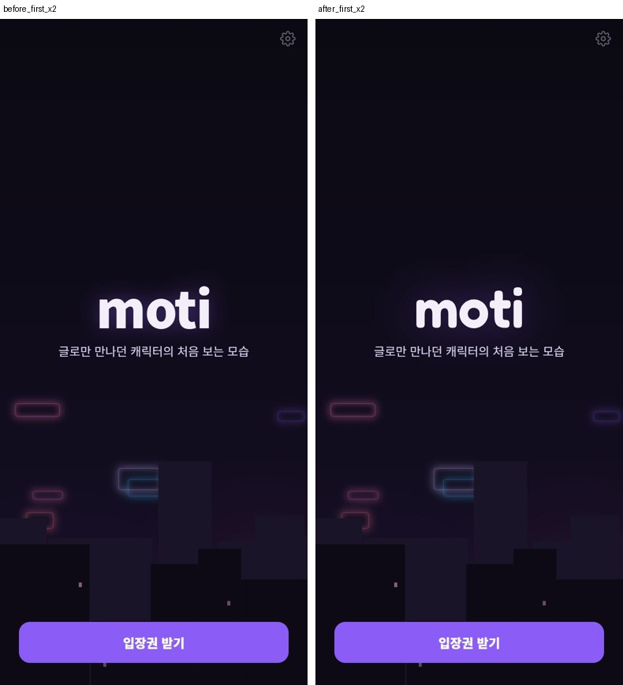
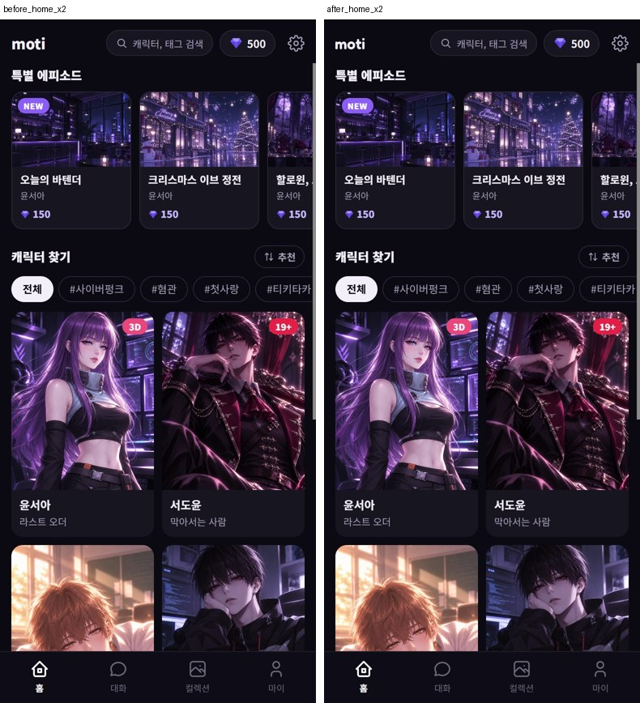
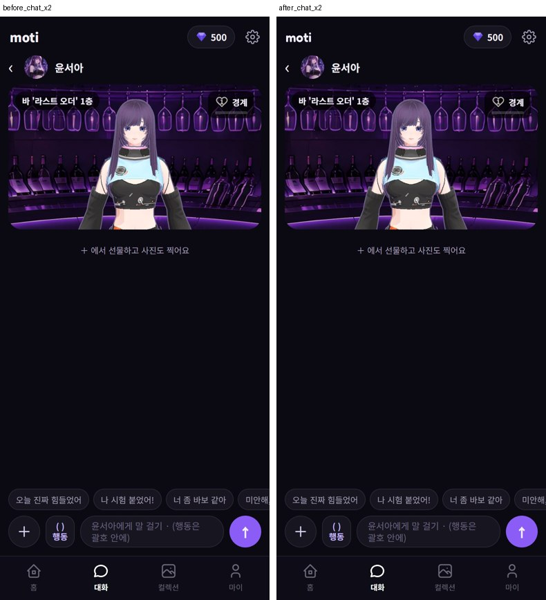
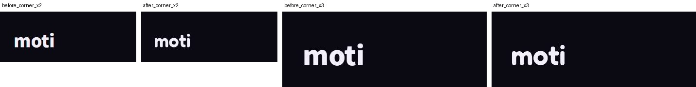
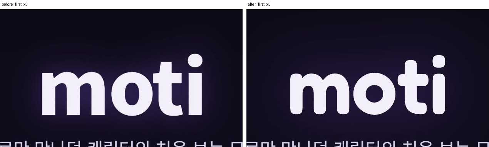
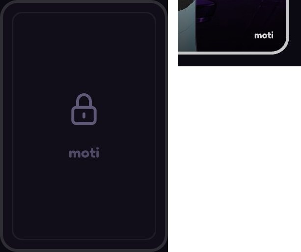

# 35 · moti 로고를 둥근 글꼴(Fredoka)로

브랜치 `step/35-logo` · 커밋 `[35] moti 로고를 둥근 글꼴로`

## 글꼴 파일

- Google Fonts CSS(`family=Fredoka:wght@600`)가 알려 준 정적 SemiBold(600) TTF 를 fonts.gstatic.com 에서 받아 `_src/Fredoka-SemiBold.ttf`(48KB)로 둠. 글꼴 안 이름 「Fredoka SemiBold」, SIL OFL 1.1
- `_src/` 는 지금까지 `.fbx` 만 막혀 있었고 `.ttf` 는 안 막혀 있어서 `.gitignore` 에 `_src/` 를 통째로 넣음

## 지금 「moti」 로고가 나오는 곳(코드에서 찾음)

| 자리 | 코드 | 바꿈 |
| --- | --- | --- |
| 시작 화면 가운데 로고(빛 효과) | `onboarding.js` `#obLogo`(문구 `data/onboarding.json first.logo`), `onboarding.css .oblogo` | ○ |
| 홈·대화·컬렉션·마이 왼쪽 위 | `index.html` `header h1`(탭 모두 같은 머리) | ○ |
| 잠긴 무빙 카드 뒷면의 작은 moti | `cards.js`(`ui.json album.card.back`), `cards.css .mcmo` | ○ |
| 무빙 카드 공유 그림 오른쪽 아래 moti | `cards.js shareImage`(캔버스 글자, `ui.json album.card.mark`) | ○ (캔버스에 같은 경로를 그림) |
| 사진 공유 그림의 「moti · 윤서아」 | `photos.js` | 안 바꿈: 캐릭터 이름과 이어진 한 줄 글자라서 |
| 이전 앱 `v1.html` 머리 | `v1.html` | 안 바꿈: 예전 버전 보존 |
| 탭 제목 `<title>moti</title>`, 파일 이름 `moti-….jpg` | | 글자라서 그대로 |

## 바뀐 파일

| 파일 | 내용 |
| --- | --- |
| `tools/logo2svg.mjs` | 새 스크립트. opentype.js 로 「moti」를 경로로, 글자 간격 −1%(글자 크기의 0.01만큼 좁힘), `fill="currentColor"`, 글자 테두리에 딱 맞는 viewBox, 좌표 소수 한 자리 |
| `assets/logo_moti.svg` | 결과(2.6KB). viewBox `40 -718 1901 735`(가로세로 2.586), 경로 하나 |
| `index.html` | `.logo`(SVG 를 마스크로, 색 = 글자색 `currentColor`), `.sr`(안 보이는 글자), 헤더 `<h1>` 을 로고 그림으로 |
| `onboarding.css` | 빛 효과 `text-shadow` → `filter: drop-shadow`(같은 색 `#8b5cf666`, 같은 번짐 24px), 로고 높이 52px |
| `onboarding.js` | 시작 화면 로고를 그림으로(`logoMark`, 이름은 데이터 `first.logo`) |
| `cards.js` · `cards.css` | 카드 뒷면 작은 moti 를 그림으로(높이 7.5px), 공유 그림의 moti 를 같은 경로로 그림(못 읽으면 예전 글자) |
| `data/collection.json` | `card.share.logoK` 0.8(공유 그림 로고 높이 = 카드 너비 × markK × logoK) |
| `docs/CREDITS.md` | Fredoka(SIL OFL 1.1, Google Fonts), opentype.js(MIT, 도구만) |
| `.gitignore` | `_src/` |
| `docs/reports/img/35/` | 캡처 6장 |

## 넣는 방법

- 로고 자리: `moti`. 화면 읽기는 「moti」 그림 하나로 읽고, 안의 `.sr` 글자는 화면에 안 보이는 검색·복사용
- `.logo` 는 SVG 를 CSS 마스크로 씌우고 바탕을 `currentColor` 로 칠함 → 로고 색은 예전처럼 글자색(`#f2effa`, 카드 뒷면 `#4f4866`)을 따름. 글꼴 파일·자바스크립트 없이 그려짐(아이폰용 `-webkit-mask` 같이 씀)
- 자리: 그림 아래 끝을 글자 기준선에 둠(`vertical-align: baseline`) → 예전 글자와 같은 줄 높이·같은 기준선. 로고 칸 높이(시작 화면 64px, 헤더 26px)는 그대로라 아래 소개 글·헤더 다른 칸 위치가 안 바뀜

## 크기 (390px, 잉크 = 실제로 칠해진 부분)

| 자리 | 예전 글자 | 새 로고 | 정한 값 |
| --- | --- | --- | --- |
| 시작 화면 | 138.5 × 53.5px (글자 64px) | 133.5 × 51.5px | 높이 **52px** |
| 헤더 | 39 × 14.5px (글자 18px) | 35.5 × 13.5px | 높이 **14px** |
| 카드 뒷면 | (글자 10px) | 19.4 × 7.5px | 높이 **7.5px** |
| 카드 공유 그림 | 글자 카드 너비 × 0.03 | 높이 = 그 × 0.8 | `logoK` 0.8 |

같은 높이면 가로도 거의 같지만(시작 화면 138px) Fredoka 가 더 둥글고 도톰해 같은 높이에선 더 커 보여서 높이를 약 3%(시작 화면 53.5 → 52, 헤더 14.5 → 14) 줄임.

## 확인

### 전·후 (390px, 픽셀 비율 2)

시작 화면 — 위치·빛 효과 그대로:

홈:

대화 화면:

### 흐림·깨짐 (픽셀 비율 2배·3배)

왼쪽 위 로고(왼쪽부터 예전 ×2, 새 ×2, 예전 ×3, 새 ×3):

시작 화면 로고 ×3 확대(왼쪽 예전, 오른쪽 새). 가장자리가 매끄럽고 보라 빛이 같은 넓이로 번짐:

- 빛 효과: 계산된 스타일이 예전 `text-shadow: rgba(139,92,246,.4) 0 0 24px` → 지금 `filter: drop-shadow(rgba(139,92,246,.4) 0 0 24px)`

### 카드 뒷면 · 공유 그림 (×3)

### 그 밖

- 콘솔 오류 없음(시작 화면 → 홈 → 대화, 컬렉션, 카드 공유 그림 만들기). 헤드리스 Chrome 새 프로필(캐시 없음)
- data JSON 모두 읽힘
- 화면 읽기 이름: 헤더·시작 화면·카드 뒷면 로고 모두 `role="img"`, `aria-label="moti"`

## 제가 정한 것

- **글꼴 받은 곳:** Google Fonts 가 주는 정적 600 TTF(굵기 600 만 든 파일이라 가변 글꼴에서 굵기를 따로 고를 필요가 없음)
- **SVG 를 쓰는 방법 = CSS 마스크:** `fill="currentColor"` 는 `` 로 넣으면 CSS 색을 못 따름. 그림을 HTML 안에 직접 넣으면 경로가 두 곳에 생겨서, 파일 하나(`assets/logo_moti.svg`)를 마스크로 씌우고 글자색으로 칠함. 빛은 로고를 감싼 칸(`.oblogo`)에 `drop-shadow`(마스크보다 바깥이라 빛이 잘리지 않음)
- **글자 간격 −1%:** 글자 크기(em)의 1%를 글자 사이마다 뺌(CSS `letter-spacing: -0.01em` 과 같은 뜻). 글꼴의 커닝은 그대로 씀
- **크기:** 시작 화면 52px, 헤더 14px(위 표). 같은 높이보다 조금 줄임
- **찾은 다른 로고 자리:** 카드 뒷면 작은 moti, 카드 공유 그림의 moti 도 바꿈. 사진 공유의 「moti · 윤서아」(이름과 붙은 글자 줄)와 `v1.html`(예전 앱)은 그대로
- **공유 그림:** 캔버스에는 마스크를 못 써서 SVG 파일의 경로(`d`)를 읽어 같은 모양을 그림. 파일을 못 읽으면 예전 글자로
- **`_src/` 통째로 무시:** 원본 파일(.fbx·.ttf)만 두는 곳이라
- opentype.js 는 저장소에 안 넣고 저장소 밖 임시 폴더에 깔아 돌림(`tools/fbx2motion.mjs` 와 같은 방식, 쓰는 법은 스크립트 맨 위)

## 아이폰에서 나중에 볼 것

- 사파리에서 `-webkit-mask` 로고가 선명한지(레티나 3배), 처음 열 때 로고가 잠깐 안 보이는 순간이 없는지(SVG 2.6KB 를 받는 동안)
- 시작 화면 보라 빛(`drop-shadow`)이 예전 글자 그림자와 같은 세기로 보이는지
- 헤더 로고가 💎·알림 줄과 높이가 맞는지
