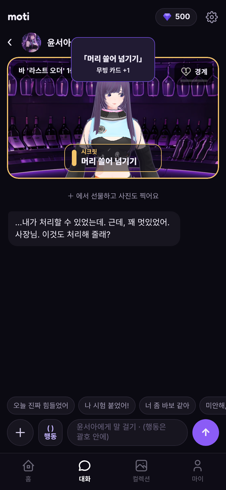
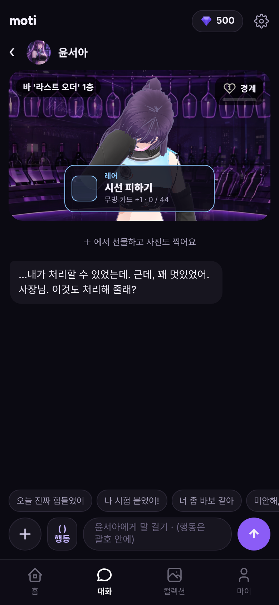
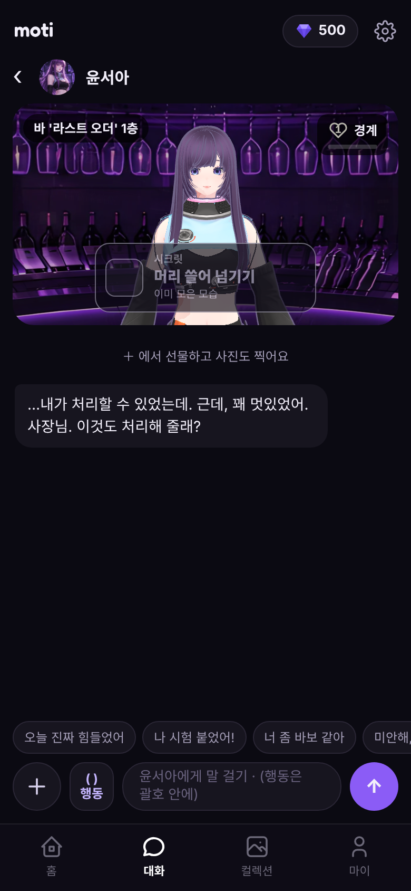

# 36 · 시크릿 알림 카드: 무대 어둡게 대신 금색 테두리 + 작은 카드

브랜치 `step/36-secret-card` · 커밋 `[36] 시크릿 알림 때 무대 안 어둡게, 금색 테두리와 작은 카드`

## 왜

대화 중 시크릿 몸짓을 처음 얻으면 알림 카드가 뜨는 2.6초 동안 무대 전체(서아 포함)가 45% 어두워져서(`data/collection.json notify.special.dim 0.45`) 몸짓이 잘 안 보였음. 390px 캡처에서 무대 평균 밝기 50 → 28. 그냥 몸짓만 나올 때는 밝기가 안 바뀜. 기획자가 시안 A·B·C 중 C를 고름.

## 바뀐 것

- 시크릿 알림 때 무대를 어둡게 하지 않음(`dim` 0)
- 대신 카드가 떠 있는 동안 무대 가장자리에 등급 색(금색 `#f5c66b`) 2px 선
- 시크릿 카드를 작게: 가로 210 → 168px, 두 줄(등급 · 몸짓 이름), 셋째 줄(무빙 카드 +1 · n / 전체) 숨김, 왼쪽 빈 네모 → 등급 색 막대, 바탕 85% → 55%

레어 카드, 이미 모은 몸짓 카드(흐린 회색)는 그대로.

## 바뀐 파일

| 파일 | 내용 |
| --- | --- |
| `data/collection.json` | `notify.special`: `dim` 0.45 → 0, `edge` true, `compact` true. `notify.card`: `compactWidthPx` 168, `compactBg` `rgba(13,11,22,0.55)`, `edgePx` 2. `_notify` 설명 보탬 |
| `index.html` | CSS `.gradefx.edge`(안쪽 선, 무대 둥근 모서리 따라감), `.gradefx.lite`(작은 카드). `gradeFx()` 가 등급의 `edge`·`compact` 를 보고 클래스를 켬(이미 모은 몸짓 카드에는 안 켬), 값은 `notify.card` 에서 |
| `docs/reports/img/36/` | 캡처 3장 |

## 캡처 (390px)

| 시크릿 새 몸짓 | 레어 새 몸짓(그대로) | 시크릿 이미 모음(그대로) |
| --- | --- | --- |
|  |  |  |

캡처의 「0 / 44」는 테스트용 빈 저장 상태라서임.

## 제가 정한 것

- 작은 카드·테두리는 시크릿에만 켬. 레어도 켜려면 `notify.rare` 에 `edge`·`compact` 를 true 로 넣으면 됨
- 셋째 줄 숨김은 화면에서만. 모은 개수는 컬렉션 화면에서 봄
- 테두리는 블러·그림자 번짐 없는 `box-shadow: inset 0 0 0 2px`(선만)
- 이미 모은 몸짓 카드(선물에서 겹친 것)는 시크릿이어도 예전 흐린 카드 그대로, 테두리 없음

## 확인할 것

- 아이폰 사파리: 무대 둥근 모서리(20px)를 따라 금색 선이 깔끔하게 그려지는지, 카드가 올라오고 사라질 때 선이 같이 나타나고 사라지는지
