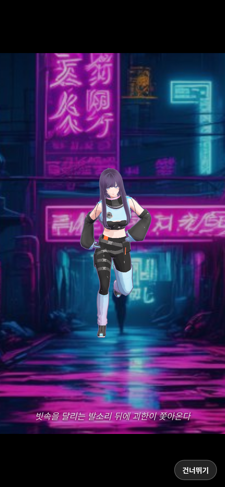
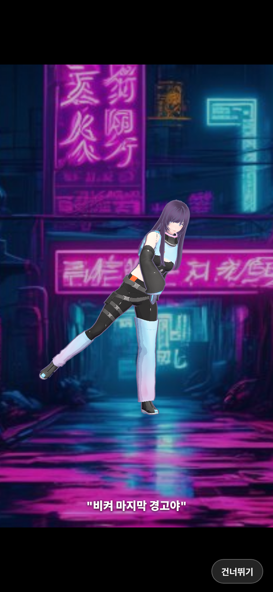
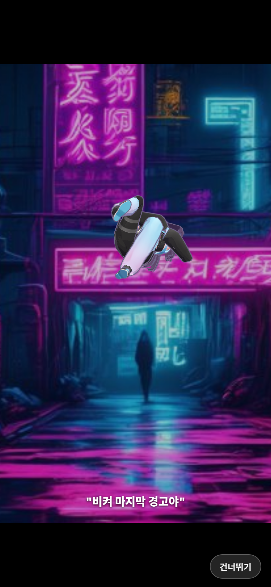
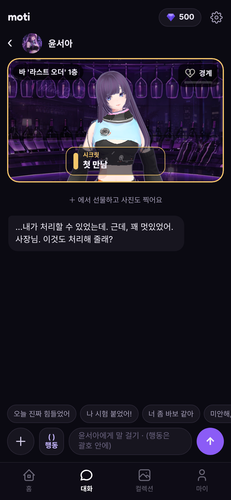

# 37 · 첫 만남 연출에 골목 프롤로그(쫓김 → 경계 → 돌려차기) + 자막

브랜치 `step/37-alley-prologue` · 커밋 `[37] 첫 만남 연출을 골목 프롤로그로(달리기·자막)`

원고: [docs/drafts/37-골목-프롤로그-원고.md](../drafts/37-골목-프롤로그-원고.md) (장면 3개, 사장님 등장 안 함, 끝은 바 1층 → 기존 오프닝)

## 흐름 (처음 시작 때 한 번, 약 9.5초, 건너뛰기 그대로)

| 장면 | 장소 | 몸짓 | 자막 | 길이 |
| --- | --- | --- | --- | --- |
| 1 | 비 내리는 골목 | x21 뒤돌아보며 달리기(새로 넣음) | *빗속을 달리는 발소리 뒤에 괴한이 쫓아온다* | 2.6초 |
| 2 | 〃 | x16 몸 낮춰 경계하기 | *막다른 벽, 서아가 천천히 돌아선다* | 1.8초 |
| 3 | 〃 | x17 돌려차기 | "비켜 마지막 경고야" | 2.8초 |
| 끝 | 바 '라스트 오더' 1층 | 대기 자세로 일어섬 → 무대가 대화 화면 크기로 | (기존 오프닝 10문단 그대로) | |

## 캡처 (390px)

| 1 달리기 | 2 경계 | 3 돌려차기 | 끝 바 1층 |
| --- | --- | --- | --- |
|  |  |  |  |

끝 캡처의 「시크릿 · 첫 만남」 카드는 원래 있던 첫 만남 무빙 카드(31단계)예요.

## 바뀐 파일

| 파일 | 내용 |
| --- | --- |
| `motions/xstage_run_look_back.json` | 새 모션. 기획자가 준 `[standard] run_look back.fbx` 변환(2.95초, 뼈 20개) |
| `data/motions.json` | x21 「뒤돌아보며 달리기」(emo 긴장, only prologue), xstage x21(`inPlace`: 원본이 앞으로 골반 높이의 약 9배를 달림) |
| `data/config.json` | `firstMeet.scene` 2(네온 골목) → 3(비 내리는 골목). 고정 순서(kick·alert·kickSec·alertFrom·alertBlendMs·alertSec·yawTo·orbitMs) → `beats` 장면 목록. `_firstMeet` 설명 보탬 |
| `data/seoa_intro.json` | `prologue.lines` 자막 3줄 + `_prologue` 설명 |
| `index.html` | `FirstMeet`: `beats` 를 차례로(몸짓·자막·카메라), 자막 줄 `.fmcap`(지문은 흐린 기울임, 대사는 굵게, 아래 띠 바로 위). `beats` 가 없으면 31단계 순서로 |
| `data/ui.json` | `_firstMeet` 설명(이제 자막이 나옴) |
| `docs/CREDITS.md` | x21 출처 |
| `docs/reports/img/37/` | 캡처 4장 |

## 제가 정한 것

- **맞춤법:** 원고 「쫒아온다」 → 「쫓아온다」만 고침. 나머지는 원고 그대로(문장 끝 마침표 없음)
- **장소:** 원고대로 비 내리는 골목. 이 장소는 360도 그림이 없어 평평한 배경이에요(전에 쓰던 네온 골목은 360도). 카메라가 살짝 돌 때 배경은 같이 안 돌아요
- **「돌아선다」:** 몸 전체를 뒤로 도는 모션이 없어서, 달리기(카메라 쪽으로 오며 뒤를 돌아봄) 다음에 카메라 쪽을 본 채 몸을 낮추는 경계 자세로 이음. 이때부터 카메라가 괴한들 쪽 시점인 것처럼 보임
- **달리기 길이:** 한 번(2.6초). 끝 섞기를 0.3초로 짧게 해서 서지 않고 바로 경계 자세로 넘어가게 함(기본 1초면 중간에 똑바로 서는 순간이 생겼음)
- **자막 모양:** 전체 화면 아래쪽 검은 띠 바로 위 가운데. 지문은 별표를 빼고 흐린 기울임, 대사는 따옴표째 굵게. 자막이 장면마다 0.35초 페이드
- **첫 만남 무빙 카드:** 그대로(x17). 카드에 기록되는 장소는 이제 비 내리는 골목
- x21 은 프롤로그 전용: 컬렉션 칸·키워드·단계 해금에 안 붙임

## 서버 프롬프트 (서버 담당에게)

원고의 한 줄을 `seoa-backand` `yoon_seoa_prompt.md` 의 OPENING 앞(서아가 아는 오늘 밤 일)에 넣어 주세요. 이 저장소에서는 바꿀 수 없어요.

> 오늘 밤 골목에서 괴한에게 쫓기다 싸워서 손등에 피가 묻은 채 바에 왔다

## 확인할 것

- 아이폰 사파리: 달리기 → 경계 섞임, 자막 페이드와 아래 띠 위치(홈 표시줄 있는 기종), 모션 파일이 하나 늘어서(46KB) 연출 시작 전 기다림
- 건너뛰기: 이 환경에서 확인함(누르면 자막이 사라지고 바 1층 대화 화면으로 바로)
