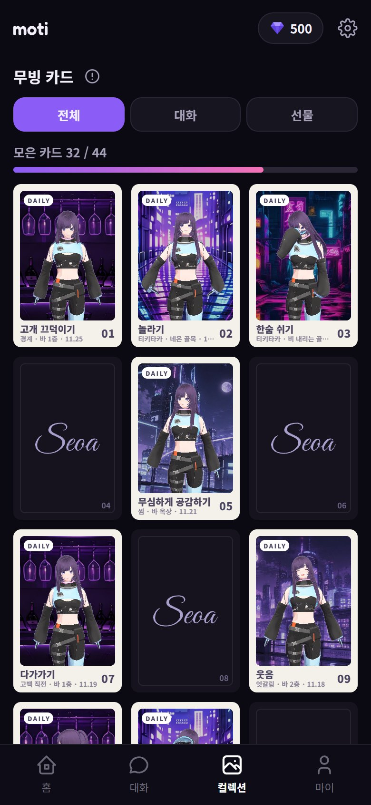
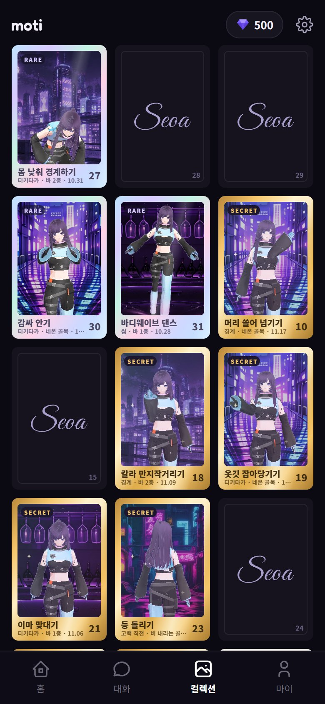
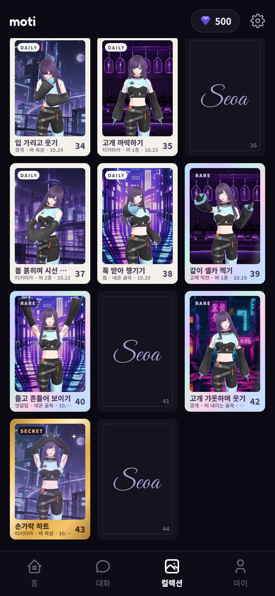
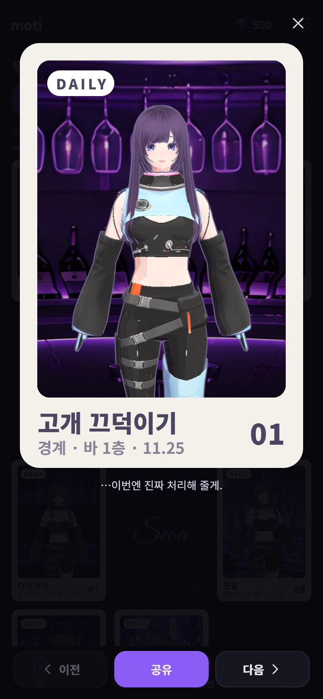
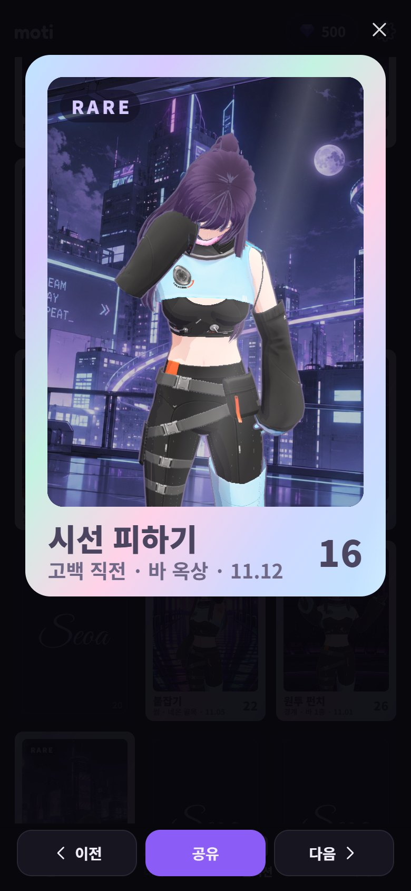
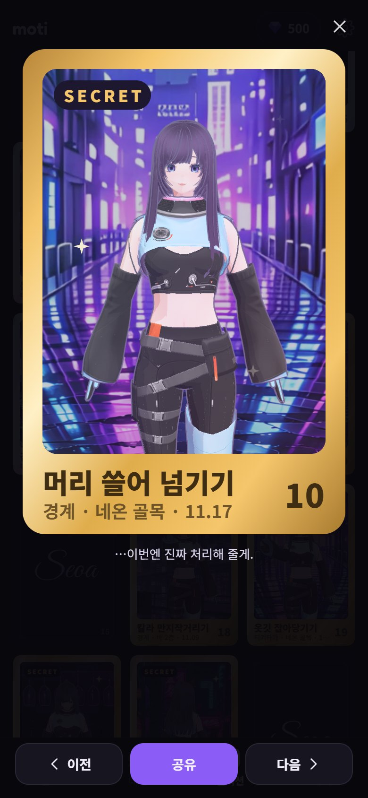
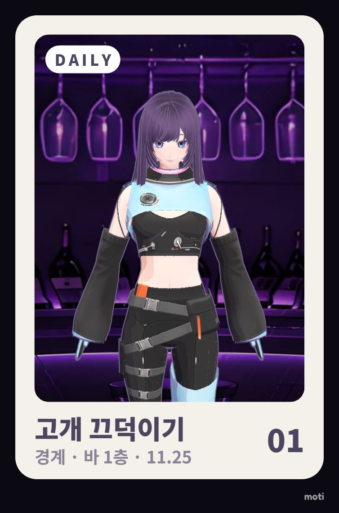
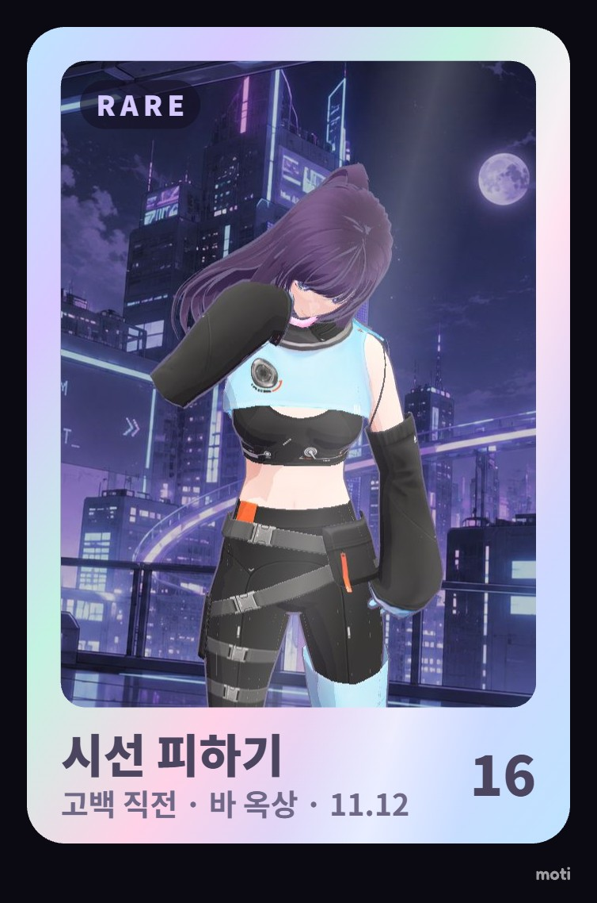
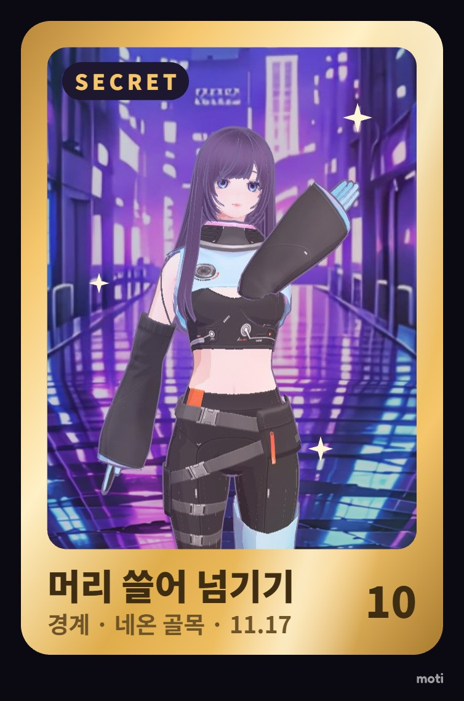

# 38 · 무빙 카드를 포토카드처럼

브랜치 `step/38-photocard` · 커밋 `[38] 무빙 카드를 포토카드처럼`

카드 그림을 찍는 방식(처음 본 순간의 의상·장소, 600×900), 카드 크게 보기의 3D 반복 재생, 36 시크릿 알림은 그대로.

## 바뀐 파일

| 파일 | 내용 |
| --- | --- |
| `cards.js` | 칸 모양을 포토카드로(`cell`), 데이터 → CSS 값(`vars`), 등급별 사진 위 효과(`fx`), 아래 띠 작은 줄(`bandLine`), 뒷면 영문 이름(`backName`). 크게 보기 안을 같은 포토카드 구조로, 아래 글은 대사만. 공유 그림(`shareImage`)을 포토카드 그대로 다시 그림. 크게 보는 동안 뒤 목록 빛 멈춤(`.app.cvon`) |
| `cards.css` | 목록 칸 전체를 포토카드로(테두리·둥근 사진·등급 표·아래 띠·번호·뒷면·빛 움직임·「동작 줄이기」). 크게 보기 테두리 규칙을 목록과 같게 |
| `index.html` | 진행 줄을 「모은 카드 {n} / {total}」 한 줄로, 잠긴 칸 힌트 토스트 삭제 |
| `data/collection.json` | `items[].no` 카드 번호(01~44, 지금 순서), `grades.*.card` 등급별 포토카드 색·빛, `card.photocard` 모양 비율, `card.back` 뒷면 색. 예전 `card.look`(26-1 테두리 색) 삭제 |
| `data/ui.json` | `album.collected`, `album.card.tag`(DAILY·RARE·SECRET), `band`·`mmdd`(아래 띠), `backAria`. 안 쓰게 된 `album.progress`·`album.hint`·`card.unseen`·`card.back`·`card.info`·`card.date` 삭제. 소개 창 아래 줄에서 「잠긴 카드를 누르면 힌트가 보여요.」 문장 뺌 |
| `data/characters.json` | 서아 `nameEn: "Seoa"` |
| `data/seoa_story.json` | 장소 0·1에 `short`(아래 띠용 짧은 이름 「바 1층」「바 2층」) |
| `tools/logo2svg.mjs` | `--font --text --track --out` 로 글꼴·글자를 고를 수 있게(인자 없이 돌리면 예전 로고 그대로 — 다시 만들어 같은 결과 확인). 글꼴 대체 규칙을 opentype.js 가 못 읽으면 글자마다 기본 글리프로 |
| `tools/build_collection.mjs` | 칸을 다시 만들어도 `no` 를 id 로 지킴. 새 칸은 가장 큰 번호 다음, 없어진 칸 번호는 `retiredNo` 에 남겨 다시 안 씀(지금 돌리면 파일이 한 글자도 안 바뀜) |
| `assets/name_seoa.svg` | 새 파일. Great Vibes 「Seoa」 경로 하나, `fill="currentColor"`, 3.6KB, 가로세로 2.09 |
| `docs/CREDITS.md` | Great Vibes(SIL OFL 1.1) |
| `docs/reports/img/38/` | 캡처 9장 |

## 모양

| 자리 | 내용 |
| --- | --- |
| 테두리 | 사진 둘레 카드 너비의 6.25%(목록 칸 114px 에서 7px), 카드 모서리 7%, 사진 모서리 4.5% |
| 아래 띠 | 높이 카드 너비의 25%. 왼쪽 이름(한 줄) / 작은 줄 「관계 단계 · 처음 본 장소 · MM.DD」, 오른쪽 번호 두 자리. 넘치면 「…」 |
| 등급 표 | 사진 왼쪽 위. 일반 `DAILY` 흰 바탕·진한 보라회색 글자, 레어 `RARE` 어두운 반투명 바탕·연보라 글자, 시크릿 `SECRET` 진한 바탕·금색 글자. 자간 0.18em |
| 일반 | 크림색 `#f4f1ea` 무광, 글자 `#4b4560` |
| 레어 | 하늘·연보라·민트·분홍 그라데이션 테두리, 테두리 위 반짝임 한 줄, 사진 위 아주 옅은 빛 한 줄(흰색 20%) |
| 시크릿 | 금박 그라데이션 테두리(36 금색 `#f5c66b` 가운데), 테두리 위 반짝임, 사진 전체 옅은 오로라(민트·보라·분홍 12~16%), 작은 반짝이 3개 |
| 뒷면(아직 모으지 않은 칸) | 어두운 바탕 + 안쪽 얇은 선, 가운데 「Seoa」(`#a99fcc`, 카드 너비 60%), 오른쪽 아래 작은 번호. 문구·자물쇠·moti·등급 표 없음. 누를 수 없는 칸(`div`) |

크기는 모두 카드 너비 비율이라 목록(114px)·크게 보기(342px)·공유 그림(660px)이 같은 모양. 목록 칸에서는 글자가 너무 작아지지 않게 가장 작은 크기만 둠(이름 10px, 작은 줄 7px, 번호 11px, 등급 표 6.5px).

빛 움직임은 CSS 만(`transform`·`opacity`), 레어 7초·시크릿 9초에 한 번 지나감. `filter`·블러·그림자·`mix-blend-mode` 안 씀.

## 캡처 (390×844, 픽셀 비율 2)

| 컬렉션 맨 위 | 레어·시크릿 섞인 곳 | 잠긴 칸 섞인 곳(선물 묶음) |
| --- | --- | --- |
|  |  |  |

| 크게 보기 · 일반 | 크게 보기 · 레어 | 크게 보기 · 시크릿 |
| --- | --- | --- |
|  |  |  |

| 공유 그림 · 일반 | 공유 그림 · 레어 | 공유 그림 · 시크릿 |
| --- | --- | --- |
|  |  |  |

캡처의 모은 카드·날짜·장소·단계는 시험용으로 넣은 저장값(44칸 중 12칸을 비움). 크게 보기 아래 대사 「…이번엔 진짜 처리해 줄게.」는 **캡처용 임시 글**이고 저장소 데이터에는 없음.

## 확인 (헤드리스 Chrome 390×844 + 앱 미리보기)

- **잠긴 칸 누르기:** 뒷면 칸은 `div`. 누른 뒤 토스트·작은 창·크게 보기 모두 안 뜸
- **「동작 줄이기」:** 켜기 전 `animation-name` 레어 테두리 `pcsheen`·빛 `pclight`, 시크릿 `pcsheen`·`pcaur`·`pctw`, 0.7초 사이 빛 위치가 움직임(105.5 → 111.7px). 켜면 모두 `none`, 0.7초 사이 위치 그대로(47.9px)
- **크게 보기:** 등급 표·이름·작은 줄·번호가 목록과 같음(일반 `DAILY 고개 끄덕이기 / 경계 · 바 1층 · 11.25 / 01`, 레어 `16`, 시크릿 `10`). 3D 반복 재생 그대로, 여는 동안 뒤 목록 빛 멈춤
- **공유 그림:** 캔버스로도 테두리·등급 표·아래 띠·번호를 모두 맞출 수 있어서 다 맞춤(움직이는 빛은 한 순간으로 멈춰 그림)
- **카드 번호:** `tools/build_collection.mjs` 다시 돌려도 `collection.json` 그대로, 번호 44개 모두 다름
- **데이터:** `data/*.json` 17개 모두 `JSON.parse` 통과
- **콘솔:** 스크립트 오류 없음. 브라우저가 스스로 찾는 `favicon.ico` 404 하나뿐(main 에서도 같음)

## 제가 정한 것

- **「잠긴 칸」 범위:** 열렸지만 아직 못 본 칸(예전 「대화에서 만나요」「선물로 만나요」)과 잠긴 칸을 모두 같은 뒷면으로. 지시에 그 두 문구를 빼라고 해서 두 칸을 하나로 봄
- **크기를 카드 너비 비율로:** CSS 컨테이너 너비 단위(`cqw`)를 씀. 목록·크게 보기·공유 그림이 같은 비율. 아이폰 사파리 16 이상에서 됨(그 아래는 테두리·글자 크기가 무너짐)
- **비율 값:** 테두리 6.25%(114px 칸에서 7px), 아래 띠 25%, 이름 8.5%, 작은 줄 5.5%, 번호 10%, 등급 표 5%. 값은 `collection.json card.photocard`
- **사진 자리:** 띠가 생겨 사진 칸이 2:3 보다 짧아짐 → 카드 그림을 위쪽 30% 기준으로 잘라 채움(머리가 안 잘리게, `photoY`)
- **테두리 반짝임:** 지시의 「빛」을 레어·시크릿 모두 테두리 위 반짝임 한 줄로도 넣음(사진 뒤를 지나가서 테두리·띠에만 보임). 레어 사진 위 빛 한 줄, 시크릿 오로라·반짝이는 지시대로
- **레어 등급 표:** 「연보라 글자」를 흰 바탕에 두면 잘 안 읽혀서 어두운 반투명 바탕 + 연보라 글자
- **장소 이름:** 「바 '라스트 오더' 1층」은 작은 줄에 너무 길어 `seoa_story.json locations` 에 `short`(「바 1층」「바 2층」)를 더함. 나머지 장소는 원래 이름
- **단계 기록이 없는 예전 카드:** 작은 줄에서 단계 이름을 빼고 「장소 · MM.DD」
- **크게 보기 아래 글:** 이름·단계·날짜가 띠 안으로 들어가서 아래에는 처음 봤을 때 대사만 남김
- **공유 그림 moti 로고:** 띠 오른쪽에 번호가 들어가서 로고는 카드 바깥 오른쪽 아래(어두운 여백)로 옮김
- **뒷면 이름:** 캐릭터마다 `assets/name_{캐릭터 id}.svg` 를 찾음(지금은 서아만). 화면 읽기는 「아직 모으지 않은 카드 07」
- **Great Vibes 글자 모양:** opentype.js 가 이 글꼴의 대체 규칙 하나를 못 읽어서 글자마다 기본 모양으로 이음(「Seoa」 네 글자는 이어 쓰기 모양이 그대로 나옴). 글자 간격 0(이어 쓰는 글씨라)
- **소개 창 문구:** 힌트가 없어져서 「잠긴 카드를 누르면 힌트가 보여요.」 문장만 빼고 「시크릿 카드도 숨어 있어요.」는 그대로. `seoa_story.json hints` 는 다른 곳에서 쓸 수 있어 지우지 않음
- **번호 고정 규칙:** 빠진 칸의 번호는 `retiredNo` 에 남겨 다시 쓰지 않음(지금은 없음)
- **크게 볼 때 뒤 목록 빛 멈춤:** 3D 재생 중 부담을 줄이려고 지시에 없이 넣음

## 아이폰에서 나중에 볼 것

- **둥근 사진 모서리:** 사진 안에서 움직이는 빛 층이 사파리에서 둥근 모서리 밖으로 새지 않는지(`overflow:hidden` + `isolation:isolate`)
- **빛 움직임:** 컬렉션을 넘겨 볼 때 버벅임이 없는지(레어·시크릿 카드마다 움직이는 층 1~5개, `transform` 만). 「설정 → 손쉬운 사용 → 동작 → 동작 줄이기」를 켜면 멈추는지
- **컨테이너 단위(`cqw`):** 테두리·띠·글자 크기가 캡처와 같은 비율인지(사파리 16 이상 필요)
- **뒷면 이름 마스크:** `-webkit-mask` 「Seoa」가 레티나에서 선명한지, 처음 열 때 빈 칸으로 보이는 순간이 없는지
- **반짝이 모양:** `clip-path` 별 모양이 깔끔한지
- **크게 보기 확대 움직임:** 칸 → 가운데로 커질 때 테두리·띠가 같이 자연스럽게 커지는지
- **공유 그림:** 공유 창에 포토카드 그림이 그대로 가는지, 글자(이름·작은 줄)가 띠 안에 맞게 들어가는지
