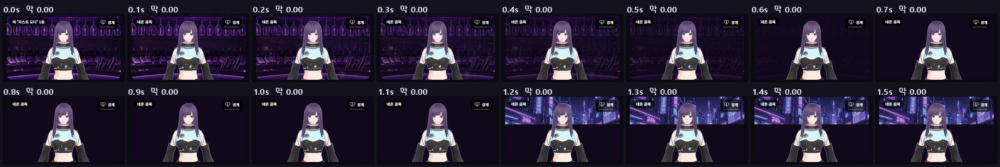
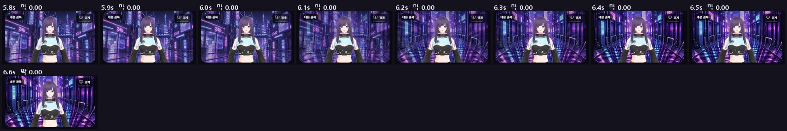
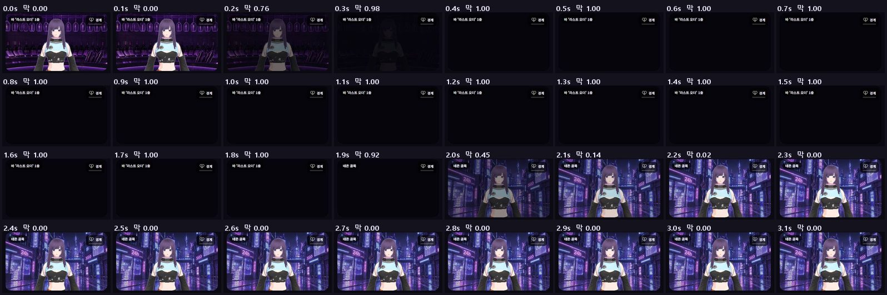
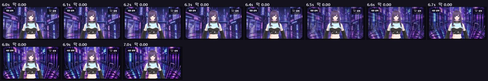
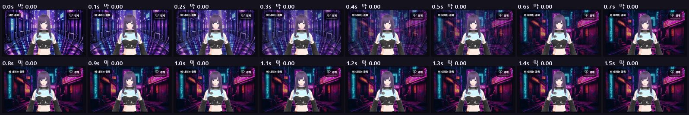
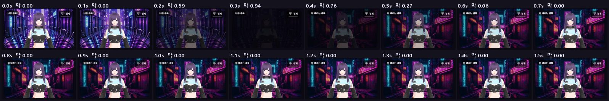
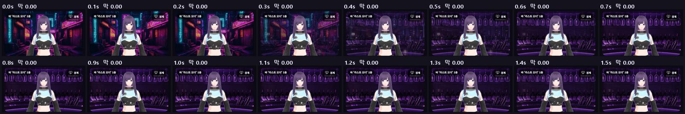
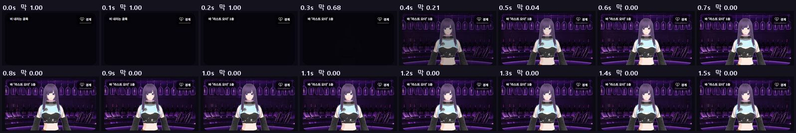

# 39 · 첫 로딩 무게 줄이기 · 장소가 바뀔 때 전환

브랜치 `step/39-load-place` · 커밋 `[39-A] 첫 로딩 무게 줄이기`, `[39-B] 장소가 바뀔 때 전환`

화면 모양·대사·몸짓 구간은 그대로. 첫 만남 연출 미리 받기(31-1)·입장권 인사 미리 받기(34)도 그대로.

## 바뀐 파일

| 파일 | 내용 |
| --- | --- |
| `index.html` | **A:** 모션 미리 받기를 둘로 나눔(`motionsSoon` = 3D 준비 뒤 곧 쓰는 것만 차례로, `Stage.xsRest` = 나머지를 대화 화면이 뜬 뒤 쉬는 틈에 하나씩). 360도 그림은 무대가 보일 때만 받음(`Stage.pano.hold`, `placeStage` 가 켜고 끔). 첫 만남 연출이 끝 장소(바 1층) 360도 그림을 첫 장면 뒤에 받아 끝까지 붙잡음(`endPin`). 처음 실행 때 온보딩 아래 홈 그림은 3D 모델을 다 받은 뒤에(`.app.homehold`). 특별 에피소드 시작 때 본 이야기 장소 360도를 괜히 받지 않게 미리 에피소드 장소로 가리킴. **B:** 장소 전환 `Place`(어두워짐 → 새 장소 → 밝아짐, 몸짓·따라감·확대 기다림, 그림 기다림), `setScene(i,{fade})`, 답장이 새 장소로 바뀐 순간에 이어짐, 특별 에피소드는 어두운 채 열려 밝아짐, 시연 패널 장소도 전환. 전환 막 CSS `.plveil`. `Stage.playing()`(지금 몸짓 id), `Stage.xsLoaded()`(확인용), `FirstMeet.armed()` |
| `data/config.json` | `preload`(나머지 모션 받기 시간 값), `placeFade`(전환 시간·색·기다림) 와 설명 |
| `docs/reports/img/39/` | 장소 전환 0.1초 간격 캡처 8장(전·후) |

## A · 첫 로딩 무게

### 잰 방법

- 헤드리스 Chrome, 새 프로필(캐시 없음), 390×844, 느린 회선 흉내(받기 4Mbps, 올리기 1.5Mbps, 지연 40ms). 저장소를 로컬 서버로 띄움(three.js 두 파일은 CDN).
- 사람 대신 스크립트가 누름: 시작 화면이 보이고 2초 뒤 「입장권 받기」 → 입장권이 보이고 1.5초 뒤 전체 동의, 0.5초 뒤 펀치 → 로그인 화면 1초 뒤 「둘러보기」 → 홈 1.5초 뒤 서아 카드 → 1초 뒤 기본 에피소드 「시작」 → 첫 만남 연출을 끝까지 → 대화 화면. 95초까지 기록.
- 받은 파일은 브라우저 Resource Timing(전송 크기). 「(나) 입장권 화면」은 입장권 버튼이 3D 준비를 최대 15초(`preloadMaxWaitMs`)까지 기다려서 두 경우 모두 그 시각(누른 뒤 15초)에 뜸 → 3D 서아가 실제로 보이는 시각을 (나′)로 따로 적음.
- 전: `main`(38-1 병합) / 후: 이 브랜치 마지막 커밋. 같은 순서로 두 번씩 재서 차이가 0.3초 안이었음(표는 마지막 것).

### 시점별(전 → 후)

| 시점 | 걸린 시간 | 받은 파일 수 | 총 크기 |
| --- | --- | --- | --- |
| (가) 시작 화면 | 1.6초 → 1.9초 | 35 → 35 | 0.68MB → 0.69MB |
| (나) 입장권 화면 | 18.7초 → 18.7초 | 45 → 37 | 2.42MB → 8.56MB |
| (나′) 입장권에 3D 서아가 보임(3D 준비) | **22.8초 → 18.7초** | 48 → 37 | 10.49MB → 8.56MB |
| (다) 첫 만남 연출 시작(검은 막이 걷히고 장면이 보임) | **28.0초 → 27.7초** | 63 → 57 | 12.60MB → 11.39MB |
| (라) 대화 화면에서 3D 서아(연출이 끝남) | 36.9초 → 36.5초 | 68 → 59 | 13.08MB → 11.99MB |
| 처음 1분 | | 68 → 67 | 13.08MB → 13.09MB |

- (가) 시작 화면은 원래 HTML·스크립트·데이터만 받고 뜸(두 번 다 1.6~1.9초, 차이는 측정 흔들림).
- **(나′):** 전에는 입장권이 15초 제한에 걸려 3D 없이 먼저 뜨고 서아가 4.1초 뒤에 나타남. 후에는 서아 모델(8MB)이 혼자 회선을 써서 18.3초에 다 받고 입장권과 서아가 같이 뜸. 입장권 버튼을 늦게 누르는 사람이면 기다림이 그만큼 4초 줄어듦.
- (나)의 「크기」가 후에 더 큰 것은 그 시각에 모델을 이미 다 받았기 때문(전에는 아직 받는 중이라 안 셈).
- (다): 검은 막 뒤에서 기다리는 시간이 0.63초 → 0.38초(연출 모션 3개를 이미 받아 둠).
- (라)까지 받은 크기 −1.1MB: 나머지 모션 8개(약 1.1MB)를 대화 화면이 뜬 뒤로 미룸.
- 처음 1분 동안 받는 총량은 같음(받는 것은 같고 순서만 바꿈). 대신 전에는 바 1층 360도 그림을 처음에 받고, 연출 동안 내려놓았다가 끝에서 다시 읽음(브라우저 캐시) → 후에는 연출 중에 한 번만.

### 처음 1분 동안 받은 파일(크기 순, 30KB 이상)

「받은 때」는 페이지를 연 뒤 초(시작~끝).

| 파일 | 크기 | 전: 받은 때 | 후: 받은 때 | 바로 쓰는지 |
| --- | --- | --- | --- | --- |
| `seoa_vroid.glb` (서아 작전복 모델) | 8052KB | 1.6~22.5 | **1.6~18.3** | 예 — 입장권 3D |
| `pano_seoa_bar.webp` (바 1층 360도) | 527KB | **1.6~6.4** (+35.9 캐시에서 다시) | **30.0~31.2** | 전: 아니오 — 첫 실행은 36초(첫 만남 뒤 대화 화면)에 처음 보임 / 후: 연출 중에 받아 36초에 씀 |
| `bg_seoa_xmas.jpg` (홈 특별 에피소드 그림) | 337KB | 1.6~5.6 | 18.4~21.7 | 전: 아니오 — 온보딩 아래(안 보임) / 후: 홈(24초) 전에 받음 |
| `motions/xstage_idle_arms_crossed_male.json` (m07 팔짱) | 318KB | 24.7~25.4 | 22.2~23.0 | 곧 — 오프닝 첫 몸짓(36.7초) |
| `motions/xstage_embarrassing3.json` (m24) | 287KB | 22.7~23.4 | **36.6~37.3** | 아니오 — 열린 몸짓 아님 |
| `bg_seoa_castle.jpg` (홈 특별 에피소드 그림) | 243KB | 1.6~4.6 | 18.4~21.3 | 위 xmas 와 같음 |
| `index.html` | 231KB | 0.0~1.2 | 0.0~1.2 | 예 |
| `motions/xstage_proud_persuasion.json` (m19) | 225KB | 25.8~26.3 | **38.1~38.7** | 아니오 — 판정 tease(2단계부터) |
| `motions/xstage_checking_watch.json` (x18 시계 보기) | 202KB | 28.0~28.7 | 24.7~25.2 | 곧 — 대화에서 25초 말이 없으면 |
| `motions/xstage_hold_forehead.json` (m04) | 188KB | 24.3~24.7 | 23.2~23.7 | 곧 — 1단계 열린 몸짓 |
| `bg_seoa_bar.jpg` (홈 「오늘의 바텐더」·바 1층 평평한 그림) | 187KB | 1.6~3.9 | 18.4~20.8 | 전: 아니오 / 후: 홈 전에 |
| `motions/xstage_raise_hand_to_stop.json` (x11) | 181KB | 26.3~26.7 | 24.0~24.4 | 곧 — 1단계 |
| `motions/xstage_wave_and_laugh.json` (m13 손 흔들기) | 174KB | 18.6~19.5 | 18.4~20.6 | 예 — 입장권 펀치(20.5초), 34 미리 받기 그대로 |
| `motions/xstage_rub_neck_one_hand.json` (m05) | 164KB | 26.7~27.1 | **38.8~39.3** | 아니오 — 3단계 |
| `motions/xstage_maid_grab.json` (x09) | 138KB | 25.4~25.8 | **37.6~38.0** | 아니오 — 4단계 |
| `motions/xstage_standard_kick.json` (x17 돌려차기) | 136KB | 27.3~28.0 | 21.8~22.2 | 예 — 첫 만남 연출 |
| `motions/xstage_annoyance_1.json` (x01) | 136KB | 23.4~23.8 | 23.7~24.0 | 곧 — 1단계 |
| `motions/xstage_shy_short_laugh.json` (x19) | 126KB | 28.7~29.0 | **39.5~39.9** | 아니오 — 선물 g02 전용 |
| `card_seoa.jpg` | 120KB | 1.6~3.1 | 18.4~19.9 | 전: 아니오(온보딩 아래) / 후: 홈 전에 |
| CDN `three.min.js` | 118KB | 0.1~1.1 | 0.1~1.1 | 예 |
| `card_haram.jpg` | 108KB | 1.6~5.7 | 18.4~21.5 | 홈 캐릭터 카드 |
| `card_doyun.jpg` | 106KB | 1.6~4.5 | 18.4~19.8 | 〃 |
| `motions/xstage_bent_over.json` (x02) | 90KB | 23.8~24.0 | 24.4~24.7 | 곧 — 1단계 |
| `motions/xstage_blunt_handing_out_candy_1.json` (m09) | 85KB | 24.0~24.3 | **37.3~37.6** | 아니오 — 2단계 |
| `card_jihu.jpg` | 83KB | 1.6~5.4 | 18.4~20.9 | 홈 캐릭터 카드 |
| `motions/xstage_wave_hand.json` (x20) | 82KB | 29.0~29.3 | **39.9~40.1** | 아니오 — 지금 어디서도 안 씀(34-1) |
| `bg_seoa_rain.jpg` (비 내리는 골목) | 81KB | 28.0~28.4 | 27.4~27.6 | 예 — 첫 만남 연출 장소 |
| `motions/xstage_shy_surprise1.json` (m03) | 75KB | 27.1~27.3 | 23.0~23.2 | 곧 — 1단계 |
| `motions/xstage_stealth_squat_idle_alert.json` (x16) | 69KB | 27.3~27.8 | 21.4~21.8 | 예 — 첫 만남 연출 |
| `card_ijun.jpg` | 63KB | 1.6~4.7 | 18.4~20.7 | 홈 캐릭터 카드 |
| `motions/xstage_run_look_back.json` (x21) | 45KB | 27.3~27.7 | 20.6~21.3 | 예 — 첫 만남 연출 첫 장면 |
| `assets/onboarding/film_seoa.webp` | 39KB | 18.6~18.9 | 18.5~21.2 | 예 — 입장권 필름 띠 |
| 그 밖 30KB 아래 33~34개(스크립트·CSS·데이터 JSON 17개·로고·favicon·서버 깨우기) | 합 약 0.3MB | 0.1~1.6 | 0.1~1.9 | 예 — 앱 시작 |

- 의상 모델(흰 옷·바·크리스마스·드라큘라)·다른 장소 360도(네온 골목)는 전에도 처음 1분 안에 받지 않았음(쓸 때 받음). 그대로.
- 서아 대화방에 다시 들어오는 사람(온보딩 끝)도 같은 규칙: 앱을 열면 홈이라 지금 장소 360도는 대화방에 들어갈 때 받음.

### 미룬 것 · 그대로 둔 것

| 무엇 | 바꾼 것 |
| --- | --- |
| XSTAGE 모션 19개(약 2.9MB) | 3D 준비 뒤 **곧 쓰는 것 11개만** 차례로: 입장권 인사(m13, 처음 실행) → 첫 만남 연출(x21·x16·x17, 볼 예정일 때) → 오프닝(m07, 볼 예정일 때) → 다시 들어올 때 인사(5단계부터 m13, 6단계 m15) → **지금 단계까지 열린 몸짓**(1단계면 m03·m04·m07·x01·x11·x02) → 시계 보기(x18). **나머지 8개**(m24·m09·m19·m05·x15·x09·x19·x20)는 대화 화면이 뜬 뒤(첫 만남 연출 중이면 끝난 뒤) 1.5초 뒤부터 쉬는 틈마다 하나씩 |
| 360도 그림 | 무대가 보일 때(서아 대화방)만 지금 장소 것을 받음. 홈·컬렉션·마이·온보딩 동안은 안 받음. 카드 확대·사진·카드 그림·첫 만남 연출처럼 직접 부르는 것은 그대로 |
| 첫 만남 끝 장소(바 1층) 360도 | 연출 첫 장면이 끝난 뒤 받기 시작해 연출이 끝날 때까지 붙잡음 → 끝에서 바로 보임, 두 번 읽지 않음 |
| 홈 그림(캐릭터 사진 5장·특별 에피소드 그림 3장, 약 1.2MB) | 처음 실행 때 온보딩 아래에서 모델과 같이 받던 것을, 3D 모델을 다 받은 뒤(입장권이 뜰 때)로. 홈이 보이기 전에 다 받음 |
| 그대로 | 서아 모델 8MB(입장권 3D 에 필요, 이것이 첫 로딩의 대부분), 스크립트·데이터 JSON(시작에 필요, 합 0.3MB), 입장권 필름 사진, 31-1 첫 만남 장소 360도 미리 받기(지금 연출 장소가 평평한 그림이라 실제로 받는 것 없음), 34 입장권 인사 미리 받기 |

**미루면 처음 재생이 늦어지는 것(그대로 둠):** 나머지 8개 모션은 대화 화면이 뜨기 전에 쓰면(예: 홈에서 곧장 특별 에피소드 → 오프닝 몸짓 m19·m09·m05·m24, 대화방에 들어가자마자 선물 g02 x19) 그때 받기 시작함. 지금도 「파일이 아직이면 받는 대로 처음부터」(`Stage.play`)라 몸짓이 받는 시간만큼(4Mbps 에서 0.2~0.6초) 늦게 시작함. 특별 에피소드 오프닝은 첫 몸짓이 2.3초 뒤(문단 1)라 대부분 그 안에 받음.

### 대화 화면에서 처음 나오는 몸짓이 늦지 않은지

후 측정에서 재생 기록(`Stage.play`) 과 받은 때:

| 몸짓 | 재생 | 파일 받은 때 |
| --- | --- | --- |
| m13 입장권 인사 | 20.5초 | 20.6초(34 미리 받기, 전과 같음) |
| x21 → x16 → x17 첫 만남 | 27.4·30.0·31.8초 | 21.3·21.8·22.2초 |
| m07 오프닝 첫 몸짓 | 36.7초 | 23.0초 |
| m01·m11 오프닝 | 46.9·50.3초 | 코드 몸짓(파일 없음) |
| x18 시계 보기 | 78.6초 | 25.2초 |
| 1단계 열린 몸짓 m03·m04·x01·x02·x11 | (대화 답장) | 23.2~24.7초 — 대화 화면(36.5초) 전에 다 받음 |

콘솔 오류 없음(전·후 모두. 경고는 three.js 의 `morphNormals` 안내만, 전과 같음). 데이터 JSON 17개 모두 읽힘.

## B · 장소가 바뀔 때 전환

### 지금(전) 어떻게 바뀌었나

- 코드: 서버 `location`·예시 대사 키워드(옥상·골목…)는 답장 처리에서 `setScene` → `showScene`. 특별 에피소드는 대화방을 연 뒤 `setScene(에피소드 장소)`. 평평한 그림은 `.stage` 의 `background-image .6s` 로 바뀌고, 360도 구는 `pano.fadeMs`(0.6초) 동안 투명도가 바뀜. 새 360도 그림을 받는 동안은 아무것도 기다리지 않음.
- 캡처(4Mbps, 새 프로필):
  - **바 1층 → 네온 골목:** 바 구가 0.6초 동안 사라지며 그 아래 평평한 그림 자리가 **빈 보라색 바탕**(골목 평평한 그림을 아직 받는 중) → 1.2초쯤 평평한 그림이 위에서부터 띠 모양으로 채워짐 → 6초쯤 360도 구가 나타남. 서아는 내내 그대로 서 있음.
  - **네온 골목 → 비 내리는 골목:** 구가 사라지며 평평한 그림이 교차(툭 바뀌지는 않지만 두 장소가 겹쳐 보임).
  - **특별 에피소드 시작(오늘의 바텐더):** 대화방이 열리는 순간 **이전 장소(비 내리는 골목)가 먼저 보이고** 0.6초 동안 바 1층으로 교차.

### 바꾼 것

- **전환:** 무대(배경 그림·3D 서아)만 0.3초 동안 어두워짐(`#05040a`) → 새 장소로 바꿈 → 0.4초 동안 밝아짐. 장소 이름표·관계 게이지는 막 위라 그대로 보이고, 이름표는 바뀌는 순간 새 장소로. 화면에 글자 없음.
- **그림 기다림:** 어두워지기 시작할 때 새 장소의 평평한 그림을 먼저 받고(밝아질 때 꼭 있어야 해서) 이어서 360도 그림(구까지). 다 되면 바로 밝아지고, 아니면 어두운 채 **최대 1.5초** 기다림. 그래도 360도가 안 되면 평평한 그림으로 밝아지고, 다 받으면 구가 0.6초(`pano.fadeMs`) 동안 나타남. 어두운 막 뒤에서 바꾸므로 평평한 그림·구는 교차 없이 바로 바꿈.
- **기다렸다가 전환:** 서아 몸짓(대기 몸짓 m25 빼고)·카메라 따라감·3D 확대·카메라 다가감 중이면 그것이 끝난 뒤 어두워짐(최대 12초). 무대가 안 보이면(다른 탭·카드 확대·첫 만남 연출) 바로 바꿈.
- **답장:** 서버 `location`·키워드로 장소가 바뀌면 「장소가 바뀌었어요」 줄은 바로, 서아 답장(말풍선·몸짓)은 **새 장소로 바뀐 순간**(밝아지기 시작할 때) 이어짐.
- **특별 에피소드 시작:** 대화방이 **어두운 채로 열려** 에피소드 장소로 밝아짐(이전 장소가 비치지 않음). 대화방이 열릴 때 받기 시작하는 360도 그림도 처음부터 에피소드 장소 것.
- 시연 패널 「장소」도 같은 전환. 초기화·이야기 줄기 바꾸기·첫 만남 연출·앨범 다시 보기는 예전처럼 바로.
- **메모리(30-1):** 지금 장소 360도 그림 하나만. 새 그림은 어두워지기 시작할 때부터 받고(몸짓을 기다리는 동안은 안 받음), 바뀐 직후 떠난 장소 그림은 내려놓음. 전환 동안만 최대 2장(30-1 과 같음).
- 값 `data/config.json placeFade`: `outMs` 300 · `inMs` 400 · `waitMs` 1500 · `busyMaxMs` 12000 · `color` · `on`(false 면 예전처럼).

### 캡처 (390px, 0.1초 간격, 4Mbps 새 프로필, 무대 칸만 잘라 붙임)

각 칸 위 숫자 = 장소를 바꾼 뒤 초, 「막」 = 전환 막 진하기(0 투명 ~ 1 검정). 헤드리스 Chrome 화면 전송 프레임에서 0.1초마다 그때 화면.

**1. 바 1층 → 네온 골목 (둘 다 360도)**

전:

전, 6초 무렵(360도 구가 나타남):

후 — 0.3초 어두워짐 → 골목 360도(1.2MB)가 아직이라 1.5초 기다림 → 1.9초 평평한 그림으로 밝아짐:

후, 6.4~6.8초 360도를 다 받아 구가 천천히 나타남:

**2. 네온 골목 → 비 내리는 골목(평평한 그림)**

전:

후 — 그림(81KB)을 어두워지는 0.3초 안에 받아 기다림 없이 바뀌고 0.7초에 끝:

**3. 특별 에피소드 시작(오늘의 바텐더, 바 1층 360도) — 홈에서 「시작」**

전 — 이전 장소(비 내리는 골목)가 먼저 보이고 교차:

후 — 어두운 채 열려 0.2초에 바 1층, 0.6초에 다 밝아짐(바 1층 그림은 앞서 받아 캐시에 있음):

### 확인

| 확인 | 결과 |
| --- | --- |
| 몸짓 중 장소 바뀜(m07 6.8초를 0.5초 재생한 때) | 몸짓이 끝난 6.4초에 어두워지기 시작, 6.9초에 새 장소 |
| 3D 확대 중(m03 확대) | 확대가 돌아온 뒤(7.3초) 전환 |
| 답장(시연 서버 없음, 「옥상 가자」 → 바 옥상) | 0.33초에 새 장소로 바뀐 순간 답장 몸짓 m12 시작, 「장소가 바뀌었어요」 줄은 바로 |
| 360도 그림 수 | 바 옥상(평평한 그림)에서 0장, 네온 골목에서 1장, 전환 동안만 2장 |
| 데이터 JSON | 17개 모두 읽힘(설정 `placeFade`·`preload` 포함) |
| 콘솔 | 오류 없음 |

## 제가 정한 것

- **측정 기준 행동:** 사람이 누르는 간격(시작 화면 2초, 입장권 1.5+0.5초, 로그인 1초, 홈 1.5초, 캐릭터 화면 1초)을 정해 스크립트로 똑같이 누름. 처음 1분 표는 30KB 이상만 줄로, 작은 파일은 한 줄로 묶음.
- **「곧 쓰는 모션」 범위:** 지금 단계까지 열린 몸짓 + 판정·사건으로 이미 연 몸짓 + 시계 보기 + 다시 들어올 때 인사(그 단계면) + 처음이면 입장권 인사·첫 만남·오프닝. 선물 몸짓(x19)·특별 에피소드 오프닝 몸짓·다음 단계 몸짓은 나머지로.
- **나머지 모션 시작 때:** 서아 대화방 무대가 처음 보일 때부터(첫 만남 연출 중이면 끝난 뒤) 1.5초 뒤, `requestIdleCallback`(최대 3초 기다림)마다 하나씩. 아이폰 사파리처럼 그 기능이 없으면 0.3초 쉬고 하나씩. 대화 화면에 한 번도 안 가면 안 받음(쓸 때 받음). 값 `data/config.json preload`.
- **360도 그림 = 무대가 보일 때:** 「지금 장소」 그림도 무대가 안 보이면 받지 않음. 그래서 다시 찾은 사람이 앱을 열고 대화방에 들어가면 그때 받기 시작함(바 0.5MB 는 4Mbps 에서 약 1.4초, 그동안 평평한 그림 → 구가 나타남. 30 의 불러오기 동작 그대로). 두 번째부터는 브라우저 캐시.
- **홈 그림 미루기 끝:** 홈이 보일 때가 아니라 3D 모델을 다 받은 때(입장권이 뜰 때). 홈이 나올 때 사진이 비어 보이지 않게. 3D 를 못 불러와도 그때(실패) 풀림.
- **전환 색:** 완전 검정 대신 앱 바탕에 가까운 `#05040a`. 막은 배경 그림·3D 위, 장소 이름표·게이지·말풍선·몸짓 이름 아래(무대만 어두워짐).
- **3D 서아도 같이 어두워짐:** 「무대가 어두워졌다 밝아짐」 이라 서아까지 가림. 어두운 동안 의상이 바뀌면(바 1층 흰 옷 등) 그 순간에 바꿈.
- **그림 받는 순서:** 평평한 그림 먼저, 다 받으면 360도. 처음에는 둘을 같이 받았는데 4Mbps 에서 1.5초 뒤 밝아질 때 평평한 그림이 반만 그려져 있어서 바꿈(대신 360도가 나타나는 때는 조금 늦어짐).
- **기다리는 1.5초:** 어두워진 뒤부터 셈(0.3초 + 최대 1.5초 = 최대 1.8초 어두움).
- **답장은 새 장소로 바뀐 순간에:** 바꾸기 전에 답장 몸짓이 시작하면 어두운 막 밑에서 몸짓·확대가 시작돼서. 밝아지는 0.4초와 몸짓 처음 섞기(0.35초)가 겹침. 그만큼(보통 0.3초, 그림이 늦으면 최대 1.8초) 답장이 늦게 보임.
- **몸짓 기다림 최대 12초:** 반복하는 몸짓 등으로 끝이 안 오면 12초 뒤 그냥 전환.
- **특별 에피소드 「이어하기」(이미 대화가 있는 줄기)와 「본 이야기로」 단추:** 지시문의 세 경우가 아니라 예전처럼 바로 바뀜(본 이야기로 단추는 의상이 먼저 바뀌는 문제가 있어 손대지 않음).
- **캡처 방식:** 헤드리스 Chrome 화면 캡처가 한 장에 0.19초 걸려서, 화면 전송(screencast) 프레임을 받아 0.1초마다 그때 화면을 골라 붙임. 캡처·측정 스크립트는 저장소 밖 임시 폴더.

## 아이폰에서 나중에 볼 것

- **전환 막(`opacity` 0.3·0.4초):** 3D 그림판 위 반투명 막이 끊기지 않는지, 막이 둥근 모서리 밖으로 새지 않는지.
- **어두운 채 열리는 특별 에피소드:** 대화방이 열릴 때 이전 장소가 한 프레임 비치지 않는지.
- **360도 그림 기다림:** 실제 LTE 에서 네온 골목(1.2MB)으로 갈 때 1.8초 어두움이 길게 느껴지는지, 평평한 그림 → 구가 나타나는 0.6초.
- **나머지 모션 받기:** 사파리엔 `requestIdleCallback` 이 없어 0.3초 간격으로 받음 — 대화 화면이 뜬 직후 버벅임이 없는지.
- **첫 실행 입장권:** 3D 서아가 입장권과 같이 뜨는지(모델 8MB 를 혼자 받음), 홈으로 넘어갈 때 캐릭터 사진이 다 들어와 있는지.
- 다시 찾은 사람이 대화방에 들어갈 때 바 1층 360도가 나타나는 시간.

## 다음에 할 만한 것(이번엔 안 함)

- 서아 모델 `seoa_vroid.glb` 8MB 가 첫 로딩의 대부분(4Mbps 에서 약 17초). 텍스처 압축·메시 압축으로 줄이면 입장권 3D 가 가장 크게 빨라짐.
- 홈 특별 에피소드 칸이 장소 배경 그림 원본(최대 340KB)을 작은 썸네일로 씀 → 작은 그림을 따로 두면 홈이 가벼워짐.
