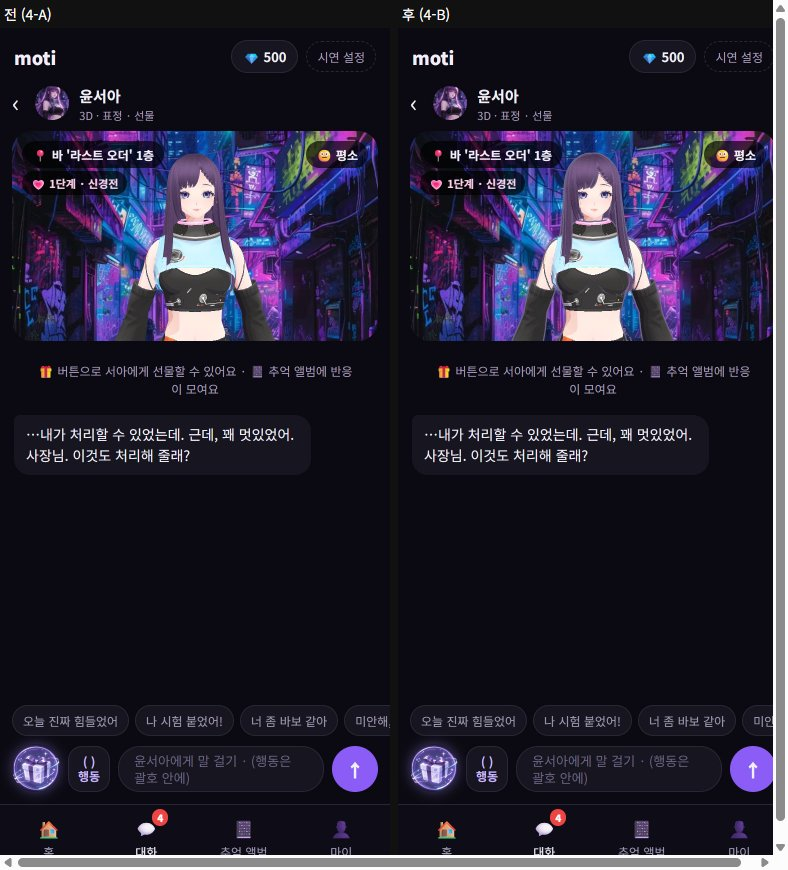
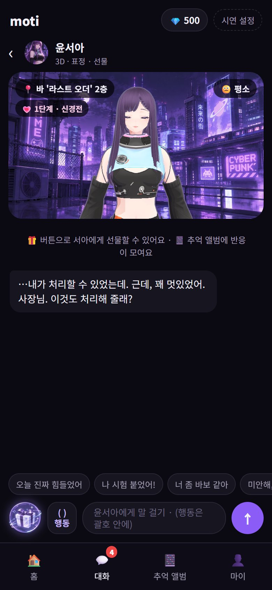
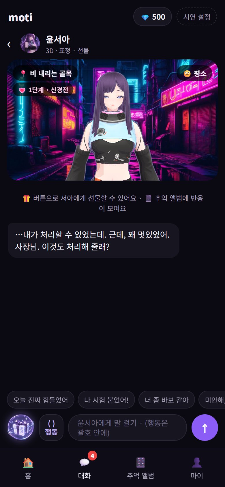
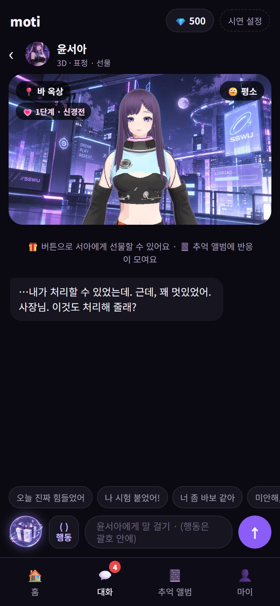
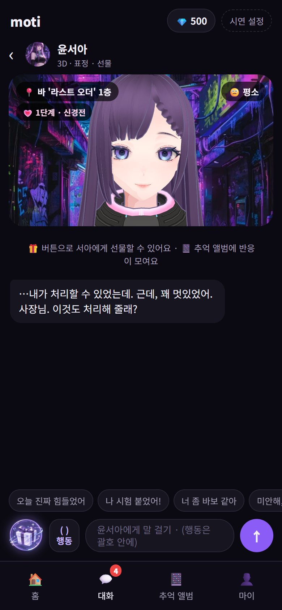

# 4. 서아 명암·외곽선

브랜치: `step/4-seoa-look` (main 병합 안 함)

| 단계 | 커밋 | 한 일 |
| --- | --- | --- |
| 4-A | `8c30fa3` | 피부·옷·머리카락 재질을 만화풍 명암 재질(MeshToonMaterial)로 교체, 조명 재배치. 값은 `data/look.json` |
| 4-B | 이 커밋 | 외곽선, 장소별 테두리 빛 |

> 4-A는 이전 노트북에서 커밋만 하고 보고서는 쓰지 않았다. 4-A 캡처는 `img/4/4A-전-*.jpg`, `img/4/4A-후-*.jpg` (평소·몸짓·얼굴).

## 4-B 바뀐 파일

| 파일 | 내용 |
| --- | --- |
| `look.js` | 외곽선 메시 만들기(`outlineMat`, `addOutline`), 테두리 빛 셰이더(`patch` — 4-A의 얼굴 명암 펴기와 합침), 장소 색 바꾸기(`setPlace`, `tick`) |
| `index.html` | 매 프레임 `Look.tick`, 배경을 바꾸는 `showScene` 에서 `Look.setPlace(장소 이름)`. `?look=4a` 로 4-B 끄기. `Stage.renderInfo()`(그리기 횟수 확인용) |
| `data/look.json` | `outline`(색·굵기·넣을 부위), `rim`(가장자리 범위·세기·바뀌는 시간·장소별 색) |
| `docs/reports/img/4/4B-*.jpg` | 캡처 7장 |

## 어떻게 했나

**외곽선 (뒤집힌 껍데기)**
- 외곽선을 넣을 메시마다 같은 도형·같은 뼈대(`skeleton`, `bindMatrix`)를 쓰는 `SkinnedMesh` 를 하나 더 만들어 원래 메시 옆에 붙인다 → 몸짓 중에도 몸에 붙어 움직인다(캡처 3, 팔짱 끼기 중).
- 재질은 뒷면만 그리기(`BackSide`), 색 `#2A2140`.
- 부풀림은 정점 셰이더에서 화면 기준으로 한다: 노멀을 화면에 투영한 방향으로 `px` 만큼 민다. 그래서 카메라가 가깝든 멀든 화면에서 굵기가 같다. 지금 **1.25px**(CSS px, 기기 배율과 무관).
- 머리카락·옷의 비치는 부분(텍스처 알파)은 외곽선도 똑같이 잘라낸다(알파 0.5 기준). 안 그러면 머리카락 카드 모양이 그대로 선으로 보인다.
- 눈·눈썹·속눈썹·입은 원래 바꾸는 재질 목록에 없어서 외곽선도 없다.

**테두리 빛 (프레넬)**
- 피부·옷·머리카락 만화풍 재질의 마지막 색에 `장소 색 × 세기 × smoothstep(가장자리 정도)` 를 더한다. 가장자리 정도 = 1 − (면 방향·보는 방향).
- 모든 재질이 같은 색 값을 나눠 써서, 장소가 바뀌면 한 곳만 바꾸면 된다. **1.2초** 동안 부드럽게 바뀐다(`fadeSec`).
- 장소 색은 `data/look.json` `rim.byLocation` — 바 1층 `#FF7AC8`, 바 2층 `#FFB38A`, 네온 골목 `#7AD8FF`, 비 내리는 골목 `#8AB4FF`, 바 옥상 `#B89CFF`.
- 앨범 다시 보기로 잠깐 다른 장소 배경이 보일 때도 그 장소 색이 된다(배경을 바꾸는 `showScene` 에 걸었기 때문).

## 성능

헤드리스 Chrome 390×844 에서 `Stage.renderInfo()` 로 잰 값(한 프레임, 서아 무대만):

| | 외곽선 메시 | 그리기 횟수 | 삼각형 |
| --- | --- | --- | --- |
| 4-A (`?look=4a`) | 0 | 20 | 49,075 |
| 4-B | **13** (옷 10, 머리카락 2, 몸 피부 1) | **33** | 90,932 |

- 그리기 횟수 +13, 삼각형 약 1.85배. 외곽선 재질은 조명 계산 없는 단색이라 무겁지 않다. 셰이더 종류는 외곽선 1개가 늘었다.
- 지금은 머리카락 외곽선을 빼지 않았다. 아이폰에서 버벅이면 `data/look.json` `outline.parts` 에서 `"hair"` 를 지우면 2개(머리카락 메시, 삼각형이 많은 쪽)가 빠진다.

## 캡처 (390px, 배율 2)

| 캡처 | 파일 |
| --- | --- |
| 전/후 비교 (바 1층, 왼쪽 4-A · 오른쪽 4-B) |  |
| 바 1층 · 분홍 |  |
| 바 2층 · 살구 |  |
| 네온 골목 · 하늘색 (팔짱 끼기 몸짓 중, 무릎 위 구도) |  |
| 비 내리는 골목 · 파랑 |  |
| 바 옥상 · 보라 |  |
| 얼굴 확대 |  |

## 아이폰 사파리 확인 (별도 확인 항목)

시각 효과를 바꿨으므로 기획자 확인이 필요하다. 이번엔 헤드리스 Chrome(소프트웨어 렌더링)으로만 봤다.

- [ ] 외곽선이 보이는지, 몸짓 중 몸에서 떨어지거나 깜빡이지 않는지
- [ ] 머리카락 끝·옷 끝에 외곽선이 끊기거나 네모로 보이지 않는지
- [ ] 장소를 바꿀 때 테두리 빛 색이 부드럽게 바뀌는지 (시연 설정 → 장소)
- [ ] 얼굴에 검은 점·줄이 없는지
- [ ] 대화방에서 버벅임(프레임 끊김)이 4-A 보다 눈에 띄게 늘지 않는지

## 제가 정한 것

1. **얼굴 피부 외곽선은 뺐다.** 처음엔 넣었는데 입 주변·눈 둘레에 검은 얼룩·줄이 생겼다(얼굴 메시 안쪽 면이 부풀려져 보임). 얼굴 윤곽은 머리카락·목(몸 피부) 외곽선으로 어느 정도 드러난다. 그래서 외곽선은 몸 피부·옷·머리카락만.
2. **굵기 1.25px** (지시 범위 1~1.5px 가운데). `outline.px` 로 바꿀 수 있다.
3. **테두리 빛 세기 0.55, 범위 0.62~0.82**: 옷 가장자리에 띠처럼 보이되 얼굴이 물들지 않을 정도로 눈으로 맞췄다. 밝은 하늘색 장갑에서는 꽤 진하게 보인다(네온 골목 캡처). 줄이려면 `rim.strength`.
4. 테두리 빛은 **빛 방향과 상관없이** 가장자리 전체에 들어간다(그림자 쪽에도). 지시에 방향 언급이 없어서 단순하게 했다.
5. 장소 색은 **장소 이름으로** 찾는다(`data/seoa_story.json` `locations` 의 `name` 과 같아야 함). 이름이 바뀌면 `look.json` 도 같이 바꿔야 한다. 못 찾으면 `rim.default`(바 1층 색).
6. 처음 대화방에 들어올 때는 부드럽게 바꾸지 않고 그 장소 색으로 바로 시작한다.
7. `?look=4a` 를 붙이면 4-B(외곽선·테두리 빛)만 끈 모습 — 전/후 비교용. `?look=old` 는 4-A 이전 모습 그대로.
8. 지후 모델(`?model=jihu`)에는 적용하지 않는다(4-A와 같음).
9. 캡처는 지시대로 장소 5장·전후 1장·얼굴 1장만. 전/후 비교는 두 장을 나란히 붙인 한 장.
