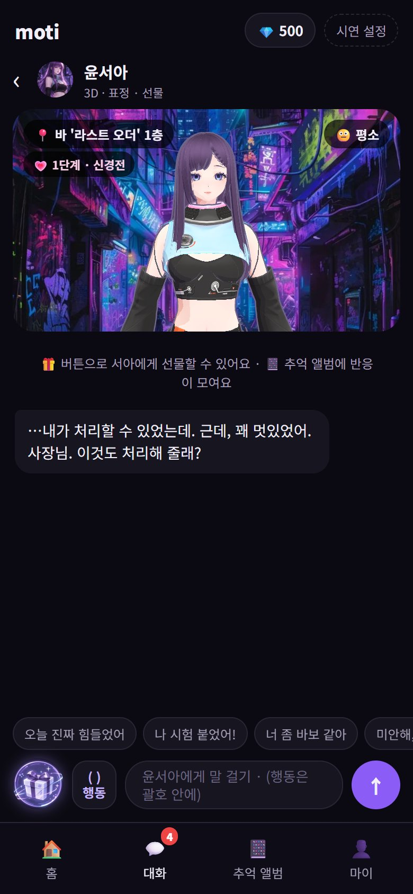
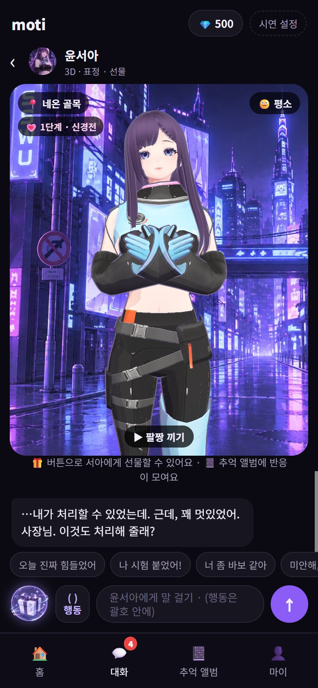
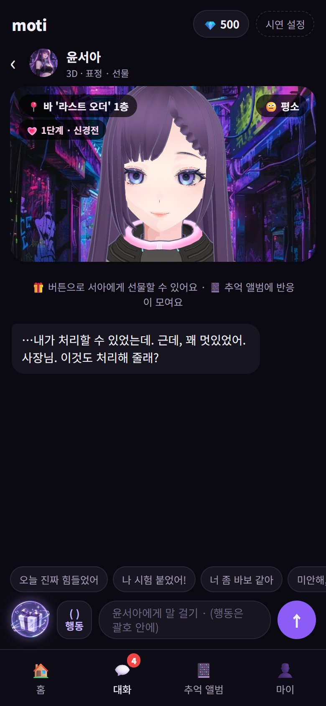
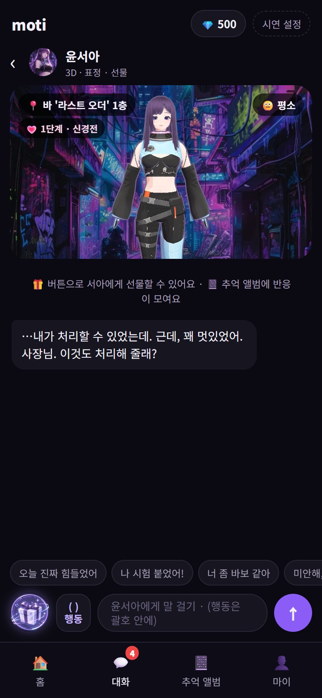
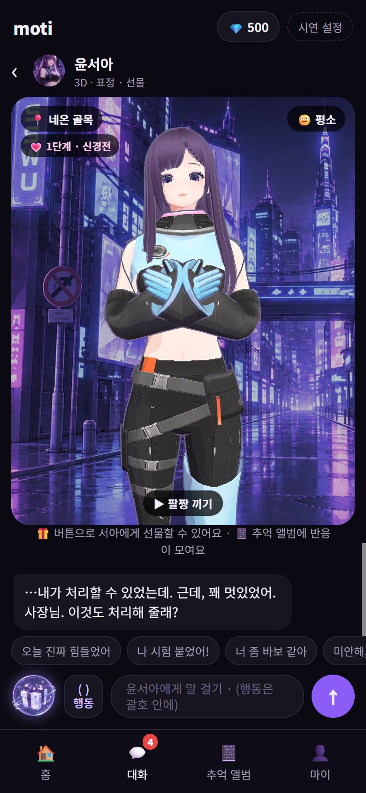
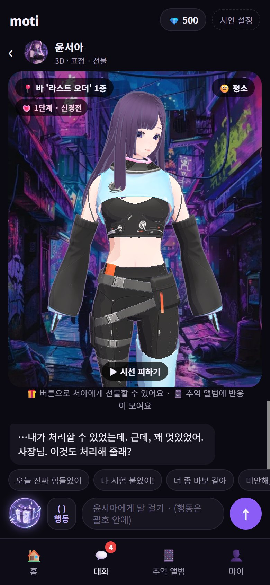
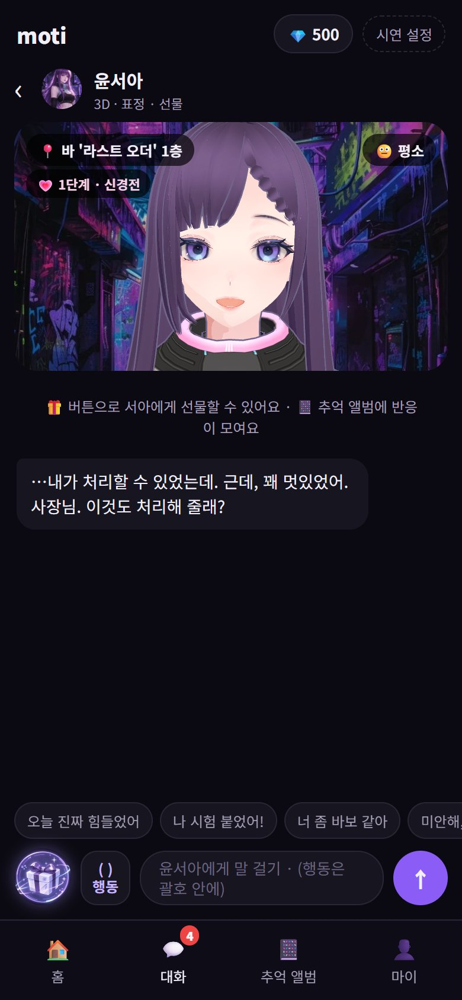
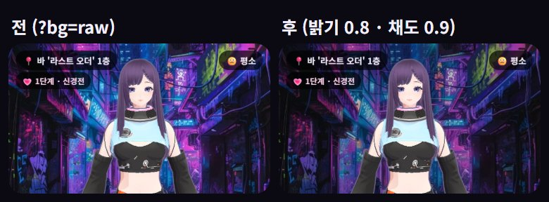

# 4. 서아 명암·외곽선

브랜치: `step/4-seoa-look` (main 병합 안 함)

| 단계 | 커밋 | 한 일 |
| --- | --- | --- |
| 4-A | `8c30fa3` | 피부·옷·머리카락 재질을 만화풍 명암 재질(MeshToonMaterial)로 교체, 조명 재배치. 값은 `data/look.json` |
| 4-B | 이 커밋 | 외곽선, 장소별 테두리 빛 |

> 4-A는 이전 노트북에서 커밋만 하고 보고서는 쓰지 않았다. 4-A 캡처는 `img/4/4A-전-*.jpg`, `img/4/4A-후-*.jpg` (평소·몸짓·얼굴).

## 4-B 바뀐 파일

| 파일 | 내용 |
| --- | --- |
| `look.js` | 외곽선 메시 만들기(`outlineMat`, `addOutline`), 테두리 빛 셰이더(`patch` — 4-A의 얼굴 명암 펴기와 합침), 장소 색 바꾸기(`setPlace`, `tick`) |
| `index.html` | 매 프레임 `Look.tick`, 배경을 바꾸는 `showScene` 에서 `Look.setPlace(장소 이름)`. `?look=4a` 로 4-B 끄기. `Stage.renderInfo()`(그리기 횟수 확인용) |
| `data/look.json` | `outline`(색·굵기·넣을 부위), `rim`(가장자리 범위·세기·바뀌는 시간·장소별 색) |
| `docs/reports/img/4/4B-*.jpg` | 캡처 7장 |

## 어떻게 했나

**외곽선 (뒤집힌 껍데기)**
- 외곽선을 넣을 메시마다 같은 도형·같은 뼈대(`skeleton`, `bindMatrix`)를 쓰는 `SkinnedMesh` 를 하나 더 만들어 원래 메시 옆에 붙인다 → 몸짓 중에도 몸에 붙어 움직인다(캡처 3, 팔짱 끼기 중).
- 재질은 뒷면만 그리기(`BackSide`), 색 `#2A2140`.
- 부풀림은 정점 셰이더에서 화면 기준으로 한다: 노멀을 화면에 투영한 방향으로 `px` 만큼 민다. 그래서 카메라가 가깝든 멀든 화면에서 굵기가 같다. 지금 **1.25px**(CSS px, 기기 배율과 무관).
- 머리카락·옷의 비치는 부분(텍스처 알파)은 외곽선도 똑같이 잘라낸다(알파 0.5 기준). 안 그러면 머리카락 카드 모양이 그대로 선으로 보인다.
- 눈·눈썹·속눈썹·입은 원래 바꾸는 재질 목록에 없어서 외곽선도 없다.

**테두리 빛 (프레넬)**
- 피부·옷·머리카락 만화풍 재질의 마지막 색에 `장소 색 × 세기 × smoothstep(가장자리 정도)` 를 더한다. 가장자리 정도 = 1 − (면 방향·보는 방향).
- 모든 재질이 같은 색 값을 나눠 써서, 장소가 바뀌면 한 곳만 바꾸면 된다. **1.2초** 동안 부드럽게 바뀐다(`fadeSec`).
- 장소 색은 `data/look.json` `rim.byLocation` — 바 1층 `#FF7AC8`, 바 2층 `#FFB38A`, 네온 골목 `#7AD8FF`, 비 내리는 골목 `#8AB4FF`, 바 옥상 `#B89CFF`.
- 앨범 다시 보기로 잠깐 다른 장소 배경이 보일 때도 그 장소 색이 된다(배경을 바꾸는 `showScene` 에 걸었기 때문).

## 성능

헤드리스 Chrome 390×844 에서 `Stage.renderInfo()` 로 잰 값(한 프레임, 서아 무대만):

| | 외곽선 메시 | 그리기 횟수 | 삼각형 |
| --- | --- | --- | --- |
| 4-A (`?look=4a`) | 0 | 20 | 49,075 |
| 4-B | **13** (옷 10, 머리카락 2, 몸 피부 1) | **33** | 90,932 |

- 그리기 횟수 +13, 삼각형 약 1.85배. 외곽선 재질은 조명 계산 없는 단색이라 무겁지 않다. 셰이더 종류는 외곽선 1개가 늘었다.
- 지금은 머리카락 외곽선을 빼지 않았다. 아이폰에서 버벅이면 `data/look.json` `outline.parts` 에서 `"hair"` 를 지우면 2개(머리카락 메시, 삼각형이 많은 쪽)가 빠진다.

## 캡처 (390px, 배율 2)

| 캡처 | 파일 |
| --- | --- |
| 전/후 비교 (바 1층, 왼쪽 4-A · 오른쪽 4-B) |  |
| 바 1층 · 분홍 |  |
| 바 2층 · 살구 |  |
| 네온 골목 · 하늘색 (팔짱 끼기 몸짓 중, 무릎 위 구도) |  |
| 비 내리는 골목 · 파랑 |  |
| 바 옥상 · 보라 |  |
| 얼굴 확대 |  |

## 아이폰 사파리 확인 (별도 확인 항목)

시각 효과를 바꿨으므로 기획자 확인이 필요하다. 이번엔 헤드리스 Chrome(소프트웨어 렌더링)으로만 봤다.

- [ ] 외곽선이 보이는지, 몸짓 중 몸에서 떨어지거나 깜빡이지 않는지
- [ ] 머리카락 끝·옷 끝에 외곽선이 끊기거나 네모로 보이지 않는지
- [ ] 장소를 바꿀 때 테두리 빛 색이 부드럽게 바뀌는지 (시연 설정 → 장소)
- [ ] 얼굴에 검은 점·줄이 없는지
- [ ] 대화방에서 버벅임(프레임 끊김)이 4-A 보다 눈에 띄게 늘지 않는지

## 제가 정한 것

1. **얼굴 피부 외곽선은 뺐다.** 처음엔 넣었는데 입 주변·눈 둘레에 검은 얼룩·줄이 생겼다(얼굴 메시 안쪽 면이 부풀려져 보임). 얼굴 윤곽은 머리카락·목(몸 피부) 외곽선으로 어느 정도 드러난다. 그래서 외곽선은 몸 피부·옷·머리카락만.
2. **굵기 1.25px** (지시 범위 1~1.5px 가운데). `outline.px` 로 바꿀 수 있다.
3. **테두리 빛 세기 0.55, 범위 0.62~0.82**: 옷 가장자리에 띠처럼 보이되 얼굴이 물들지 않을 정도로 눈으로 맞췄다. 밝은 하늘색 장갑에서는 꽤 진하게 보인다(네온 골목 캡처). 줄이려면 `rim.strength`.
4. 테두리 빛은 **빛 방향과 상관없이** 가장자리 전체에 들어간다(그림자 쪽에도). 지시에 방향 언급이 없어서 단순하게 했다.
5. 장소 색은 **장소 이름으로** 찾는다(`data/seoa_story.json` `locations` 의 `name` 과 같아야 함). 이름이 바뀌면 `look.json` 도 같이 바꿔야 한다. 못 찾으면 `rim.default`(바 1층 색).
6. 처음 대화방에 들어올 때는 부드럽게 바꾸지 않고 그 장소 색으로 바로 시작한다.
7. `?look=4a` 를 붙이면 4-B(외곽선·테두리 빛)만 끈 모습 — 전/후 비교용. `?look=old` 는 4-A 이전 모습 그대로.
8. 지후 모델(`?model=jihu`)에는 적용하지 않는다(4-A와 같음).
9. 캡처는 지시대로 장소 5장·전후 1장·얼굴 1장만. 전/후 비교는 두 장을 나란히 붙인 한 장.

## [4-1] 앞머리 톱니 줄 확인, 테두리 빛 0.45

### 앞머리 톱니 줄 — 원인은 머리카락 외곽선이 아니라 모델 자체

- 4-B 얼굴 확대 캡처에서 앞머리 오른쪽을 따라 보이던 톱니 같은 줄은 **외곽선을 넣기 전 캡처에도 똑같이 있다**:
  - `img/4/4A-전-얼굴.jpg` (4-A 이전, 조명 무시 재질, 외곽선 없음)
  - `img/4/4A-후-얼굴.jpg` (4-A 만화풍 명암, 외곽선 없음)
- 즉 VRoid 모델(`seoa_vroid.glb`)에 원래 있는 **땋은 머리 가닥**의 모양이다. 머리카락 외곽선 메시가 만든 줄이 아니다.
- 그래서 지시의 "다른 원인이면" 쪽에 해당한다. **`outline.parts` 에서 `"hair"` 는 빼지 않았다**(빼도 톱니 줄은 그대로 남고, 머리카락 윤곽선만 사라진다).
- 코드로 "고치는" 것은 하지 않았다. 땋은 머리는 모델 디자인이라, 없애려면 모델을 VRoid에서 고쳐 다시 내보내야 한다 → 기획 판단이 필요하다(아래 "제가 정한 것" 1).

### 테두리 빛

- `data/look.json` `rim.strength` 0.55 → **0.45**. 네온 골목의 하늘색 장갑이 조금 덜 진하게 보인다.

### 바뀐 파일

| 파일 | 내용 |
| --- | --- |
| `data/look.json` | `rim.strength` 0.45 |
| `docs/reports/img/4/4-1-*.jpg` | 캡처 2장 |

### 캡처 (390px, 배율 2)

| 캡처 | 파일 |
| --- | --- |
| 얼굴 확대 (바 1층) |  |
| 몸짓 · 무릎 위 (네온 골목, 팔짱 끼기 중) |  |

### 제가 정한 것

1. 톱니 줄 원인이 머리카락 외곽선이 아니어서 **머리카락 외곽선은 그대로 뒀다.** 지시받은 커밋 메시지("머리카락 외곽선 제외")는 실제와 달라져서 "[4-1] 앞머리 톱니 줄 원인 확인(모델의 땋은 머리), 테두리 빛 0.45" 로 바꿔 커밋했다. 땋은 머리가 거슬리면 선택지는 (가) 그대로 둔다, (나) VRoid에서 그 머리 가닥을 지우거나 바꿔 `.glb` 를 다시 내보낸다.
2. 아이폰 사파리 확인 항목은 4-B와 같다(테두리 빛 세기만 바뀜).

## [4-2] 서아를 살아 있게: 머리카락 흔들림, 숨쉬기, 시선, 말할 때 입, 배경 어둡게

| 단계 | 커밋 | 한 일 |
| --- | --- | --- |
| 4-2A | `1ac2e98` | 머리카락 흔들림, 숨쉬기·무게중심 이동, 시선 (`alive.js` 새 파일) |
| 4-2B | `62048f1` | 말할 때 입 움직임, 배경 밝기·채도 낮추기 |

모두 몸짓(`motion.js`) 위에 **더해지는** 작은 움직임이다. 매 프레임 몸짓이 뼈를 세운 뒤에 더한다. 몸짓 값·카메라 구도·관계·해금 규칙, 원본 모델, 지후 모델(`?model=jihu`)은 건드리지 않았다.

### 바뀐 파일

| 파일 | 내용 |
| --- | --- |
| `alive.js` (새 파일) | 머리카락 스프링, 숨쉬기·무게중심, 시선. `Alive.init` / `Alive.update` |
| `index.html` | 매 프레임 `Alive.update`, 시선 피하기 판단(`avert`), `setFace(표정, 감정)`, 입 움직임(`mouth`) 교체, `Stage.talkFor`, 배경 어둡게 층(`#bgdim`)·`applyBg` |
| `data/look.json` | `seoa.alive`(hair·breath·sway·gaze·bigScale), `seoa.talk`, `background` |
| `docs/reports/img/4/4-2*.jpg` | 캡처 5장 |

### 쓴 뼈·표정 (모델에서 먼저 확인한 것)

| 쓰임 | 뼈·표정 | 비고 |
| --- | --- | --- |
| 머리카락 | `J_Sec_Hair1_01` ~ `J_Sec_Hair6_15` — **가닥 15개, 뼈 75개** | 모두 `Head` 에 붙어 있음. 앞머리 4가닥(3마디, 10~14cm), 옆·뒷머리 11가닥(5~7마디, 33~41cm). 끝점 `_end` 는 제외 |
| 건드리지 않음 | `J_Sec_L/R_Bust*`, `J_Sec_*_CoatSkirt*` | 이름이 `J_Sec_Hair` 로 시작하는 것만 고름 |
| 숨쉬기 | `Spine02`(가슴), `Spine01`(가슴의 40%), `LeftShoulder`·`RightShoulder` | |
| 무게중심 | `Hips`(기울기), `Spine`(반대로 세움), 모델 전체 좌우 이동 | |
| 시선 | 눈 뼈 `J_Adj_L_FaceEye`·`J_Adj_R_FaceEye`, 머리 `Head` | 눈 뼈는 얼굴·몸·머리카락 메시 3개의 뼈대에 모두 들어 있어 실제로 눈동자가 움직인다 |
| 시선 표정 | **없음** | 모델에 눈 방향 표정(LookLeft 등)이 없다. 그래서 눈 뼈만 씀 |
| 입 | `Fcl_MTH_A`·`I`·`U`·`E`·`O` — **5개 모두 있음** | |
| 외곽선 | 같은 뼈대를 쓰므로 머리카락 외곽선도 같이 움직인다 | 캡처에서 떨어진 곳 없음 |

### 어떻게 했나

**머리카락** — 가닥마다 감쇠 스프링 하나. 머리가 돌거나 움직이면 그만큼 가닥 끝이 반대로 밀리고(늦게 따라옴), 스프링이 제자리로 당기며 몇 번 흔들리다 멈춘다. 휘는 각도는 뿌리에서 끝으로 갈수록 크게 나눠 준다. 가닥 끝은 원래 방향에서 **최대 8°** 를 넘지 않는다. 계산은 1/60초 간격으로 고정해서 아이폰 60Hz·120Hz 에서 같은 빠르기로 움직인다.

**숨쉬기·무게중심** — 4초 주기로 가슴이 0.8° 젖혀졌다 펴지고 어깨가 0.6° 올라간다. 6~8초(한 바퀴마다 새로 뽑음) 주기로 골반이 0.6° 기울고 상체는 그 80% 만큼 반대로 세워, 몸이 좌우로 0.4cm 옮겨 간다.

**시선** — 눈 중심에서 카메라 쪽 방향을 머리 기준으로 구해, 머리가 그 30%(최대 12°), 눈이 나머지(옆 12°·위아래 8° 까지)를 맡는다. 눈은 빠르게(16), 머리는 천천히(3) 따라간다. 2~5초마다 2.5° 안쪽으로 0.25~0.6초 동안 시선이 살짝 흔들렸다 돌아온다.
- **피하기:** 감정이 `당황|수줍|부끄`, 표정이 `shy`(수줍음), 몸짓이 `m05`(시선 피하기)·`m10`(등 돌리기)이면 카메라에서 옆으로 30°·아래로 8° 쪽을 본다. 왼쪽/오른쪽은 피하기가 시작될 때마다 무작위.
- **몸짓과 부딪히지 않게:** 몸짓이 머리를 기본 자세에서 8° 넘게 돌리면 시선의 머리 회전을 줄이기 시작해 25° 에서 0 이 된다(눈은 계속 움직임). 3D 확대 중에는 0.4 배.

**3D 확대 중(큰 몸짓)** — 숨쉬기·무게중심·시선 머리 회전을 0.4 배로(부드럽게 바뀜). 머리카락은 줄이지 않았다(아래 "제가 정한 것" 3).

**말할 때 입** — 서아 답장의 대사(말풍선 부분. `*지문*`·`action` 제외)가 나올 때 **띄어쓰기를 뺀 글자 수 × 70ms, 최대 4초** 동안. 입 모양 5개 중 하나를 초당 8~10번 불규칙하게(같은 모양 연속 없음, 15% 확률로 거의 다문 순간) 크기 0.35~0.8 로 바꾼다. 지금 감정 표정이 입을 쓰고 있으면(`Fcl_ALL_…`·`Fcl_MTH_…`) 그 세기 × 0.5 만큼 작게 섞는다. 끝나면 0.12초 동안 다문다. 오프닝의 따옴표 대사(`"…"` 문단)에도 그대로 적용된다(지문 문단에는 안 움직임).

**배경 어둡게** — 필터를 쓰지 않고, 배경 이미지와 3D 캔버스 사이에 반투명 층을 하나 겹쳤다: 검은색 20%(= 밝기 0.8), 그 위에 회색 '채도' 섞기(`mix-blend-mode: saturation`) 10%(≈ 채도 0.9). 3D 캔버스는 그 위에 그려져서 캐릭터에는 영향이 없다. `?bg=raw` 면 층을 숨겨 예전 밝기.

### 최종 값 (`data/look.json`)

| 항목 | 키 | 값 |
| --- | --- | --- |
| 확대 중 세기 | `seoa.alive.bigScale` | 0.4 |
| 머리카락 흔들리는 빠르기(뻣뻣함) | `hair.freqHz` | 2.5 Hz (가닥마다 ±10% 무작위) |
| 머리카락 감쇠 | `hair.damping` | 0.3 |
| 머리카락 따라가는 정도 | `hair.follow` | 1 |
| 머리카락 최대 각도 | `hair.maxDeg` | 8° |
| 숨 주기 / 가슴 / 어깨 | `breath.periodSec` / `chestDeg` / `shoulderDeg` | 4초 / 0.8° / 0.6° |
| 무게중심 주기 / 골반 / 상체 반대 / 이동 | `sway.periodSec` / `hipDeg` / `counter` / `shiftCm` | 6~8초 / 0.6° / 0.8 / 0.4cm |
| 머리가 따라가는 비율 | `gaze.headFollow` | 0.3 |
| 눈 최대(옆 / 위아래), 머리 최대 | `eyeMaxYawDeg` / `eyeMaxPitchDeg` / `headMaxDeg` | 12° / 8° / 12° |
| 눈·머리 따라가는 빠르기 | `eyeSpeed` / `headSpeed` | 16 / 3 |
| 몸짓 머리 회전에 따라 시선 머리 줄이기 | `reduceDeg` | 8° ~ 25° |
| 시선 흔들림 | `jitter.everySec` / `deg` / `holdSec` | 2~5초 / 2.5° / 0.25~0.6초 |
| 시선 피하기 | `avertEmotion` / `avertFaces` / `avertMotions` / `avertYawDeg` / `avertPitchDeg` | `당황\|수줍\|부끄` / `shy` / `m05`·`m10` / 30° / 8° |
| 입: 글자당 / 최대 | `seoa.talk.msPerChar` / `maxMs` | 70ms / 4000ms |
| 입: 바뀌는 횟수 / 크기 | `rateHz` / `weight` | 초당 8~10 / 0.35~0.8 |
| 입: 감정과 섞기 / 다무는 시간 | `emotionDamp` / `closeSec` | 0.5 / 0.12초 |
| 배경 밝기 / 채도 | `background.brightness` / `saturation` | 0.8 / 0.9 |

### 확인 (헤드리스 Chrome 390×844, 소프트웨어 렌더링 약 12~25fps)

머리카락 가닥 끝 각도(기본 방향에서 벌어진 최대값)와 프레임마다 바뀐 양을 재서 떨림이 없는지 봤다.

| 상태 | 가닥 끝 최대 각도 | 비고 |
| --- | --- | --- |
| 대기 | 0.1° | 거의 안 움직임 |
| 팔짱 끼기 (m07) | 약 2° | 머리가 거의 안 움직이는 몸짓 |
| 시선 피하기 (m05) | 약 6° | 고개를 크게 돌리는 몸짓. 8° 안 |

- 이상하게 꺾이거나 떨리는 곳 없음(캡처 3장). 시선 피하기에서 머리는 몸짓대로 돌고, 눈은 옆을 보며, 시선 머리 회전은 거의 0 으로 줄어 몸짓과 부딪히지 않았다.
- `Alive.update` 한 번에 약 0.09ms(헤드리스, 프레임당). 그리기 횟수·삼각형 수는 4-B 와 같다(새 메시 없음).
- 입: 13글자 대사 → 0.91초 동안 움직이고 약 0.3초 안에 다묾. 헤드리스는 프레임이 느려(약 12fps) 초당 바뀌는 횟수를 그대로 볼 수는 없었다(코드상 초당 8~10).

### 캡처 (390px, 배율 2)

| 캡처 | 파일 |
| --- | --- |
| 대기 (무릎 위 구도) |  |
| 팔짱 끼기 (네온 골목) — 카메라를 봄 |  |
| 시선 피하기 — 고개는 몸짓대로, 눈은 옆으로 |  |
| 말하는 도중 (살짝 미소 표정과 섞임) |  |
| 배경 전/후 (왼쪽 `?bg=raw` · 오른쪽 밝기 0.8·채도 0.9) |  |

### 아이폰 사파리 확인 (별도 확인 항목)

- [ ] **머리카락 흔들림:** 고개를 돌리는 몸짓(시선 피하기·갸웃) 뒤에 머리카락 끝이 살짝 늦게 따라와 몇 번 흔들리다 멈추는지. 앞머리가 얼굴(눈)·옷을 뚫고 들어가지 않는지. 머리카락 외곽선이 같이 움직이는지
- [ ] **숨쉬기·무게중심:** 가만히 있을 때 겨우 느껴질 정도인지(너무 크거나 출렁이지 않는지)
- [ ] **시선:** 평소엔 나를 보는지, 가끔 살짝 흔들렸다 돌아오는지, 수줍음·당황·시선 피하기·등 돌리기 때 옆을 보는지. 눈동자가 흰자 밖으로 나가 보이지 않는지
- [ ] **입 움직임:** 대사 길이만큼 움직이고 끝나면 다무는지, 지문만 있는 답장에선 안 움직이는지, 웃는 표정 중에 입이 깨져 보이지 않는지
- [ ] **배경:** 배경만 어두워지고 캐릭터 색은 그대로인지, 장소가 바뀔 때 깜빡이지 않는지, 둥근 모서리 밖으로 층이 삐져나오지 않는지
- [ ] **버벅임:** 대화방에서 4-B 보다 프레임 끊김이 눈에 띄게 늘지 않는지
- 비교: `?alive=off`(4-2A 끄기), `?bg=raw`(배경 예전 밝기)

### 제가 정한 것

1. **머리카락은 뼈마다 따로 계산하는 방식(VRM 스프링 본) 대신 "가닥마다 스프링 하나"로 했다.** 처음엔 뼈마다 계산했는데, 앞머리 뼈가 2cm 로 아주 짧아 초당 5~10번 떨리듯 흔들리고 팔짱 같은 작은 몸짓에도 최대 각도까지 튀었다. 가닥 단위로 바꾸니 대기 0.1°, 팔짱 2°, 시선 피하기 6° 로 안정됐다. 대신 가닥 하나가 한 덩어리로 휘어서 끝만 따로 출렁이는 느낌은 약하다. 지시의 "뻣뻣함"은 `freqHz`(클수록 뻣뻣), "감쇠"는 `damping` 으로 뒀다.
2. **머리카락 충돌(얼굴·몸 뚫림) 계산은 하지 않았다.** 최대 각도 8° 로 막는다. 뚫리면 `hair.maxDeg` 를 줄인다.
3. **3D 확대 중에 머리카락은 줄이지 않았다.** 머리카락 흔들림은 몸짓이 머리를 움직여서 생기는 것이라 줄이면 오히려 뻣뻣해 보인다. 숨쉬기·무게중심·시선 머리 회전만 0.4 배.
4. **시선 피하기 판단:** 감정 글자(`당황|수줍|부끄`) 또는 표정 이름 `shy` 또는 몸짓 `m05`·`m10`. 선물 반응·해금 연출처럼 감정 글자 없이 `shy` 표정만 오는 경우도 피하게 했다. 표정이 평소로 돌아오면(7초 뒤 `faceReset`) 다시 나를 본다. `설렘` 은 원래 `shy` 표정으로 바뀌므로 함께 피한다.
5. **시선 피하는 방향**은 옆 30°·아래 8°, 왼쪽/오른쪽은 피하기 시작할 때마다 무작위. 눈은 12° 까지만 돌아가므로 실제로는 머리 조금 + 눈 끝까지.
6. 시선 머리 회전은 `Head` 한 뼈에만 줬다(목 `neck` 은 몸짓만).
7. **입 시간은 띄어쓰기를 뺀 글자 수**로 셌다. 예전 코드는 글자당 85ms 에 `Fcl_MTH_A` 하나만 썼는데 이번에 바꿨다. 앨범 다시 보기 자막은 70자에서 자르지만 입 시간은 자르기 전 대사 전체로 잰다(최대 4초라 차이 거의 없음).
8. **배경:** 지시의 필터 대신 처음부터 반투명 층으로 했다(아이폰 부담 줄이기). 밝기는 검은 층으로 정확히 0.8 배, 채도는 `mix-blend-mode: saturation` 회색 층 10% 라 CSS `saturate(0.9)` 와 아주 약간 다를 수 있다. 배경은 장면이지 모델이 아니라서 `?model=jihu` 에도 적용된다.
9. 확인용으로 `Stage.alive()`, `Stage.mouth()`, `Alive.state()`·`probe()`·`probeDev()` 를 남겼다(화면에는 영향 없음). `?alive=off` 로 4-2A 전체를 끈다.
10. 4-2A 커밋에는 4-2B 코드(입·배경)를 빼고 넣어 두 커밋을 나눴다.
