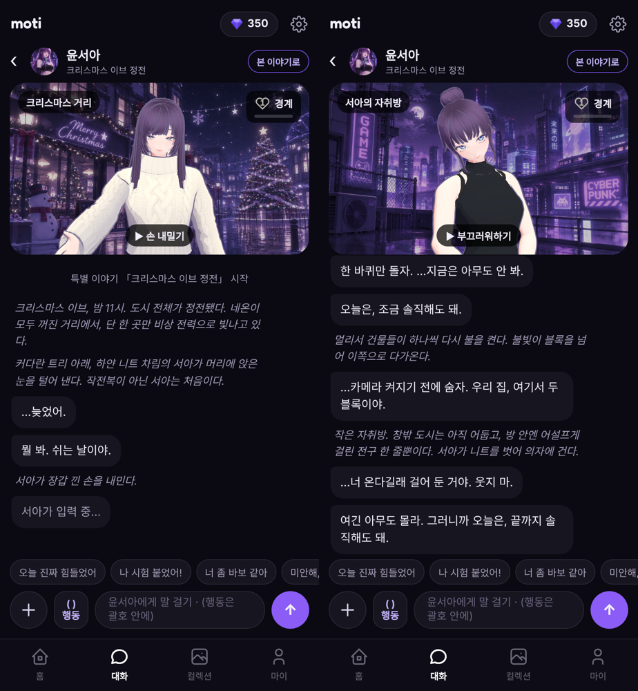

# 40단계 · 크리스마스 이브: 거리 → 서아의 자취방, 장소별 의상

왼쪽: 크리스마스 거리(하얀 니트) · 오른쪽: 서아의 자취방(새 의상, 묶은 머리)

## 한 일
- 새 의상 모델 `seoa_xmas_room.glb` (VRoid `.vrm` 변환, 원본은 저장소 밖) · `data/config.json outfits.xmasRoom`
- 새 장소 7 「서아의 자취방」(에피소드 전용) · `data/seoa_story.json`
- 크리스마스 에피소드(s2): `places: [6, 7]`(이 에피소드 안에서 오갈 수 있는 장소), `outfitByScene: {"7": "xmasRoom"}`(자취방에서는 새 의상)
- 첫 장면 뒤에 5문단 추가: 불이 다시 들어옴 → "카메라 켜지기 전에 숨자" → 자취방으로(어두워졌다 밝아지는 전환) → "너 온다길래 걸어 둔 거야" → "오늘은 끝까지 솔직해도 돼"
- 에피소드에 다시 들어오면 마지막에 있던 장소(거리/자취방)와 그 의상 그대로
- 무빙 카드도 장소별 의상으로 저장(자취방 = 새 의상)

## 바뀐 파일
- `index.html`: setScene(에피소드 places 안 이동), Outfit.want(outfitByScene), outfitForScene, Thread.go, 첫 장면 장소 전환
- `data/config.json`, `data/seoa_story.json`, `data/episodes.json`, `seoa_xmas_room.glb`

## 제가 정한 것
- **자취방 배경 그림이 아직 저장소에 없어서** 임시로 `bg_seoa_roof.jpg`(temp)를 씀. 팀원이 올린 파일 이름을 알려 주면 `data/seoa_story.json` 7번 img 만 바꾸면 됨
- 추가 문단 원고는 기획 대화에서 정한 흐름(거리 → 자취방)에 맞춰 Claude가 씀. 원고가 오면 바꿈

## 확인 필요
- 아이폰 사파리: 첫 장면 중 장소·의상이 같이 바뀌는 전환(모델 6MB를 처음 받는 순간)이 멈칫하는지
