# 41단계 · 남은 장소를 모두 360도 배경으로

브랜치 `step/41-pano-all` · 커밋 `[41] 남은 장소를 모두 360도 배경으로`

바 1층·네온 골목의 360도 설정, 메모리 규칙(지금 장소 360도 그림 하나만), 40·40-1 의 이야기·의상·대화로 장소 이동은 그대로. 그림 파일은 받은 그대로(줄이거나 색을 바꾸지 않음).

## 한 일

- **그림 6개:** 다운로드 폴더의 `pano_seoa_rooftop`·`room`·`rain`·`castle`·`xmas`·`xmas_room` `.webp` 를 맨 위 폴더로 복사. 모두 4096×2048.
- **장소 데이터(`data/seoa_story.json` locations):** 8곳 모두 `pano`·`panoYaw`·`panoBright`.
  - 1 바 2층: `temp` 뺌. 평평한 그림 `bg_seoa_room.jpg` 새로 만듦(360도 그림 가운데 1600×900).
  - 7 서아의 자취방: `temp` 뺌. 평평한 그림 `bg_seoa_xmas_room.jpg` 새로 만듦(같은 방식).
  - 3 비 내리는 골목, 4 바 옥상, 5 드라큘라의 성, 6 크리스마스 거리: 평평한 그림은 그대로.
- **테두리 빛 색(`data/look.json rim.byLocation`):** 「서아의 자취방」 `#FFC48A`(촛불·전구 빛 같은 따뜻한 살구색).
- **고친 것(`index.html` 360도 구 투명도, 한 줄):** 확인하다 보니 구가 다 나타난 뒤에도 매 프레임 투명도가 1 → 0.97(아이폰 60fps 기준, 느린 기기일수록 더 내려감) → 1 로 오가고 있었음(30단계부터, 바 1층·네온 골목도 같음). 「목표가 지금보다 크면 올리고, 아니면 내린다」라서 이미 1일 때도 내렸던 것. 목표와 같으면 그대로 두게 고침. 전환(나타나기·사라지기 0.6초)은 그대로.

## 바뀐 파일

| 파일 | 내용 |
| --- | --- |
| `pano_seoa_room.webp`, `pano_seoa_rain.webp`, `pano_seoa_rooftop.webp`, `pano_seoa_castle.webp`, `pano_seoa_xmas.webp`, `pano_seoa_xmas_room.webp` | 360도 배경 그림(새 파일, 0.3~0.9MB) |
| `bg_seoa_room.jpg`, `bg_seoa_xmas_room.jpg` | 바 2층·자취방 평평한 그림(새 파일, 190KB·135KB) |
| `data/seoa_story.json` | locations 8곳 pano 값, `temp` 2개 뺌, `_locations` 설명 |
| `data/look.json` | 자취방 테두리 빛 색 |
| `index.html` | 360도 구 투명도 깜빡임 고침(`panoTick`) |
| `docs/CREDITS.md` | 새 그림 8개 출처 |
| `docs/status.md` | 41단계 절, 남은 일 |
| `docs/reports/img/41/` | 캡처 |

## 장소별 값

`panoYaw` 는 8곳 모두 0(그림 가운데가 서아 뒤). 받은 그림이 모두 가운데에 장소의 중심(바 카운터·창·골목 끝·성 계단·트리·자취방 창)을 두고 있어 돌릴 필요가 없었음.

| 장소 | 그림 | panoBright | 이유 |
| --- | --- | --- | --- |
| 0 바 1층 | `pano_seoa_bar.webp` | 1 (그대로) | 30단계 값 |
| 1 바 2층 | `pano_seoa_room.webp` | **1** | 서아 머리색과 방 색이 비슷하지만 테두리 빛으로 윤곽이 보임 |
| 2 네온 골목 | `pano_seoa_street.webp` | 1 (그대로) | 30단계 값 |
| 3 비 내리는 골목 | `pano_seoa_rain.webp` | **1** | 가운데 밝기가 네온 골목보다 조금 낮음(그림 가운데 평균 밝기 71 / 네온 골목 76) |
| 4 바 옥상 | `pano_seoa_rooftop.webp` | **0.9** | 8곳 중 가장 밝은 그림(가운데 평균 88). 1 에서는 바닥의 연보라와 서아 바지(하늘색)가 섞여 보여서 낮춤 |
| 5 드라큘라의 성 | `pano_seoa_castle.webp` | **1.1** | 어두운 성(가운데 54)에서 드라큘라 의상(검정)이 묻혀서 올림 |
| 6 크리스마스 거리 | `pano_seoa_xmas.webp` | **1** | 하얀 니트가 트리 앞에서 잘 보임 |
| 7 서아의 자취방 | `pano_seoa_xmas_room.webp` | **1.15** | 가운데가 어두운 창(가운데 50). 새 의상(검은 원피스) 윗몸이 창과 겹쳐 묻혀서 범위 끝까지 올림 |

평균 밝기는 그림을 흑백으로 바꾼 값(0~255), 「가운데」는 서아 뒤에 오는 가로 가운데 1/4·세로 가운데 1/2.

**바닥 이음매:** 8곳 모두 전신 구도에서 서아 발이 그림 바닥 위에 섬. 뜨거나 파묻히지 않음. 바닥이 평평하게 눌리는 자리(발밑 둘레)가 어색하게 꺾여 보이는 곳 없음.

## 캡처 (390px, 무대 칸만, 픽셀 2배)

시연 패널 「장소」로 차례로 옮김. 왼쪽 평소 구도, 오른쪽 전신(바닥 확인). 시연 패널로 옮기면 의상은 바뀌지 않아(본 이야기 의상 규칙) 모두 작전복 — 에피소드 의상은 아래 크리스마스·셀카 캡처에서.

| 장소 | 평소 구도 | 전신 |
| --- | --- | --- |
| 바 1층 | 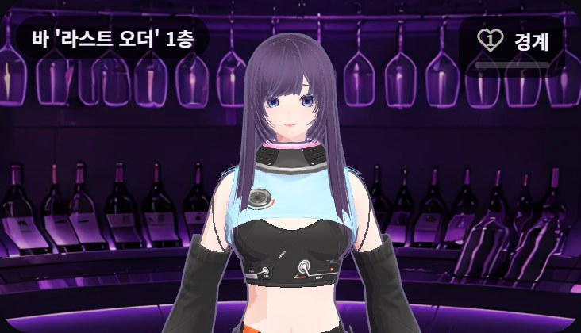 | 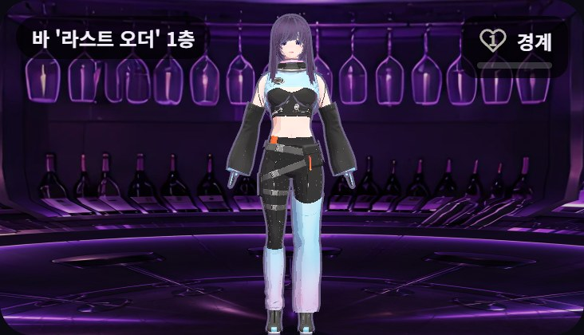 |
| 바 2층 | 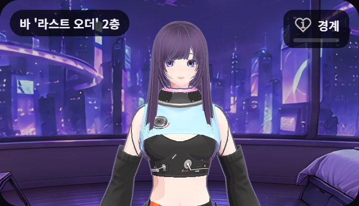 | 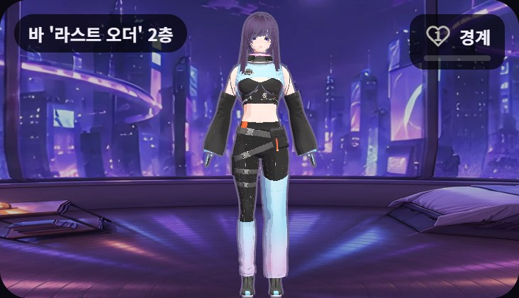 |
| 네온 골목 | 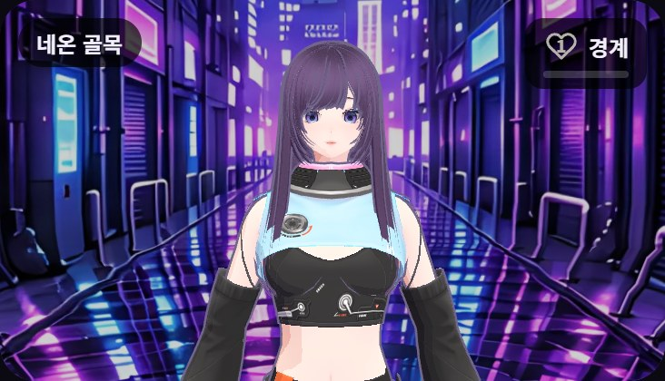 | 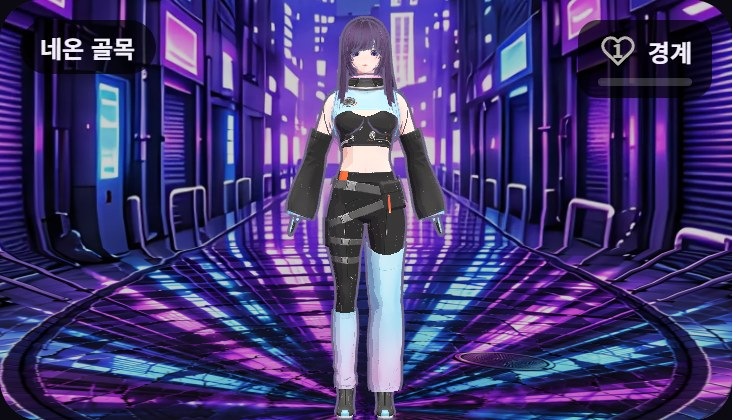 |
| 비 내리는 골목 | 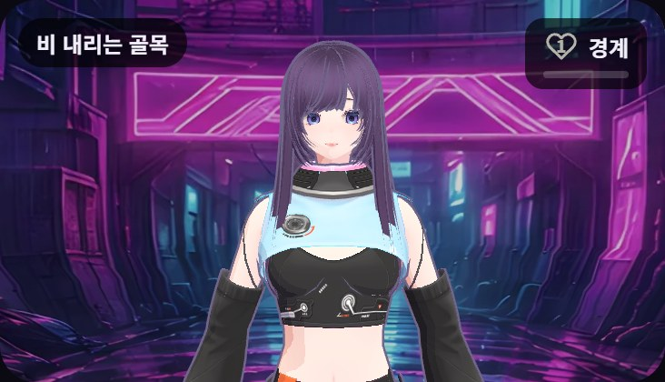 | 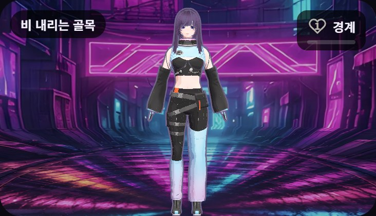 |
| 바 옥상 | 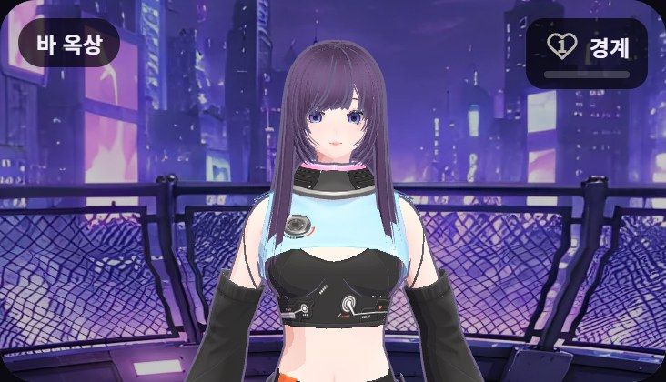 | 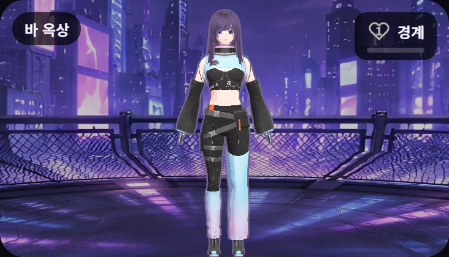 |
| 드라큘라의 성 | 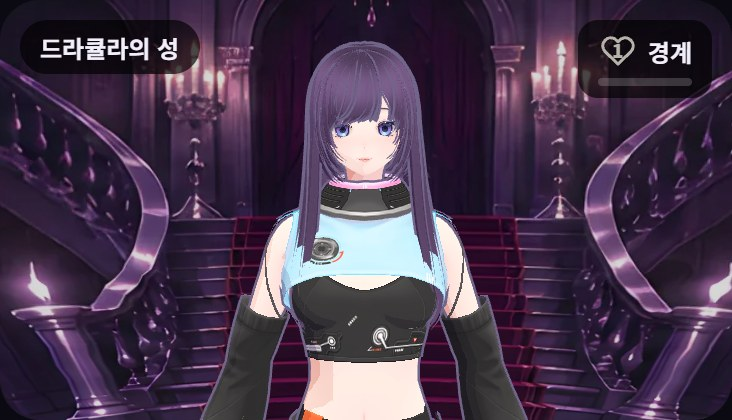 | 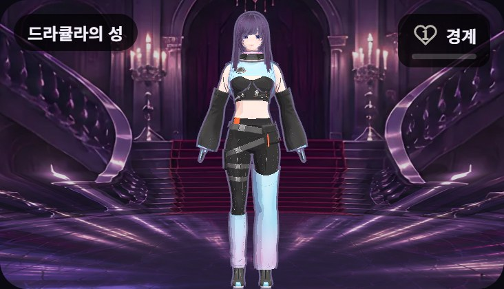 |
| 크리스마스 거리 | 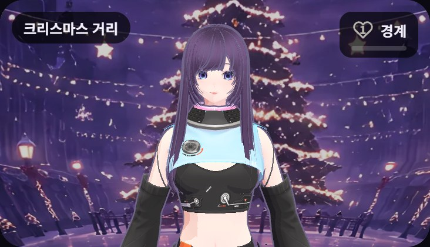 | 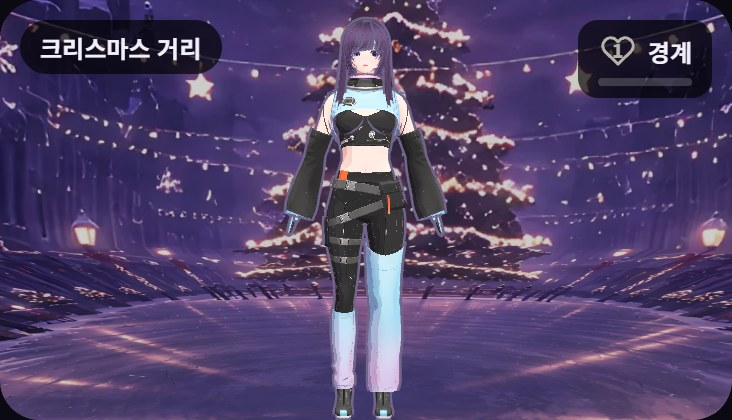 |
| 서아의 자취방 | 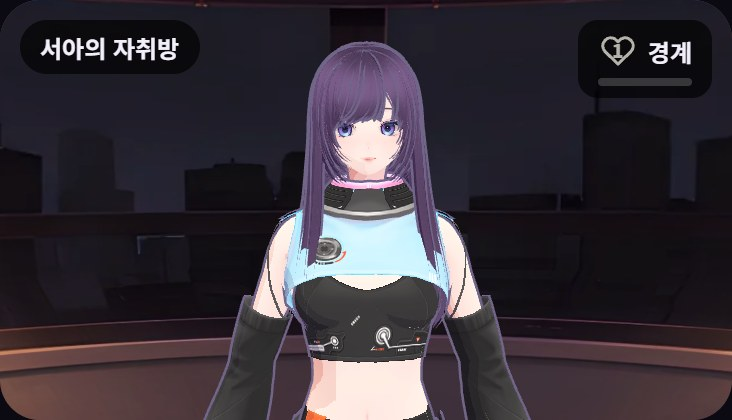 | 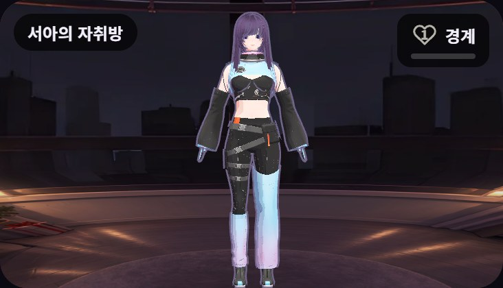 |

대화 화면 전체(바 2층): 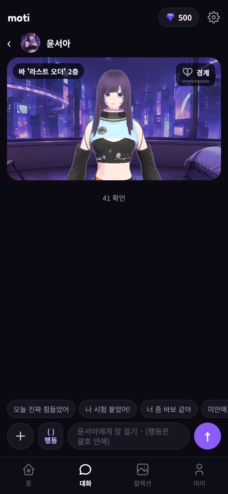

## 확인

헤드리스 Chrome, 390×844(픽셀 2배), 로컬 서버, 서버 없음 모드(`?server=0`). 브라우저 창이 숨겨진 상태에서는 화면 그리기가 느려져 전환을 제대로 볼 수 없어서 39 처럼 헤드리스로 돌림. 같은 순서를 고치기 전·후 두 번 돌림(아래는 후).

### 8곳 순회 · 장소 전환(39)

바 1층 → 2층 → 네온 골목 → 비 내리는 골목 → 옥상 → 성 → 크리스마스 거리 → 자취방 → 바 1층(8번 이동) → 바 2층(9번째).

0.1초마다 잰 값(「막」 = 전환 막 진하기, 0 투명 ~ 1 검정):

| 이동 | 0.1초 | 0.2초 | 0.3초 | 0.5초 무렵 | 0.7초 | 끝(막 0, 새 구 다 보임) |
| --- | --- | --- | --- | --- | --- | --- |
| → 바 2층 | 막 0 | .56 | .97 | .12 · 새 장소 | .09 | 0.64초 |
| → 네온 골목 | .17 | .56 | .98 | .06 · 새 장소 | .05 | 0.68초 |
| → 비 내리는 골목 | 0 | .79 | .91 | .15 · 새 장소 | 0 | 0.64초 |
| → 바 옥상 | .21 | .81 | .98 | .09 · 새 장소 | 0 | 0.64초 |
| → 드라큘라의 성 | 0 | .56 | .98 | .12 · 새 장소 | 0 | 0.65초 |
| → 크리스마스 거리 | 0 | .63 | .93 | .08 · 새 장소 | 0 | 0.64초 |
| → 서아의 자취방 | 0 | .59 | .92 | .27 · 새 장소 | .01 | 0.72초 |
| → 바 1층 | 0 | .56 | .92 | .22 · 새 장소 | 0 | 0.61초 |

- 모두 39 그대로: 0.3초 어두워짐 → 어두운 동안 평평한 그림·360도 구가 함께 바뀜 → 0.4초 밝아짐. 밝아질 때 새 장소 구가 이미 다 나와 있음(교차·빈 바탕 없음).
- 로컬 서버라 그림을 받는 시간이 거의 없음. 실제 회선의 「그림을 어두운 채 최대 1.5초 기다림」은 39 그대로이고 이번에 새로 재지 않음(아래 「아이폰에서 나중에 볼 것」).
- 고치기 전에는 다 나타난 뒤에도 구 투명도가 0.91~1 사이를 계속 오갔음(헤드리스는 프레임이 느려 폭이 큼). 고친 뒤 1 로 고정.

### 메모리(지금 장소 360도 그림 하나만)

| 때 | 남은 360도 그림 | 3D 텍스처 수 |
| --- | --- | --- |
| 시작(바 1층) | 1 (바 1층) | 45 |
| 1~8번 이동 뒤 각각 | 1 (그 장소) | 45 (8번 모두 같음) |
| 9번째 이동(바 2층) | 1 | 45 |
| 셀카 8장(장소마다 다른 360도) 뒤 | 1 (바 2층) | 46 (+1 은 사진을 만들며 생긴 것. 남은 360도 그림 수는 1 이라 360도 그림은 아님) |
| 크리스마스 에피소드 자취방·거리·자취방 | 1 | 32 (에피소드 의상 모델) |

장소를 8번 옮겨도 텍스처 수가 늘지 않음 = 떠난 장소 그림을 매번 내려놓음(30-1 규칙 그대로).

### 크리스마스 에피소드(s2)

홈 → 「크리스마스 이브 정전」 시작.

| | 캡처 |
| --- | --- |
| 첫 장면, 크리스마스 거리(하얀 니트) | 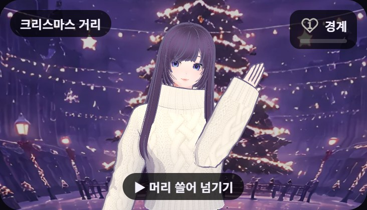 |
| 첫 장면 9번째 문단 → 자취방(새 의상) | 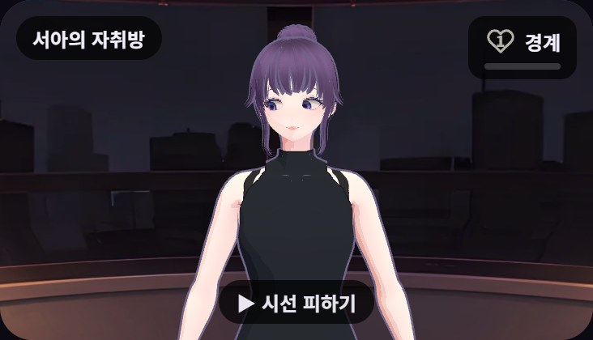 |
| 「트리 보러 다시 나가자」 → 거리 | 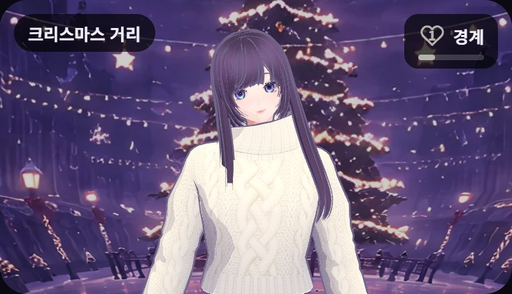 |
| 「너네 집으로 가자」 → 자취방 | 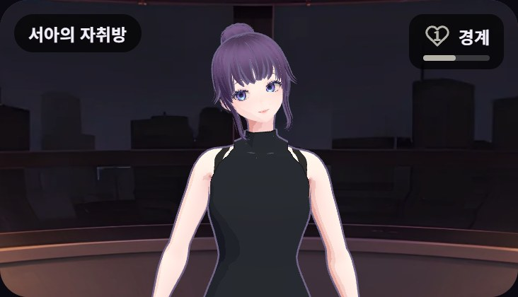 |

- 에피소드 시작: 대화방이 어두운 채(막 1) 열려 0.6초에 크리스마스 거리 360도로 밝아짐. 의상은 막 뒤에서 니트로.
- 첫 장면 → 자취방: 17.9초(9번째 문단)에 장소가 바뀌고 0.3초 어두워짐 → 0.5초 무렵 자취방 360도·평평한 그림 → 0.6초에 새 의상 → 0.75초 다 밝아짐.
- 「트리 보러 다시 나가자」 0.78초, 「너네 집으로 가자」 0.82초에 끝(막 0, 360도·의상 다 바뀜). 「장소가 바뀌었어요」 줄 나옴. 답장은 서버 없음 모드의 예시 대사.
- **같이 본 것:** 의상은 배경보다 0.1~0.15초 늦게 바뀜(막이 0.2 정도로 거의 걷혔을 때). 40 의 의상 바꾸기 순서라 이번엔 손대지 않음 → 아래 「아이폰에서 나중에 볼 것」.

### 서아 사진(셀카) 장소마다 한 장

`SeoaPhoto.make({scene, shot:"selfie"})`. 에피소드 장소는 그 에피소드 의상으로(성 = 드라큘라, 거리 = 니트, 자취방 = 새 의상). 위 줄 왼쪽부터 바 1층·2층·네온 골목·비 내리는 골목, 아래 줄 옥상·성·크리스마스 거리·자취방.

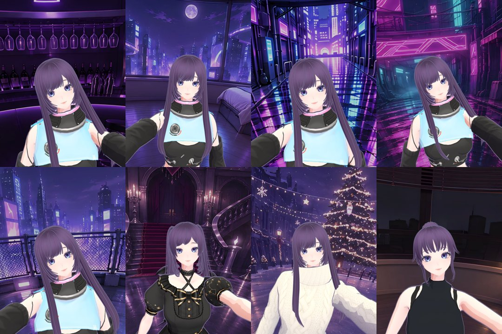

8장 모두 그 장소 360도 배경. 사진을 다 만든 뒤 남은 360도 그림은 매번 1장(대화방 장소 것).

### 첫 만남 연출

연출 장소(비 내리는 골목)도 이제 360도라 연출이 360도 골목에서 진행됨(31-1 미리 받기가 이 그림을 받음). 시연 패널 「첫 만남 다시 보기」로 끝까지: 골목 360도 → 끝에서 바 1층 360도로 교차 → 대화 화면, 끝난 뒤 360도 그림 1장.

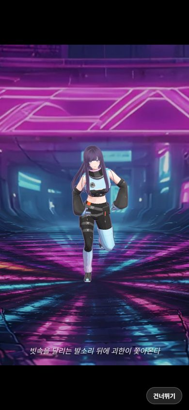

### 오류

- 콘솔 오류 없음(로컬 서버에 없는 `favicon.ico` 404 한 줄뿐, 전과 같음).
- 데이터 JSON 17개 모두 200 으로 읽힘.

## 제가 정한 것

- **panoBright:** 옥상 0.9, 성 1.1, 자취방 1.15, 나머지 1. 서아가 묻히는지만 보고 정함(그림 분위기는 그대로 두려고 범위 안에서 최소만). 성은 드라큘라 의상, 자취방은 새 의상을 입혀 보고 정함.
- **자취방은 1.15 로도 조금 어둡다:** 그림 가운데가 어두운 창이라 검은 원피스 윗몸이 창과 겹침. 1.15(범위 끝)에서 테두리 빛과 함께 윤곽은 보이는 정도. 더 밝게 하려면 범위를 넘기거나, `panoYaw` 로 트리 쪽(그림 왼쪽)을 서아 뒤로 돌리는 방법이 있지만 「그림 가운데가 서아 뒤」 지시대로 0 으로 둠.
- **자취방 테두리 빛 색:** `#FFC48A`. 방 안 빛이 촛불·전구라 따뜻한 색으로. 바 2층(`#FFB38A`)과 비슷하지만 조금 더 노랑. **드라큘라의 성·크리스마스 거리**도 색이 없어 기본 분홍(`#FF7AC8`)을 쓰고 있음 — 지시가 7번만이라 그대로 둠.
- **평평한 그림 자르기:** 지시대로 360도 그림 가운데를 1600×900 그대로 잘라 jpg(품질 85). 360도 그림 가운데는 좌우가 넓게 펼쳐진 모양이라 평평한 그림이 약간 넓은 화각으로 보임(창틀이 조금 휜 정도).
- **`bg_seoa_roof.jpg`:** 이제 서아 장소에서는 안 씀. 예전 앱(`app.js`)·`xstage.html` 이 아직 써서 지우지 않음.
- **`temp` 설명:** `_locations` 의 temp 설명을 「41단계부터 쓰는 곳 없음」으로 바꿈(앞으로 임시 그림이 생기면 쓸 수 있게 설명은 남김).
- **구 투명도 깜빡임 고침:** 지시에 없었지만, 8곳이 모두 360도가 되면서 모든 장소에 해당해서 한 줄 고침. 360도 설정 값·메모리 규칙·전환 시간은 그대로.
- **확인 방법:** 앱 안 브라우저 창이 숨겨진 상태라 화면 그리기가 거의 멈춰서, 헤드리스 Chrome 으로 시연 패널 단추를 눌러 확인(39 와 같은 방식). 확인 스크립트는 저장소 밖 임시 폴더.

## 아이폰에서 나중에 볼 것

- **그림 불러오기:** 새 360도 그림 0.3~0.9MB. 실제 LTE 에서 장소를 옮길 때 어두운 채 기다림(최대 1.5초)이 길게 느껴지는지, 늦으면 평평한 그림 → 구가 나타나는 0.6초.
- **처음 실행 첫 만남 연출:** 이제 비 내리는 골목 360도(0.88MB)를 연출 전에 받음(31-1 미리 받기, 기다림 최대 `firstMeet.panoWaitMs` 2초). 39 에서 잰 첫 로딩보다 받는 양이 0.88MB 늘어남 — 연출 시작이 늦어지지 않는지.
- **메모리:** 지금 장소 그림 하나만(4096×2048, GPU 약 32~43MB)은 그대로. 장소를 여러 번 옮길 때·자취방 의상 모델(6MB)과 같이 있을 때 사파리가 탭을 다시 불러오는지.
- **구 깜빡임 고침:** 다 나타난 360도 배경이 가만히 있는지(전에는 60fps 에서 3% 정도 비침이라 눈에 잘 안 띄었을 수 있음).
- **의상이 배경보다 조금 늦게 바뀜(40):** 크리스마스 거리 ↔ 자취방에서 밝아지는 중에 앞 의상이 0.1초쯤 보이는지.
- **어두운 자취방:** 실제 화면 밝기에서 검은 원피스가 창에 묻히지 않는지(1.15 로 충분한지).
