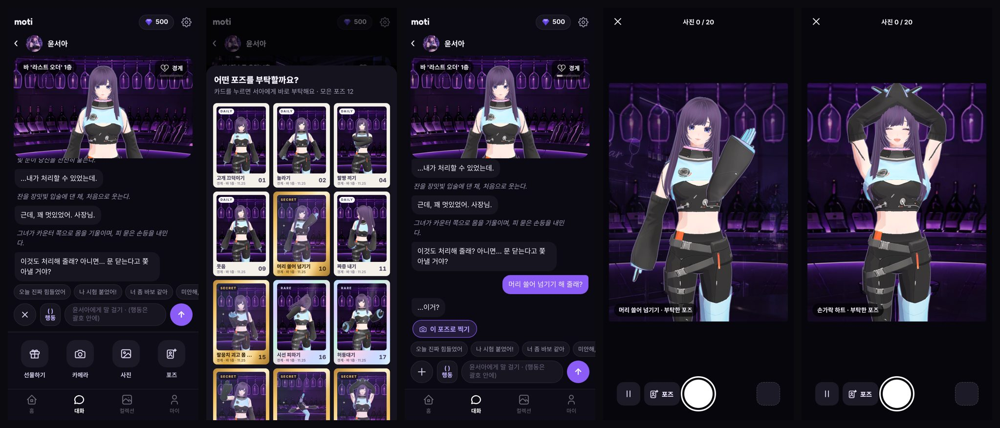
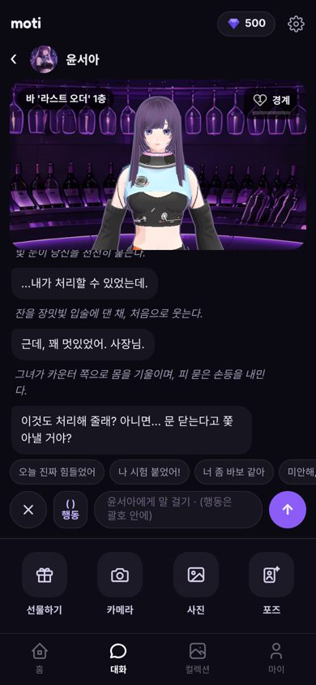
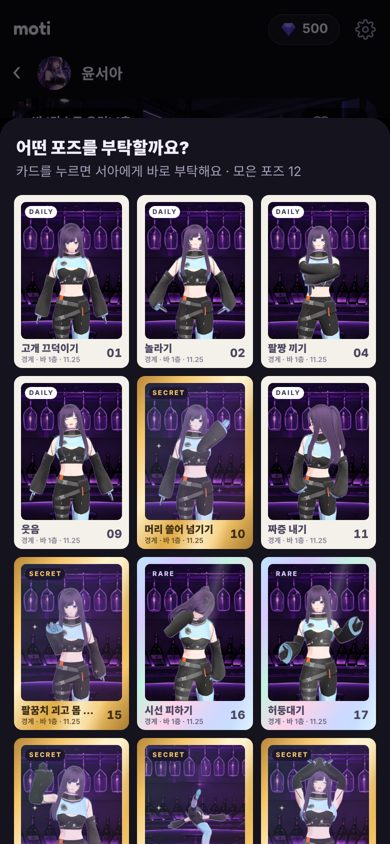
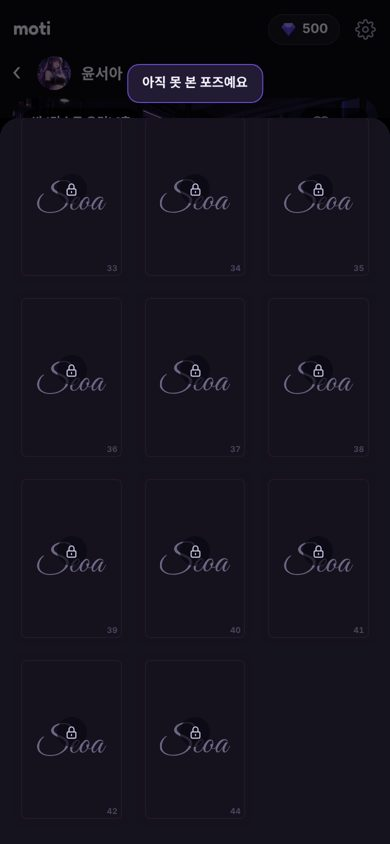
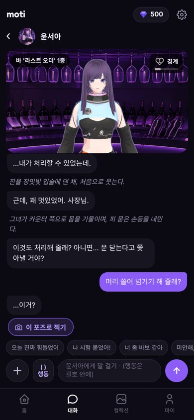
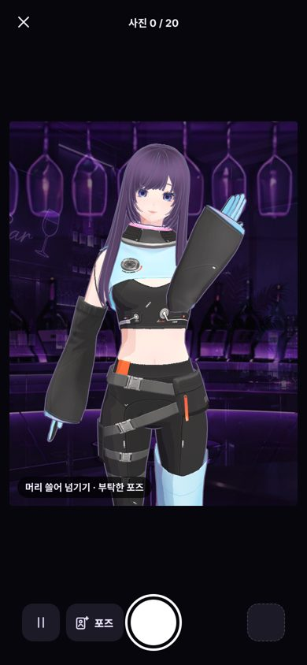
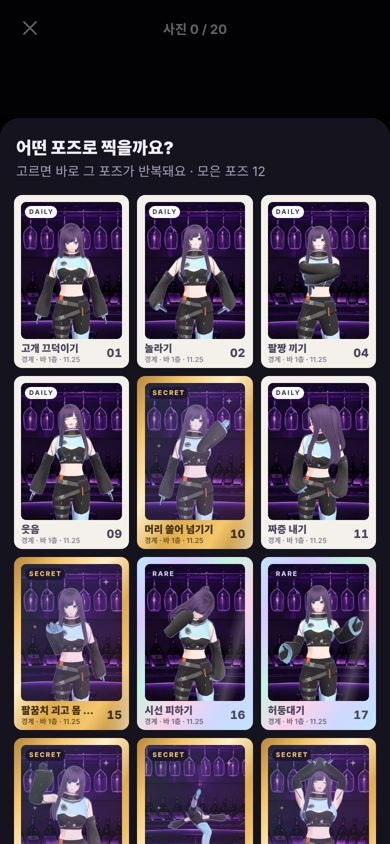
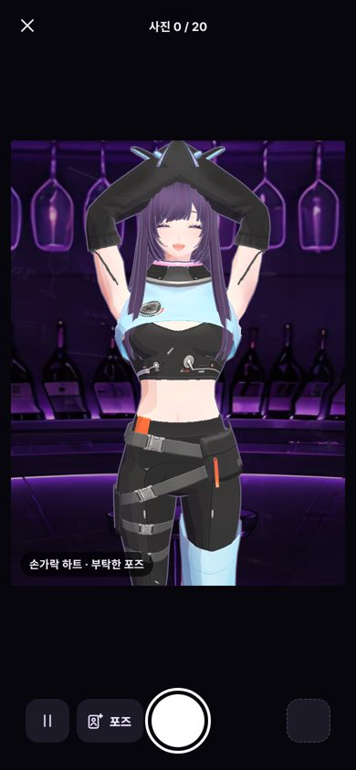

# 41단계 · 포즈: 모은 카드로 포즈를 부탁하고 그대로 찍기

왼쪽부터: ＋ 기능판 「포즈」 · 카드 목록 · 서아 답장과 「이 포즈로 찍기」 · 부탁한 포즈로 촬영 · 촬영 중 다른 포즈로 바꿈

원고: [docs/drafts/41-포즈-원고.md](../drafts/41-포즈-원고.md)

## 한 일
- **＋ 기능판 네 번째 칸 「포즈」**: 다른 칸과 같은 선 아이콘(세로 카드 안 사람 + 작은 반짝임)
- **카드 목록 시트**(`#poseSheet`): 컬렉션 포토카드(`Cards.grid`)를 그대로 3열. 모은 카드가 앞(번호 순), 못 모은 칸은 뒷면 + 자물쇠. 잠긴 칸을 누르면 「아직 못 본 포즈예요」 알림만
- **A. 대화에서**: 카드를 누르면 내 말 「{이름} 해 줄래?」가 자동으로 보내지고, 서아 답장과 함께 **그 몸짓이 꼭 재생**됨(서버가 고른 몸짓보다 우선). 답장 아래 「이 포즈로 찍기」 → 그 몸짓을 반복하는 촬영 화면
- **B. 촬영 화면에서**: 멈춤 옆 「포즈」 버튼 → 같은 카드 목록(제목 「어떤 포즈로 찍을까요?」) → 고르면 바로 그 몸짓 반복
- 촬영 칩: 고른 포즈면 「{이름} · 부탁한 포즈」, 멈추면 예전처럼 「{이름} · 멈춤」
- 서버 답장이 없을 때(서버 없음·실패) 서아 대사는 예비 대사 대신 「…이거?」
- 선물 카드(g01…)도 고를 수 있음: 그 카드의 재생 설정(`Cards.motionOf`) 몸짓·표정으로

## 바뀐 파일
- `pose.js` (새 파일): 카드 목록 시트, 부탁 보내기, 「이 포즈로 찍기」
- `pose.css` (새 파일): 시트·자물쇠·답장 아래 버튼
- `index.html`: ＋ 기능판 칸, `#poseSheet`, `send()`(포즈 부탁이면 그 몸짓·기본 대사, 답장에 `pose` 표시), `renderLog()`(답장 아래 버튼)
- `photos.js`: 촬영 화면 「포즈」 버튼, `Cam.open({pose})`, `Cam.setPose()`, 칩 문구, 아이콘 pose·camera
- `photos.css`: 촬영 화면 아래 줄을 「멈춤·포즈 | 셔터 | 최근 사진」으로(셔터는 계속 가운데)
- `data/ui.json`: `fn.pose`, `pose.*` 문구

## 캡처 (390×844)
| | |
| --- | --- |
|  |  |
|  |  |
|  |  |
|  | |

## 제가 정한 것
- 기능 이름은 기획 대화에서 「포즈 부탁」 → **「포즈」**로 확정된 것을 따름. 시트 제목·칩 등 안쪽 문구는 원고의 「부탁」 표현을 그대로 둠
- 시트 설명 줄 「카드를 누르면 서아에게 바로 부탁해요 · 모은 포즈 {n}」, 촬영 화면 쪽 「어떤 포즈로 찍을까요?」「고르면 바로 그 포즈가 반복돼요 · 모은 포즈 {n}」은 원고에 없어 Claude가 씀
- 서버는 손대지 않음: 내 말 「{이름} 해 줄래?」가 평소 대화처럼 서버로 가고, 답장 대사는 서버 AI가 씀. 몸짓만 앱에서 부탁한 것으로 고정
- 못 모은 칸도 목록 뒤쪽에 보여 줌(잠금). 숨기지 않은 이유: 모을 게 남았다는 걸 보여 주려고
- 원고의 「시크릿 포즈 특별 반응」「같은 포즈 연달아 → 또?」「하루 몇 번 무료 / 다이아」는 이번에 넣지 않음(지금은 무제한 무료). 서버 프롬프트에 포즈 부탁 표시를 넘기는 일과 같이 다음 단계로
- 촬영 중에 포즈를 바꾸면 멈춤을 풀고 처음부터 반복

## 확인 필요
- 아이폰 사파리: 카드 목록 시트(카드 반짝임 애니메이션이 시트 안에서도 부드러운지, 시트 스크롤), 촬영 화면 아래 줄(좁은 화면에서 「멈춤·포즈」와 셔터가 겹치지 않는지)
- 서버 v2에서 「○○ 해 줄래?」에 대한 답이 자연스러운지 (어색하면 서버 프롬프트에 포즈 부탁 한 줄 추가)
