# 42 · 크리스마스 에피소드를 에피소드 관계 단계로 · 걸어 나가고 들어오기

브랜치 `step/42-xmas-stage` · 커밋 `[42-A] 에피소드만의 관계 단계`, `[42-B] 단계별 장면과 걸어 나가고 들어오기`, `[42-B] 걷기 모션 출처`, `[42-C] 서버 신호와 카드, server-sync`
원고: [drafts/42-크리스마스-에피소드-원고.md](../drafts/42-크리스마스-에피소드-원고.md) (다운로드 폴더에서 복사, 2절 문단·대사를 그대로 넣음)

## 한 일

### A · 에피소드만의 관계 단계
- `data/episodes.json` s2 에 `stage` 묶음: 기준 호감 `[0,8,18,30,42,55]`, 단계별 상한 `[7,17,29,41,54,100]`(다음 기준 − 1), 5→6 에 필요한 판정 플래그 `sincere·pursue·comfort`(하나라도).
- 에피소드 호감·단계·받은 플래그는 `S.threads.s2.ep` 에 따로 저장. 에피소드 안 판정 결과는 에피소드 호감에만 더하고, 본 이야기 호감·단계·대화 횟수는 건드리지 않음.
- 에피소드 안에서는 화면 위 하트·게이지가 에피소드 단계(이름은 본 이야기와 같은 「경계·티키타카·썸·고백 직전·엇갈림·연인」). 「본 이야기로」를 누르면 본 이야기 단계로.
- 처음 들어가면 1단계, 다시 들어가면 마지막 단계·장소·의상에서 이어짐.
- 시연 패널(톱니바퀴)에 에피소드 안에서만 「에피소드 단계」 묶음: 지금 단계·호감·상한·못 올린 판정 수·플래그, 본 이야기 단계(그대로인지 확인용), 단계 1~6, 판정 +5 / +10 / +0 / −3, 다음 판정 플래그(care·sincere·pursue·comfort), 장면 다시, 에피소드 처음부터.

### B · 단계별 장면 · 걸어 나가고 들어오기
- s2 `stageScenes`(단계 → 시작 장소·문단·몸짓·표정·장소 이동·걷기·신호). 예전 `opening`(12문단, 40에서 Claude 가 쓴 자취방 문단 포함)은 지우고 원고 1단계 장면이 시작 장면.
- 단계가 오르면 「관계가 변했어요 · 이름」 줄 → 그 단계 장면을 오프닝처럼 1.9초 간격으로 → 끝나면 자유 대화. 장면 도중 나가면 진행 자리를 저장해 다시 들어올 때 그 자리부터(문단 중복 없음).
- **신호:** 한 단계에서 판정이 3번 이어서 단계를 못 올리면 그 단계 「신호」를 서아 지문으로 한 번.
- **장소:** 1~3단계는 크리스마스 거리만(40-1 장소 단어로도 자취방에 못 감). 4단계부터 자취방이 열리고 그 뒤는 40-1 그대로.
- **의상:** 4단계 장면에서 자취방으로 옮길 때는 니트 그대로 → 「걸어서 화면 밖으로」로 나가 있는 동안 자취방 옷(xmasRoom) → 「걸어서 화면 안으로」. 그 뒤 자취방에 다시 들어올 때·이어하기 때는 갈아입었으면(또는 5단계부터) 자취방 옷, 거리는 니트.
- **걷기 x22:** `_src/standard_Walk.fbx`(이름 그대로) → `motions/xstage_walk.json`(`tools/fbx2motion.mjs`), `data/motions.json` x22 「걷기」 `only: "walk"`(대화 몸짓 목록·컬렉션·키워드에 안 나옴). 출처 [CREDITS.md](../CREDITS.md).
  - 걸어 나가기: 0.3초 동안 화면 왼쪽으로 돌며 걷기 시작 → 제자리 걸음을 되풀이하며 서아 몸을 왼쪽으로 → 3D 칸 왼쪽 끝 + 0.45m 밖에서 멈춤.
  - 걸어 들어오기: 칸 왼쪽 밖에서 오른쪽을 향해 걸어 → 마지막 0.5초 동안 고르게 느려지며 앞을 향해 돌고 기본 자세로 원래 자리에 섬.
  - 옮기는 거리 = 모션 골반이 실제로 앞으로 간 거리(되풀이마다 이어 붙임) × 섞는 무게 × 서아 골반 높이(`walk.strideK` 1). 카메라는 그대로.
  - 걷는 동안·화면 밖에 있는 동안은 다른 몸짓(답장 몸짓·시계 보기 33·다시 들어올 때 인사 34)을 받지 않음.
  - 값 `data/config.json walk`, 구간 `data/motions.json xstage.x22`(2.067~3.233초 되풀이).

### C · 서버 신호 · 카드 · 서버에 알릴 것
- 에피소드 중 `/chat` state 에 `episode: "s2"`, `episode_stage`(1~6), `episode_stage_name`, `location`(「크리스마스 거리」/「서아의 자취방」)을 더함. `/judge` 도 같은 값 + 에피소드 단계·호감·플래그.
- 6단계 장면이 끝나면 시크릿 무빙 카드 「크리스마스 이브」(`data/collection.json` e01, 45번, c05 이마 맞대기·자취방·xmasRoom 의상, 카드 띠의 단계는 「연인」).
- [docs/server-sync.md](../server-sync.md) 새로 만듦: 맨 위 표(날짜 · 앱 단계 · 서버가 할 일 · 상태), 첫 줄 = 원고 5절 EPISODE_XMAS 블록과 state 신호 4개. 아래 「서버에 물어볼 것」(단계 이름 차이 등).

## 바뀐 파일

| 파일 | 내용 |
| --- | --- |
| `index.html` | `EpStage`(에피소드 단계·호감·상한·플래그·장소 열림·옷 갈아입음), `EpScene`(단계 장면 진행·이어하기·신호·카드), `runJudge` 에피소드 갈래, `send()` 에피소드 판정/대화 횟수, `chatState()`(서버 신호), `Thread.save/go`(에피소드 값 보존, 판정 묶음 줄기마다), `renderBond`, `setScene`·`Outfit.want`·`outfitForScene`(장소·의상 규칙), `startStory`·`openRoom`(시작·이어하기), 무대 `Stage.walk`(걸어 나가기·들어오기, `cur.win`), `IdleWatch`·`Greet`(걷는 동안 막기), 시연 패널 「에피소드 단계」, 모르는 몸짓 id 방어, `cards.js?v=42` |
| `cards.js` | 몸짓 칸이 아닌 카드(e01)도 `play` 로 그림 |
| `data/episodes.json` | s2 `stage`·`stageScenes`(원고 2절), `opening` 지움, 설명 |
| `data/motions.json` | x22 걷기(`only: walk`), xstage 구간과 설명 |
| `data/config.json` | `walk` 값과 설명 |
| `data/collection.json` | e01 「크리스마스 이브」 |
| `data/demo.json` | 시연 패널 「에피소드 단계」 문구 |
| `motions/xstage_walk.json` | 걷기 모션(53KB) |
| `docs/server-sync.md` | 새 문서 |
| `docs/CREDITS.md` | 걷기 모션 출처 |
| `docs/drafts/42-크리스마스-에피소드-원고.md` | 원고 |
| `docs/reports/img/42/` | 캡처·확인 기록(`res-*.json`) |

## 캡처 (390×844, 픽셀 2배, 헤드리스 Chrome)

브라우저 창(앱 안 브라우저)이 숨겨진 상태라 화면 그리기가 느려서 39·41 처럼 헤드리스 Chrome 으로 찍음. 서버 없음 모드(`?server=0`)에서 시연 패널과 같은 함수(`EpStage.judged` = 판정 +n)로 에피소드 호감을 올림. 본 이야기는 3단계(썸)·호감 45 로 맞춰 둠.

### 1~6단계

| 본 이야기(전) | 1 경계 — 시작 장면 | 1단계 신호 | 2 티키타카 |
| --- | --- | --- | --- |
| 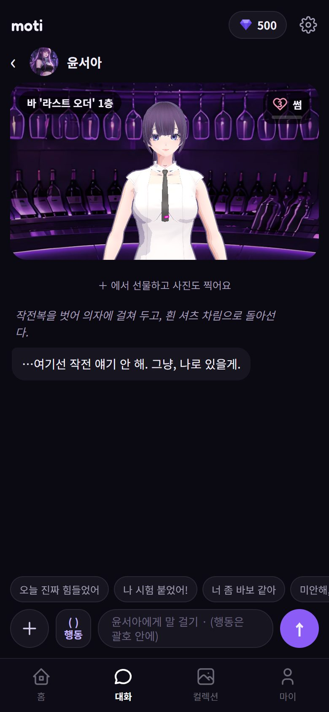 | 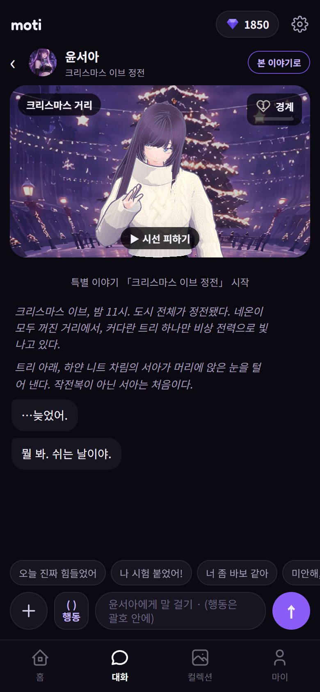 | 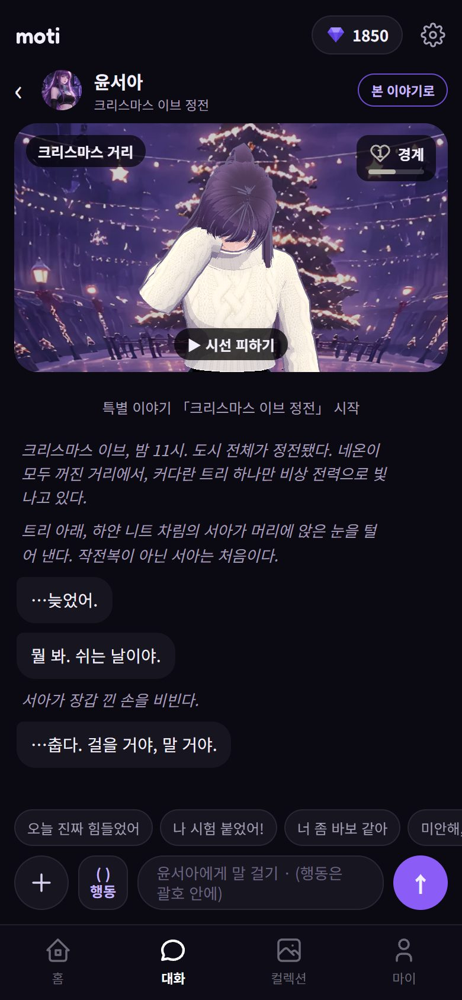 | 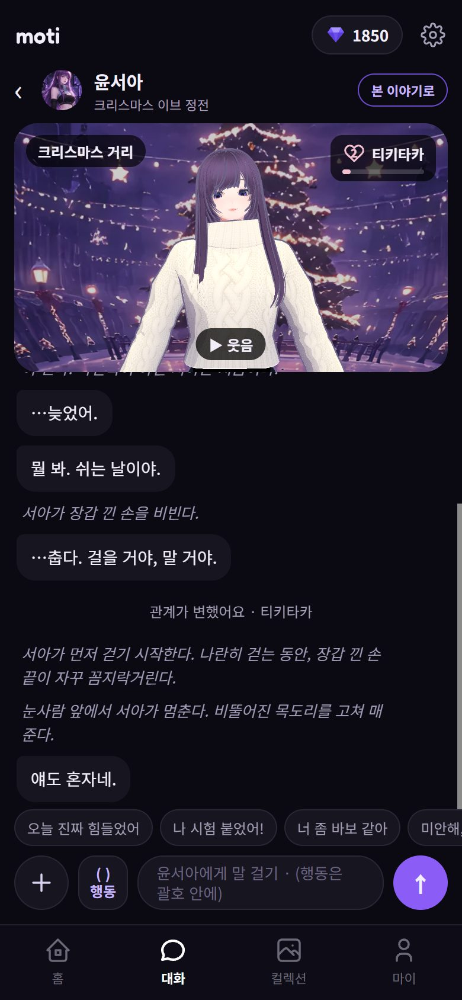 |

| 3 썸 | 3단계에서 「집에 가자」 → 거리 그대로 | 4 고백 직전(걸어 나갔다 들어온 뒤) | 4단계 「트리 보러 다시 나가자」 → 거리(니트) |
| --- | --- | --- | --- |
| 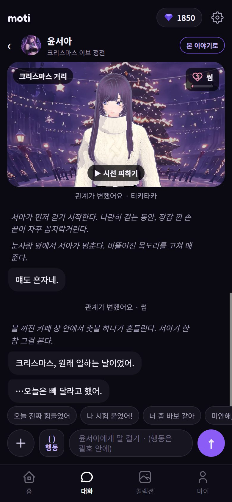 | 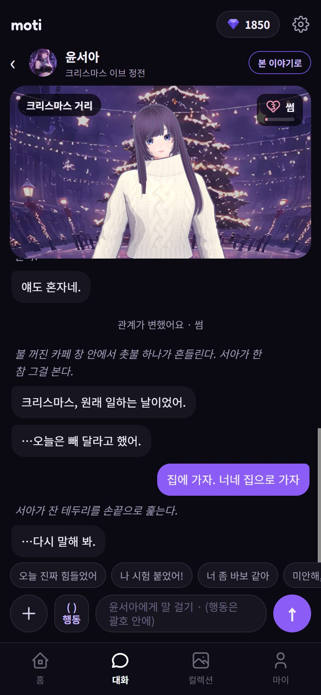 | 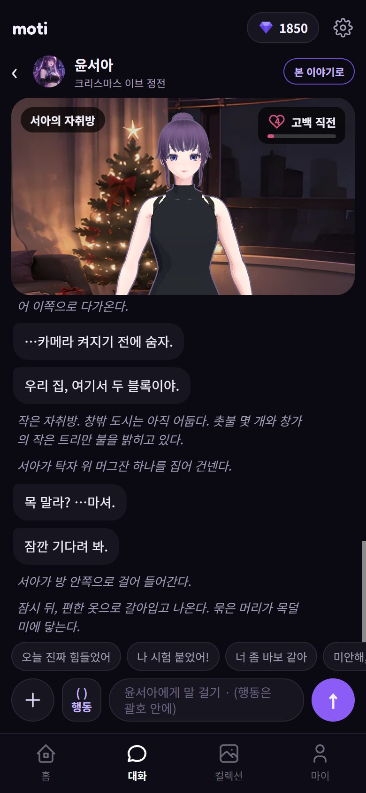 | 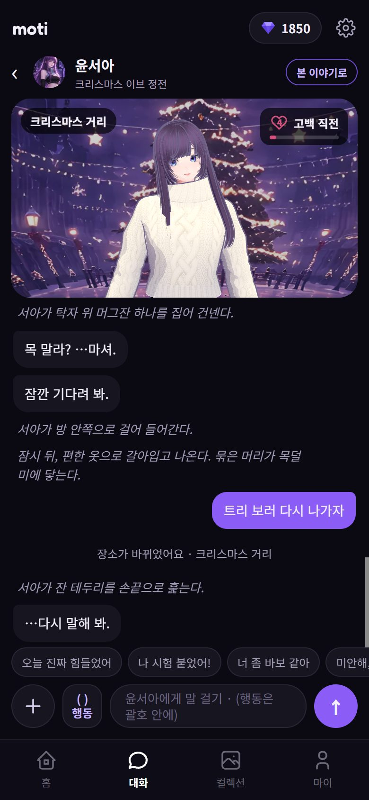 |

| 「너네 집으로 가자」 → 자취방(자취방 옷) | 5 엇갈림 | 6 연인 | 본 이야기로(후) | 다시 들어옴 |
| --- | --- | --- | --- | --- |
| 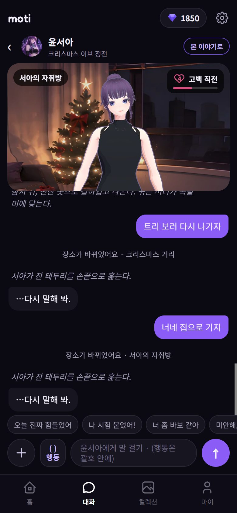 | 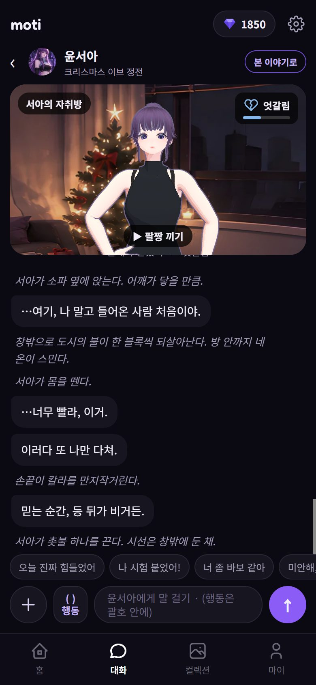 | 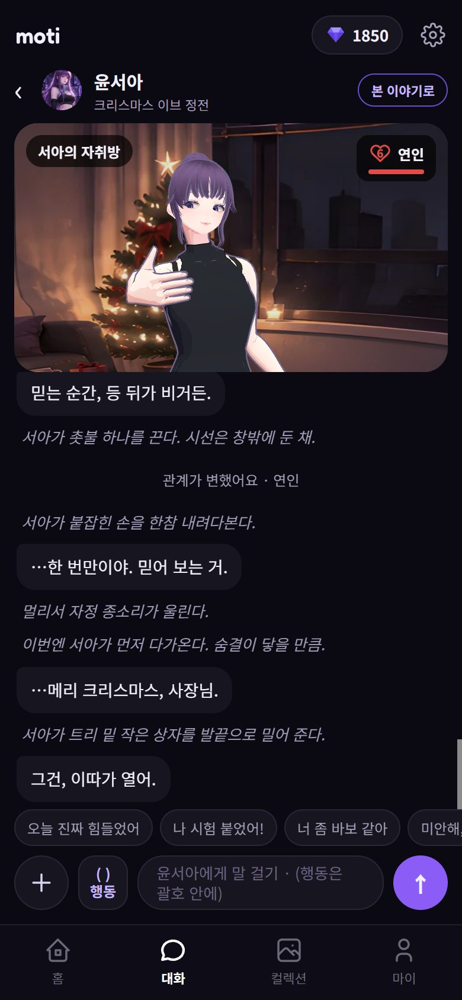 | 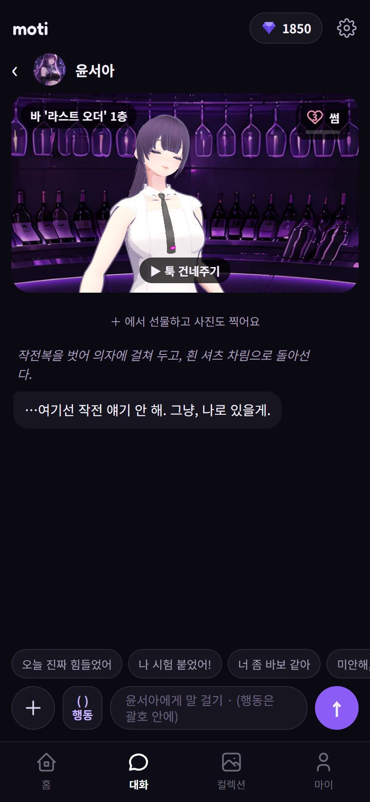 | 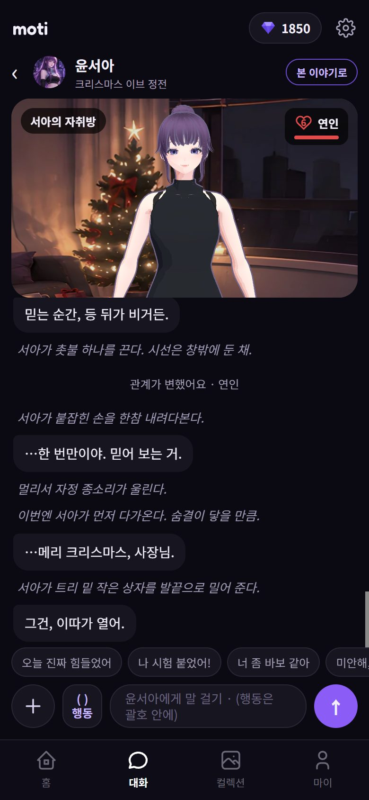 |

| 순간 | 위 하트·게이지 | 에피소드 단계 · 호감 | 본 이야기 단계 · 호감 | 장소 · 옷 |
| --- | --- | --- | --- | --- |
| 들어가기 전 | 썸 | — | 3 · 45 | 바 1층 · 흰 옷 |
| 1단계 장면 뒤 | 경계 0% | 1 · 0 | 3 · 45 | 거리 · 니트 |
| 판정 +1 × 4(신호 뒤) | 경계 50% | 1 · 4 (못 올린 판정 4) | 3 · 45 | 거리 · 니트 |
| +5 | 티키타카 | 2 · 9 | 3 · 45 | 거리 · 니트 |
| +10 | 썸 | 3 · 19 | 3 · 45 | 거리 · 니트 |
| 「집에 가자. 너네 집으로 가자」 | 썸 | 3 · 19 | 3 · 45 | **거리 그대로** |
| +12 | 고백 직전 | 4 · 31 | 3 · 45 | 자취방 · 자취방 옷 |
| +12 | 엇갈림 | 5 · 47 | 3 · 45 | 자취방 · 자취방 옷 |
| +20, 플래그 없음 | 엇갈림 | **5 · 54 (상한)** | 3 · 45 | |
| +2, pursue | 연인 100% | 6 · 56 | 3 · 45 | 자취방 · 자취방 옷 |
| 본 이야기로 | 썸 | — | 3 · 45 | 바 1층 · 흰 옷 |
| 다시 들어옴 | 연인 | 6 · 56 | 3 · 45 | 자취방 · 자취방 옷 |

- 신호: 판정 3번 뒤 「*서아가 장갑 낀 손을 비빈다.* "…춥다. 걸을 거야, 말 거야."」 한 줄, 4번째 판정 뒤에도 그대로 **1줄**.
- 5→6: 호감이 기준(55)을 넘어도 플래그가 없으면 5단계에 상한 54 로 머묾. pursue 가 오면 6.
- 단계 상한: 3단계 29 에서 +30 이 와도 4단계(상한 41)까지만(A 확인 때).

### 걸어 나가기·들어오기 (0.1초 간격)

3D 그림판을 그린 바로 뒤 100ms 마다 그대로 떠서 모음. 평소 대화 구도는 상반신이라 발이 안 보여서, 같은 장면을 전신 구도(시연용으로 기본 구도만 전신으로 바꿈)로 한 번 더 찍음.

- 걸어 나가기(전신): 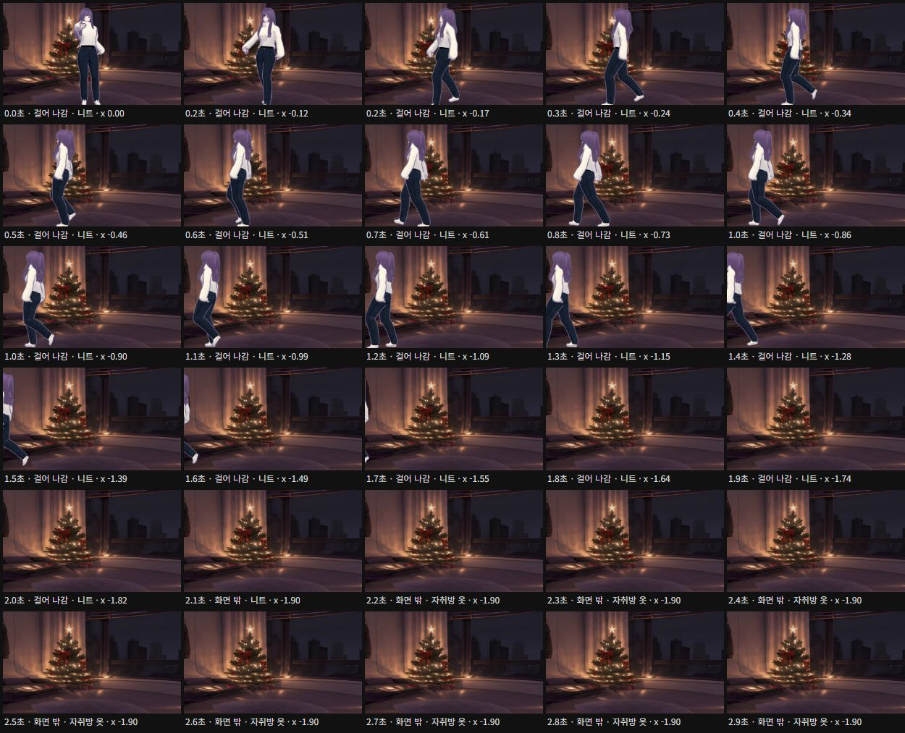
- 걸어 들어오기(전신): 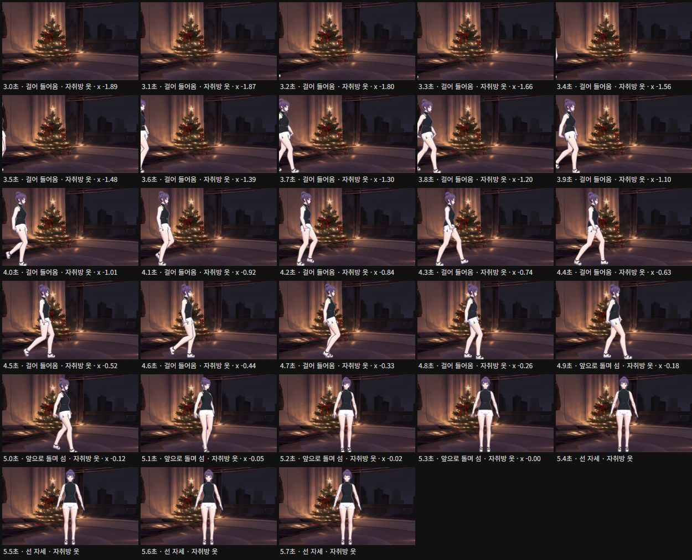
- 평소 구도(실제 앱 화면의 무대 칸): 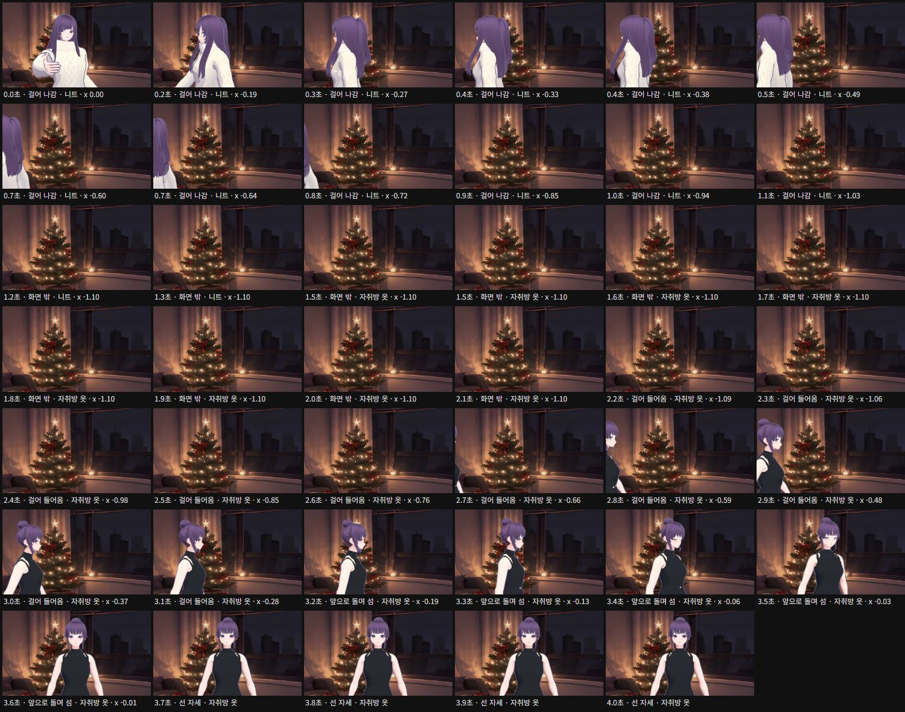

| 확인 | 결과 |
| --- | --- |
| 화면 밖으로 완전히 나가는지 | 예. 평소 구도 −1.10m, 전신 구도 −1.90m 에서 멈춤(칸 반폭 + 0.45m). 멈춘 화면에 서아 없음 |
| 나간 동안 옷이 바뀌는지 | 예. 니트 → 자취방 옷이 화면 밖(off)에서 바뀜(평소 구도 1.45초, 전신 2.2초). 들어올 때는 이미 자취방 옷 |
| 시간 | 평소 구도: 나가기 1.2초 → 밖 1.0초 → 들어오기 1.0초 → 앞으로 돌며 섬 0.5초. 전신: 2.1 → 0.9 → 1.9 → 0.5초 |
| 들어와서 자연스럽게 서는지 | 마지막 0.5초 동안 몸을 앞으로 돌리며(90° → 0°) 고르게 느려져 x 0.00 에 섬 → 기본 자세. 튀는 프레임 없음 |
| 발 미끄러짐 | 옮기는 거리가 모션 골반 이동 그대로라 몸 속도(0.93m/초 = 골반 높이 × 1.15/초)가 원본 걸음과 같음. 디딤발(발목) 움직임: 원본 FBX 자체(제자리 이동 포함) 골반 높이 × 0.35~0.44/초, 앱 곧게 걷는 구간 0.27~0.61/초(프레임이 초당 25장 정도라 흔들림). 원본과 같은 범위 — 디딜 때 발목이 굴러가는 만큼만 움직임. 눈으로도 걸음과 몸 이동이 맞음 |
| 그림자 | 대화 무대에는 발밑 그림자가 없음(그림자는 촬영 화면·카드에만, 엉덩이 뼈를 따라감). 따로 움직일 것 없음 |
| 카메라 | 그대로(평소 구도) |

### 이어하기 (걸어 나간 채 나갔다가 다시 들어옴)

| 화면 밖에 있을 때 본 이야기로 | 다시 들어옴 → 걸어 나가기부터 마저 | 장면 끝난 뒤 또 들어옴 |
| --- | --- | --- |
| 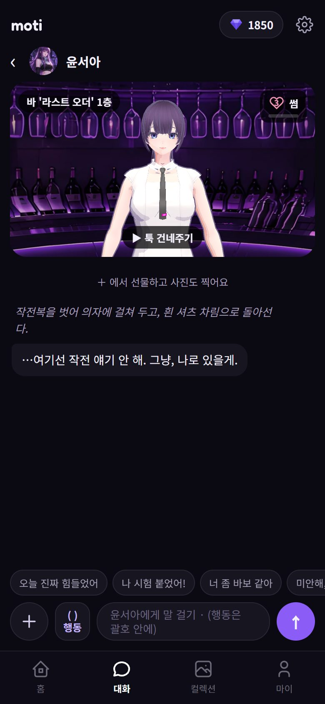 |  | 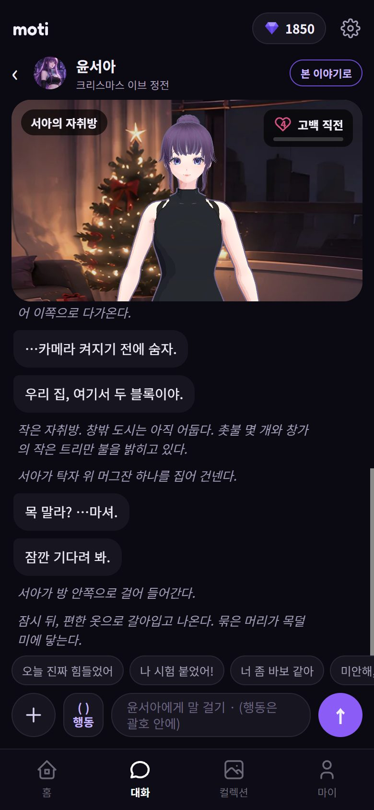 |

- 나간 순간 저장값 `play = {n:4, k:7, pend:6}`(4단계, 다음 문단 8번째, 6번 문단의 걷기가 덜 끝남). 본 이야기에서는 서아가 제자리·본 이야기 옷. 다시 들어오면 걸어 나가기 → 8번째 문단 + 걸어 들어오기, 문단은 한 번씩만.

### 카드 「크리스마스 이브」

| 6단계 장면 끝 — 시크릿 알림 | 카드 크게 보기 |
| --- | --- |
| 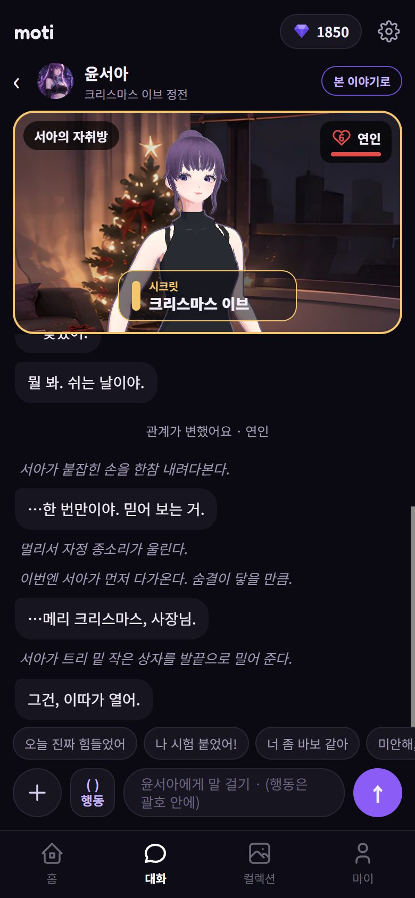 | 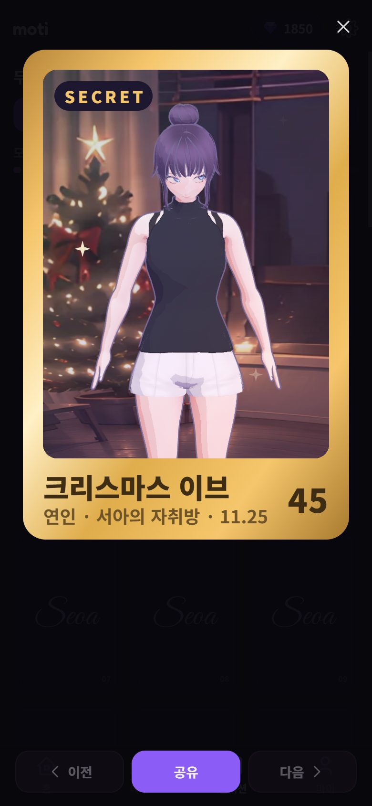 |

- 5단계까지 `S.col.e01` 없음, 6단계 장면 끝에 생김(장소 7 자취방, 옷 xmasRoom, 단계 6). 카드를 주는 곳은 6단계 장면(`stageScenes.6.card`) 하나뿐.

### 서버로 보내는 요청 (실서버 `seoa-backand.onrender.com`)

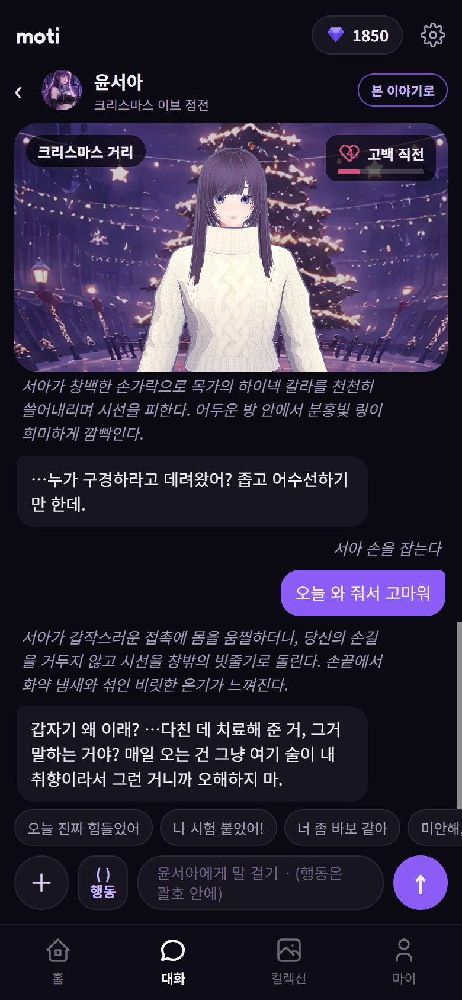

```
/chat  {"stage":3,"affection":45,"location":"크리스마스 거리","episode":"s2","episode_stage":1,"episode_stage_name":"경계"}  message "안녕, 늦어서 미안"
/chat  {"stage":3,"affection":45,"location":"크리스마스 거리","episode":"s2","episode_stage":4,"episode_stage_name":"고백 직전"}  message "집 예쁘다"
/chat  {… 같은 값 …}  message "(서아 손을 잡는다) 오늘 와 줘서 고마워"
/judge {"stage":4,"affection":30,"stage_flags":[],"location":"크리스마스 거리","episode":"s2","episode_stage":4,"episode_stage_name":"고백 직전"}
```
- 3턴째 판정: 에피소드 호감 30 → **33**, 플래그 `care`(손을 잡는 행동), 본 이야기 3 · 45 그대로. 서버는 아직 에피소드를 몰라 답장이 바 설정으로 나옴(서버 블록을 넣기 전이라 예상대로), 앱은 그대로 동작.

### 그 밖
- `data/*.json` 모두 읽힘, 스크립트 문법 검사 통과. 위 캡처 동안 콘솔 오류 없음(경고는 three.js `morphNormals` 만, 전과 같음).
- 카드 확대에서 한 번 오류가 났는데 원인은 헤드리스 브라우저가 예전 `cards.js` 를 캐시에서 씀 → `cards.js?v=42` 로 바꾸고, 무대가 모르는 몸짓 id 를 받으면 멈추게(매 프레임 오류로 무대가 서지 않게) 막음.

## 제가 정한 것
- **상한과 단계 오르기 순서:** 상한(다음 기준 − 1)을 먼저 걸면 다음 기준에 영영 못 닿아서, 판정 한 번마다 「더한 호감이 다음 기준 이상(+ 플래그 조건)이면 한 단계 오름 → 그 결과 단계의 상한으로 자름」. 한 번에 한 단계만.
- **판정 플래그**는 그 단계에서 받은 것을 모아 두고 단계가 오르면 비움(서버 `stage_flags` 와 같은 방식). 5단계에서 sincere 가 먼저 오고 호감은 다음 판정에 채워도 6단계로 감.
- **호감 변화 읽기:** 서버 `/judge` 는 변화량을 따로 주지 않아서, 에피소드 단계·호감으로 보낸 뒤 돌아온 `state.affection − 보낸 호감`을 변화로 씀. 서버의 단계 상한(30·50…)은 에피소드 상한보다 커서 잘리지 않음. 서버가 바꾼 단계·사건은 쓰지 않음.
- **`/chat` 의 `stage`·`affection`은 본 이야기 값 그대로**(지시문 「더한다」 대로, 서버가 몰라도 지금처럼 동작). `/judge` 는 판정이 에피소드 단계를 알아야 해서 에피소드 값. server-sync 「물어볼 것」에 적음.
- **서버 v1·서버 없음**에서는 판정이 없어서 3턴마다 에피소드 호감 +4(`noServerGain`, 플래그 없음 → 5→6 은 시연 패널 플래그로만). 이 판정도 신호의 「못 올린 판정」으로 셈.
- 에피소드 메시지는 본 이야기 대화 횟수(`S.bond`)에 안 셈. 판정 묶음(`judgeBuf`)도 줄기마다 따로(본 이야기 턴이 에피소드 판정에 섞이지 않게).
- **마이 「관계」 줄**은 본 이야기 단계 그대로(에피소드 밖 화면이라).
- **1단계 장면 = 시작 장면:** 예전 첫 장면 12문단(40에서 Claude 가 쓴 자취방 문단 포함)은 원고로 바뀌면서 지움. 예전 첫 대사 옆 「이야기 전용 장면 · 부끄러워하기」 표시는 1단계 장면 끝이 부끄러워하기가 아니라서 s2 에서는 안 붙임.
- **장면 시작 장소:** 1~4단계는 거리, 5·6단계는 자취방(`place`). 단계가 오를 때 다른 장소에 있으면 어두워졌다 밝아지는 전환으로 먼저 옮김(예: 4단계 뒤 거리에 나와 있다가 5단계가 되면 자취방으로).
- 원고 4-4 「[장소: 서아의 자취방 · 어두워졌다 밝아지는 전환]」은 그 문단(작은 자취방…)이 나올 때 전환. 6-3 「m12 다가가기 → c05 이마 맞대기」는 m12 가 90% 쯤 끝날 때 c05.
- 원고 문단 끝 ( — · 표정 )처럼 몸짓이 없는 문단은 표정만. 신호 문단은 원고에 몸짓·표정이 없어서 글만.
- 6단계는 원고에 신호가 없어 신호 없음. 2단계 「손을 잡으면 판정 care」, 5단계 「촛불을 다시 켜는 행동」 메모는 서버 판정 몫이라 server-sync 에 적음.
- **걷기 구간:** 원본 3.53초 중 앞뒤 자세 차이가 가장 작은 한 걸음(2.067~3.233초, 이음매 3.4°)을 되풀이. 원본 0초는 T자라 안 씀.
- **걷기 값:** 도는 시간 0.3초(지시문), 멈추며 앞으로 도는 시간 0.5초, 칸 밖 여유 0.45m, 나가 있는 최소 시간 0.9초, 갈아입을 옷 모델 기다림 최대 8초. 3D 가 안 보이면(다른 탭·촬영 중) 걷지 않고 옷만 바꿈(원고의 「없으면 대체」는 모션이 있어 쓰지 않음).
- 걷는 동안 오는 몸짓은 버림(답장 몸짓 포함). 장면 중엔 입력이 막혀 있어 실제로는 판정·사진 쪽만 해당.
- **옷:** 자취방 옷은 「장면에서 갈아입은 뒤」 또는 5단계부터(`dressFrom`). 시연 패널 단계 버튼으로 4단계에 가면 아직 니트.
- **카드:** 몸짓 칸이 아니라서 id `e01`(첫 만남 x17 처럼 `only` 칸, 대화 묶음), 그림은 c05 이마 맞대기 + 수줍음 표정. 카드 띠 단계는 에피소드 단계(연인).
- **예전 저장값:** 42 전에 크리스마스 에피소드를 하던 사람은 대화는 남기고 1단계부터(1단계 장면 없이) 이어 감.
- 시연 패널 「에피소드 단계」 묶음은 `?debug=1` 없이도 에피소드 안에서 보임(시연에서 단계를 올려 보이기 쉽게).
- `motions/xstage_walk.json` 은 A 커밋에 같이 들어감(B 에서 등록).

## 아이폰에서 나중에 볼 것
- 걸어 나가기·들어오기: 걸음과 몸 이동이 맞는지(발 미끄러짐), 화면 밖으로 다 나가는지(아이폰 무대 칸 비율), 프레임이 끊기지 않는지.
- 화면 밖에 있는 동안 자취방 옷 모델(약 6MB)을 처음 받을 때: 기다림이 길어지면 최대 8초 화면 밖에 머묾 → 실제 회선에서 얼마나 걸리는지.
- 4단계 장면의 장소 전환(어두워졌다 밝아짐)과 바로 이어지는 몸짓, 6단계 m12 → c05 이어짐.
- 시크릿 카드 「크리스마스 이브」 알림 금색 선·카드 그림(c05).
- 하트·게이지가 에피소드 ↔ 본 이야기를 오갈 때 색·길이가 다시 차오르는 모양.
