# 43 · 새 모션 다섯 개 · 답장 기다릴 때 생각하는 몸짓과 문구

브랜치 `step/43-motions-wait` · 커밋 `[43-A] 새 모션 다섯 개와 카드 그림 다시 만들기`, `[43-B] 답장 기다릴 때 생각하는 몸짓과 문구`

## 한 일

### A · 모션 다섯 개 변환·연결

다운로드 폴더의 FBX 다섯 개를 이름 그대로 `_src/` 에 복사해 `tools/fbx2motion.mjs` 로 변환했다(뼈 20개, 30fps, 빠진 뼈 없음). FBX 는 저장소에 넣지 않았다(`.gitignore`).

| 원본 | 변환 결과 | 길이 | 연결 | 재생 구간 |
| --- | --- | --- | --- | --- |
| `standard_Wave_Hands_Upward.fbx` | `motions/xstage_wave_hands_upward.json` 179KB | 11.85초 | **x23 두 손 흔들기**(`only: onboarding`) = 입장권 인사 | 5.2~8.6초(3.4초), `turn` 6, `inPlace` |
| `standard_Idle_Arms_Crossed_female.fbx` | `motions/xstage_arms_crossed_female.json` 304KB | 20.41초 | **m07 팔짱 끼기**의 진짜 모션(25 의 남자 배우 파일은 남김) | 5.4~16.9초 중 7.4~15.4초 건너뜀(3.5초), `skipBlend` 0.4 |
| `standard_Shy_Brushing_hair_back.fbx` | `motions/xstage_brushing_hair_back.json` 111KB | 7.34초 | **c02 머리 쓸어 넘기기**의 진짜 모션(예전 코드 몸짓 대신) | 1.2~5.2초(4.0초), `turn` 83, `inPlace` |
| `standard_Shy _Glancing_around_nervously.fbx` (경로 따옴표) | `motions/xstage_glancing_nervously.json` 77KB | 5.07초 | **m06 허둥대기**의 진짜 모션(예전 코드 몸짓 대신) | 0.6~3.6초(3.0초), `turn` 90, `inPlace`, `damp` |
| `standard_Standing_Think_Chin.fbx` | `motions/xstage_think_chin.json` 143KB | 10초 | **x24 턱 괴고 생각하기**(`only: wait`) = 답장 기다릴 때만 | 1.0~8.4초 중 3.4~6.9초 건너뜀(3.9초), `skipBlend` 0.4 |

- 입장권: `data/onboarding.json greet.motion` m13 → **x23**, `leaveMs` 1650 → **2950**(카드가 사라지는 450ms 가 몸짓 끝 3.4초에 끝남). m13 은 다시 들어올 때 인사(`data/config.json greet`)에 그대로.
- x23·x24 는 `only` 라서 대화 몸짓 목록·서버에 보내는 목록·키워드·컬렉션에 안 나옴(`node tools/build_collection.mjs` → 45칸 그대로). 시연 패널 몸짓 목록에는 미리보기로 나옴(XSTAGE 모션 전체가 나오는 기존 규칙).
- 출처 `docs/CREDITS.md` 에 다섯 줄.

**새 재생 값 두 개**(`data/motions.json xstage`, `index.html xsApply`):
- `skipBlend`: 건너뛰는 이음매 앞 몇 초 동안 건너뛴 뒤 자세와 섞음. 팔짱·턱 괴기는 유지 구간이 길어 건너뛰어야 2~4초가 되는데, 유지하는 동안에도 손목이 6~9° 돌아 있어 이음매에서 툭 튀었음 → 0.4초 섞기로 이음매 안쪽 최대 회전 4.7°(모션 자체 빠르기와 같음).
- `damp`: 뼈마다 모션을 따르는 몫(0~1). m06 원본은 등·목·머리를 합쳐 80° 가까이 숙여 정면에서 정수리만 보였음 → 등·목 0.3, 머리 0.6 으로 약 35°. 옆으로 돌리는 고개(눈을 피하는 부분)는 남음. damp 를 준 뼈는 「모션 안 부모의 목표」 기준으로 계산해, 부모를 덜 숙여도 자식이 다시 꺾여 숙이지 않게 함(팔 등 나머지 뼈는 예전 계산 그대로).

### A · 카드 그림 다시 만들기 (motionVer)
- `data/motions.json xstage` 에 `motionVer`(없으면 1). 이번에 진짜 모션이 바뀐 m07·c02·m06 = **2**.
- 카드 그림을 만들 때 기록 `S.col[id].mv` 와 카드 저장소에 그 버전을 남김. 예전 카드는 mv 가 없음 = 1.
- **앱을 열 때 한 번**(`Cards.refresh`, `Cards.init` 뒤): 그림이 있는데 그 몸짓 버전 ≠ 기록 버전이면 그 카드 그림만 지우고 다시 만들기 예약 → 26-2 나눠 만들기 그대로(쉬는 틈에 한 장씩). 의상·장소·날짜·대사·단계는 기록 그대로. 컬렉션을 열 때(`Cards.fill`)도 같은 검사.
- 다시 만든 그림이 컬렉션 칸에 이미 보이고 있으면 바로 바꿔 넣음.
- 카드 그림 순간(`data/collection.json card.momentById`): **m07 35%**(팔짱을 다 낀 때), **c02 18%**(손을 머리 옆으로 올려 머리카락을 쓸어 넘기는 때), **m06 65%**(고개를 숙이며 옆으로 눈을 피한 때). 후보 그림 아래.
- 앞으로 진짜 모션을 바꾸면: 그 몸짓의 `motionVer` 를 하나 올리면 됨(필요하면 `momentById` 도).

### B · 답장 기다릴 때 생각하는 몸짓과 문구
- 새 묶음 `data/config.json wait`: `motions` ["x24","m07"], `waitStartMs` 2500, `waitGapMs` 1500, `face` "neutral", `endBlendMs` 600, `retryMs` 400. 코드 `index.html Wait`.
- 내 메시지를 보낸 뒤 2.5초 안에 답이 없으면 x24 → (끝나고 1.5초 쉼) → m07 → x24 … 차례(같은 것을 바로 되풀이하지 않음). 그 전 2.5초는 예전처럼 m25 고개 갸웃하며 듣기.
- 문구(`data/ui.json chat`): `typing` 「서아가 입력 중…」 → **「서아가 생각 중…」**, 새 `typingLong` **「서아가 고민 중…」**, `typingLongMs` **8000**. 보낸 지 8초가 지나면 그 줄만 바꿈. 답이 오면 다음 기다림은 다시 「생각 중」부터. 서버가 깨기 전 첫 답장의 「서아가 바에 들어오는 중…」(`config.waitText`)은 그대로 먼저. 다른 캐릭터 방도 같은 줄(몸짓은 서아 방만).
- **시간 맞춤:** 2.5초 x24(3.9초) → 6.4초 끝 → 1.5초 쉼 → **7.9초 m07** ≈ 문구가 바뀌는 8.0초(0.1초 차이). 실제 측정 m07 시작 8.08~8.13초, 문구 8.06초.
- **답이 오면:** 하던 기다리는 몸짓에서 0.6초(`endBlendMs`, 평소 몸짓끼리는 0.35초) 동안 섞으며 답장 몸짓으로. 답장 몸짓이 없으면 대기 자세(m25 → 기본 자세)로 같은 섞기.
- **막는 때**(그동안은 0.4초마다 다시 봄): 서아 대화방 아님·3D 안 보임·촬영 중·걷기(42)·단계 장면(42)·첫 만남(31)·오프닝 문단이 나오는 동안·확대(커짐·다가감·크기 바뀌는 중)·서아 사진 그리기·해금 연출·다시 들어올 때 인사·카드 크게 보기·사진 크게 보기·다른 몸짓 재생 중.
- **시계 보기(33):** 답을 기다리는 동안 `IdleWatch.why()` = "waiting" 이라 세지 않음(지금 규칙 그대로, 측정으로 확인).
- **보내지 않는 것:** 기다리는 몸짓은 `Stage.play(…,{quiet:true, wait:true})` 로만 재생 → 이름 칩·확대 없음, 최근 몸짓 목록(`Stage.recent`, 서버·반복 방지용)·`Stage.last`·컬렉션 기록·턴·판정에 안 들어감. 촬영 화면·카드 그림이 「방금 몸짓」으로 이어받지도 않음(`recentMotion` 에서 뺌).
- 확인용 `?slow=ms`: 보낸 뒤 적어도 그만큼 기다렸다 답장(화면 글자 없음).

## 바뀐 파일

| 파일 | 내용 |
| --- | --- |
| `motions/xstage_wave_hands_upward.json` 외 4개 | 새 모션 변환 결과 |
| `data/motions.json` | x23·x24 이름(`only`), xstage m07(파일 교체)·c02·m06·x23·x24, `skipBlend`·`damp`·`motionVer` 설명 |
| `data/onboarding.json` | `greet` x23·leaveMs 2950 |
| `data/collection.json` | `card.momentById` m07·c02·m06 |
| `data/config.json` | `wait` 묶음, `camera.waveHigh`·`byMotion.x23`, 설명 |
| `data/ui.json` | `chat.typing` 「생각 중」, `typingLong`, `typingLongMs` |
| `index.html` | `xsApply` skipBlend·damp, XS 에 `ver`, `Stage.play` wait·blendNext, `recentMotion` 에서 wait 뺌, `Wait` 모듈, 기다림 문구 `typingText`, `send` 시작·끝, `?slow`, 오프닝 끝 시각 `introEnd`, 미리 받기에 wait 몸짓, 시작 때 `Cards.refresh` |
| `cards.js` | 모션 버전 기록·검사(`verOf`·`stale`·`refresh`), 다시 만든 그림 칸에 바로 반영 |
| `onboarding.js` | 주석만 |
| `docs/CREDITS.md` | 모션 다섯 줄 |
| `docs/reports/img/43/` | 캡처 |

## 캡처 (390×844, 픽셀 2배, 헤드리스 Chrome)

### 원본 모션과 고른 구간 (전신, 0초 = 원본 시각)

| 모션 | 그림 |
| --- | --- |
| Wave Hands Upward(0.3초 간격) — 이름과 달리 오른손 하나만 높이 듦 | 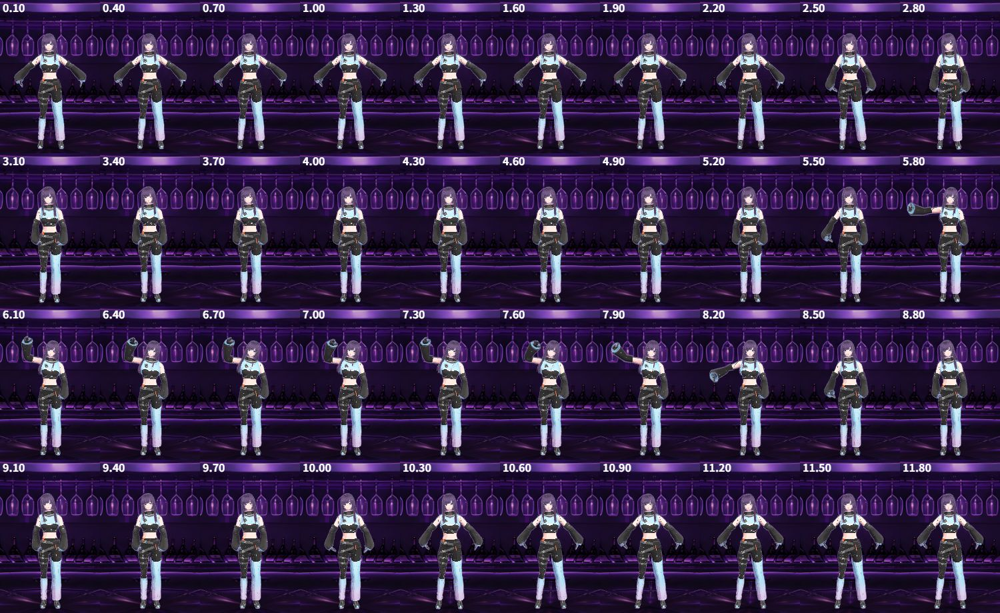 |
| Arms Crossed female(0.5초 간격) | 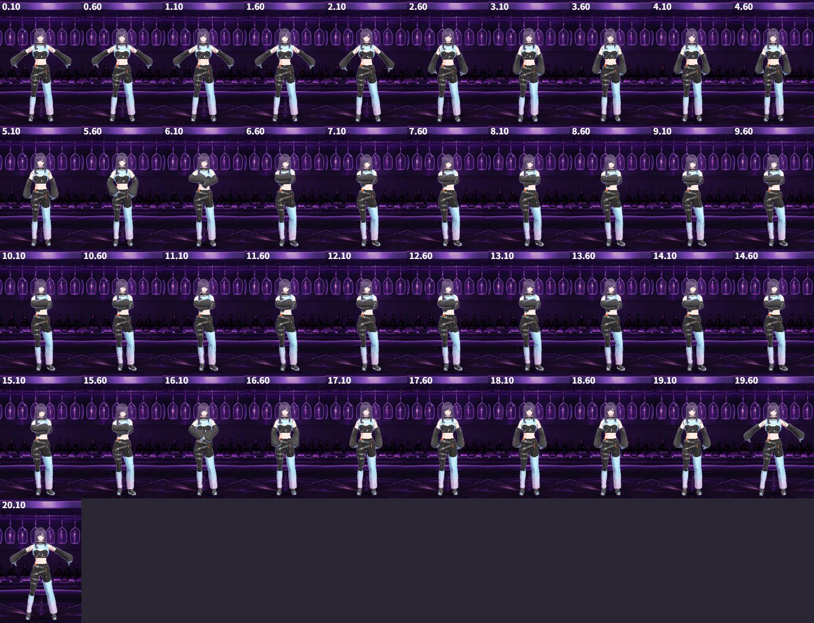 |
| Brushing hair back 원본(옆을 봄) → turn 83 | 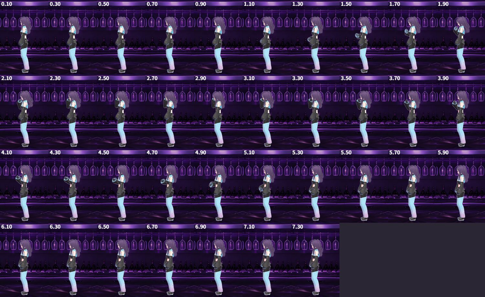 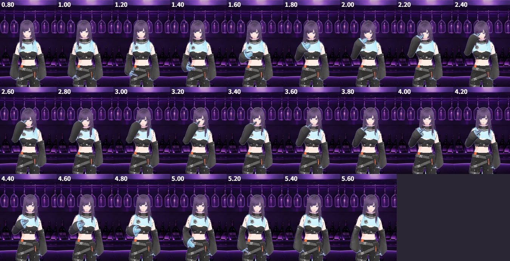 |
| Glancing nervously 원본 → turn 90(정수리가 보임) → damp 뒤 정면·옆 | 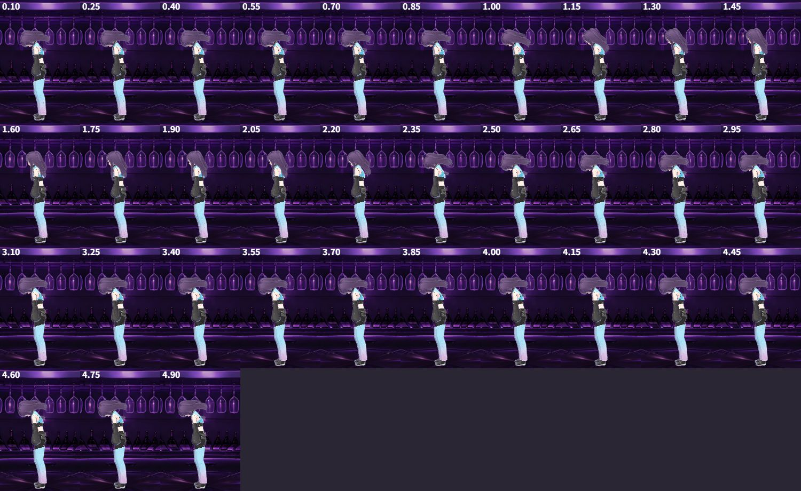 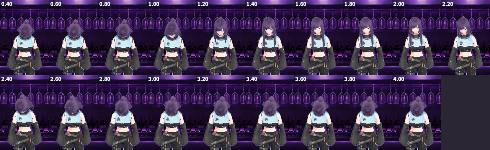 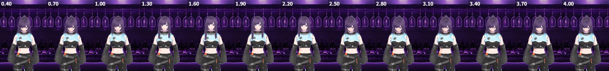 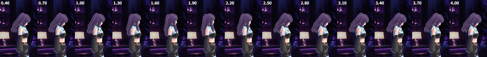 |
| Think Chin(0.25초 간격) | 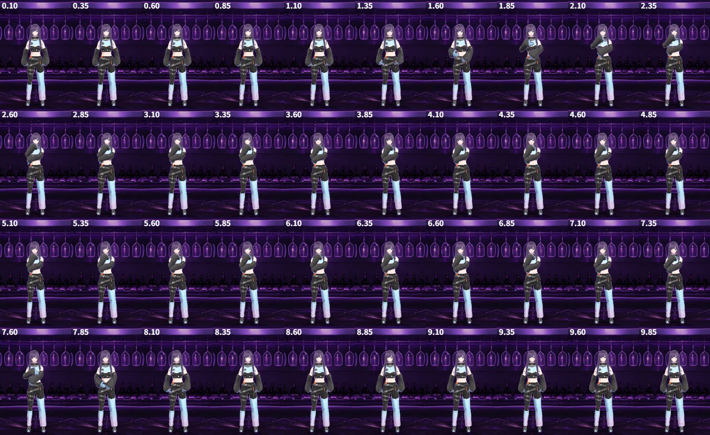 |

### 시연 패널과 같은 재생(Stage.play + 확대), 0.5초 간격

몸짓 시작 = 0초. 3D 칸 안에 손·팔이 다 들어옴(x23 은 처음에 주먹이 칸 위끝에 닿아 `camera.waveHigh` 구도를 더함 → 손이 칸 안 173px~380px, 칸 98~398px). 낱장은 `img/43/390_{몸짓}_{초}.jpg`.

| 몸짓 | 0.5초 간격 |
| --- | --- |
| x23 두 손 흔들기 | 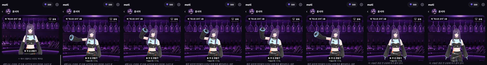 |
| m07 팔짱 끼기 | 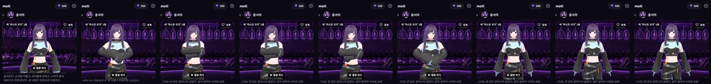 |
| c02 머리 쓸어 넘기기 | 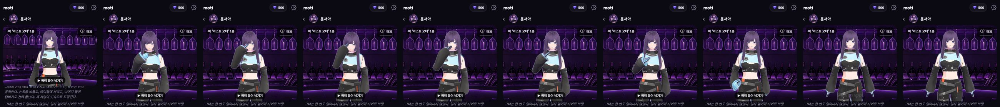 |
| m06 허둥대기 | 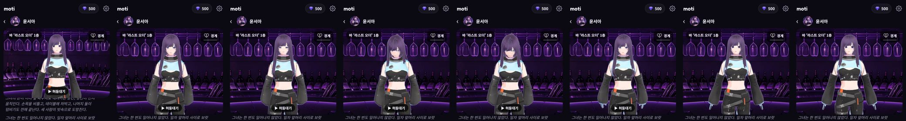 |
| x24 턱 괴고 생각하기 | 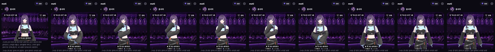 |

**시작·끝이 튀는지** — 1/30초씩 넘기며 뼈 20개의 한 칸 최대 회전(°). 처음 0.6초·끝 0.8초에는 기본 자세와 섞이는 움직임이 들어 있음(25 보고서와 같은 재는 법).

| 몸짓 | 길이 | 처음 0.6초 최대 | 끝 0.8초 최대 | 안쪽 95% | 안쪽 최대(이음매 포함) |
| --- | --- | --- | --- | --- | --- |
| x23 | 3.4 | 11.5 | 11.5 | 10.2 | 11.2 |
| m07 | 3.5 | 19.1 | 14.1 | 4.5 | 4.7 |
| c02 | 4.0 | 16.5 | 14.1 | 5.0 | 5.5 |
| m06 | 3.0 | 10.3 | 7.9 | 4.1 | 4.9 |
| x24 | 3.9 | 10.5 | 9.9 | 7.6 | 8.1 |

m07·c02 처음 값은 팔을 빠르게 올리는 모션 자체 동작(팔짱을 끼러 손이 올라오는 0.1~0.9초, 손을 얼굴로 가져가는 때)이 섞기와 겹친 것. 25 의 예전 m07(남자 배우) 끝 36.2° 같은 휙 돎은 없음. 이음매(m07·x24 skipBlend)는 안쪽 최대가 모션 자체 빠르기와 같아 보이지 않음.

### 입장권 (전체 초기화 상태 → 「눌러서 입장」)

펀치 직전 → 펀치 뒤 0, 0.5 … 4.5초. 1.0~2.5초 오른손을 머리 위로 흔들고, 2.95초 카드가 올라가기 시작 → 3.0초쯤 카드가 사라지고 서아 전신 → 3.5초 로그인. 손은 입장권 3D 안에 들어옴.

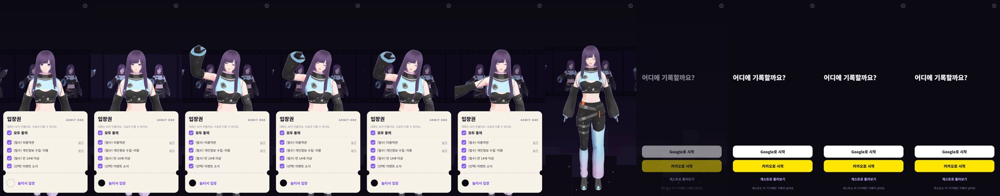

### 카드 그림 다시 만들기

예전 모션으로 m07(네온 골목 11/20)·c02(비 내리는 골목 11/21)·m06(바 1층 11/22)·m01(네온 골목 11/23, 비교용) 카드를 만들고 mv 를 지운 뒤(= 예전 저장값) 앱을 다시 엶 → 11.3초 만에 세 장 다시 만듦. m07·c02·m06 은 `mv: 2`, 의상·장소·날짜·대사 그대로, m01 은 그림 크기(88177B)·기록 그대로.

위 = 예전 그림, 아래 = 다시 만든 그림 (m07 · c02 · m06 · m01):

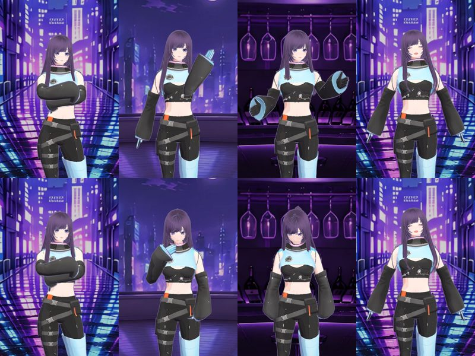

카드 그림 순간 후보:

| m07 | c02 | m06 |
| --- | --- | --- |
| 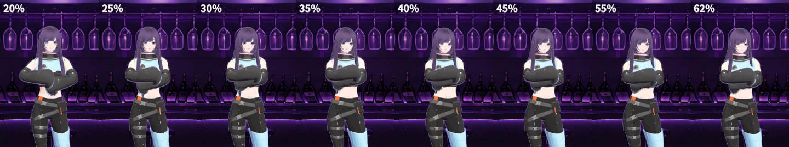 | 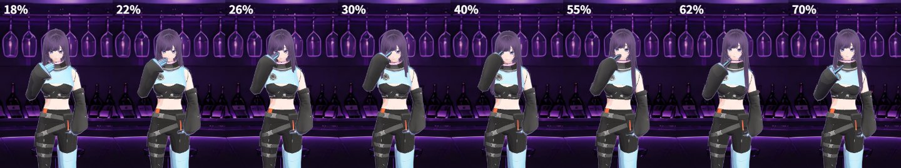 | 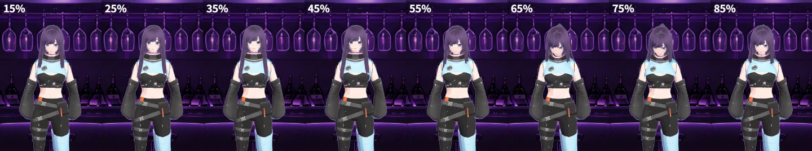 |

### 기다림 (`?server=0&slow=…`)

| 기다린 시간 | 측정(보낸 순간 = 0) |
| --- | --- |
| 3초 | 0.06 m25 「생각 중」 → 2.51 x24 → 3.06 답 → 대기 자세 |
| 8초 (답장 몸짓 m01) | 2.52 x24 → 6.46 끝 → 8.07 답(m07 직전) → m01 |
| 10초 (답장 몸짓 m01) | 2.55 x24 → 6.45 끝 → 8.06 「고민 중」 → 8.13 m07 → 10.09 답 → 0.6초 섞으며 m01 |
| 15초 | 2.56 x24 → 6.51 끝 → 8.11 m07 「고민 중」 → 11.60 끝 → 13.16 x24 → 15.06 답 → 다음 기다림 문구 다시 「생각 중」 |
| 9초 + 1초에 다른 몸짓 확대 | 1.06 m03 확대 → 8.7초까지 막힘(zoom) → 9.05 답. 기다리는 동안 시계 보기는 내내 "waiting" |

모두 최근 몸짓 목록 `[]`(답장 몸짓만 들어감), 콘솔 오류 없음.

15초(1·3·5·7·8.5·10·12·13.5·15.3·16·17초):
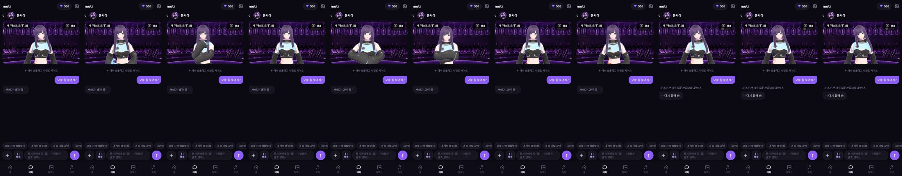

10초, 팔짱 중에 답(9·9.75·10.25·10.5·10.75·11·11.5·12초):
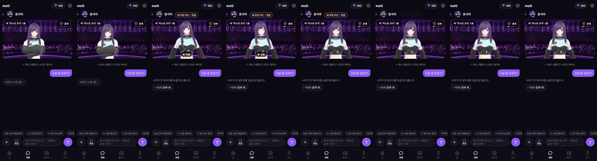

3초 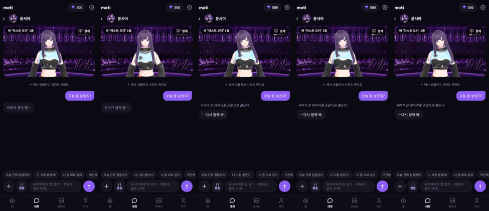 · 8초 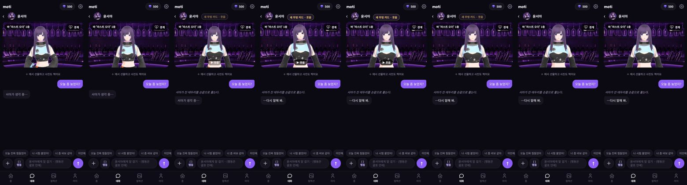

### 그 밖
- `data/*.json` 모두 읽힘(JSON 검사), 모든 확인 실행에서 콘솔 오류·예외 없음(three.js 의 `morphNormals` 경고는 예전부터).
- m07·c02·m06 은 대화에서도 같은 `XS` 를 쓰므로 위 시연 재생과 같은 새 모션으로 나옴(XSTAGE 가 있으면 코드 몸짓보다 먼저).

## 제가 정한 것
- **새 번호:** 두 손 흔들기 = **x23**, 턱 괴고 생각하기 = **x24**(x22 다음). 이름은 지시문대로 「두 손 흔들기」로 뒀지만 원본 Wave Hands Upward 는 **오른손 하나**만 머리 위로 들어 흔듦(왼손은 내내 내림). 입장권 화면에는 이름이 안 나옴.
- **구간:** 위 표대로. x23 은 손을 들기 전 서 있는 5.2초부터 내려놓은 8.6초까지. m07 은 팔짱을 끼기 시작하는 5.4초부터(0.1초 뒤 움직임) 다 푼 16.9초까지, 유지 중간을 건너뜀. c02 는 손을 올리기 시작하는 1.2초부터 다 내린 5.2초까지(4.0초, 상한). m06 은 고개 숙인 채 옆 → 올려다봄 → 반대쪽 아래로 피함이 다 들어가는 0.6~3.6초. x24 는 손을 턱으로 올리기 시작 ~ 다 내림, 유지 중간을 건너뜀.
- **turn:** 원본 배우가 옆을 보는 c02(−87°→−78°) 83, m06(−90°) 90, x23(−6°) 6.
- **m06 숙임 줄이기(damp):** 원본 그대로면 정수리가 보일 만큼 숙여서(목·머리 합쳐 약 80°) 새 값 `damp` 를 만들어 약 35° 로 줄임. 원본 느낌(숙인 채 눈치 보기)은 남김.
- **skipBlend 0.4초:** 유지 구간을 건너뛰는 이음매에서 손목이 6~9° 튀어서 새 값으로 섞음.
- **x23 대화 구도 `camera.waveHigh`(top 1.24, width 0.6):** 시연 패널로 대화방에서 재생할 때 주먹이 칸 위·왼쪽 끝을 넘어서. 입장권은 원래 구도로 손이 들어와 그대로.
- **leaveMs 2950:** 몸짓 끝(3400ms) − 카드 사라지는 시간(450ms). 손을 내리는 동안 카드가 올라감.
- **motionVer 자리:** `data/motions.json xstage` 각 항목(진짜 모션 자리와 같이). 기록은 `S.col[id].mv`(저장값이 이미 쓰는 기록 안, 카드 저장소에도 같이). 앱을 열 때 한 번 + 컬렉션을 열 때 검사.
- **카드 그림 순간:** 후보 8개씩 중 m07 35%·c02 18%·m06 65%. 표정은 예전 기본(soft) 그대로.
- **기다리는 몸짓 표정 neutral**, 처음 몸짓을 시작할 때 한 번(답장이 오면 답장 표정).
- **답이 올 때 섞기 0.6초**(`wait.endBlendMs`): 기다리던 몸짓(팔짱·턱 괴기)은 팔을 풀어야 해서 평소 0.35초보다 길게, 그때만.
- **막혔을 때:** 건너뛰지 않고 0.4초마다 다시 봐서 풀리면 그때 시작(그래서 확대가 끝난 뒤 늦게 시작할 수 있음).
- **처음 2.5초:** 예전처럼 m25 고개 갸웃하며 듣기(보낸 순간). 몸짓 사이 1.5초 쉼은 기본 자세.
- **다른 캐릭터 방:** 문구만 바뀜(「서아가 생각 중…」은 예전 「서아가 입력 중…」처럼 다른 방에도 그대로 나옴 — 예전부터 있던 것).
- **`?slow=ms`:** 서버를 일부러 늦추는 확인용 주소 값(시연 패널에 버튼을 만들면 새 글자가 생겨서 주소 값으로만).
- **25 의 m07 남자 배우 파일**(`xstage_idle_arms_crossed_male.json`)은 지우지 않고 둠(어디서도 안 씀).
- `three@0.160.0` 은 변환 때만 `--no-save` 로 설치(저장소에 안 들어감).

## 아이폰에서 나중에 볼 것
- 입장권 두 손 흔들기: 주먹이 입장권 3D 위쪽에서 잘리지 않는지, 카드가 사라지는 때가 손 내리기와 맞는지(느린 기기에서 모션 파일을 받기 전 펀치하면 어긋날 수 있음 — 입장권이 보일 때 먼저 받아 둠은 그대로).
- m06 허둥대기: 숙인 고개(damp)가 아이폰 화면에서도 정수리가 보이지 않는지.
- m07·x24 이음매(skipBlend): 낮은 프레임에서 손목이 튀어 보이지 않는지.
- 답장을 기다리다 답이 올 때 0.6초 섞기가 끊기지 않는지(사파리 백그라운드 탭에서 돌아왔을 때 포함).
- 앱을 열 때 카드 그림 다시 만들기(세 장)가 첫 화면을 버벅이게 하지 않는지(쉬는 틈에 한 장씩, 헤드리스 PC 11초).
- 새 모션 파일 다섯 개 약 0.8MB 더 받음(m07·x24 는 미리 받기 목록에, 나머지는 쉬는 틈에).
