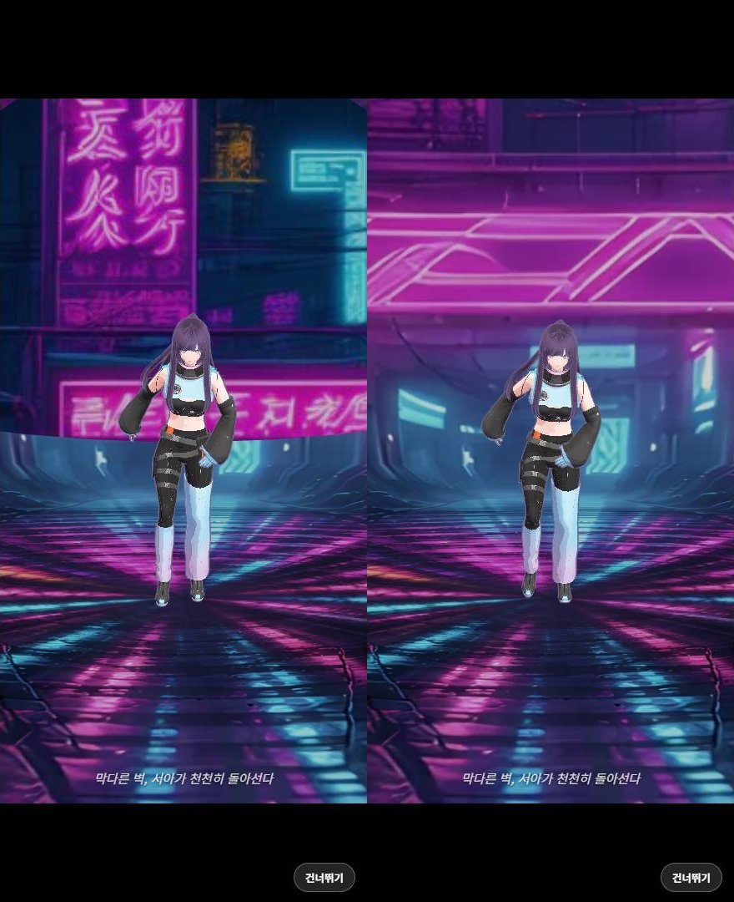
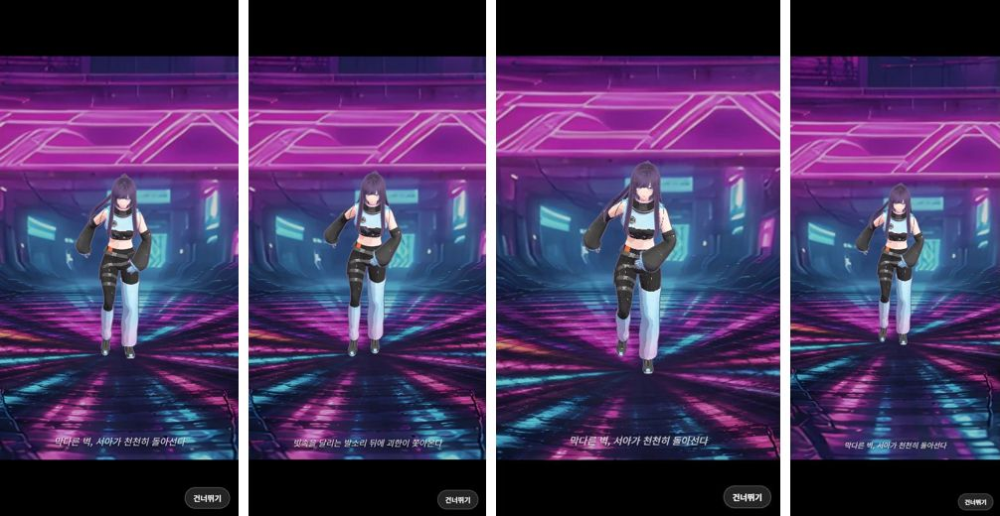
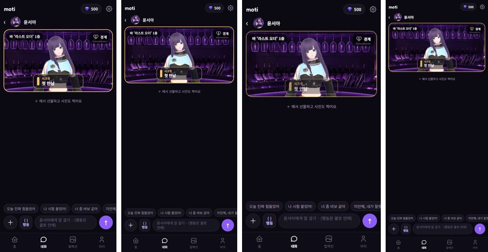
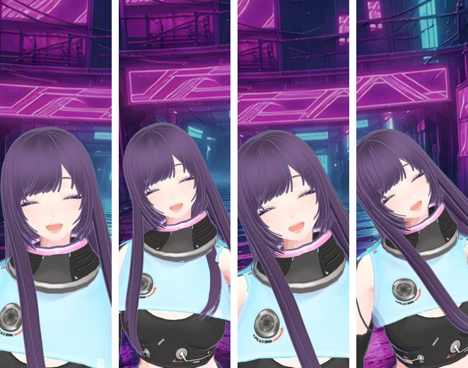
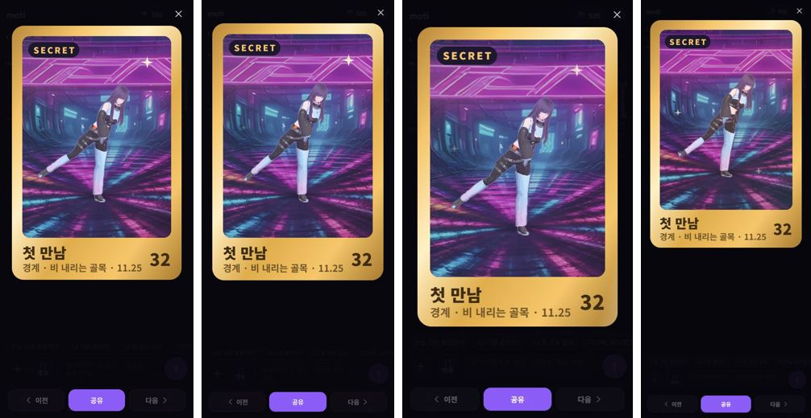
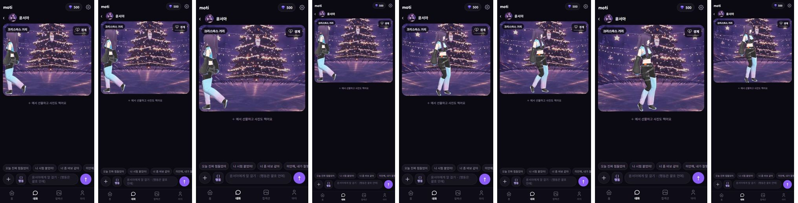
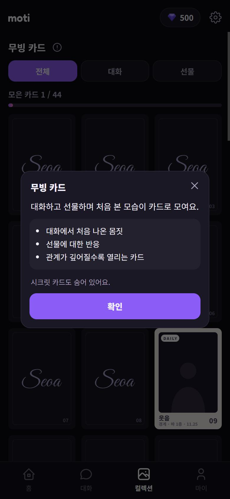
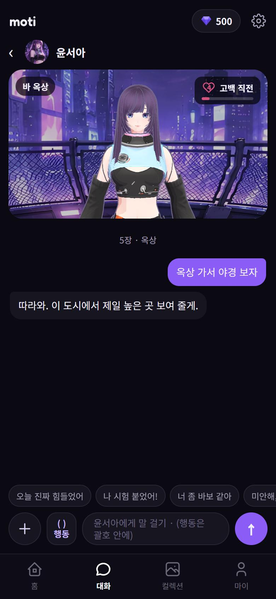

# 44 · 첫 만남 배경 반원 고치기 · 옥상 춤 보류

브랜치 `step/44-dome-rooftop` · 커밋 `[44-A] 첫 만남 배경 반원 고치기`, `[44-B] 옥상 춤 보류`

## A · 첫 만남 배경에 반원이 보이는 문제

### 원인 — 추측(카메라가 구 밖으로 나감)과 다름

**카메라는 어느 크기에서도 구 안에 있었다**(구 중심에서 6.5~8.7m, 반지름 12m). 진짜 원인은 **카메라의 먼 면(far) 20m**.

- 3D 카메라는 처음부터(`f63d464`) `PerspectiveCamera(30, …, 0.1, 20)` = 20m 보다 먼 것은 그리지 않음.
- 첫 만남의 넓은 구도(`firstMeet.frame`: 키의 −0.25~1.25, 최소 너비 1.25)는 3D 칸이 **좁고 길수록**(가로/세로 비율이 작을수록) 카메라가 더 물러남.
- 컴퓨터 크롬에서는 앱이 가운데 440px 칸이라, 1920×1080 창이면 3D 칸이 440×1080(비율 0.41) → 카메라가 구 중심에서 8.73m → **구 뒤쪽 벽까지 8.73 + 12 = 20.73m > 20m** → 서아 뒤쪽 구가 먼 면에서 둥글게 잘리고, 그 구멍으로 360도 구 아래 깔린 **평평한 배경 그림(CSS, 같은 골목 그림을 화면 크기로 늘린 것)** 이 보임 = 「반원 안팎이 같은 그림인데 크기가 다름」.
- 휴대폰(390×844·430×932)은 3D 칸 비율 0.46 → 7.7m → 19.7m 로 20m 안쪽이라 안 보임(아슬아슬). 1280×800 은 440×800(0.55) → 18.5m.
- 41단계 뒤에 생긴 까닭: 첫 만남 장소 「비 내리는 골목」이 41에서 360도가 됨(그 전엔 평평한 그림뿐이라 잘릴 구가 없었음).

| 창 크기 | 3D 칸 | 비율 | 카메라~구 중심 | 구 뒤쪽까지 | 먼 면(전) | 반원 |
| --- | --- | --- | --- | --- | --- | --- |
| 390×844 | 390×844 | 0.462 | 7.70m | 19.70m | 20 | 없음 |
| 430×932 | 430×932 | 0.461 | 7.71m | 19.71m | 20 | 없음 |
| 1280×800 | 440×800 | 0.550 | 6.47m | 18.47m | 20 | 없음 |
| 1920×1080 | 440×1080 | 0.407 | 8.73m | **20.73m** | 20 | **있음** |

(첫 만남 1.5·3·5·7초 모두 같은 거리. 카메라 높이 1.27m, 구 중심 높이 1.43m)

### 고친 것 (`index.html panoFit`, 매 프레임 `panoTick` 안)
- **먼 면 = 카메라~구 중심 가로 거리 + 구 반지름 + 1m**(`pano.farPad`), 처음 값 20m 아래로는 안 내림. 1920×1080 첫 만남에서 21.73m, 대화 화면 등 가까운 구도는 그대로 20m.
- 지시문의 「카메라가 어떤 크기에서도 구 안에」도 막아 둠: 카메라가 구 가장자리에서 2m(`pano.camMargin`) 안쪽을 넘으면 **구를 가로(x·z)로만 넓힘**. 높이·바닥 평면(y=0)·바닥 이음매(30단계 평평하게 누른 바닥)는 그대로라 발이 떠 보이지 않음. 지금 구도들에서는 넓힐 일이 없음(배율 1).
- 구 가로 위치를 카메라에 맞춰 옮기는 방법은 쓰지 않음: 첫 만남처럼 카메라가 서아 주위를 돌 때 바닥 그림이 서아 발밑에서 미끄러져 보여서.
- 메모리 규칙(30-1: 지금 장소 구만)은 그대로. 구 모양 하나를 같이 쓰고 배율만 바꿈.

### 전·후 (1920×1080, 첫 만남 3초 — 앱 칸만 자름)

왼쪽 = 고치기 전(위쪽에 평평한 그림이 다른 크기로, 허리 높이에 반원 경계) · 오른쪽 = 고친 뒤

고치기 전 네 크기(1.5·3·5·7초): `img/44/before_fm_*.jpg`, 1280×800 은 `img/44/crop_before_1280_3.jpg`

### 고친 뒤 네 크기 (390×844 · 430×932 · 1280×800 · 1920×1080, 컴퓨터는 앱 칸만)

| 화면 | 캡처 |
| --- | --- |
| 첫 만남(3초) |  |
| 대화 화면(첫 만남 끝난 뒤 바 1층) |  |
| 셀카(비 내리는 골목, `SeoaPhoto.make` 그림) |  |
| 카드 크게 보기(「첫 만남」 넓은 구도) |  |
| 크리스마스 거리 걷기(42-1 확대 구도): 걸어 나가는 중 4장 · 걸어 들어오는 중 4장 |  |

모두 반원 없음, 서아 발이 바닥에 붙어 있음. 측정: 첫 만남 먼 면 20.7/20.71/20/21.73m(구 뒤쪽 19.7/19.71/18.47/20.73m), 대화·카드·걷기는 20m(구 뒤쪽 13.4·16.8·15.2m), 구 배율 모두 1.

## B · 옥상 춤 보류

- `data/seoa_story.json unlock.event.ROOFTOP`: 사건은 그대로, `motions` → `[]`, `text` → `""`, 원래 값(`["m23"]`, 「서아가 처음으로 춤을 보여 줬어요」)은 같은 자리 `_보류` 칸에. 몸짓이 비면 해금 연출·알림이 안 나옴(`unlockShow` 가 보여 줄 몸짓이 없으면 아무것도 안 함 — 코드 수정 없음).
- `ban` 에 m23 → 대화 몸짓·서버에 보내는 허용 목록·키워드(「춤을 추」 등)에서 빠짐. 모션(`motion.js` m23)·키워드 데이터·`camera` 전신 구도는 지우지 않음.
- `data/collection.json` m23 칸에 `hold: true`, 번호 31 그대로. 앱은 데이터를 읽을 때 hold 칸을 `COL.held` 로 따로 빼서, 컬렉션 목록·「모은 카드 n / total」·마이·캐릭터별 카드 수·카드 크게 보기·시연 패널 어디에도 안 나오고 세지 않음. 이미 모은 저장값(`S.col.m23`)은 지우지 않음.
- `tools/build_collection.mjs`: hold 칸은 ban·unlock 에서 빠져도 그대로 남기고 번호를 지킴(`retiredNo` 로 안 감). 다시 만들면 「대화 30 + 보류 1 + 연출 2 + 선물 12 = 45칸」.
- `docs/server-sync.md` 「44 · 옥상 춤 보류」 한 줄.

### 확인 (390×844)
- 예전 저장값(m23 카드 모음 + m23 해금) → 다시 열기: `S.col.m23` 남아 있음, 컬렉션 「모은 카드 1 / 44」(m01 만 셈), m23 칸 없음(44칸), `unlockedIds`·`allowedMotions` 에 m23 없음. 
- 시연 장면 5 「옥상」 → 「옥상 가서 야경 보자」 → 예약된 사건 ROOFTOP 실행(예약 비워짐) → 새로 열린 몸짓 없음, 해금 연출·알림 없음, 무대·토스트에 춤 문구 없음. 
- `data/*.json` 모두 읽힘, 모든 실행에서 콘솔 오류 없음.

## 제가 정한 것
- **원인을 먼 면으로 고침**: 지시문 추측(구 밖)과 달라서, 지시문 예시 중 「반지름을 넉넉히」 대신 먼 면을 카메라 거리에 맞춤(반지름을 키우면 오히려 더 멀어져 더 잘림). 「구 안에 있게」는 넘을 때만 가로로 넓히는 안전장치로.
- **먼 면 최소값 20m 유지**: 가까운 구도에서 깊이 정밀도(외곽선 껍데기)가 예전과 같게.
- **`camMargin` 2m · `farPad` 1m**: `data/config.json pano` 에 둠.
- **사진·카드 그림(still)** 은 그리는 순간 카메라를 따로 놓지만 모두 서아 가까이(셀카 1m 안팎, 카드 「첫 만남」 넓은 구도도 4.8m)라 직전 프레임의 먼 면으로 충분해 따로 맞추지 않음.
- **ROOFTOP `text` 도 비움**: 몸짓이 없으면 안 쓰이지만 춤 문구라 `_보류` 로 옮김(키는 남겨 구조 그대로).
- **m23 힌트(「1년에 단 하루…」)·키워드·`motion.js` 동작**은 그대로 둠(칸이 숨겨져 안 보이고, ban 이라 안 나옴).
- hold 칸은 build 결과에서 대화 칸 뒤·연출 칸 앞에 둠(화면은 번호 순서라 자리와 상관없음).

## 아이폰에서 나중에 볼 것
- 첫 만남·셀카·카드 크게 보기·걷기에서 360도 배경이 예전과 같은지(먼 면을 늘린 첫 만남 구도에서 외곽선·머리카락이 깜빡이지 않는지).
- 아이패드·가로로 긴 기기처럼 3D 칸이 아주 좁고 긴 경우 첫 만남 배경.
- 컬렉션 44칸·마이 카드 수가 맞는지, 옥상 장면 뒤 알림이 없는지.
